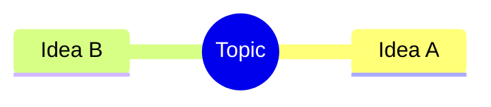

# StudyPack

Course notes and self-test Q&A, organised by course and week. Works on laptop and phone.

**Live site:** https://asyrafmika.github.io/StudyPack/

Built with [Astro](https://astro.build) (static site generator) + MDX (Markdown that can use components). Deployed to GitHub Pages by `.github/workflows/deploy.yml` on every push to `main`.

## Run locally

```bash
npm install
npm run dev        # http://localhost:4321/StudyPack/
npm run build      # outputs static files to dist/
```

## Project structure

```
src/
  content/
    courses.json              ← list of courses
    notes/
      cse242/                 ← folder name = course id
        week-01.mdx           ← one file per week
        images/               ← figures used in that course's notes
  components/                 ← Callout, QA, QAList, Figure
  pages/                      ← routes: /, /<course>/, /<course>/week-NN/
  lib/                        ← URL helpers, progress, theme, mermaid
  styles/global.css
```

## Add a course

1. Add an entry to `src/content/courses.json`:
   ```json
   { "id": "cse242", "code": "CSE242", "title": "…", "totalWeeks": 14, "color": "#4f7cff", "order": 1 }
   ```
2. Create `src/content/notes/cse242/` and add `week-01.mdx`, `week-02.mdx`, …

## Writing a week

~~~mdx
---
week: 1
title: Topic name
summary: One-line description
---
import Callout from '../../../components/Callout.astro';
import QA from '../../../components/QA.astro';
import QAList from '../../../components/QAList.astro';
import Figure from '../../../components/Figure.astro';
import img from './images/w01-diagram.png';

<Callout type="why">Why this topic matters…</Callout>
<Callout type="key">Key points…</Callout>

## Section
Normal markdown, tables, code…

<Figure src={img} alt="…" caption="…" credit="Lecture 1, slide 5" />



<QAList>
  <QA q="Question?" level="easy" why="Short explanation shown if the learner gets it wrong">Answer.</QA>
</QAList>
~~~

Callout types: `why`, `key`, `tip`, `warn`, `exam`, `note`.
Diagrams: any [Mermaid](https://mermaid.js.org) type (`mindmap`, `flowchart`, `sequenceDiagram`, `classDiagram`, `erDiagram`, `stateDiagram-v2`, `timeline`…).

## Flashcards

Questions are written in the note's MDX (inside `<QAList>`), but they are **not shown on the note page**.
Each page with questions gets a flashcard deck at `/<course>/<slug>/flashcards/`:
filter by easy/medium/hard, flip to reveal, self-grade, and see the `why` explanation when wrong
(missed cards come back at the end). Best scores are saved per device in localStorage.
