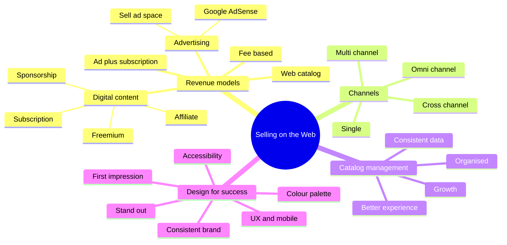

import Callout from '../../../components/Callout.astro';
import QA from '../../../components/QA.astro';
import QAList from '../../../components/QAList.astro';
import Figure from '../../../components/Figure.astro';
import revenue from './images/w04-revenue-models.png';
import catalogFeat from './images/w04-catalog-features.png';
import multiOmni from './images/w04-multi-omni.png';
import omniTable from './images/w04-omni-table.png';
import evolution from './images/w04-channel-evolution.png';
import channelRev from './images/w04-channel-revenue.png';
import catalogMgmt from './images/w04-catalog-mgmt.png';
import spotify from './images/w04-spotify.png';
import affiliate from './images/w04-affiliate.png';
import uxroi from './images/w04-ux-roi.png';
import firstImp from './images/w04-first-impression.png';
import presence from './images/w04-presence.png';
import access from './images/w04-accessibility.png';

<Callout type="why">
A website on its own makes **zero ringgit**. Before you build anything you have to answer: **how will this site actually earn money, and why would a visitor buy from it?** This week gives you the menu of **revenue models**, the **channels** you can sell through, and the **design rules** that turn visitors into buyers.

- **Real life:** Spotify (freemium), Netflix (subscription), Google (advertising), Shopee sellers (web catalog), bloggers (affiliate links). Any startup idea, even a student marketplace, has to pick one of these.
- **Connects to:** Week 6 (operating the business once it sells), Week 9 (marketing it so people find it), and the exam tips on **marketplace vs own website** and **platform dependency**.
</Callout>

<Callout type="key">
1. **Revenue model** = how a business earns money online. Five types: **web catalog, digital content, advertising-supported, advertising–subscription mixed, fee-based**. The same model can work for **B2C** and **B2B**.
2. **Web catalog** = the online version of a printed catalog. **Product catalog management** keeps product data **organised, consistent and high quality across every sales channel**.
3. **Multi-channel** = sell on many channels that are **not integrated**. **Omni-channel** = all channels **connected**, so the customer gets **one seamless experience**.
4. **Digital content** models: **freemium** (Spotify), **subscriptions** (Netflix), **fixed-fee sponsorships**, **cost-per-click ads**, **affiliate marketing** (30–70% commission).
5. **Advertising** works only with a **very large audience**: Google Ads/AdSense (paid per click) or **selling your own ad space** (flat fee or per 1,000 impressions, CPM).
6. **Design for success:** first impression, UX (easy navigation, clear CTAs, mobile-friendly), consistent brand, a deliberate colour palette, and standing out from the crowd. **Design for your target audience.**
</Callout>

## Big picture

## 1. Why sell online at all?

Selling online gives you **convenience** for buyers, **flexibility** (open 24/7, from anywhere), **faster delivery** of digital products, **cost-effectiveness** (no rent for a physical shop), an **easy set-up**, and **substantial income** potential.

The catch: anyone can set up a store, so **everyone is competing**. The revenue model and the design are what separate a store that sells from one that doesn't.

## 2. The five revenue models

<Figure src={revenue} alt="Online revenue generation models: subscription, pay per view, commissions, affiliate, feature listings, ads, sponsorships" caption="The many ways a website can earn. Most real businesses mix two or three." credit="Week 4, slide 5" />

| Model | How it earns | Classic example | Works best when… |
|---|---|---|---|
| **Web catalog** | Sells physical products listed in an online catalog | Zalora, Shopee stores, Uniqlo online | You have products people already want to buy |
| **Digital content** | Sells or licenses information, media, software | e-books, music, courses, templates | The product can be delivered as a file or a stream |
| **Advertising-supported** | Free content; advertisers pay to reach the audience | Google, YouTube, news portals | You have a **huge** audience |
| **Advertising–subscription mixed** | Ads **plus** paid subscribers (often fewer ads for payers) | Spotify Free/Premium, newspapers | Some users will pay to remove ads or get more |
| **Fee-based** | Charges a fee per transaction or service | Agoda/booking sites, Grab, job boards | You provide a service each time someone uses it |

<Callout type="tip" title="Memory trick">
**"Catalog, Content, Ads, Ads+Subs, Fees"**: think **CCAAF**, or *"Can Customers Always Afford Fees?"*
</Callout>

## 3. The web catalog model

The web catalog is the most common model: **list your products online and sell them**. It **expands the traditional model**: the same catalog can feed your website, a marketplace, social media and a physical store.

**Product catalog management** means making sure product data is **high quality across all sales channels**: organising, standardising and publishing the data to each channel.

<Figure src={catalogMgmt} alt="Ecommerce catalog management cycle: planning and research, product data entry, catalog image processing, catalog building and indexing, regular updates, product feed submission, catalog conversion" caption="Catalog management is a cycle, not a one-off task: data entry → images → indexing → regular updates → feeds to each channel." credit="Week 4, slide 17" />

### Why invest in catalog management? (4 reasons)

1. **Organised catalog.** Online buyers **can't touch the product**, so detailed descriptions and good images replace touching it. Customers can also search and navigate easily.
2. **Consistent product information.** Same data everywhere, with no short forms or false information. This is what makes an **omni-channel** experience possible.
3. **Improved customer experience.** Rich, detailed information means even **new customers** feel confident buying.
4. **Business growth.** A good catalog system can handle **many more products** and gets you to market faster.

<Figure src={catalogFeat} alt="Must features for an e-commerce catalog: colour filter, sort by, quick view, filters, back to top button, no paging function, average review ratings, price range" caption="Must-have catalog features: filters (colour, size, price), sort by, quick view, review ratings, back-to-top, and no endless paging." credit="Week 4, slide 9" />

## 4. Multi-channel vs omni-channel

<Figure src={evolution} alt="Single channel, multi-channel, cross-channel and omni-channel: from one touch point to a single seamless brand experience" caption="From the legacy single channel to the omni-channel 'nirvana' where the customer sees one brand, not separate channels." credit="Week 4, slide 14" />

<Figure src={multiOmni} alt="Multichannel: all channels available to the consumer but not integrated. Omnichannel: all channels available and connected." caption="Same channels, one difference: are they **connected**?" credit="Week 4, slide 10" />

| | **Multi-channel** | **Omni-channel** |
|---|---|---|
| Idea | Sell **anywhere** your customers are | Every channel works **together** |
| Channels | Each has its **own goals** and incentives | Incentives designed to **collaborate across** channels |
| Customer data | Stored and managed **separately per channel** | **Integrated** view of the customer |
| Analytics | Channel-specific | **360°** view of all touchpoints |
| Focus | Reach | **Seamless, consistent experience** |
| Example | Same shirt on Shopee, TikTok Shop and your own site, each run separately | You abandon a cart on the website → you get an **email coupon** → a **retargeting ad** reminds you → after buying you get a **cross-sell** offer |

<Figure src={omniTable} alt="Multi-channel vs omni-channel customer experience: goals, consumer data, analytics, agent alignment" caption="The textbook comparison table: goals, data, analytics and agent alignment." credit="Week 4, slide 13" />

<Figure src={channelRev} alt="Multi-channel marketing and selling: average percent increase in revenue: +1 channel 38%, +2 channels 120%, +3 channels 190%" caption="More channels, much more revenue: adding 1 channel gave +38%, 2 channels +120%, 3 channels +190%." credit="Week 4, slide 15" />

<Callout type="warn">
**Don't mix them up.** *Multi* = **many** channels. *Omni* = **all channels as one**. The keyword for omni is **integrated / seamless / unified data**. A shop that is on Shopee *and* Instagram but doesn't share stock or customer data is **multi-channel**, not omni.
</Callout>

**Why this matters (exam tips):** relying on **one** platform, such as TikTok Shop only, is risky. Fee changes, algorithm changes and policy changes hit 100% of your revenue, and **the platform owns your customer data**. Multi-channel spreads the risk; omni-channel also lets you **own** the customer relationship.

## 5. Digital content revenue models

Digital content is anything you can deliver as a file or a stream: music, e-books, courses, games and software, photos and videos, website templates.

### Freemium (Spotify)

**Free tier** to attract a huge user base (supported by ads) + **premium tier** for people who pay to remove ads and get extra features. The free users are the **funnel** into paid subscriptions.

<Figure src={spotify} alt="Spotify business model: ad-supported free tier and premium subscription; premium generates most revenue" caption="Spotify: free users bring scale, premium subscribers bring most of the revenue." credit="Week 4, slide 19" />

### The other digital content models

- **Subscriptions** (Netflix, Spotify Premium, Amazon Prime). Advantages: a **loyal user base**, **continuous predictable revenue**, and a **predictable sales pipeline**. Downside: you must keep producing content worth renewing for. Netflix and Spotify spend billions on originals.
- **Fixed-fee sponsorships:** a company pays a flat fee to be featured, e.g. "this video is sponsored by…".
- **Cost-per-click (CPC) advertising:** you earn each time a visitor clicks an ad.
- **Affiliate marketing:** recommend a product with your **affiliate link**; when a visitor buys, you get a **commission (30–70%)**. Networks: ClickBank, ShareASale. <Own note="e.g. Shopee Affiliate links" />

<Figure src={affiliate} alt="Affiliate marketing: find and endorse products you like, earn 30 to 70 percent commission when visitors buy through your link" caption="Affiliate marketing: you sell someone else's product and keep a cut." credit="Week 4, slide 23" max={560} />

## 6. Advertising revenue model

Google showed how powerful it can be: everything is **free** for users, and Google earns by selling **ads** against the data from its search pages. Its ad business passed **$110 billion in 2017**.

**The catch:** unless you are Google or Facebook, **advertising alone rarely pays** unless you have a **very large user base**.

| | **Google Ads (AdWords)** | **Google AdSense** | **Sell ad space directly** |
|---|---|---|---|
| Who uses it | **Advertisers**: ads at the top of Google search results | **Publishers** (bloggers, site owners) | Site owners with lots of traffic |
| How money flows | Advertiser **pays** per click | Google shows relevant ads on your site; **you earn per click** | A company pays you a **flat monthly fee** (or per 1,000 views, CPM) |
| Good | Targeted reach | Very simple: paste the code once | Can earn up to ~$5,000/month for a banner on a big site |
| Bad | Costs money | Earnings are small per click | Low traffic means you earn little |

**E-commerce advertising trends to adopt:** programmatic, beacon, social media, VR, **buy buttons**, mobile, video and **native** advertising.

## 7. Design for success

<Figure src={firstImp} alt="75% of users judge a company's credibility by its website design; 94% of B2B customers search the web before buying; 85% of first impressions are design-related" caption="Design is not decoration: 75% judge credibility by design, and most first impressions are design-related." credit="Week 4, slide 32" max={560} />

1. **First impression is key.** Like walking into a messy shop, a cluttered layout, low-quality images or mismatched fonts make people leave. Keep it clean and professional, with high-quality, consistently styled images.
2. **User experience (UX) design.** A fluid journey from start to finish: **simple navigation**, **clear CTAs** (calls-to-action), easy-to-find FAQ and contact pages. **Mobile-friendly / responsive**: large tap targets, concise text, a burger menu, and icons for cart and account.
3. **Keep the brand consistent** across every platform. A wedding-dress shop should feel delicate; a survival-kit shop should feel outdoorsy.
4. **Colour palette:** match your logo colours and use **colour theory** (below).
5. **Stand out from the crowd.** Keep a familiar layout, but add something memorable: a fun colour scheme, a strong logo, animations.

<Figure src={uxroi} alt="Every pound invested in user experience will bring 2 to 100 pounds in return" caption="UX pays: every £1 invested returns £2–£100." credit="Week 4, slide 33" max={420} />

| Colour | Conveys | Typical use |
|---|---|---|
| 🟢 Green | Fresh, harmony, wealth | Easy to digest |
| 🟡 Yellow | Joy, happiness | Attention grabber |
| 🟠 Orange | Bold | **Call-to-action** buttons (aggressive if overused) |
| 🔴 Red | Strength, energy, passion | Sales, urgency |
| 🟣 Purple | Royalty, power | Luxury |
| 🔵 Blue | Calm, clean, trustworthy | **Professional services** |
| ⚪ White | Cleanliness, innocence | **Minimalist** sites |
| ⚫ Black | Luxury, exclusivity | **High-end** brands |

### Web presence objectives and accessibility

<Figure src={presence} alt="Web presence objectives and strategies table: attracting visitors, making the site interesting, convincing visitors to follow links, creating a consistent impression, building trust, reinforcing positive images, encouraging return visits" caption="Each web presence objective has a matching strategy, e.g. build trust → ensure information is valid and objective; encourage return visits → keep content regularly updated." credit="Week 4, slide 37 (Cengage Figure 3-5)" />

<Figure src={access} alt="Accessibility goals for business web sites: easily accessible facts, experience the site in different ways, two-way communication, sustain attention and return visits, easily accessible product information" caption="Accessibility goals: easy facts about the organisation, different ways to experience the site, two-way communication, return visits, easy product information." credit="Week 4, slide 38 (Cengage Figure 3-8)" />

<Callout type="exam">
**"Design for your target audience: they are the ones using your website and buying."** This line closes the lecture and is the logic behind the *attention economy* tip question: the content that **resonates with your target audience's needs** wins.
</Callout>

<QAList>
  <QA q="What is a revenue model? List the five web revenue models." level="easy" why="How a business earns money online: web catalog, digital content, advertising-supported, ad–subscription mixed, fee-based.">
    A revenue model is **how a business earns money** from its online activities. The five models: **web catalog, digital content, advertising-supported, advertising–subscription mixed, fee-based**. The same model can serve both B2C and B2B.
  </QA>
  <QA q="Define product catalog management and give its four benefits." level="easy" why="Keeping product data high-quality and consistent across all channels: organised catalog, consistent information, better experience, business growth.">
    Making sure **product data is high quality across all sales channels** by organising, standardising and publishing it to each channel. Benefits: (1) **organised catalog** (customers can't touch the product, so detail and images matter), (2) **consistent product information**, (3) **improved customer experience**, (4) **business growth** (supports a larger catalog, faster to market).
  </QA>
  <QA q="Differentiate multi-channel from omni-channel selling, with an example." level="medium" why="Multi = many unconnected channels; omni = all channels integrated into one seamless experience with unified data.">
    **Multi-channel:** sell on many channels (marketplace, social, website) but each runs **separately**, with its own data and goals. **Omni-channel:** all channels are **integrated**, with one customer view and one seamless experience. Example of omni: an abandoned cart on the website triggers an email coupon, a retargeting ad reminds you of it, and after purchase you get a cross-sell offer.
  </QA>
  <QA q="Explain the freemium model using Spotify." level="easy" why="Free ad-supported tier builds a huge audience; a paid premium tier (no ads, extra features) earns most of the revenue.">
    A **free tier** (with ads) attracts a huge user base. A **premium subscription** removes ads and adds features. Free users act as a **funnel**: some upgrade, and premium subscribers generate most of the revenue.
  </QA>
  <QA q="State three advantages and one challenge of the subscription model." level="easy" why="Loyal users, predictable recurring revenue, predictable pipeline; must keep producing content worth renewing.">
    Advantages: a **loyal user base**, a **continuous, predictable revenue stream**, a **more predictable sales pipeline**. Challenge: you must keep delivering value (Netflix and Spotify spend billions on original content) or subscribers cancel.
  </QA>
  <QA q="How does affiliate marketing work?" level="easy" why="Endorse another company's product with your link; earn a commission (30–70%) when visitors buy.">
    You **endorse** another company's product on your site or channel using an **affiliate link**. When a visitor clicks and buys, you receive a **commission** (about 30–70%), e.g. via ClickBank or ShareASale.
  </QA>
  <QA q="Compare Google AdWords and Google AdSense." level="medium" why="AdWords: advertisers pay to appear in search results. AdSense: publishers earn by hosting Google's ads on their site.">
    **AdWords (Google Ads):** the **advertiser pays** to show ads at the top of Google search results. **AdSense:** the reverse; **publishers** place Google's code on their site, relevant ads appear, and the publisher **earns each time** a visitor clicks.
  </QA>
  <QA q="Why is the advertising-only model risky for a small website?" level="medium" why="Income depends on traffic; only giants with huge audiences make it pay on ads alone.">
    Ad income grows with **traffic**. Unless you have a **very large user base** (like Google or Facebook), clicks and impressions are too few to earn much. Selling your own ad space has the same problem: low traffic means low prices.
  </QA>
  <QA q="List five design-for-success principles for an e-commerce website." level="easy" why="First impression, UX, consistent brand, colour palette, stand out.">
    (1) **First impression:** clean, professional, high-quality imagery. (2) **UX design:** simple navigation, clear CTAs, mobile-friendly. (3) **Consistent brand** across platforms. (4) **Colour palette** matching the brand, using colour theory. (5) **Stand out from the crowd** with something memorable.
  </QA>
  <QA q="Which colours suit a luxury brand, a professional service and a call-to-action button?" level="medium" why="Black or purple for luxury; blue for professional; orange for CTAs.">
    **Luxury:** black (exclusivity) or purple (royalty). **Professional service:** blue (calm, clean, trustworthy). **Call-to-action:** orange (bold, grabs attention, but aggressive if overused).
  </QA>
  <QA q="A seller lists only on TikTok Shop. Using this week's ideas, explain two risks and one fix." level="hard" why="Platform rules (fees, algorithm) control all revenue, and the platform owns customer data; fix with multi- or omni-channel.">
    **Risks:** (1) all revenue depends on **one platform's rules**, so a fee or algorithm change can suddenly cut profit; (2) **the platform owns the customer data**, so the seller can't segment or remarket. **Fix:** go **multi-channel** (add Shopee and an own website) and ideally **omni-channel**, integrating stock and customer data so you own the relationship.
  </QA>
  <QA q="Explain the trade-off between a marketplace and an independent website." level="hard" why="Marketplace: built-in traffic but fees and limited control. Own site: full control and higher margin but must pay for marketing up front.">
    **Marketplace:** ready traffic and infrastructure, but **fees**, limited control over display and promotion, and no ownership of customer data. **Own website:** **full control** of branding, UX and promotions, and **more profit per sale**, but you must invest **up front** in marketing (SEO, ads) to attract visitors. Many sellers use both.
  </QA>
</QAList>
