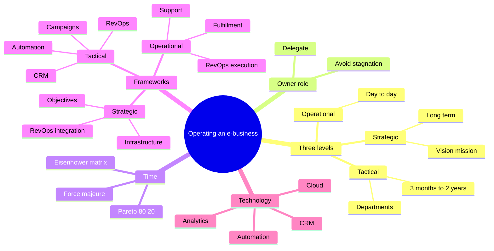
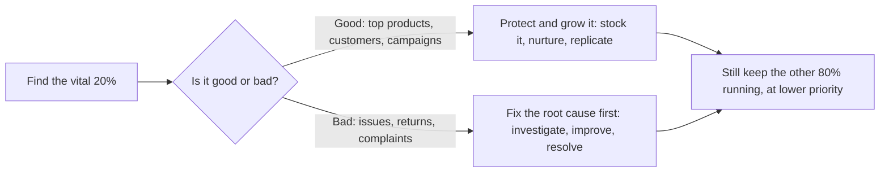
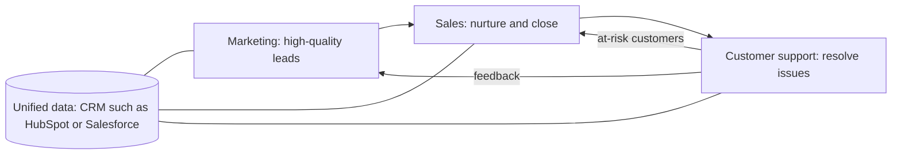

import Callout from '../../../components/Callout.astro';
import QA from '../../../components/QA.astro';
import QAList from '../../../components/QAList.astro';
import Figure from '../../../components/Figure.astro';
import levels from './images/w06-levels.png';
import pyramid from './images/w06-pyramid.png';
import pareto from './images/w06-pareto.png';
import eisenhower from './images/w06-eisenhower.png';

<Callout type="why">
Week 4 got the store **selling**. Now it has to **run**: every day, without the owner doing every job themselves. Many small e-businesses die not because nobody buys, but because the owner is stuck answering chats, packing parcels and doing the accounts, and never has time to **plan**. This week is about organising that work into **levels**, spending time where it matters most (**Pareto**), and getting teams to pull in the same direction (**RevOps**).

- **Real life:** Zalora, eBay and Amazon all hit **stagnation** and escaped it with strategy, partnerships and technology. Lazada's abandoned-cart emails and J&T's AI delivery routing are this week's **tactical** and **operational** levels in action.
- **Exam alert:** **5 of the 13 lecturer tip questions are Pareto (80/20) scenarios.** Learn the rule in section 4 and the [exam tips](../tips/) become free marks.
</Callout>

<Callout type="key">
1. **Three levels:** **Strategic** (long-term, 2–5+ years, *what and why*, executives) → **Tactical** (3 months–2 years, departments, middle management, *what to do*) → **Operational** (day-to-day, teams, *how and where*).
2. **Strategy** = long-term goals and the way to reach them. **Tactics** = specific actions that support the strategy. **Operations** = the routine processes that execute the tactics.
3. The owner must **not be the "number one" at everything**. **Delegate** and hire specialists, or the company hits **stagnation** (no growth).
4. **Pareto principle (80/20):** **20% of effort/causes → 80% of results.** Put effort on the vital 20%. Planning split: **20% strategy / 80% other**.
5. **Eisenhower-style time split:** **20% strategic, 60% routine, 20% force majeure** (unexpected events). Many "emergencies" are really routine tasks.
6. **RevOps (Revenue Operations)** = aligning **sales, marketing and customer service** with **unified data, tools and processes** to grow revenue and **break down silos**.
</Callout>

## Big picture

## 1. Three levels of planning and execution

<Figure src={levels} alt="Strategic: big picture, long-term 2 to 5+ years, vision and mission, executive management. Tactical: short-term 3 months to 2 years, specific department, middle management. Operational: day-to-day running, detailed processes, execution by teams." caption="The three levels: each answers a different question and is owned by a different layer of the company." credit="Week 6, slide 3" />

| | **Strategic** | **Tactical** | **Operational** |
|---|---|---|---|
| Question | *Who and why?* What is the right direction? | *What?* Which activities support the strategy? | *How and where?* Are we acting in line with the strategy? |
| Time span | Long term, **2–5+ years** | Short term, **3 months–2 years** | **Day-to-day** |
| Owner | **Executive** management | **Middle** management, departments | **Teams** and managers |
| Detail | Low (big picture) | Medium | **High** (detailed processes) |
| E-business example | "Grow online sales 30% next year" | A personalised Black Friday ad campaign | Packing orders, answering chats, shipping |

<Figure src={pyramid} alt="Pyramid: strategic (who and why) at the top, tactical (what) in the middle, operational (how and where) at the bottom; level of detail increases downward" caption="The higher the level, the less detail; the lower, the more detail." credit="Week 6, slide 6" max={620} />

**Why distinguish them?** Doing daily tasks without a clear goal is just **productivity, not effectiveness**. Work backwards instead: define the **goal** first, then pick exactly the tasks needed to reach it. What counts is the **result**, not ticking off tasks.

<Callout type="tip" title="Memory trick">
**S-T-O = "Should, Then, Operate"**: decide what you **should** achieve, **then** plan it, then **operate** it daily. Time spans shrink as you go down: **years → months → days**.
</Callout>

## 2. Don't be the "number one" in your company

The owner's real job is to **generate ideas and create new space for the company to grow**. In small and medium businesses the owner often does **everything**, from management to accounting to driving the van.

**The fix:** **delegate** responsibilities and **hire specialists**. It feels expensive at first but leads to a **big rise in profit and effectiveness** over time. If nothing changes, the company will sooner or later hit **stagnation**.

### Stagnation: causes and consequences

**Stagnation** = stopping, or lacking movement, growth, development or change. Economic stagnation brings **low employment, low investment and low consumer activity**. In a company it brings **dissatisfaction, low productivity and lost opportunities**. Escaping it takes **decisive action**: reform, extra investment, new strategies, or changes in the company.

| Company | Why it stagnated | How it escaped |
|---|---|---|
| **Zalora / FashionValet** 🇲🇾 | Shopee and Lazada expanded their product range and customer base | **Strategic partnerships** (payment gateways, logistics → faster delivery) + **AI/ML** for inventory, recommendations and targeted marketing |
| **eBay** | Amazon and AliExpress grew; retention suffered | **Refocused on its core strength** (unique, hard-to-find items, C2C + B2C) + AI search and personalisation + a better mobile app + **localisation** in emerging markets |
| **Amazon** | Size, Walmart, Alibaba, Shopify | **Diversified** (AWS, Prime Video, Whole Foods, Amazon Go) + **customer experience** (Prime, Alexa, Fresh) + supply-chain **automation and robotics**, Prime Day |

**Lesson:** to overcome stagnation an e-business must keep **innovating, planning and adjusting strategy** as the market changes.

## 3. Strategy vs tactics in time use

Every business has two main ways managers spend their time: on **tactics** and on **strategy**, and clear rules make this easier. **Strategising and managing time are key jobs for leaders and owners.**

## 4. The Pareto principle (80/20) ⭐

<Figure src={pareto} alt="Pareto principle: 20% of effort produces 80% of outcomes; 80% of effort produces 20% of outcomes" caption="20% of effort → 80% of outcomes; the other 80% of effort → only 20% of outcomes." credit="Week 6, slide 14" max={640} />

**Pareto principle** (the "80/20 rule"): **most results come from a small share of efforts or causes.** 20% of effort can give 80% of the results, and the other 80% of effort gives only the remaining 20%.

**In strategic planning:** the ideal time split is **20% for mandatory strategic planning and 80% for other matters**.

### How to answer any Pareto question

| Scenario (from the exam tips) | ✅ Pareto answer | ❌ Traps |
|---|---|---|
| 20% of products → 80% of **returns** | **Investigate and improve** those products | Remove *all* of them / *ignore* returns |
| 20% of issues → 80% of **complaints** | **Resolve those 20% of issues** | Treat *all* equally / *ignore* minor ones |
| 20% of products → 80% of **sales** | Keep top sellers **always in stock** | Stock *equally* / remove top sellers |
| 20% of campaigns → 80% of **leads** | **Analyse and replicate** the top 20% | Run all *equally* / *stop all* others |
| 20% of customers → 80% of **revenue** | **Nurture relationships** with the top 20% | Treat *evenly* / chase new markets |

<Callout type="warn">
**Pareto means *prioritise*, never *eliminate* or *ignore*.** Options with **all / ignore / equally / stop all / remove all** are the traps. "Stop all campaigns except the top 20%" sounds Pareto-ish but is too extreme. The right answer **focuses on** the 20% without deleting everything else.
</Callout>

## 5. Optimising productivity: the Eisenhower matrix

<Figure src={eisenhower} alt="Eisenhower decision matrix: urgent and important = Do it now; not urgent but important = Decide, schedule it; urgent but not important = Delegate; neither = Delete" caption="Urgent × Important gives four actions: Do, Decide (schedule), Delegate, Delete." credit="Week 6, slide 16" max={640} />

| | **Urgent** | **Not urgent** |
|---|---|---|
| **Important** | **Do** it now | **Decide**: schedule a time to do it |
| **Not important** | **Delegate**: who can do it for you? | **Delete**: eliminate it |

**Time split for a business (slide 15):**

- **20%** strategic tasks
- **60%** routine tasks (customer service, mail)
- **20%** force majeure (unexpected situations)

### Force majeure and its real impact

**Force majeure** = unpredictable events that affect a business. Their impact is often **smaller than it seems**. A logistics company believed force majeure took **50–60%** of its time, but most of it was really **routine** work such as car repairs.

Once they **reclassified those tasks as routine**, they could:

1. see that force majeure is actually **smaller** than they thought,
2. **stop stressing** and arguing about it,
3. **plan and do routine tasks on time**,
4. **hire a specialist** responsible for that area (delegation again).

## 6. The three e-business frameworks

### 6a. Strategic framework (long-term vision and roadmap)

High-level goals: **market positioning, value proposition, infrastructure planning, revenue strategy**. It aligns all resources toward **growth and sustainability**. Three key areas:

1. **Business objectives**
   - **Growth targets**, e.g. +30% online sales next year.
   - **Value proposition**, your unique selling point: convenience, price or experience. *Zalora: trendy, affordable fashion with fast delivery.*
   - **Market expansion**, geographic or by product. *Amazon: from books to groceries, electronics and media.*
2. **Infrastructure investment**
   - **Cloud** (AWS, Google Cloud): scalable power for traffic spikes such as Lazada and Shopee mega-sales.
   - **E-commerce platforms**: **Shopify** (easy, quick for small businesses) and **Magento** (open source, flexible for large firms).
3. **Revenue operation integration**
   - **RevOps** aligns sales, marketing and service.
   - **Data-driven decisions** with HubSpot, Salesforce and Marketo. *TikTok: AI analytics for personalised ads aligned with sales targets.*

### 6b. Tactical framework (turning strategy into actionable steps)

| Component | Objective | Tools | Example |
|---|---|---|---|
| **Marketing campaigns** | Convert prospects into **loyal buyers** | Facebook/Google Ads (keyword and demographic targeting), Instagram Ads, **personalised content** | Zalora's hyper-targeted Black Friday / CNY ads from purchase history |
| **CRM** | Manage and nurture relationships across the **customer lifecycle** | **Salesforce** (large enterprises), **HubSpot** (free option for SMEs), Zoho | Amazon's personalised offers and checkout suggestions |
| **Automation** | Automate repetitive tasks so the team can focus on strategy | **Zapier** (connect apps), Mailchimp, SendGrid | **Lazada's abandoned-cart reminder emails** |
| **Integrating RevOps** | Align marketing, sales and support; **break down silos** | Shared data and processes | TikTok tracks the journey from ad view to conversion |

### 6c. Operational framework (smooth daily running)

| Component | Objective | Tools | Example |
|---|---|---|---|
| **Order fulfilment and logistics** | Deliver **accurately, efficiently, on time** | ShipBob, DHL, **J&T**, **OMS** (Brightpearl, Cin7), predictive AI logistics | J&T uses AI to handle the 11.11 surge and give live tracking |
| **Customer support** | Fast, reliable, **personalised** support | Zendesk, LiveChat, Freshdesk, **AI chatbots**, **IVR**, self-service FAQs | A retailer uses Zendesk reports to remove recurring friction points |
| **RevOps execution** | Align daily workflows with revenue and **retention** | **HubSpot Service Hub** | A delivery delay triggers the sales team to send a **discount**, turning a complaint into loyalty |

## 7. RevOps (Revenue Operations)

**RevOps** puts sales, marketing and customer success on **one strategy with shared data, tools and processes**, so no stage of the customer journey becomes a **bottleneck**. Without it, each team keeps its own data (**data silos**) and the customer gets a disjointed experience.

## 8. Technology, top-down flow and challenges

**Technology roles:**

- **Cloud** (AWS, Azure): scale for seasonal spikes.
- **Automation** (Zapier, ActiveCampaign): less manual work.
- **Real-time analytics** (Google Analytics, Power BI, Tableau): data-driven decisions.
- **RevOps tools** (HubSpot, Salesforce): visibility across teams.

**Top-down operational flow:**

1. **Strategic:** leadership sets the vision and targets, e.g. "+20% sales in Q4".
2. **Tactical:** marketing launches a targeted email campaign.
3. **Operational:** operations adds faster shipping routes.
4. **Technology** gives everyone the **same real-time data**.

| Challenge | Solution |
|---|---|
| **Data silos** | RevOps systems (HubSpot, Salesforce) for a unified view |
| **Scaling** | Cloud auto-scaling (e.g. AWS Elastic Beanstalk) |
| **Customer retention** | AI and predictive analytics to spot **at-risk** customers and reduce **churn** |
| **Security** | Regulatory compliance (e.g. **GDPR**; in Malaysia, **PDPA**) <Own note="PDPA added for local context" />, secure payment gateways such as **Stripe** |

**For startups and solo entrepreneurs:** success comes from **agility, customer focus and creative problem-solving**, using **affordable, scalable tools**:

- **Local:** a batik seller uses Instagram Shops, Shopee Seller Centre, Mailchimp newsletters and Pos/J&T.
- **International:** a snack-box startup uses Shopify, HubSpot, Facebook Ads and DHL.
- **Hybrid:** a home-decor seller uses Lazada locally and Etsy internationally, with Canva and Google Analytics.

<Callout type="exam">
Expect scenario MCQs: *"A company finds 20% of X causes 80% of Y; what should it do?"* (Pareto), and short answers such as **compare strategic, tactical and operational** or **explain how RevOps helps an e-business**. Always give a **tool + example** (e.g. *Lazada uses automated abandoned-cart emails*).
</Callout>

<QAList>
  <QA q="Compare strategic, tactical and operational planning in terms of time span, owner and focus." level="easy" why="Strategic: 2–5+ yrs, executives, direction. Tactical: 3 months–2 yrs, middle management, department activities. Operational: day-to-day, teams, execution.">
    **Strategic:** long term (2–5+ years), executive management; vision, mission and direction (*who and why*). **Tactical:** short term (3 months–2 years), middle management and departments; the activities that support the strategy (*what*). **Operational:** day-to-day, teams and managers; detailed processes and execution (*how and where*).
  </QA>
  <QA q="Differentiate strategy, tactics and operations." level="easy" why="Strategy = long-term goals and how to reach them; tactics = actions supporting strategy; operations = routine processes executing tactics.">
    **Strategy:** defines **long-term goals** and the ways to achieve them. **Tactics:** **actions and decisions** aimed at specific goals that support the strategy. **Operations:** the **specific routine processes** performed daily to run the business and implement the tactics.
  </QA>
  <QA q="Why should a business owner not be the number one in every function?" level="medium" why="The owner should create ideas and growth; doing every job prevents that and leads to stagnation, so delegate and hire specialists.">
    The owner's role is to **generate ideas and create space for growth**. If they do everything (management, accounting, driving), they have no time for that role. They should **delegate and hire specialists**: costly at first, but it raises profit and effectiveness. Otherwise the company **stagnates**.
  </QA>
  <QA q="Define stagnation and explain how Zalora overcame it." level="medium" why="No growth or change; Zalora used strategic partnerships (payment, logistics) and invested in AI/ML for inventory, recommendations and targeting.">
    **Stagnation** is a state of no movement, growth or development, leading to dissatisfaction, low productivity and lost opportunities. When Shopee and Lazada expanded, **Zalora** (1) formed **strategic partnerships** with payment gateways and logistics firms for faster delivery and service, and (2) **invested in AI and machine learning** for inventory, product recommendations and targeted marketing.
  </QA>
  <QA q="State the Pareto principle and how it applies to strategic planning." level="easy" why="20% of effort gives 80% of results; spend 20% of time on mandatory strategic planning, 80% on other matters.">
    Most results come from a small share of efforts: **20% of effort produces 80% of results**, and the other 80% produces only 20%. In strategic planning, the ideal is **20% of time on mandatory strategic planning and 80% on other matters**.
  </QA>
  <QA q="A store finds 20% of products cause 80% of returns. What should it do, and why is removing them wrong?" level="medium" why="Investigate and improve those products (root cause). Removing all is extreme and loses sales; ignoring is backwards.">
    **Investigate and improve** those products (sizing, quality, descriptions), because fixing that 20% removes most of the returns. **Removing all of them** is too extreme: they may still sell well. **Ignoring** the returns misreads the data, since that 20% causes **80%** of the problem.
  </QA>
  <QA q="Explain the Eisenhower matrix and the 20/60/20 time split." level="medium" why="Urgent/important gives Do, Decide (schedule), Delegate, Delete; time is 20% strategic, 60% routine, 20% force majeure.">
    **Important + urgent → Do** now; **important, not urgent → Decide** (schedule); **urgent, not important → Delegate**; **neither → Delete**. Recommended time split: **20% strategic tasks, 60% routine tasks** (customer service, mail), **20% force majeure** (unexpected situations).
  </QA>
  <QA q="What is force majeure, and what did the logistics company learn about it?" level="medium" why="Unpredictable events; they thought it took 50–60% of time but most was routine work, so reclassifying it let them plan, stop stressing and hire a specialist.">
    **Force majeure** = unpredictable events that affect a business. The logistics company thought it took **50–60%** of its time, but most was **routine** work such as car repairs. Reclassifying it showed force majeure was smaller than thought, so they stopped stressing, planned routine tasks on time, and hired a specialist for that area.
  </QA>
  <QA q="List the three key areas of the strategic framework for e-business, with an example of each." level="medium" why="Business objectives (Zalora's value proposition), infrastructure investment (AWS/Shopify), revenue operation integration (TikTok analytics).">
    (1) **Business objectives:** growth targets, value proposition, market expansion, e.g. Zalora's trendy affordable fashion with fast delivery, or Amazon's diversification. (2) **Infrastructure investment:** cloud (AWS for Shopee and Lazada sale spikes) and platforms (Shopify, Magento). (3) **Revenue operation integration:** RevOps and data-driven decisions, e.g. TikTok's AI analytics aligning ads with sales targets.
  </QA>
  <QA q="Describe the four components of the tactical framework." level="medium" why="Marketing campaigns, CRM, automation, integrating RevOps, each with a tool and example.">
    (1) **Marketing campaigns:** Facebook, Google and Instagram ads plus personalised content (Zalora's targeted festive ads). (2) **CRM:** Salesforce, HubSpot or Zoho to nurture relationships (Amazon's personalised offers). (3) **Automation:** Zapier and Mailchimp for repetitive tasks (Lazada's abandoned-cart emails). (4) **Integrating RevOps:** align marketing, sales and support to break down silos (TikTok's ad-to-conversion tracking).
  </QA>
  <QA q="What is RevOps and what problem does it solve?" level="medium" why="Aligning sales, marketing and customer success with unified data, tools and processes; it removes data silos and bottlenecks.">
    **Revenue Operations** aligns **sales, marketing and customer service** under one strategy with **shared data, tools and processes** (e.g. HubSpot, Salesforce). It solves **data silos**: marketing passes quality leads to sales, sales closes them, and support resolves issues and feeds insight back, so no stage becomes a bottleneck and revenue grows.
  </QA>
  <QA q="Give an example of RevOps in daily operations turning a problem into loyalty." level="hard" why="Operational data (a delivery delay) triggers sales to offer a personalised discount while operations fixes the issue.">
    A subscription-box company sees from operational data that a customer's **delivery was delayed** or they complained. RevOps shares this with **sales**, who send a **promotional discount** to retain the customer while **operations fixes the delivery issue**. Potential dissatisfaction becomes **loyalty**.
  </QA>
  <QA q="List four operational challenges of an e-business and the matching solutions." level="hard" why="Data silos → RevOps; scaling → cloud; retention → AI and predictive analytics; security → compliance and secure gateways.">
    **Data silos** → RevOps systems such as HubSpot or Salesforce for a unified view. **Scaling** → cloud auto-scaling (AWS Elastic Beanstalk). **Customer retention** → AI and predictive analytics to find at-risk customers and reduce churn. **Security** → comply with regulations (GDPR, PDPA) and use secure payment gateways such as Stripe.
  </QA>
</QAList>
