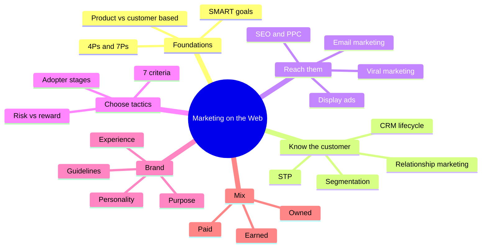
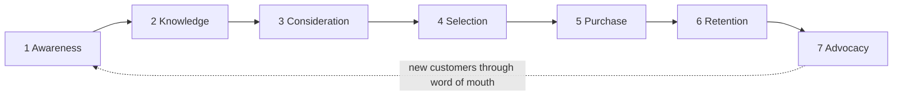
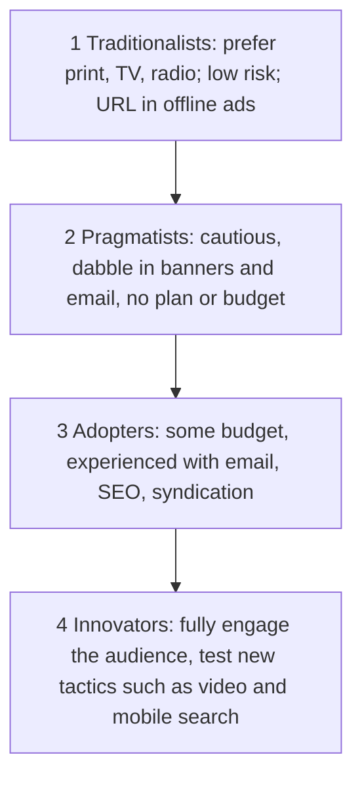

import Callout from '../../../components/Callout.astro';
import QA from '../../../components/QA.astro';
import QAList from '../../../components/QAList.astro';
import Figure from '../../../components/Figure.astro';
import smart from './images/w09-smart.png';
import fourps from './images/w09-4ps.png';
import sevenps from './images/w09-7ps.png';
import stp from './images/w09-stp.png';
import segBases from './images/w09-seg-bases.png';
import segEx from './images/w09-seg-example.png';
import crm from './images/w09-crm.png';
import lifecycle from './images/w09-lifecycle.png';
import adTypes from './images/w09-ad-types.png';
import heatmap from './images/w09-display-heatmap.png';
import proscons from './images/w09-tactics-proscons.png';
import riskReward from './images/w09-risk-reward.png';
import inbound from './images/w09-inbound.png';
import emailProc from './images/w09-email-process.png';
import seoPpc from './images/w09-seo-ppc.png';
import funnel from './images/w09-funnel.png';
import poe from './images/w09-poe.png';

<Callout type="why">
Week 4 built the store; Week 6 got it running. But a store nobody finds sells nothing. **Marketing on the web** is how strangers find you, trust you, buy, and come back. Online you usually get **one chance**: they open your email or ignore it, click your search result or the next one.

- **Real life:** Shopee's personalised push notifications (segmentation), HubSpot CRM, Google search ads (PPC), "Add to cart" reminder emails, a TikTok video going viral.
- **Connects to:** Week 4 (design for your target audience), Week 6 (CRM, marketing campaigns, RevOps), and the tips about the **attention economy**, **customer data** and **nurturing the top 20% of customers**.
</Callout>

<Callout type="key">
1. Marketing goals must be **SMART**: **S**pecific, **M**easurable, **A**ttainable/Actionable, **R**elevant, **T**ime-bound. The marketing mix is the **4Ps** (Product, Price, Promotion, Place), extended to the **7Ps** (+ People, Process, Physical evidence).
2. **Product-based** strategy focuses on making the best product; **customer-based** strategy finds out what customers want, then provides it (better loyalty, but costly research).
3. **Market segmentation** divides customers into groups by **geographic, demographic, psychographic and behavioural** traits, followed by **targeting** and **positioning** (**STP**). Segmented email campaigns showed a **760%** revenue boost.
4. **CRM** manages relationships along the **customer lifecycle**: awareness → knowledge → consideration → selection → purchase → retention → **advocacy**.
5. Choose tactics using **7 criteria** (goals, business environment, audience, competitors, site technology, internal resources, risk tolerance). **Email** has the highest channel ROI.
6. **Branding** = *who you are* (purpose, personality, guidelines, experience). **Marketing** = *how you spread it* (inform, inspire, profit, sell). **SEO** (organic: slow, long-term ROI) vs **PPC** (paid: fast, measurable, costly). The best mix blends **Paid + Owned + Earned**.
</Callout>

## Big picture

## 1. Foundations: SMART goals and the marketing mix

<Figure src={smart} alt="SMART marketing objectives: specific, measurable, actionable, relevant, time-bound" caption="SMART objectives. Example: 'Increase market share by 10% within 1 year.'" credit="Week 9, slide 5" max={460} />

| Letter | Meaning | Test |
|---|---|---|
| **S**pecific | Clear, e.g. "increase market share by 10%" | Can anyone tell exactly what the goal is? |
| **M**easurable | You can objectively tell if it was reached | Is there a number? |
| **A**ttainable | A stretch, but not impossible | Is it realistic? |
| **R**elevant | Fits the organisation's **mission** | Does it support business goals? |
| **T**ime-based | Has a completion date, e.g. 1 year | When is the deadline? |

<Figure src={fourps} alt="The four Ps of marketing: product, price, promotion, place, all feeding marketing strategy" caption="The 4Ps: what you sell, what you charge, how you communicate, where you sell." credit="Week 9, slide 6 (Cengage Figure 4-1)" />

- **Product:** what you sell (quality, design, features, branding, packaging).
- **Price:** value to the customer, competitors' prices, discounts.
- **Promotion:** how you communicate and motivate buyers (advertising, PR, online communication).
- **Place:** distribution: where the products are sold, logistics.
- **7Ps** add **People** (staff, service), **Process** (how the service is delivered) and **Physical evidence** (packaging, website look, reviews).

<Figure src={sevenps} alt="The 7Ps marketing mix: product, price, place, promotion, people, process, physical evidence, with how the internet varies each" caption="The extended 7Ps, and how the internet changes each one." credit="Week 9, slide 7" />

## 2. Product-based vs customer-based strategy

| | **Product-based** | **Customer-based** |
|---|---|---|
| Focus | Make the **best product** at the best price | Find out **what customers want**, then provide it |
| ✅ Pros | Focus on what you do best; **reputation for quality**; loyalty from quality | Customers more likely to buy; **loyalty** because you listen to them |
| ❌ Cons | Can **alienate customers** and ignore the target market, leaving sales on the table | **Costly** (market research); can **distract** from product quality |

<Callout type="tip" title="Which is better?">
Neither on its own. The slides' message is to **match a quality product to a target market**. The *attention economy* tip question rewards the **customer-based** idea: content that **resonates with your target audience's needs**.
</Callout>

## 3. Market segmentation and STP

**Market segmentation** = dividing your customers into **smaller groups** with shared traits, so you can target each better than with one strategy for everyone. **The goal is to find shopping patterns within groups.**

<Figure src={stp} alt="Segmentation, targeting, positioning: select customers to serve, decide on a value proposition, create value for targeted customers" caption="STP: Segmentation (divide) → Targeting (choose) → Positioning (place your offer in their minds), with differentiation alongside." credit="Week 9, slide 10" />

<Figure src={segBases} alt="Bases for market segmentation: geographic (country, city, climate), demographic (age, gender, income, education), psychographic (lifestyle, interests, values), behavioural (benefits sought, usage, buyer stage, engagement)" caption="Four bases: Geographic, Demographic, Psychographic, Behavioural." credit="Week 9, slide 12" />

<Callout type="tip" title="Memory trick">
**G-D-P-B = "Good Data Predicts Buying"**: **G**eographic (*where*), **D**emographic (*who*), **P**sychographic (*what they value*), **B**ehavioural (*what they do*).
</Callout>

**Example segments** for an online store:

- **VIPs**: shop most often or spend the most.
- **Active long-time** recurring customers.
- **Reactivated**: bought, went quiet, then bought again.
- **Low-tier recurring**: buy less often and spend less.
- **New customers**: just made a first purchase.
- **New visitors**: joined the mailing list but haven't bought yet.

<Figure src={segEx} alt="Example: all customers average 28 dollars; split into segments like VIPs at 150 dollars and new customers, average becomes 42 dollars" caption="Treating segments differently raised the average order value from $28 to $42." credit="Week 9, slide 13" max={560} />

**Benefits:**

1. **Saves time and money:** no wasted generic campaigns.
2. **Builds better relationships:** you keep learning about each group.
3. **Reveals strengths, weaknesses and opportunities:** you see which parts of your strategy work.

Research by the DMA found that segmented email campaigns produced a **760%** boost in email revenue.

## 4. Relationship marketing and CRM

**Relationship marketing** = everything a brand does to build **strong, lifelong relationships** with customers: influencer programmes, referrals, affiliates. **The most important part is two-way conversation.** ROI grows over time: referral revenue grew **3×** between years 1 and 2.

<Figure src={crm} alt="Objectives of CRM: improve customer satisfaction, expand the customer base, enhance business sales, improve workforce productivity; CRM cycle across marketing, support, orders and sales" caption="Four CRM objectives: customer satisfaction, a bigger customer base, more sales, and a more productive workforce." credit="Week 9, slide 17" />

<Figure src={lifecycle} alt="The customer lifecycle: awareness, knowledge, consideration, selection, purchase, retention, advocacy" caption="The customer lifecycle. Sales, marketing and service each lead at different stages but support each other." credit="Week 9, slide 18" />

| Stage | What the customer does | What you do |
|---|---|---|
| Awareness | First discovers the product | Ads, social posts, SEO |
| Knowledge | Looks for more information | Product pages, content, reviews |
| Consideration | Weighs options, compares | Comparisons, testimonials |
| Selection | Decides on a product | Clear pricing, CTAs |
| Purchase | Buys | A smooth checkout |
| Retention | A good experience keeps them | Follow-up emails, loyalty perks |
| **Advocacy** | **Recommends you to others** | Referral programmes, review requests |

## 5. Advertising on the web

<Figure src={heatmap} alt="Eye-tracking heatmap of an online page showing the percentage of users who saw each ad position, e.g. 73% top-left, 30% bottom-right" caption="Ad position matters: some placements are seen by about 73% of users, others by only about 30%." credit="Week 9, slide 20" max={560} />

<Figure src={adTypes} alt="Types of ads based on how the ad is served (display, contextual, search, local, mobile, map, social), how it is displayed (expandable, floating, pop-up, interstitial, wallpaper) and where it is served (browser-based, non-browser, feeds, newsletters, emails)" caption="Classifying ads three ways: how they are served, how they are displayed, and where they are served." credit="Week 9, slide 22" />

**The internet as a marketing tool:**

- Raising **awareness**.
- Building and retaining **loyalty**.
- Generating **leads**.
- **Shortening the sales cycle** with relevant information.
- **Collecting customer information**.
- Communicating company information.
- Enhancing **customer service**.

### The four stages of online marketing adopters

## 6. Selecting the right tactics

<Figure src={proscons} alt="Online marketing advantages and disadvantages: high click-through vs lower click-through, quick vs long to implement, active vs passive audience, measurable vs hard to measure, trusted vs low credibility, inexpensive vs expensive" caption="Every tactic is rated on these pros and cons: click-through, speed, audience, measurability, credibility, cost, targeting, direct response." credit="Week 9, slide 25" max={520} />

The **7 selection criteria**:

1. **Online goals**, mapped to business objectives: brand awareness, visibility, traffic, online or offline sales, sign-ups, downloads.
2. **Business environment:** B2B (long sales cycles, so offer whitepapers then follow-up emails) vs B2C (direct sales), market saturation.
3. **Online audience:** where they "live" online, plus demographics, psychographics and internet savviness.
4. **Online competitors:** local *and* international. Analyse their tactics, then compete head-on or find a niche.
5. **Site technology:** CMS, dynamic or static, the analytics package. Flash or frame sites are hard to optimise for SEO.
6. **Internal resources:** money and people. A blog with no one to post on it fails. You can outsource, but still need an internal **Online Marketing Champion**.
7. **Risk tolerance:** biometrics is happy with risk; finance prefers traditional methods. **Higher risk usually means higher return.**

<Figure src={riskReward} alt="Risk vs reward chart of online tactics: pop-up ads, widgets and social media marketing are high risk; email marketing, paid search and affiliate marketing are lower risk with high reward" caption="When judging risk, weigh the size of investment, time and effort, and how predictable the outcome is." credit="Week 9, slide 27" max={560} />

<Figure src={inbound} alt="Target marketing process: attract strangers to visitors (blog, keywords, social), convert visitors to leads (forms, CTAs, landing pages), close leads to customers (CRM, email, workflows), delight customers into promoters (surveys, smart content, social monitoring)" caption="The target marketing process: Attract → Convert → Close → Delight turns strangers into promoters." credit="Week 9, slide 29" />

## 7. Email marketing

**Email outperforms every other online channel on ROI**: email 73%, SEO 67%, content 62%, PPC 59%, affiliate 47%. It is the **most cost-effective** way to promote products and stay in touch with customers.

**Strategies:**

- **Real-time personalisation** (content that adapts when the email is opened).
- **Multi-channel marketing intelligence** (study customers' behaviour across channels).
- **Schedule your campaigns** for when your audience is most active.
- **Content** that hooks the reader.

<Figure src={emailProc} alt="The email marketing process: define, test, send, measure, report" caption="Email process: Define → Test → Send → Measure → Report." credit="Week 9, slide 33" max={560} />

**Top benefits marketers report:** generating more leads (23%), improved sales (19%), better conversion rates (17%), and reduced marketing costs (13%).

## 8. Branding vs marketing

**Your brand** is the customer's **total experience** of your business, not just the logo. It covers your promise, values, personality and how you talk to customers. A good brand **delivers a message, confirms credibility, connects emotionally, motivates purchase and creates loyalty**. It also creates **loyal employees**.

**The 3 key questions:** (1) Did the product perform as expected? (2) Was the quality as good as promised, or better? (3) Was the whole customer experience positive? **Three yeses = a loyal customer.**

**Brand checklist:**

- Does it relate to my target audience instantly?
- Does it show my uniqueness?
- Does it reflect my promise?
- Does it reflect the values I want to show?

| **Branding** (*who you are*) | **Marketing** (*how you spread it*) |
|---|---|
| **Brand purpose:** why you exist, what you believe | **Informative:** awareness, why the brand matters |
| **Brand personality:** emotions, voice | **Inspirational:** shows how life gets better |
| **Brand guidelines:** logo, colours, tone, kept consistent | **Profitable:** generates sales |
| **Brand experience:** consistent, so customers trust it | **Tool for selling:** but too "salesy" loses credibility |

**Why they need each other:** brand guidelines are the **outline for marketing**, and marketing **reinforces the brand**. You need a brand for consistent marketing, and marketing to build the brand.

## 9. Viral marketing

**Viral marketing** = users create the buzz by **passing your message on** to other users and sites.

- **How:** appealing, relevant content; the platform best suited to the audience; the right influencer.
- **Methods:** social media optimisation (SMO), SEO, influencer marketing, mobile integration, web search engines.
- **Benefits:**
  - **Lower cost**, because users do the spreading.
  - A **huge**, even international, reach.
  - Better user–brand interaction and a stronger social presence.
  - **Brand awareness**, which is great for **new businesses**.

## 10. Search engine marketing: SEO vs PPC

**Organic search** results come from the search engine's ranking algorithm, and you earn a high place only through good **SEO**. **Paid search** (PPC) lets advertisers **bid** on keywords, and the highest bid gets the top spot. **Paid search visits convert 35% better than organic visits** for e-commerce sites.

<Figure src={seoPpc} alt="SEO (organic): pros long-term ROI, high ceiling, more exposure; cons tough to quantify, lots of work, takes a while. PPC (search advertising): pros quick setup, highly measurable, fewer resources; cons more expensive, lower ceiling, ad blindness" caption="SEO vs PPC at a glance." credit="Week 9, slide 46" max={560} />

| | **SEO (organic)** | **PPC (paid)** |
|---|---|---|
| ✅ | Great long-term ROI; high ceiling and volume; more exposure, branding, awareness | **Quick setup**; highly **measurable**; fewer development resources |
| ❌ | Hard to quantify; lots of work; **takes a while** | **More expensive**; lower ceiling; "**ad blindness**" |
| Best for | Long-term, sustainable traffic | Fast results, launches, testing |

## 11. Combining channels: paid, owned, earned

<Figure src={funnel} alt="Marketing funnel mapped to the customer journey: unaware, interest established, problem acknowledged, looking for solution, with content types at each stage" caption="Map each channel to a stage of the customer's journey through your sales funnel." credit="Week 9, slide 47" />

<Figure src={poe} alt="The digital marketing mix: earned media (reviews, mentions, shares), paid media (PPC, display ads, paid social, paid influencers), owned media (website, blog, email, social pages); the optimal mix leverages them all" caption="Paid, Owned, Earned: the sweet spot is where all three overlap." credit="Week 9, slide 48" max={560} />

- **Owned:** property you own and control, such as your **website**, blog, email list and social pages.
- **Paid:** you pay to be in front of an audience, such as **PPC**, display ads and paid social.
- **Earned:** someone else promotes you **for free**, such as reviews, shares and press mentions.

Used **together** toward one strategic plan, their **ROI far exceeds the sum of the parts**. A good plan considers all three; a great plan **blends** them.

<Callout type="warn">
**Selling only on a marketplace means you have no owned channel.** That's why the tips say a TikTok-only brand **can't gather detailed customer data**: the platform owns the customer list, so you can't segment, email or run CRM yourself.
</Callout>

<Callout type="exam">
Likely questions: **explain SMART with an example**, **list the bases of segmentation**, **describe the customer lifecycle**, **compare SEO and PPC**, **branding vs marketing**, and **paid, owned, earned**. In scenarios, a strong answer names the **segment**, the **channel** and the **reason**.
</Callout>

<QAList>
  <QA q="What does SMART stand for? Give an example SMART marketing goal." level="easy" why="Specific, Measurable, Attainable, Relevant, Time-based, e.g. increase online sales by 10% within 12 months.">
    **Specific, Measurable, Attainable (Actionable), Relevant, Time-based.** Example: *"Increase online sales by 10% within the next 12 months through email campaigns to existing customers."*
  </QA>
  <QA q="List the 4Ps of marketing and the three extra Ps in the 7Ps." level="easy" why="Product, Price, Promotion, Place, plus People, Process, Physical evidence.">
    **4Ps:** Product (what you sell), Price (what you charge), Promotion (how you communicate and motivate buyers), Place (where and how it is distributed). The **7Ps** add **People**, **Process** and **Physical evidence**.
  </QA>
  <QA q="Compare product-based and customer-based marketing strategies." level="medium" why="Product-based: focus on quality, reputation, but may alienate customers. Customer-based: give customers what they want, loyalty, but costly research and distraction.">
    **Product-based:** focus on what you do best and build a reputation for quality, but you may **alienate customers** and miss your target market. **Customer-based:** research what customers want and provide it, building **loyalty**, but it is **costly** (market research) and can **distract** from product quality.
  </QA>
  <QA q="Define market segmentation and list its four bases." level="easy" why="Dividing customers into groups with shared traits to find shopping patterns: geographic, demographic, psychographic, behavioural.">
    Dividing customers into **smaller groups with shared qualities** so each can be targeted better; the goal is to find **shopping patterns**. Bases: **Geographic** (country, city, climate), **Demographic** (age, gender, income, education), **Psychographic** (lifestyle, interests, values), **Behavioural** (benefits sought, usage, buyer stage).
  </QA>
  <QA q="State three benefits of market segmentation." level="easy" why="Saves time and money, builds better relationships, shows strengths/weaknesses/opportunities (760% email revenue boost).">
    (1) **Saves time and money:** targeted campaigns, not generic ones. (2) **Builds better relationships:** you keep learning about each group. (3) **Reveals strengths, weaknesses and opportunities** in your strategy. The DMA found a **760%** boost in email revenue from segmented campaigns.
  </QA>
  <QA q="List the four objectives of CRM." level="easy" why="Improve customer satisfaction, expand customer base, enhance sales, improve workforce productivity.">
    **Improve customer satisfaction, expand the customer base, enhance business sales, and improve workforce productivity.**
  </QA>
  <QA q="Describe the stages of the customer lifecycle." level="medium" why="Awareness → knowledge → consideration → selection → purchase → retention → advocacy.">
    **Awareness** (first discovers) → **Knowledge** (seeks information) → **Consideration** (weighs options) → **Selection** (decides) → **Purchase** → **Retention** (a positive experience keeps them) → **Advocacy** (recommends you, bringing in new customers). Sales, marketing and service each lead different stages but support each other.
  </QA>
  <QA q="Describe the four stages of online marketing adopters." level="medium" why="Traditionalists (offline, low risk) → pragmatists (cautious, no plan) → adopters (budget, proven tactics) → innovators (test new tactics).">
    **1 Traditionalists:** prefer print, TV and radio; low risk; their URL appears in offline ads. **2 Pragmatists:** cautious; try banners or email but have no plan or budget. **3 Adopters:** a dedicated budget and experience with email, SEO and syndication. **4 Innovators:** fully engage the audience online and test unproven tactics (video, mobile search).
  </QA>
  <QA q="List the seven criteria for selecting online marketing tactics." level="medium" why="Online goals, business environment, online audience, online competitors, site technology, internal resources, risk tolerance.">
    **Online goals, business environment (B2B vs B2C), online audience, online competitors, site technology, internal resources, and risk tolerance.**
  </QA>
  <QA q="Why is email marketing considered so effective? Outline its process." level="medium" why="Highest channel ROI (73%), most cost-effective; process define → test → send → measure → report.">
    It has the **highest ROI** of all online channels (73%, vs SEO 67% and PPC 59%) and is the **most cost-effective** way to promote products and stay in touch with customers. Process: **Define** (name the campaign, subject) → **Test** (browsers, email clients) → **Send** (now or scheduled) → **Measure** (opens, clicks) → **Report**.
  </QA>
  <QA q="Differentiate branding from marketing." level="medium" why="Branding = identity (purpose, personality, guidelines, experience); marketing = spreading it (informative, inspirational, profitable, tool for selling).">
    **Branding** is the business's **identity**: purpose, personality, guidelines and experience (*who you are*). **Marketing** **spreads** that identity to drive sales: it informs, inspires, earns profit and is a tool for selling (*how you tell people*). Brand guidelines outline the marketing; marketing reinforces the brand.
  </QA>
  <QA q="What are the three key branding questions?" level="easy" why="Did it perform as expected? Was quality as good as promised or better? Was the whole experience positive?">
    (1) Did the product or service **perform as expected**? (2) Was the **quality as good as promised**, or better? (3) Was the **entire customer experience positive**? Positive answers to all three create a loyal customer.
  </QA>
  <QA q="Define viral marketing and list three benefits." level="easy" why="Users pass the message on; cheaper, huge (international) reach, brand awareness for new businesses.">
    Marketing where **users create the buzz** by passing the message on to others. Benefits: **lower cost** (users spread it), **potential to reach a huge, even international audience**, better user–brand interaction, social presence, and **brand awareness**, which is especially good for new businesses.
  </QA>
  <QA q="Compare SEO and PPC." level="medium" why="SEO: organic, long-term ROI, slow, hard to quantify. PPC: paid bids, fast, measurable, costly, ad blindness.">
    **SEO (organic):** long-term ROI, high ceiling and exposure, but slow, lots of work and hard to quantify. **PPC (paid):** advertisers bid on keywords for top spots; quick to set up and highly measurable (paid visits convert about 35% better), but more expensive, with a lower ceiling and **ad blindness**.
  </QA>
  <QA q="Explain paid, owned and earned media, with an example of each." level="medium" why="Owned = your website or email list; paid = PPC or paid social; earned = free reviews or shares. Best used together.">
    **Owned:** property you control (your website, email list). **Paid:** you pay to reach an audience (Google PPC, sponsored Instagram posts). **Earned:** others promote you for free (customer reviews, shares, press mentions). Blended in one plan, their ROI is greater than the sum of the parts.
  </QA>
  <QA q="A brand sells only on TikTok Shop. Using CRM and paid/owned/earned, explain its competitive disadvantage." level="hard" why="No owned channel, so the platform owns customer data; it can't segment, run CRM or email; fix by building owned media.">
    It has **no owned channel**: TikTok owns the customer data. The brand **can't build its own CRM**, segment customers, or run email and retention campaigns, and its visibility depends on the algorithm. **Fix:** build owned media (a website and email list), collect customer data with consent, and blend it with paid ads and earned reviews.
  </QA>
</QAList>
