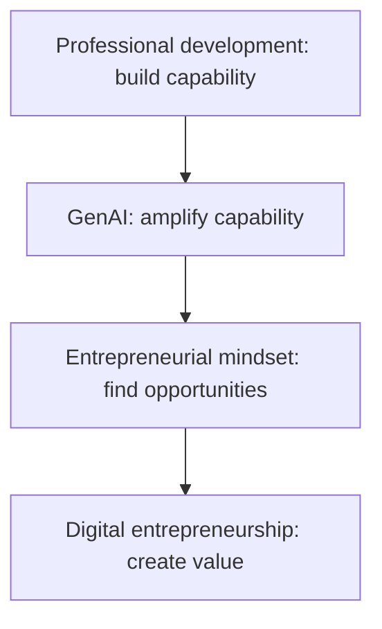
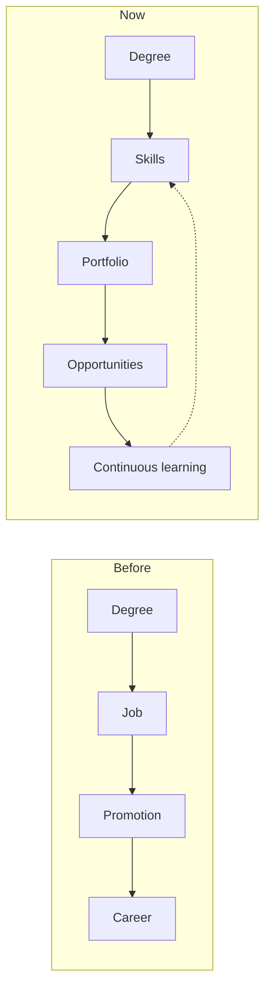
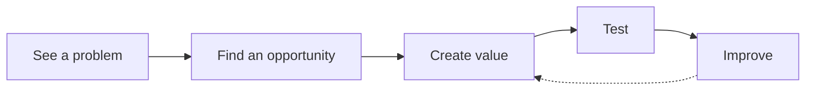
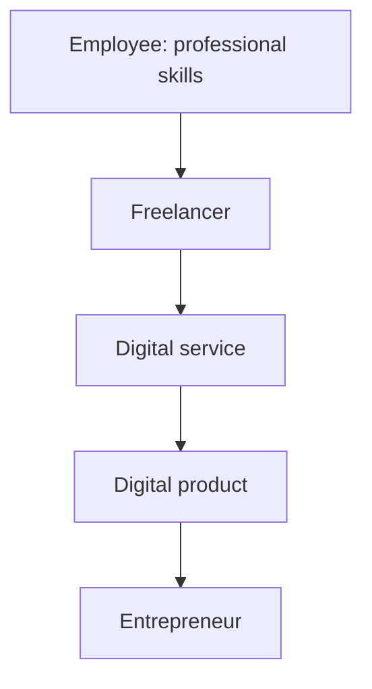

import Callout from '../../../components/Callout.astro';
import QA from '../../../components/QA.astro';
import QAList from '../../../components/QAList.astro';

<Callout type="why">
Weeks 4–9 taught how to **build, run and market** an e-business. This session steps back to **you**: the person doing it. GenAI can now write, design, code and analyse, so the question isn't *"Can I get a job?"* but **"How do I stay valuable when technology keeps changing?"** Entrepreneurship is **one** path; **professional adaptability** matters on **every** path.

- **Real life:** job ads now ask for *"AI literacy"*; one graduate with Power BI can sell dashboards to small shops; a web developer can build a booking site for a clinic. <Own note="examples beyond the slide cases" />
- **Connects to:** Week 4 (digital revenue models give you ways to earn) and Week 6 (start small, use affordable scalable tools).
</Callout>

<Callout type="key">
1. **Old career model:** Degree → Job → Promotion → Career. **New:** Degree → **Skills → Portfolio → Opportunities → Continuous learning**. One person can have **several income or career paths**.
2. **Professional development** = continuously improving your **knowledge, skills, communication, judgement and adaptability**, to **become more useful over time**.
3. Employers now ask **"What can you do? What problem can you solve? Can you learn quickly?"**, not just what you studied.
4. **GenAI** is fast, scalable, pattern-based and good at drafts. **Humans** bring context, judgement, responsibility, trust and relationships. The future is **HUMAN + AI**, not human vs AI.
5. **Opportunity formula:** **Skill + Real problem + Digital tool + Customer = Possible value.** But a **prototype ≠ a successful business**.
6. Avoid **Prompt → Copy → Submit**. Do **Prompt → Understand → Verify → Adapt → Create**. **Use GenAI, but remain the human in charge.**
</Callout>

## Big picture

## 1. The graduate career model has changed

The new path is a **loop**: you keep learning, and one person can have **several income or career paths** at once (a job plus freelancing, for example).

**What makes someone employable?** A degree, CGPA, technical skill, communication, experience, a portfolio, problem-solving… The answer is **usually a combination, and it changes by job**.

| Old employer question | New employer questions |
|---|---|
| *"What subjects did you study?"* | **"What can you do?"** · **"What problem can you solve?"** · **"Can you learn quickly?"** |

## 2. GenAI in the workplace: human + AI

AI already helps with **writing, research, coding, data, design, marketing and analysis**. So *"I can use AI"* is **not** the valuable skill. The valuable skill is **"I know what to ask, check, improve and apply."**

| **GenAI** | **Human** |
|---|---|
| Fast | **Context** |
| Scalable | **Judgement** |
| Pattern-based | **Responsibility** |
| Draft generation | **Trust** and **relationships** |

**What GenAI can't easily replace:**

- Trust
- Responsibility
- Professional judgement
- **Understanding the customer**
- Ethical decisions
- Human relationships
- **Knowing the local context**

## 3. Entrepreneurial mindset and digital entrepreneurship

**An entrepreneurial mindset is *not* "I must start a company".** It is a way of thinking:

**Employees can have an entrepreneurial mindset too.**

**Digital entrepreneurship** = **creating value using digital technology**: e-commerce, digital services, apps, websites, content, online education, data services, freelancing. **Start small.**

**Why GenAI makes starting easier:** the old barrier was *"I need a whole team"*. Now **one person can prototype** content, a website, a business idea, customer communication and data analysis. ⚠️ But **prototype ≠ successful business**: you still need real customers and real value.

### The opportunity formula

> **SKILL + REAL PROBLEM + DIGITAL TOOL + CUSTOMER = POSSIBLE VALUE**

| | **Case 1: Data graduate** | **Case 2: Computing graduate** |
|---|---|---|
| Skill | Excel + Power BI | Web development |
| Real problem | Small businesses can't understand their sales data | A small business has no simple booking system |
| Solution | A simple dashboard + monthly business insights | A low-cost booking website |
| Value / GenAI role | GenAI helps explain trends, draft reports and generate ideas | Saves the owner time, reduces manual work |

**Mini challenge from class:** look around (campus, family business, food, transport, education, tourism, healthcare, retail, student life). **What is one annoying problem that could be improved digitally?**

## 4. Career paths can overlap

You **don't have to choose everything today**. Paths can run side by side, e.g. an employee who freelances, then turns a service into a product.

## 5. Can GenAI do it all? No.

**Risks:**

- Wrong information
- Generic output
- Bias
- Privacy issues
- Overdependence
- Lack of originality

**Professional development means learning to *check* AI.**

| ❌ **Dangerous habit** | ✅ **Better habit** |
|---|---|
| **Prompt → Copy → Submit** | **Prompt → Understand → Verify → Adapt → Create** |
| Produces *an answer* | Produces *a capable graduate* |

**Avoiding over-dependence:**

- Use AI to **accelerate** learning, not **replace** it.
- **Check facts.**
- **Understand** the output.
- **Protect confidential information.**
- Follow academic and professional rules.

<Callout type="warn">
Never paste **confidential** company or customer data into a public AI tool. It ties to the **PDPA** and privacy issues in the exam tips. <Own note="link to the tips" />
</Callout>

## 6. Show it: your digital portfolio

Don't just say *"I know Power BI"*. **Show it**: a dashboard, website, app, campaign, case study, data analysis, prototype or digital product. **Evidence is stronger than a list of skills.**

## 7. The new graduate skill stack

1. **Domain knowledge**
2. **Digital skills**
3. **Communication**
4. **Critical thinking**
5. **Problem solving**
6. **AI literacy**
7. **Entrepreneurial mindset**

<Callout type="tip" title="Memory trick: the take-home loop">
**LEARN → BUILD → SHOW → SOLVE → IMPROVE.** Learn a skill, build something, show it in a portfolio, solve a real problem, improve and repeat. **Be employable. Be adaptable. Be entrepreneurial.** *Use GenAI, but remain the human in charge.*
</Callout>

<QAList>
  <QA q="How has the graduate career model changed?" level="easy" why="From Degree → Job → Promotion → Career to Degree → Skills → Portfolio → Opportunities → Continuous learning, with several paths possible.">
    **Before:** Degree → Job → Promotion → Career (one linear path). **Now:** Degree → **Skills → Portfolio → Opportunities → Continuous learning**, a loop in which one person can have **several income or career paths**.
  </QA>
  <QA q="What does professional development really mean?" level="easy" why="Continuously improving knowledge, skills, communication, judgement and adaptability to become more useful over time.">
    Not just attending courses: **continuously improving** your **knowledge, skills, communication, judgement and adaptability**, with the goal of **becoming more useful over time**.
  </QA>
  <QA q="What questions do employers increasingly ask instead of what subjects you studied?" level="easy" why="What can you do? What problem can you solve? Can you learn quickly?">
    **"What can you do?"**, **"What problem can you solve?"** and **"Can you learn quickly?"**
  </QA>
  <QA q="Compare GenAI value and human value. Why is the future human + AI?" level="medium" why="AI: fast, scalable, pattern-based drafts. Human: context, judgement, responsibility, trust, relationships. Combined they do more than either alone.">
    **GenAI** is fast, scalable and pattern-based, and good at generating drafts. **Humans** bring context, judgement, responsibility, trust and relationships. AI does the volume; humans decide what to ask, check the output, take responsibility and apply it to real customers. Together they beat either alone, hence **human + AI**.
  </QA>
  <QA q="Define an entrepreneurial mindset. Must you start a company to have one?" level="easy" why="See a problem → find an opportunity → create value → test → improve; no, employees can have it too.">
    A way of thinking: **see a problem → find an opportunity → create value → test → improve**. **No**, it doesn't mean you must start a company; **employees can have an entrepreneurial mindset too**.
  </QA>
  <QA q="State the opportunity formula and apply it to a computing graduate." level="medium" why="Skill + real problem + digital tool + customer = possible value; e.g. web dev + no booking system + website + small business owner.">
    **Skill + Real problem + Digital tool + Customer = Possible value.** Example: **web development** skill + a small business that **has no simple booking system** + a **low-cost booking website** + the **business owner** as customer = value: it saves the owner time and reduces manual work.
  </QA>
  <QA q="Why does GenAI make starting a digital business easier, and what is the catch?" level="medium" why="One person can prototype content, a website, ideas, communication and analysis, but a prototype is not a successful business.">
    The old barrier was needing a **whole team**. Now **one person can prototype** content, a website, a business idea, customer communication and data analysis. **Catch:** a **prototype ≠ a successful business**. It still needs real customers, real value and checking.
  </QA>
  <QA q="List four risks of relying on GenAI." level="easy" why="Wrong information, generic output, bias, privacy issues, overdependence, lack of originality.">
    Any four of: **wrong information, generic output, bias, privacy issues, overdependence, lack of originality.**
  </QA>
  <QA q="Contrast the dangerous graduate habit with the better habit when using AI." level="medium" why="Prompt → copy → submit vs prompt → understand → verify → adapt → create.">
    **Dangerous:** **Prompt → Copy → Submit**: it produces an answer but not a capable graduate. **Better:** **Prompt → Understand → Verify → Adapt → Create**: you check the facts, understand them, and add your own value.
  </QA>
  <QA q="Why is a digital portfolio stronger than a list of skills?" level="easy" why="Evidence beats claims: a dashboard or app shows you can actually do it.">
    **Evidence is stronger than claims.** Saying *"I know Power BI"* is a claim; **showing** a dashboard, website, app, campaign or case study **proves** you can do it.
  </QA>
  <QA q="List the seven skills in the new graduate skill stack." level="easy" why="Domain knowledge, digital skills, communication, critical thinking, problem solving, AI literacy, entrepreneurial mindset.">
    **Domain knowledge, digital skills, communication, critical thinking, problem solving, AI literacy, entrepreneurial mindset.**
  </QA>
  <QA q="Name five things GenAI cannot easily replace." level="medium" why="Trust, responsibility, professional judgement, understanding the customer, ethical decisions, relationships, local context.">
    Any five of: **trust, responsibility, professional judgement, understanding the customer, ethical decisions, human relationships, knowing the local context.**
  </QA>
</QAList>
