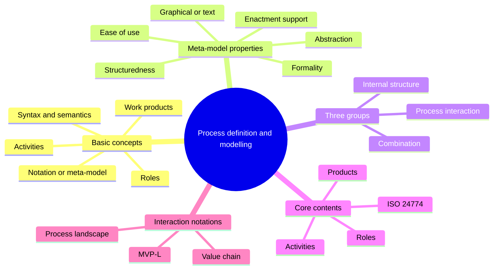
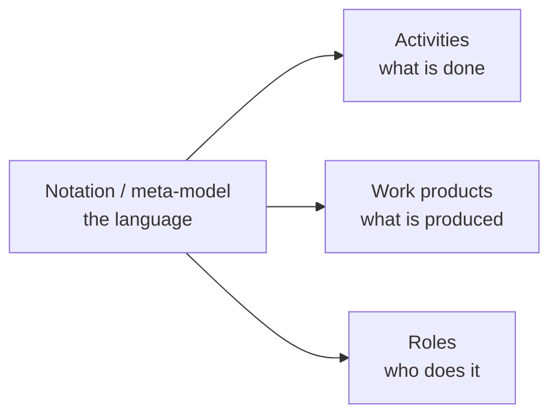
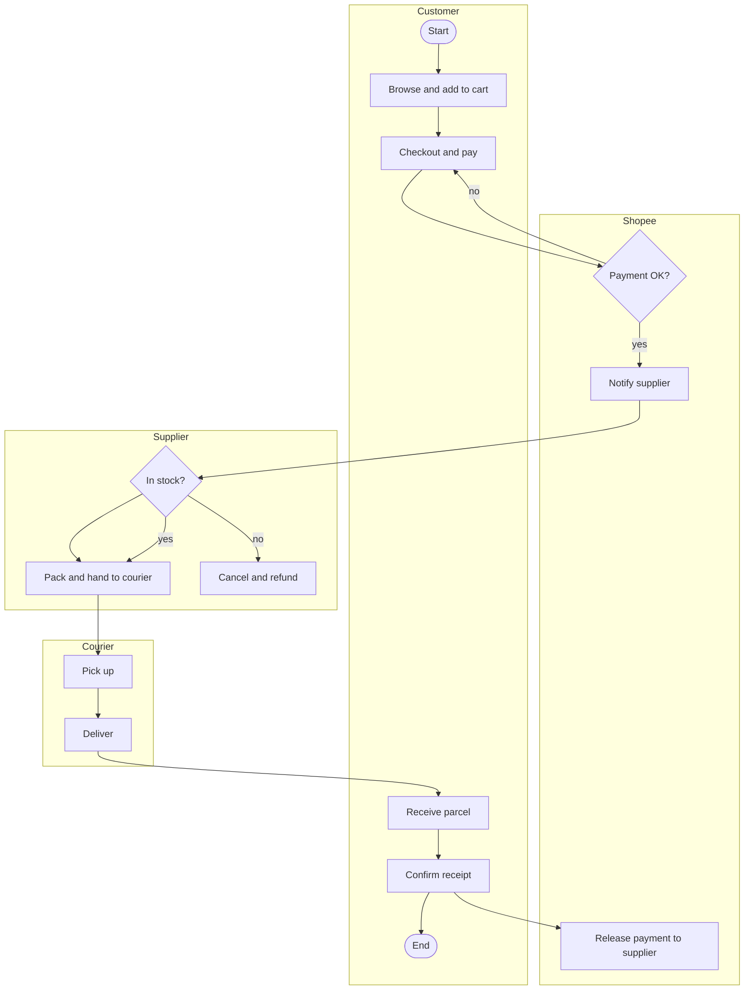
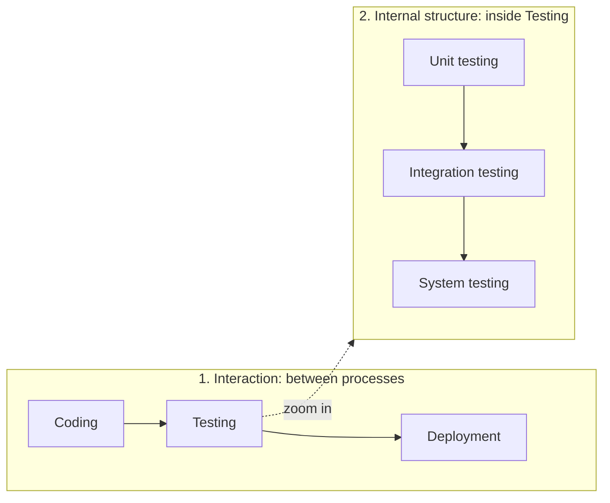

import Callout from '../../../components/Callout.astro';
import QA from '../../../components/QA.astro';
import QAList from '../../../components/QAList.astro';
import Figure from '../../../components/Figure.astro';
import bpmn from './images/w02-bpmn-example.png';
import groups from './images/w02-metamodel-groups.png';
import core from './images/w02-core-elements.png';
import royce from './images/w02-royce-waterfall.png';
import landscape from './images/w02-process-landscape.png';
import mvpl from './images/w02-mvpl.png';

<Callout type="why">
Every software team follows *some* process, even if it's "whatever we did last time". If that process exists only in people's heads, it can't be taught, checked, improved or automated.

**Process modelling** is how you write a process down so others can follow it, tools can read it, and auditors can check it. It's the same skill as drawing a class diagram, but for **how work gets done** instead of how code is structured.

- **Real life:** onboarding a new developer ("here's how we do code review"), passing an ISO 9001 audit, designing a CI/CD pipeline, or automating a business workflow in tools like Bizagi or Camunda. A process diagram is also often the first deliverable in a process-automation project.
- **Connects to:** Week 3 (detailed notations: BPMN, EPC, SIPOC, SPEM…), Week 4 (life cycle models are process models), Week 5 (selecting a process notation is a governance decision), later topics (process assessment, measurement, tool support).
</Callout>

<Callout type="key">
1. A process description is built from a **notation / meta-model** that describes **activities**, **work products** and **roles**.
2. **Defined notations** beat plain text: structure, different views for different people, tool exchange, automation, and checkable criteria for audits.
3. Every notation has **abstract syntax** (the building blocks), **concrete syntax** (the symbols) and **semantics** (the meaning).
4. Meta-models differ in **abstraction, structuredness, ease of use, formality, enactment support, and graphical vs text**.
5. **Three groups of notations:** process **interaction** (high level), process-**internal structure** (detailed), and **combination** (both).
6. **Core elements:** **products, activities, roles**. Models are either **product-oriented** or **activity-oriented**.
7. **ISO/IEC/IEEE 24774:2021:** title, purpose, outcome, activities, tasks, information items.
8. **Interaction notations:** value chain / process landscape diagrams, and **MVP-L** (functional, behavioural, organisational and data views).
</Callout>

## Big picture

## 1. Basic concepts

A **software process model** describes how software is developed. The language you use to write it is the **notation**, defined by a **meta-model** (a "model of models" that says which elements are allowed). The three things almost every process description contains:

### Why defined notations instead of plain text?

| Benefit | What it means | Example |
|---|---|---|
| **Explicit, structured description** | Different levels: phases and stages broken down into (sub-)processes, activities and tasks | "Testing" → "Unit testing" → "Write unit tests for module X" |
| **Automated selection** | Show only the parts relevant to a role or a phase | A tester sees only testing activities |
| **Different formats for different purposes** | Same content as hypertext (HTML) or as a printable linear document | Online process portal plus a PDF handbook |
| **Exchange between tools** | Standard notations can be read by different tools | A **BPMN** model drawn in Bizagi, opened in Camunda |
| **Automated support for other tasks** | Analysis, tailoring, even **executing** the process | A workflow engine runs the BPMN model |
| **Clear criteria for checking** | A basis for checking that the process is followed | Assessments and **audits** (e.g. ISO 9001) |

### Syntax and semantics of a notation

Every modelling language, like a programming language, has three parts:

| Part | Defines | Example (BPMN) |
|---|---|---|
| **Abstract syntax** | The **building blocks** that exist | Activity, event, gateway, sequence flow |
| **Concrete syntax** | The **symbols** used to draw them | Rounded rectangle = activity, circle = event, diamond = gateway |
| **Semantics** | What each block **means** | A gateway means "choose one path based on a condition" |

<Callout type="tip" title="Analogy">
In English, the **abstract syntax** is "a sentence has a subject and a verb", the **concrete syntax** is the letters and words you write, and the **semantics** is what the sentence means. Two people can draw the same process with different symbols (concrete syntax) and still mean the same thing.
</Callout>

### Process notations are also used for business processes

In software engineering, the same notations are used in two places:
1. To **define software processes** (how *we* develop software).
2. In **analysis**, to describe the **business or application processes** the software will support (how the *customer* works).

### Class activity: Shopee order process

> Draw the process of ordering items from Shopee Malaysia: customers add items to the cart and pay, suppliers recheck stock once the order is received, the courier delivers, and the customer confirms receipt.

**A sample answer** *(mine, BPMN-style, one lane per participant)*:

<Figure src={bpmn} alt="BPMN diagram with three swimlanes (customer, employee, POS) showing activities like look at menu, choose, make payment, collect order, make ice cream, calculate total and produce receipt, connected by solid sequence flows and dashed message flows" caption="A BPMN example from the slides: each horizontal lane (pool/lane) is a participant, solid arrows are the order of steps, and dashed arrows are messages between participants." credit="Topic 2, slide 9" max={420} />

## 2. Properties of process meta-models

| Property | Question it answers | Example |
|---|---|---|
| **Level of abstraction / detail** | How much detail? | Life cycle models like waterfall show only high-level phases, with no individual activities or artefacts |
| **Degree of structuredness** | Are there clear levels? | Complex processes separate high-level phases/stages from activities and tasks |
| **Ease of use** | Easy for *authors* to describe, tailor and keep consistent? Easy for *users* to find and interpret information? | A one-page checklist vs a 300-page manual |
| **Degree of formality** | Mathematical and exact, or informal (or not written down at all)? | Petri nets (formal) vs a sketch of the waterfall |
| **Enactment / execution / simulation support** | Can a tool run or simulate it? | BPMN executed by a workflow engine |
| **Graphical vs text-based** | Pictures, text, or both? | Most use a **mixture**: graphics for the overview, text for detail |

### Three groups of meta-models and notations

<Figure src={groups} alt="Tree: Process interaction notation (life cycle diagram, value chain/process landscape, MVP-L); Notation for process-internal structure (notation from requirements analysis, high-level notation for general processes, business process notation, process notation for formal analysis); Combination notation (best practice model, assessment model, combined life cycle and process model — formal for tool support or informal for human users)" caption="The three groups, and the notations in each. Weeks 2–3 walk through this tree." credit="Topic 2, slide 12 (Fig 2.1)" max={560} />

| Group | Shows | Level | Example |
|---|---|---|---|
| **1. Process interaction** | **Multiple processes** and how they trigger and depend on each other | **High** abstraction ("life cycle process models"); usually graphical, with little defined syntax and semantics | Coding → Testing → Deployment |
| **2. Process-internal structure** | What happens **inside one** process: its **activities, results and roles** | Detailed | Inside Testing: Unit → Integration → System testing |
| **3. Combination** | **Both** the life-cycle overview **and** the details of each process in one notation | Both | RUP, V-Model XT, SPEM-based models |

<Callout type="warn" title="About the 'combination notations' slide">
The slide illustrates combination notations with "how many ways to pair 4 developers", which is **mathematical combinations** (C(4,2) = 6 possible pairs). That's a different idea. In process modelling, a **combination notation** means one notation that **combines** the high-level life-cycle view **and** the detailed internal view of each process. In an exam, use that definition. (Also, splitting 4 developers into **two** pairs can only be done in **3** ways; 6 is the number of possible *pairs*.)
</Callout>

## 3. Core contents of software process models

The **core elements** of any software process (meta-)model:
- the **products** to be created
- the **activities** that create them
- the **roles** responsible

<Figure src={core} alt="Fig 2.3: (a) Product-oriented core — Template linked to Product, Product linked to Role, Method linked to Activity, Activity linked to Product. (b) Activity-oriented core — Template linked to Product, Method linked to Activity, Activity linked to Role" caption="(a) Product-oriented: roles are attached to products (who is responsible for this document?). (b) Activity-oriented: roles are attached to activities (who performs this step?). Templates describe products; methods describe how to perform activities." credit="Topic 2, slide 20 (Fig 2.3)" max={600} />

| | **Product-oriented** | **Activity-oriented** |
|---|---|---|
| Leading component | The **products** (documents, code, test reports) | The **activities** (steps) |
| Role is linked to | A product: "the architect owns the design document" | An activity: "the tester performs system testing" |
| Feels like | A checklist of deliverables | A flowchart of steps |
| Example | V-Model XT | Most BPMN process flows |

### ISO/IEC/IEEE 24774:2021

This standard gives a simple structure for describing software processes:

| Element | Meaning | Example: "Code review" process |
|---|---|---|
| **Title** | Name of the process | Code review |
| **Purpose** | Why it exists | Find defects and share knowledge before merging |
| **Outcome** | Observable results when it's done well | Every merged change is reviewed by at least one other developer |
| **Activities** | Groups of related tasks | Prepare, review, rework |
| **Tasks** | Specific actions | Open a pull request; leave comments; approve |
| **Information items** | Anything else needed | Review checklist, coding standard |

<Callout type="note">
In ISO/IEC/IEEE 24774, **products** appear only briefly as a type of outcome, and **roles are not addressed at all**. That's a known limitation compared with the products–activities–roles core above.
</Callout>

## 4. Notations for modelling the interaction between processes

High-level notations covering **many** processes are mostly used to describe **life cycle models**. These are usually drawn **ad hoc** (no defined notation), like Royce's waterfall:

<Figure src={royce} alt="Royce's waterfall: System Requirements, Software Requirements, Analysis, Program Design, Coding, Testing, Operations, drawn as a descending staircase of boxes" caption="Royce's waterfall model: an ad-hoc diagram with no formally defined notation, but everyone understands it." credit="Topic 2, slide 24 (Fig 1.2)" max={520} />

Two **defined** notations exist:

### 1. Value chain diagrams and process landscape diagrams

- These come from **business process modelling**.
- They give an **overview of many (or all) processes** in an organisation and the **interfaces** between them.
- They show the role that processes such as software development play in the **overall organisation**.

<Figure src={landscape} alt="Process landscape for an IT service provider: management processes (business strategy), primary processes grouped into Plan (IT strategy, business analysis, portfolio management), Build (analysis, design, implementation, test, project management, quality management) and Run (transition/deployment, operations, service management), and supporting processes (purchasing, process management)" caption="A sample process landscape for an IT service provider: management processes on top, the primary value chain (Plan → Build → Run) in the middle, supporting processes at the bottom." credit="Topic 2, slide 25 (Fig 2.5)" max={420} />

| Layer | Contains | In the example |
|---|---|---|
| **Management processes** | Steer the organisation | Business strategy |
| **Primary processes** | Directly create value for the customer (the **value chain**) | Plan → **Build** (software development lives here) → Run |
| **Supporting processes** | Enable the primary ones | Purchasing, process management |

### 2. MVP-L (Multi-View Process Modeling Language)

- Describes (software development) processes **formally**, by their **external behaviour** without looking at their internal structure, similar to **abstract data types**.
- Named "multi-view" because it supports **several views of the same process** for different purposes and roles:

| View | Focuses on | Question |
|---|---|---|
| **Functional** | What tasks and functions are performed | *What* is done? |
| **Behavioural** | Dynamics: sequence and timing of tasks | *When* and in what order? |
| **Organisational** | Roles, responsibilities, organisational units | *Who* does it? |
| **Data** | Information and data objects used and produced | *What* goes in and out? |

<Figure src={mvpl} alt="MVP-L diagram: a vertical timeline with states S-0 to S-6; products (pd: PD, rs: RS, dd: DD, cd: CD) shown as ovals and processes (req_s, design, coding) as boxes; transition conditions like pd.status = complete AND rs.status = non_existent" caption="MVP-L in action: states S-0 to S-6 down the timeline; each process (requirements, design, coding) starts when its input product is 'complete' and its output is 'non_existent', and ends when the output is 'complete'." credit="Topic 2, slide 27" max={600} />

**Reading the MVP-L figure:**
- **States** (S-0 … S-6) and the **transitions** between them.
- **Entry / Exit** mark where the process starts and ends.
- The **timeline** (Req_S → Design → Coding) is the chronological order.
- Each transition has a **condition**, e.g. design may start when `rs.status = complete AND dd.status = non_existent`.

<QAList>
  <QA q="Name the three core elements of a software process model." level="easy">
    **Products** (what is created), **activities** (what is done to create them) and **roles** (who is responsible).
  </QA>
  <QA q="Give four reasons for using a defined notation rather than plain text to describe a process." level="medium">
    Any four of: an explicit, structured description at different levels; automated selection of the parts relevant to a role or phase; displaying the same content in different formats (HTML, print); exchanging descriptions between tools (e.g. BPMN); automated support for analysis, tailoring or execution; clear criteria for checking the process in assessments and audits.
  </QA>
  <QA q="Distinguish abstract syntax, concrete syntax and semantics, using BPMN as an example." level="medium">
    **Abstract syntax:** the building blocks (activity, event, gateway). **Concrete syntax:** the symbols that draw them (rounded rectangle, circle, diamond). **Semantics:** what they mean (a gateway chooses one path based on a condition).
  </QA>
  <QA q="List the six properties of process meta-models." level="easy">
    Level of abstraction/detail; degree of structuredness; ease of use; degree of formality; process enactment/execution/simulation support; graphical vs text-based notation.
  </QA>
  <QA q="Explain the three groups of process meta-models and notations, with an example of each." level="medium">
    1. **Process interaction notations:** high-level, show how multiple processes trigger each other (Coding → Testing → Deployment; value chains, MVP-L).
    2. **Process-internal structure notations:** detailed view inside one process: activities, results, roles (Unit → Integration → System testing inside Testing; BPMN, SIPOC).
    3. **Combination notations:** both levels in one notation (RUP, V-Model XT, SPEM-based models).
  </QA>
  <QA q="Differentiate product-oriented and activity-oriented process models." level="medium">
    In a **product-oriented** model the **products** lead and roles are attached to products (who is responsible for each deliverable). In an **activity-oriented** model the **activities** lead and roles are attached to activities (who performs each step). Templates describe products; methods describe activities.
  </QA>
  <QA q="List the elements of a process description in ISO/IEC/IEEE 24774:2021. What's missing?" level="medium">
    Title, purpose, outcome, activities, tasks and information items. **Products** are only briefly covered as a kind of outcome, and **roles** are not covered at all.
  </QA>
  <QA q="Write an ISO/IEC/IEEE 24774-style description of a 'bug triage' process." level="hard">
    - **Title:** Bug triage.
    - **Purpose:** ensure every reported bug is assessed and prioritised quickly.
    - **Outcomes:** each new bug has a severity, a priority and an owner within 2 working days.
    - **Activities:** intake, assessment, assignment.
    - **Tasks:** reproduce the bug; set severity and priority; assign to a developer; notify the reporter.
    - **Information items:** severity definitions, triage checklist, bug-tracker workflow.
  </QA>
  <QA q="What are value chain and process landscape diagrams used for?" level="easy">
    They come from business process modelling and give an **overview of many or all processes** in an organisation and the interfaces between them, showing how processes such as software development fit into the whole organisation (management, primary and supporting processes).
  </QA>
  <QA q="Name and explain the four views of MVP-L." level="medium">
    **Functional** (what tasks are performed), **behavioural** (sequence and timing), **organisational** (roles, responsibilities and units), **data** (information objects used and produced).
  </QA>
  <QA q="In the MVP-L figure, when may the design process start?" level="hard">
    When its transition condition holds: `rs.status = complete AND dd.status = non_existent`, meaning the requirements specification (its input) is complete and the design document (its output) doesn't exist yet. When design finishes, `dd.status = complete`, which in turn enables coding.
  </QA>
  <QA q="Why are life cycle models like the waterfall called 'ad hoc' notations?" level="easy">
    They're usually drawn with whatever boxes and arrows the author chooses, with **no formally defined syntax or semantics**. Everyone understands the picture, but there are no rules saying what each symbol means, unlike BPMN or MVP-L.
  </QA>
</QAList>
