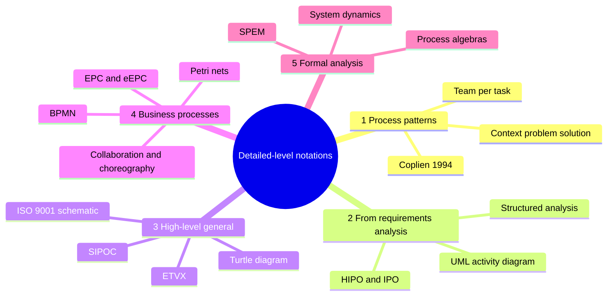
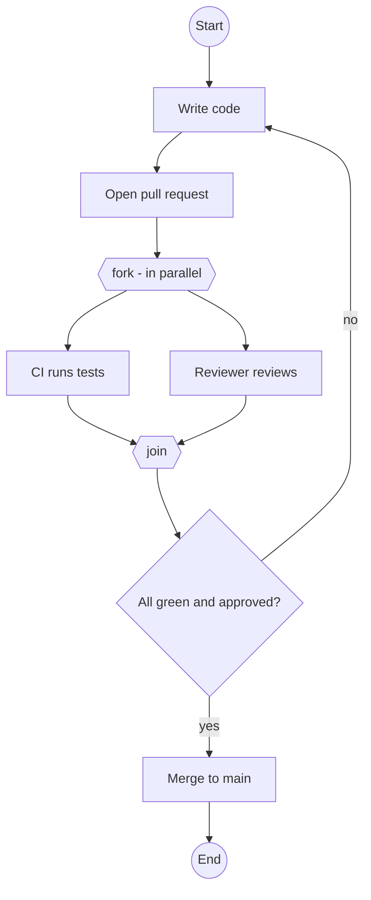
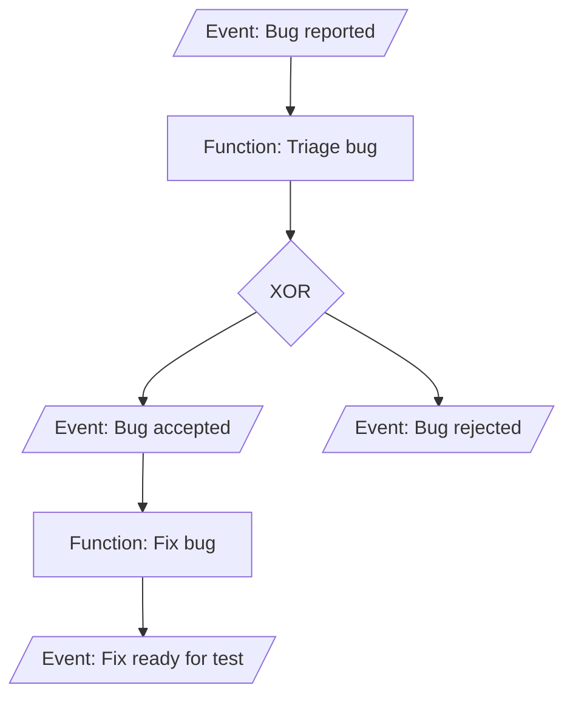
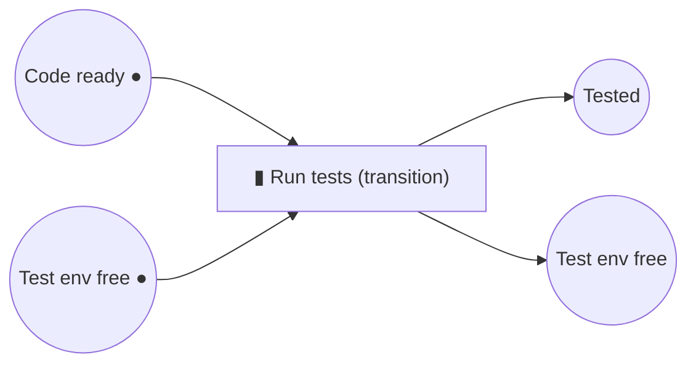

import Callout from '../../../components/Callout.astro';
import QA from '../../../components/QA.astro';
import QAList from '../../../components/QAList.astro';
import Figure from '../../../components/Figure.astro';
import hipo from './images/w03-hipo.png';
import etvx from './images/w03-etvx.png';
import turtle from './images/w03-turtle.png';
import sipoc from './images/w03-sipoc.png';
import iso from './images/w03-iso9001.png';
import epc from './images/w03-epc.png';
import petri from './images/w03-petri.png';
import spem from './images/w03-spem.png';

<Callout type="why">
Week 2 gave the big picture: processes and how they connect. This week **zooms into one process** and asks how to describe it precisely enough that someone can actually follow it.

There's no single "best" notation. Each comes from a different world (software design, quality management, business analysis, mathematics), and each suits a different audience. Knowing several lets you pick the right one: a **SIPOC** for a manager, **BPMN** for a workflow tool, a **turtle diagram** for an ISO auditor, a **Petri net** if you need to prove the process can't deadlock.

- **Real life:** Six Sigma projects start with a SIPOC; ISO 9001 audits use turtle diagrams; process-automation tools (Camunda, Bizagi, Power Automate) use BPMN; SAP uses EPCs.
- **Connects to:** Week 2 (the three groups of notations: these are the "process-internal structure" group), Week 4 (life cycle models), Week 5 (selecting a process notation for an organisation), Topic 7 (tool support).
</Callout>

<Callout type="key">
1. **Five families** of detailed notations: **(1) process patterns, (2) notations from requirements analysis, (3) high-level notations for general processes, (4) business process notations, (5) notations for formal analysis.**
2. **Process patterns** (Coplien, 1994) are proven solutions to recurring process problems, described **bottom-up**: context → problem → solution.
3. **From requirements analysis:** structured analysis, **HIPO / IPO**, and **UML activity diagrams**.
4. **High-level general notations** are all variants of **Input–Process–Output**: **ETVX** (IBM, 1980s), **Turtle** (automotive), **SIPOC** (Six Sigma), and the **ISO 9001:2015** schematic.
5. **Business process notations:** **EPC/eEPC** (Scheer, 1992), **BPMN**, BPMN **collaboration and choreography** diagrams, and **Petri nets**.
6. **Formal notations** (process algebras, system dynamics, **SPEM**) are mostly **descriptive**, for analysis and simulation, not for prescribing how people should work.
</Callout>

## Big picture

These notations describe **individual processes in detail**. Several aren't specific to software; they come from **business processes** and other areas. All of them can model several processes, and some support **hierarchies**: a top-level process broken down into sub-processes, sub-sub-processes and so on.

## 1. Process patterns

- The idea comes from **design patterns** in software architecture: descriptions of communicating objects and classes customised to **solve a general design problem in a particular context**. You reuse and refine solutions that worked in the past.
- Design patterns proved their value, so **Coplien (1994)** applied the same technique to **software development processes**.

> **Process patterns** describe a **proven, successful approach** or series of actions for developing software. They are a **bottom-up** description: they start from a specific **context and problem** and suggest a **solution**.

### Example: "Team per task" (Alistair Cockburn, risk management patterns catalogue)

| Section | Content (summarised) |
|---|---|
| **Sensation** | "We're getting distracted. We're losing precious design cycles." |
| **Symptoms** | The project isn't moving forward as it should. People have several things to do; a secondary task dominates their time, they switch context constantly, and they can't concentrate on their main task |
| **Forces** | If people drop everything to focus on one task, other important dates are missed. But being active on several tasks at once isn't working either |
| **Try this** | **Split the team.** Give each sub-team one primary task and group distracting activities together. Each team has a dedicated lead |
| **Counterforce** | Eventually you'll have one-person teams. Before that, splitting may cost more in lost teamwork than it gains in focus |

<Callout type="tip">
Notice the structure: it reads like a **doctor's diagnosis** (sensation → symptoms → causes → treatment → side-effects). That's what makes patterns reusable: you recognise the symptoms in your own project and apply the treatment.
</Callout>

## 2. Modelling notations from requirements analysis

An obvious choice: use the **same notations** you already use for business and application processes, and leverage the expressiveness and popularity of notations such as **UML**.

| Notation | Origin | Used for |
|---|---|---|
| **Structured analysis** | 1970s–80s structured methods | Process flow using requirements notations: **data-flow diagrams** and **state charts** |
| **HIPO / IPO** (Hierarchy plus Input–Process–Output) | IBM systems design | **Core components are input, activities (process) and resulting output**. IPO is a family of notations |
| **UML** | Object-oriented modelling | Occasionally used to describe software processes. **Activity diagrams** are the main type |

### HIPO

<Figure src={hipo} alt="HIPO technique: (a) hierarchy chart with numbered boxes, (b) visual table of contents linking boxes 1.0, 2.0, 2.1, 3.0, 4.0, 4.1, 4.2, (c) overview IPO diagram with input, process, output columns, (d) detailed IPO diagram with extended description" caption="HIPO = a hierarchy chart (visual table of contents) plus an IPO diagram for each module, first as an overview and then in detail." credit="Topic 2 Part 2, slide 36" max={560} />

HIPO is a systems analysis **design aid and documentation technique** that represents the **modules of a system as a hierarchy** and documents **each module** with an **Input → Process → Output** chart.

### UML activity diagram example *(extra)*

*A "code review" process as an activity diagram: the actions, a decision, and a fork/join where two things happen in parallel.*

## 3. High-level notations for general processes

These notations are **not software-specific**. They give a **quick, high-level overview** of a process rather than full detail, and most are **extensions or variations of Input–Processing–Output (IPO)**.

### ETVX: Entry–Task–Verification–Exit

<Figure src={etvx} alt="ETVX diagram: Entry box on the left, eXit on the right, with Task and Validate in a cycle in the middle" caption="ETVX = Entry, Task, Validation (Verification), eXit." credit="Slide 39" max={460} />

- **Introduced at IBM in the 1980s.**
- Gives a **quick overview** of a process, e.g. in a **card-like format**.

| Element | Meaning | Example: "System testing" |
|---|---|---|
| **Entry** criteria | What must be true before starting | Build deployed to the test environment; test plan approved |
| **Task** | The work itself | Execute the test cases; log defects |
| **Verification / Validation** | How we check the task was done right | All high-severity defects retested; test report reviewed |
| **eXit** criteria | What must be true to finish | 95% of tests pass; no open critical defects |

### Turtle diagrams

<Figure src={turtle} alt="Turtle diagram: central 'Process' oval with input on the left, output on the right, and legs labelled Who?, With What?, How? and KPI" caption="The 'turtle': body = process, head and tail = input and output, four legs = Who? (people), With what? (resources), How? (methods) and KPI (measures)." credit="Slide 40" max={440} />

- **Fairly well known in the automotive industry** (e.g. for IATF 16949 / ISO 9001 audits).

| Part | Question |
|---|---|
| **Input** | What goes in? |
| **Output** | What comes out? |
| **With what?** | Equipment, tools, resources |
| **Who?** | People, competence, training |
| **How?** | Methods, procedures, work instructions |
| **KPI** | How do we measure performance? |

### SIPOC: Suppliers, Inputs, Process, Outputs, Customers

<Figure src={sipoc} alt="SIPOC table with columns suppliers, inputs, process, outputs, customers: users with social or health needs supply a request; the process receives the request, establishes the type, decides if simple, provides an answer or searches other info; the output is an answer to the request for the users" caption="A SIPOC for handling a user request, drawn as a table with a small flowchart in the Process column." credit="Slide 41" max={520} />

- **Commonly used in Six Sigma.**
- Can be drawn **graphically** or as a **table with one column per component**.

**A software example** *(mine)*: "release a new app version"

| Suppliers | Inputs | Process | Outputs | Customers |
|---|---|---|---|---|
| Developers, QA team, product owner | Merged code, test report, release notes | 1. Build → 2. Sign → 3. Upload to store → 4. Staged rollout → 5. Monitor | New app version in the store, changelog | End users, support team |

<Callout type="tip" title="How to build a SIPOC">
Start in the **middle**: write 4–7 high-level process steps. Then fill **Outputs → Customers** (who gets what), and finally **Inputs → Suppliers** (what you need, and from whom).
</Callout>

### Schematic representation according to ISO 9001

<Figure src={iso} alt="ISO 9001:2015 schematic: Sources of inputs (predecessor processes) → Inputs (matter, energy, information) → Activities (with starting point and end point) → Outputs (matter, energy, information) → Receivers of outputs (subsequent processes), with possible controls and check points to monitor and measure performance" caption="ISO 9001:2015's view of a single process: sources → inputs → activities → outputs → receivers, plus control and check points to monitor performance." credit="Slide 42" max={560} />

This is a **variant of the SIPOC notation**, suggested by **ISO 9001:2015**. Its additions are an explicit **start and end point** and **controls / check points** for monitoring and measuring.

| Notation | Origin / industry | Core idea | Best for |
|---|---|---|---|
| **ETVX** | IBM, 1980s | Entry and exit criteria around a task, with verification | Quality gates, a process "card" |
| **Turtle** | Automotive | IPO plus who, with what, how, KPI | Audits; seeing all resources at a glance |
| **SIPOC** | Six Sigma | Suppliers → Inputs → Process → Outputs → Customers | Scoping an improvement project |
| **ISO 9001 schematic** | ISO 9001:2015 | SIPOC plus start/end points and check points | ISO-compliant process documentation |

## 4. Notations for modelling business processes

Business process modelling has several widely accepted **standard notations** that can also describe software engineering processes. (The **value chain** diagram was covered in Week 2.)

### (Extended) Event-driven Process Chains: EPC and eEPC

<Figure src={epc} alt="EPC basics: there are three basic elements — functions (activities carried out by a real person), events (trigger these activities or are the result of them), and control flow (the sequence of activities). Rules: every EPC starts and ends with an event; events and functions alternate; trivial events must not be modelled" caption="EPC basics: functions, events, and control flow." credit="Slide 44" max={560} />

- A type of **flowchart for business process modelling**.
- Developed by **Prof. August-Wilhelm Scheer and colleagues at Saarland University in 1992**. It is widely used in SAP and ARIS.
- **Three basic elements:** **functions** (activities, the *active* part), **events** (states that **trigger** functions or **result** from them, the *passive* part), and the **control flow** (the sequence).
- **Rules:**
  - Every EPC **starts and ends with an event**.
  - **Events and functions alternate**: a function can't directly follow a function, nor an event an event.
  - **Trivial events must not be modelled** (e.g. "check invoice" → "invoice checked").
- **Logical connectors** (AND, OR, XOR) split and join the flow.
- **eEPC** (extended EPC) adds organisational units, information objects and systems.

*An EPC for bug handling (my example). It starts and ends with events, events and functions alternate, and an XOR connector splits the flow.*

### BPMN: Business Process Model and Notation

The **most widely used** standard notation today (by the OMG), and it can be **executed** by workflow engines. Its core symbols:

| Element | Symbol | Meaning |
|---|---|---|
| **Event** | Circle (thin = start, thick = end) | Something that happens |
| **Activity / task** | Rounded rectangle | Work that is done |
| **Gateway** | Diamond (× = XOR, + = AND/parallel) | Decision, split or merge |
| **Sequence flow** | Solid arrow | Order of activities |
| **Message flow** | Dashed arrow | Communication between participants |
| **Pool / lane** | Horizontal band | A participant, or a role within one |

**BPMN collaboration and choreography diagrams:**
- **Collaboration:** several **pools** (participants, e.g. Customer and Shop) with **message flows** between them. Each pool shows its own internal process.
- **Choreography:** focuses only on the **sequence of message exchanges** between participants, with no internal details.

### Petri nets

<Figure src={petri} alt="Table mapping BPMN objects (start, end, message, task, fork, join, decision, merge, event-based decision, receive task) to equivalent Petri-net modules made of places (circles) and transitions (bars)" caption="Each BPMN element can be translated into a small Petri-net module of places (circles) and transitions (bars). This is how BPMN models can be analysed mathematically." credit="Slide 45" max={560} />

- Also called **place/transition (PT) nets**: a **mathematical modelling language** for describing **distributed systems**, part of the class of **discrete event dynamic systems**.
- **Places** (circles) hold **tokens**; **transitions** (bars) **fire** when every input place has a token, moving tokens to the output places.
- Because they're mathematical, you can **prove** properties, e.g. that a process can never **deadlock** or that every case eventually finishes.

*Petri-net idea: the transition "Run tests" can fire only when **both** input places have a token (code ready **and** test environment free).*

## 5. Process notations for formal analysis

- Formal notations model and **analyse complex interactions** between process components.
- **Unlike most notations above**, they are **not for prescriptive modelling** (telling people how to work), but for **descriptive** modelling, used for **analysis and simulation**.
- They're **fairly complex**, so not widely used, but they can help **explain the behaviour** of organisations and their processes.
- **Examples:** process algebras, system dynamics, and **SPEM**.

### SPEM: Software & Systems Process Engineering Meta-Model

<Figure src={spem} alt="SPEM diagram: a requirements engineer performs 'Define system requirements' and 'Identify constraints' tasks (chevrons), with input and output work products (documents such as guidance for gathering requirements, preliminary functional requirements, company internal stakeholders, legal documentation, requirements document) linked by mandatory input/output relationships" caption="A SPEM model: a role (requirements engineer) performs tasks (chevrons) that take mandatory inputs and produce outputs (work products)." credit="Slide 47" max={600} />

- A **process engineering meta-model** (by the **OMG**, the same body behind UML and BPMN) as well as a **conceptual framework**.
- It provides the concepts for **modelling, documenting, presenting, managing, interchanging and enacting** development methods and processes.
- Its core is the same as Week 2's: **roles** perform **tasks** that consume and produce **work products**. It's used by tools such as Eclipse Process Framework (EPF), e.g. to publish OpenUP or RUP.

## Which notation when?

| Need | Good choice |
|---|---|
| Share hard-won experience ("when this happens, do that") | **Process pattern** |
| Developers already know it | **UML activity diagram** |
| One-page overview for managers or an improvement project | **SIPOC** |
| Clear quality gates for a phase | **ETVX** |
| Automotive / ISO audit | **Turtle** / **ISO 9001 schematic** |
| Automate or execute the process in a tool | **BPMN** |
| SAP / ARIS environment | **EPC / eEPC** |
| Prove no deadlock, simulate throughput | **Petri nets**, system dynamics |
| Publish a full method (roles, tasks, work products) | **SPEM** |

<QAList>
  <QA q="List the five families of detailed-level notations for individual processes." level="easy">
    (1) Process patterns; (2) modelling notations from requirements analysis; (3) high-level notations for general processes; (4) notations for modelling business processes; (5) process notations for formal analysis.
  </QA>
  <QA q="What is a process pattern, and where does the idea come from?" level="medium">
    A process pattern describes a **proven, successful approach** or series of actions for developing software. It's a **bottom-up** description that starts from a specific context and problem and suggests a solution. The idea comes from **design patterns** in software architecture; **Coplien (1994)** applied it to software processes.
  </QA>
  <QA q="Describe the 'Team per task' pattern using its sections." level="hard">
    - **Sensation:** distraction is costing design time.
    - **Symptoms:** the project isn't moving, people juggle several tasks, a secondary task dominates and context-switching kills focus.
    - **Forces:** dropping everything for one task misses other deadlines, but multitasking isn't working.
    - **Try this:** split the team so each sub-team has one primary task and a dedicated lead, grouping distracting tasks together.
    - **Counterforce:** don't split down to one-person teams, because lost teamwork can outweigh the gain in focus.
  </QA>
  <QA q="What does HIPO stand for, and what does it consist of?" level="easy">
    **Hierarchy plus Input–Process–Output.** A hierarchy chart (visual table of contents) of the system's modules, plus an IPO diagram (input → process → output) documenting each module, both as an overview and in detail.
  </QA>
  <QA q="Explain ETVX and give entry and exit criteria for a 'code review' process." level="medium">
    **ETVX = Entry, Task, Verification (Validation), eXit**, introduced at IBM in the 1980s for quick process overviews. For code review: **Entry:** a pull request is open and CI passes. **Task:** a reviewer reads the change and comments. **Verification:** the comments are addressed and re-checked. **Exit:** at least one approval and no unresolved comments.
  </QA>
  <QA q="Draw (describe) a turtle diagram. Which industry is it associated with?" level="medium">
    Central **process** (body), **input** and **output** (head and tail), and four legs: **Who?** (people), **With what?** (resources and tools), **How?** (methods and procedures), **KPI** (measures). It's well known in the **automotive** industry.
  </QA>
  <QA q="What does SIPOC stand for? Create a SIPOC for 'online food delivery order'." level="hard">
    **Suppliers, Inputs, Process, Outputs, Customers.**
    - **Suppliers:** customer, restaurant, rider, payment gateway.
    - **Inputs:** order, menu, payment, address.
    - **Process:** place order → restaurant accepts → prepare food → rider picks up → deliver.
    - **Outputs:** delivered meal, receipt, rating request.
    - **Customers:** the customer (and the restaurant, which receives payment).
  </QA>
  <QA q="How does the ISO 9001:2015 process schematic differ from SIPOC?" level="medium">
    It's a **variant of SIPOC** (sources of inputs → inputs → activities → outputs → receivers of outputs) that adds an explicit **starting point and end point** and **possible controls and check points** to monitor and measure the process's performance.
  </QA>
  <QA q="State the three basic elements and three rules of an EPC." level="medium">
    **Elements:** functions (activities), events (trigger or result from functions), control flow (sequence). **Rules:** every EPC starts and ends with an event; events and functions alternate; trivial events must not be modelled.
  </QA>
  <QA q="Who developed EPC, and when?" level="easy">
    Prof. **August-Wilhelm Scheer** and colleagues at **Saarland University**, in **1992**.
  </QA>
  <QA q="What is the difference between a BPMN collaboration diagram and a choreography diagram?" level="hard">
    A **collaboration** diagram shows several participants (pools), each with its **own internal process**, connected by **message flows**. A **choreography** diagram shows **only the sequence of message exchanges** between participants, without their internal processes.
  </QA>
  <QA q="What are Petri nets, and why would you model a process with one?" level="medium">
    Petri nets (place/transition nets) are a **mathematical** modelling language for distributed, discrete-event systems: tokens in **places** enable **transitions** to fire. Because they're formal, you can **analyse and prove** properties of a process, such as that it can't deadlock or that every case completes, and simulate it.
  </QA>
  <QA q="How do formal process notations differ in purpose from notations like BPMN or ETVX?" level="medium">
    Formal notations are mainly **descriptive**, used to **analyse and simulate** how a process behaves. Most other notations are **prescriptive**: they tell people how to perform the process. Formal notations are complex and so less widely used.
  </QA>
  <QA q="What is SPEM, and what can it be used for?" level="easy">
    The **Software & Systems Process Engineering Meta-Model** (OMG): a process engineering meta-model and conceptual framework that provides concepts for **modelling, documenting, presenting, managing, interchanging and enacting** development methods and processes, built around roles, tasks and work products.
  </QA>
  <QA q="Your manager wants a one-page overview of the release process for a Six Sigma improvement project, but your DevOps team wants to automate it. Which notations do you use?" level="hard">
    A **SIPOC** for the manager: one page, suppliers to customers, the standard first step in Six Sigma. **BPMN** for the DevOps team: precise and **executable** by workflow and automation tools. The same process in two notations for two audiences, which is one of the benefits of defined notations from Week 2.
  </QA>
</QAList>
