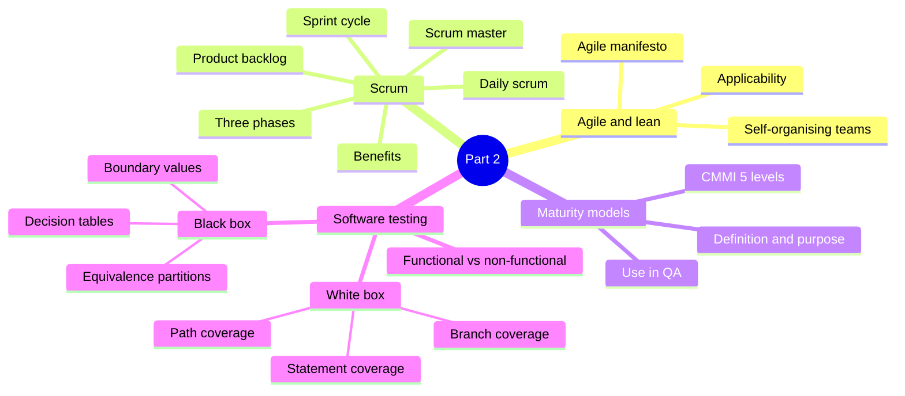
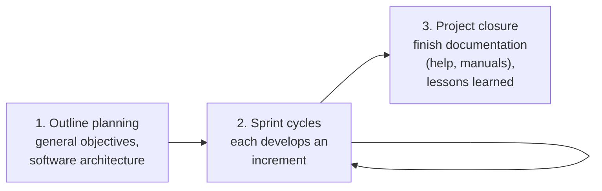
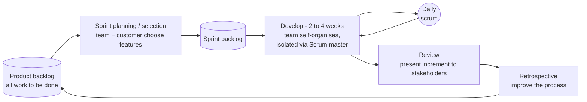

import Callout from '../../../components/Callout.astro';
import QA from '../../../components/QA.astro';
import QAList from '../../../components/QAList.astro';
import Figure from '../../../components/Figure.astro';
import scrum from './images/w04-scrum.png';
import cmmi from './images/w04-cmmi-levels.png';

<Callout type="why">
Almost every software team you join will say it is "agile" and run **Scrum**: sprint planning, daily stand-ups, retros. Knowing *why* those rituals exist lets you spot when a team is just going through the motions.

**Maturity models** like CMMI are how big clients (banks, government, defence) judge whether a software vendor is reliable before signing a contract. **Testing** is the most visible part of quality assurance: it's where a process either catches the bug or ships it to customers.

- **Real life:** sprint planning with a product backlog in Jira; a vendor proudly advertising "CMMI Level 3"; writing unit tests to reach a coverage target in your CI pipeline; boundary-value tests for a form that accepts ages 18–60.
- **Connects to:** Part 1 (iterative models and release trains led to agile), Week 5 (Boehm & Turner's agile-vs-plan-driven factors, tailoring Scrum), Topic 5 (process assessment and improvement, which is where maturity models live), Topic 6 (measurement, e.g. coverage).
</Callout>

<Callout type="key">
1. **Agile** = react fast to change (culture + practices), with **self-organising** teams. **Lean** = eliminate waste and maximise value flow. They overlap but are different.
2. Agile methods: focus on **code over design**, **iterative**, **deliver working software quickly**, minimise overheads (less documentation).
3. **Scrum:** outline planning → **sprint cycles** (2–4 weeks, each delivering an **increment**) → project closure. **Product backlog**, **sprint**, **daily scrum**, **Scrum master** (a facilitator who protects the team).
4. **Maturity models:** a structured collection of elements describing an organisation's maturity. **CMMI** has 5 levels: **Initial → Managed → Defined → Quantitatively Managed → Optimizing**.
5. **White-box testing** uses internal code knowledge: **statement → branch → path coverage** (each stronger than the last).
6. **Black-box testing** uses only the requirements: **boundary value analysis, equivalence partitioning, decision tables**.
</Callout>

## Big picture



## 1. Agile and lean development

The plan- and requirements-driven approaches (Part 1) showed their limits, which led to **agile** and **lean**: two similar and overlapping, but different, families of methodologies, techniques and practices.

- **Agile** focuses on **reacting fast to changes** in the environment, such as changed requirements. It combines a suitable **culture** with **practices** that support that reaction. Its core ideas are in the **Agile Manifesto**.
- Agile puts a lot of emphasis on **self-organisation of teams**, which tends to make it popular with developers but **less so with managers**.

### The Agile Manifesto (2001) *(extra: referenced but not shown on the slide)*

> We value **individuals and interactions** over processes and tools,
> **working software** over comprehensive documentation,
> **customer collaboration** over contract negotiation,
> **responding to change** over following a plan.
>
> *That is, while there is value in the items on the right, we value the items on the left more.*

**Lean** *(extra, from Toyota manufacturing)*: **eliminate waste** (unused features, waiting, hand-offs, partially done work), amplify learning, decide as late as possible, deliver as fast as possible, empower the team, build quality in, and see the whole.

### Why agile methods appeared

Dissatisfaction with the **overheads** of the design methods of the 1980s and 1990s led to agile methods, which:
- **focus on the code** rather than the design
- are **iterative**
- **deliver working software quickly** and evolve it quickly to meet **changing requirements**

**Aim:** reduce overheads in the software process (e.g. by **limiting documentation**) and respond quickly to changing requirements **without excessive rework**.

### When does agile apply?

| Situation | Why agile fits |
|---|---|
| **Product development:** a software company building a **small or medium-sized product for sale** | Virtually all software products and apps are now developed with an agile approach |
| **Custom system development** within an organisation, where the **customer is clearly committed to being involved**, and there are **few external rules and regulations** | Agile needs frequent customer feedback; heavy regulation demands documentation agile tries to minimise |

*Agile fits less well for very large teams, safety-critical or heavily regulated systems, and customers who won't get involved. See Boehm & Turner's five factors in Week 5.*

## 2. Scrum

> **Scrum:** an agile method that focuses on **managing iterative development** rather than on specific agile practices (it doesn't tell you *how* to code).

### Three phases



<Figure src={scrum} alt="Scrum methodology: Product Owner manages the product backlog; Scrum Master and Development Team (3–9); the sprint consists of sprint planning, development work with a daily scrum loop, sprint review and sprint retrospective; sprint backlog; definition of done; output is an increment" caption="Scrum: from the product backlog, sprint planning picks the work (sprint backlog); the team develops it with a daily scrum; the sprint ends with a review and a retrospective, delivering a potentially shippable increment." credit="Fig 3.16 The Scrum methodology" max={560} />

### The sprint cycle



| Step | What happens |
|---|---|
| **Fixed length** | Sprints are **normally 2–4 weeks** |
| **Starting point** | The **product backlog**: the list of all work to be done on the project |
| **Selection** | The **whole team** works **with the customer** to choose the features from the backlog to develop in this sprint |
| **Development** | Once agreed, the team **organises itself** to build the software. During this stage the team is **isolated** from the customer and organisation, and all communication goes through the **Scrum master** |
| **Review** | At the end, the work is **reviewed and presented to stakeholders**. The next sprint then begins |

### Teamwork in Scrum

- **Scrum master:** a **facilitator**. Arranges daily meetings, tracks the backlog, records decisions, measures progress against the backlog, and communicates with customers and management outside the team. Their key role is to **protect the development team from external distractions**.
- **Daily scrum:** a short daily meeting with the whole team. Everyone shares information: **progress since the last meeting, problems that have arisen, and plans for the following day**.
- *(Scrum Guide roles, extra: **Product Owner** owns and prioritises the backlog; the **Developers** (3–9 people) build the increment.)*

### Scrum benefits

1. The product is broken into **manageable, understandable chunks**.
2. **Unstable requirements don't hold up progress.**
3. The whole team has **visibility of everything**, so communication improves.
4. Customers see **on-time delivery of increments** and give feedback on how the product works.
5. **Trust** between customers and developers is built, creating a positive culture where everyone expects the project to succeed.

### Writing a product backlog: user stories

A backlog item is usually a **user story**:

> **As a** &lt;type of user&gt;, **I want** &lt;goal&gt;, **so that** &lt;benefit&gt;.
> **Acceptance criteria:** testable conditions that must be true for it to be "done".

Worked examples (for the Touch 'n Go eWallet case) are on the [Week 5 Part 2 page](../week-05-management/#practice-questions-from-the-slides).

## 3. Maturity models

| | |
|---|---|
| **Definition** | A **structured collection of elements** that describe certain aspects of **maturity** in an organisation |
| **Purpose** | Help organisations **improve their processes**, typically in software development and **QA** |
| **Example** | **CMMI (Capability Maturity Model Integration)**, a well-known maturity model in software development |

<Figure src={cmmi} alt="CMMI maturity levels as a staircase: 1 Initial (unpredictable and reactive, work gets completed but often delayed and over budget); 2 Managed (managed on the project level, projects are planned, performed, measured and controlled); 3 Defined (proactive rather than reactive, organisation-wide standards guide projects, programmes and portfolios); 4 Quantitatively Managed (measured and controlled, data-driven with quantitative performance improvement objectives); 5 Optimizing (stable and flexible, focused on continuous improvement, built to pivot and respond to opportunity and change)" caption="The five CMMI maturity levels. Each level builds on the one below it." credit="Topic 3, slide 31" max={600} />

| Level | Name | In one phrase | What it looks like |
|---|---|---|---|
| **1** | **Initial** | Unpredictable and reactive | Work gets done, but often **late and over budget**; success depends on heroes |
| **2** | **Managed** | Managed at the **project** level | Projects are **planned, performed, measured and controlled** |
| **3** | **Defined** | **Proactive**, not reactive | **Organisation-wide standards** guide all projects, programmes and portfolios |
| **4** | **Quantitatively Managed** | Measured and controlled | **Data-driven**, with quantitative improvement objectives |
| **5** | **Optimizing** | Stable and flexible | **Continuous improvement**; can pivot to respond to opportunity and change |

<Callout type="tip" title="Memory trick">
"**I M D Q O**": **I**n **M**y **D**ream **Q**A is **O**ptimal. Or think: chaos → project discipline → company standard → measured with numbers → always improving.
</Callout>

### Applying maturity models in quality assurance

- **Application:** assess how **effective** current QA processes are and identify **areas for improvement**.
- **Benefits:** better **product quality**, higher **customer satisfaction**, increased **efficiency**.
- **Steps:** **self-assessment** → **comparison** with the maturity model → **implementation** of improvement strategies.

**CMMI in particular:**
- Provides a **roadmap for software process improvement**, based on the principle that **the quality of a product is influenced by the quality of the process that produces it**.
- Helps organisations identify **strengths and weaknesses**, set improvement objectives, implement plans and monitor progress.
- Helps **benchmark** against industry standards and best practice, and demonstrate **compliance and credibility** to customers and stakeholders.
- Applies to different **domains** (development, services, acquisition) and different **types** of software (embedded, web, mobile).

## 4. Introduction to software testing

> **Software testing:** the process of **evaluating and verifying** that a software product or application **does what it is supposed to do**.

**Why it matters:** bugs found **early** can be fixed before delivery. Properly tested software is **dependable, secure and performant**, which saves time and cost and improves customer satisfaction.

| Category | Tests… | Examples |
|---|---|---|
| **Functional** | **What** the system does, against its requirements | Login works, the total is calculated correctly |
| **Non-functional** | **How well** it does it | Performance, usability, security, reliability |

### White-box testing

> **White-box** (clear-box, glass-box) **testing** evaluates the **internal workings** of software. The tester **sees the code, architecture and design** and uses that knowledge to design test cases.

- **When and why:** to verify the internal structure and correctness **at the code level**. It's often automated in **CI/CD pipelines** (e.g. unit tests plus a coverage report on every push).

**Coverage techniques** (weakest to strongest):

| Technique | Goal | Slide example |
|---|---|---|
| **Statement coverage** | Every **statement** is executed at least once | 10 statements, tests run 8, so **80%** |
| **Branch coverage** | Every **branch** of every decision (true **and** false) is taken | An `if-else` needs one test for true and one for false for 100% |
| **Path coverage** | Every **possible path** through the code is executed | Two `if-else` statements have **2 × 2 = 4** paths |

**Worked example** *(mine)*:

```python
def grade(score):
    result = "fail"          # S1
    if score >= 50:          # D1
        result = "pass"      # S2
    if score == 100:         # D2
        result += " (perfect)"   # S3
    return result            # S4
```

| Test input | D1 | D2 | Statements run | Path |
|---|---|---|---|---|
| `grade(100)` | true | true | S1 S2 S3 S4 (**all**) | T-T |
| `grade(70)` | true | false | S1 S2 S4 | T-F |
| `grade(30)` | false | false | S1 S4 | F-F |
| *(score < 50 and == 100)* | false | true | **impossible** | F-T ✗ |

- **Statement coverage 100%:** just `grade(100)`, **1 test**.
- **Branch coverage 100%:** `grade(100)` + `grade(30)` cover D1 true/false and D2 true/false, **2 tests**.
- **Path coverage:** 4 paths in theory, but F-T is **infeasible**, so 3 tests (100, 70, 30) cover all **feasible** paths.

<Callout type="warn">
100% statement coverage **doesn't** mean the code is bug-free. `grade(100)` alone hits every line but never tests a failing score. That's why branch and path coverage are stronger, and why coverage is a guide, not a guarantee.
</Callout>

### Black-box testing

> **Black-box testing** examines the **functionality** without looking at the internal structure. It's based on the **requirements, specifications and design**, and applies at the **unit, integration, system and acceptance** levels.

- **When and why:** test functionality **without access to the code**. It can also check for exploitable **security** issues without knowing how the application was built. Testers evaluate external behaviour against the specified requirements.

| ✅ Advantages | ❌ Disadvantages |
|---|---|
| Easy to use, **no programming knowledge** needed | May **miss internal defects** unrelated to functionality |
| Effective at finding **functional** issues | Needs **more test cases**; harder to **automate** or measure coverage |
| Tests from the **user's** point of view | |

**Techniques**, for a field that accepts numbers **1 to 10**:

**Equivalence partitioning:** split inputs into classes that behave the same, and test one value from each:

| Partition | Range | Pick |
|---|---|---|
| Invalid (too low) | ≤ 0 | −5 |
| **Valid** | 1–10 | 5 |
| Invalid (too high) | ≥ 11 | 20 |

**Boundary value analysis:** errors cluster at the **edges**, so test just around each boundary: **0, 1, 10, 11** (often also 2 and 9).

**Decision table testing:** a table of input combinations → expected output, to test **business rules** systematically. Slide example: a discount depends on **product type** and **quantity** *(the numbers are mine)*:

| Rule | 1 | 2 | 3 | 4 |
|---|---|---|---|---|
| Product is electronics? | Y | Y | N | N |
| Quantity ≥ 10? | Y | N | Y | N |
| **Discount** | **15%** | **5%** | **10%** | **0%** |

Each column becomes **one test case**: 2 conditions give 2² = 4 rules.

| | White box | Black box |
|---|---|---|
| Based on | **Code** and internal structure | **Requirements** and specification |
| Tester needs | Programming knowledge | Domain knowledge |
| Finds | Logic errors, dead code, untested paths | Missing or incorrect features |
| Typical level | Unit, integration | System, acceptance (but all levels possible) |
| Measured by | Statement/branch/path **coverage** | Requirements coverage |

**Choosing the right method** depends on the development stage, the testing objectives and the available resources. The two **complement** each other. *Further topics:* grey-box, regression, usability and security testing.

<QAList>
  <QA q="What led to the creation of agile methods, and what do they aim to achieve?" level="easy" why="A reaction to heavy 1980s–90s overheads: aim for less documentation and fast response to change.">
    Dissatisfaction with the **overheads** of 1980s–90s design methods. Agile methods focus on code rather than design, are iterative, and deliver working software quickly. They aim to **reduce process overheads** (e.g. by limiting documentation) and **respond quickly to changing requirements** without excessive rework.
  </QA>
  <QA q="State the four values of the Agile Manifesto." level="easy" why="Individuals, working software, customer collaboration, responding to change, each valued over its counterpart.">
    Individuals and interactions over processes and tools; working software over comprehensive documentation; customer collaboration over contract negotiation; responding to change over following a plan.
  </QA>
  <QA q="In which two situations is agile development most applicable?" level="medium" why="Small or medium product development, or in-house custom work with an involved customer and few regulations.">
    (1) **Product development** of a small or medium-sized product for sale. (2) **Custom system development** within an organisation where the customer is clearly committed to being involved and there are few external rules and regulations.
  </QA>
  <QA q="Describe the three phases of Scrum." level="easy" why="Outline planning → sprint cycles → project closure.">
    (1) **Outline planning:** set general objectives and design the software architecture. (2) **Sprint cycles:** each develops an increment of the system. (3) **Project closure:** wrap up, finish documentation (help frames, manuals) and assess lessons learned.
  </QA>
  <QA q="Explain the Scrum sprint cycle from product backlog to review." level="medium" why="Backlog → select with customer → self-organised development + daily scrum → review → next sprint.">
    Sprints are fixed-length (2–4 weeks). The team and customer **select** features from the **product backlog**. The team **self-organises** to develop them, isolated from outside distractions by the Scrum master, with a **daily scrum**. At the end the work is **reviewed and presented** to stakeholders, and the next sprint begins.
  </QA>
  <QA q="What are the responsibilities of the Scrum master?" level="medium" why="A facilitator: runs daily meetings, tracks the backlog, communicates outside, shields the team.">
    A **facilitator** who arranges daily meetings, tracks the backlog, records decisions, measures progress against the backlog, communicates with customers and management outside the team, and **protects the team from external distractions**.
  </QA>
  <QA q="List four benefits of Scrum." level="easy" why="Manageable chunks, unstable requirements don't block, visibility, on-time increments, trust.">
    The product is broken into manageable chunks; unstable requirements don't hold up progress; the whole team has visibility, which improves communication; customers get on-time increments and give feedback; trust between customers and developers builds a positive culture.
  </QA>
  <QA q="Define a maturity model and list the five CMMI maturity levels." level="easy" why="Initial, Managed, Defined, Quantitatively Managed, Optimizing.">
    A **structured collection of elements** describing aspects of an organisation's maturity, used to improve its processes. CMMI levels: **1 Initial, 2 Managed, 3 Defined, 4 Quantitatively Managed, 5 Optimizing**.
  </QA>
  <QA q="What is the difference between CMMI level 2 (Managed) and level 3 (Defined)?" level="medium" why="Level 2 = disciplined per project. Level 3 = one standard process across the organisation.">
    **Level 2:** processes are managed **per project**; each project is planned, performed, measured and controlled, but projects may do things differently. **Level 3:** there are **organisation-wide standard** processes that every project follows (tailored as needed), which makes the organisation **proactive** rather than reactive.
  </QA>
  <QA q="How can maturity models be applied in quality assurance?" level="medium" why="Self-assess → compare with the model → improve. The principle: better process gives a better product.">
    To **assess** the effectiveness of current QA processes and **identify areas for improvement**. The steps are self-assessment, comparison with the maturity model, and implementing improvement strategies. Benefits: better product quality, higher customer satisfaction, more efficiency. The underlying principle: product quality depends on process quality.
  </QA>
  <QA q="Compare statement, branch and path coverage." level="medium" why="Statement ⊂ branch ⊂ path, from weakest to strongest coverage.">
    - **Statement:** every line runs at least once (weakest).
    - **Branch:** every decision takes both true and false.
    - **Path:** every possible route through the code (strongest; it grows exponentially, 2ⁿ for n independent decisions, and some paths may be infeasible).

    100% path coverage implies 100% branch coverage, which implies 100% statement coverage.
  </QA>
  <QA q="A function has three independent if-else statements. How many paths are there? What's the minimum number of tests for 100% branch coverage?" level="hard" why="Paths = 2³ = 8; branch coverage can be reached with 2 tests (all true, all false).">
    Paths = 2³ = **8**. Branch coverage needs each if to be both true and false, which can be done with **2 tests** (all true, then all false), if the conditions are independent.
  </QA>
  <QA q="An age field accepts 18 to 60 inclusive. Give the equivalence partitions and the boundary values to test." level="medium" why="Three partitions (below, inside, above); boundaries just either side of 18 and 60.">
    **Partitions:** invalid ≤ 17 (e.g. 10), valid 18–60 (e.g. 35), invalid ≥ 61 (e.g. 70). **Boundaries:** **17, 18, 60, 61** (optionally 19 and 59).
  </QA>
  <QA q="Build a decision table: free shipping if the order is ≥ RM100, OR the customer is a premium member." level="hard" why="2 conditions → 4 rules. Only the 'neither' case gets no free shipping.">
    | Rule | 1 | 2 | 3 | 4 |
    |---|---|---|---|---|
    | Order ≥ RM100? | Y | Y | N | N |
    | Premium member? | Y | N | Y | N |
    | **Free shipping?** | Yes | Yes | Yes | **No** |

    Four rules give four test cases.
  </QA>
  <QA q="Compare white-box and black-box testing, with one advantage and one disadvantage of black-box testing." level="medium" why="White box uses the code; black box uses the requirements. Black box needs no coding knowledge but can miss internal defects.">
    **White-box** uses the internal code (coverage-based, needs programming skill). **Black-box** uses only requirements and external behaviour. Black-box advantage: no programming knowledge needed, and it's effective at finding functional problems. Disadvantage: it can miss internal defects, needs more test cases, and is harder to automate or measure for coverage.
  </QA>
</QAList>
