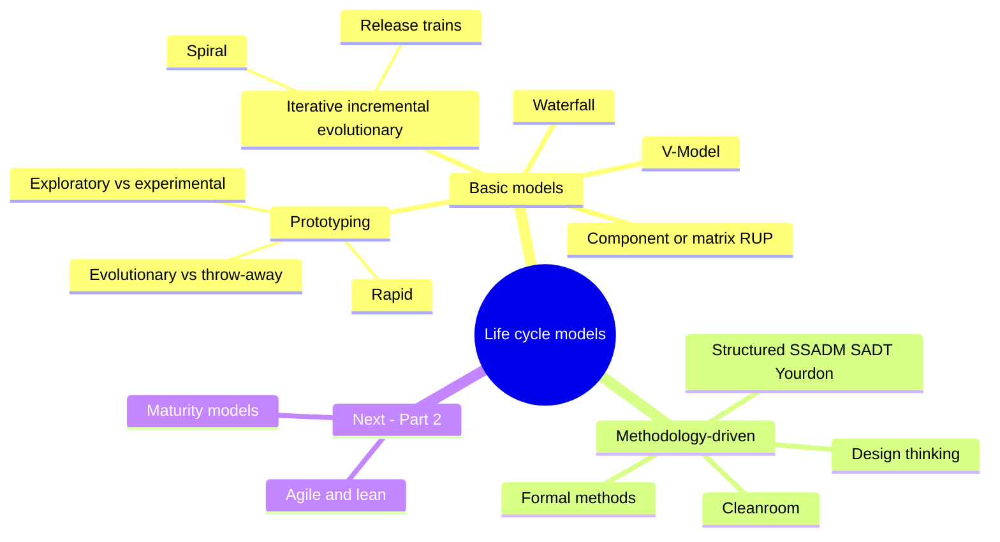
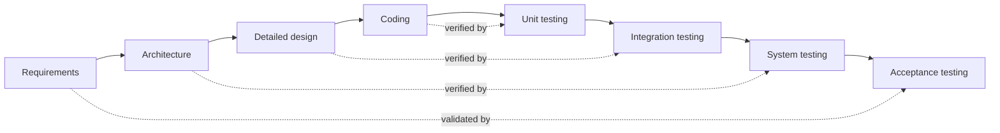
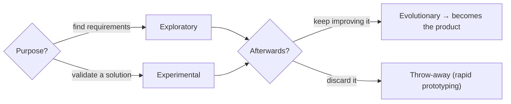

import Callout from '../../../components/Callout.astro';
import QA from '../../../components/QA.astro';
import QAList from '../../../components/QAList.astro';
import Figure from '../../../components/Figure.astro';
import royce from './images/w02-royce-waterfall.png';
import vmodel from './images/w04-v-model.png';
import matrix from './images/w04-matrix-model.png';
import spiral from './images/w04-spiral.png';

<Callout type="why">
A **life cycle model** is the skeleton of every software project: it decides **when** you gather requirements, **when** you test, and **how often** the customer sees something.

Pick the wrong one and you get the classic failures: a waterfall project where the customer sees the product only at the end and says "that's not what I wanted", or an endless prototype loop that never ships.

- **Real life:** banks, aircraft and medical devices still use **V-Models** (safety standards demand it); mobile apps ship in **iterations**; big companies coordinate dozens of teams with **release trains** (SAFe); Figma mock-ups are **prototypes**.
- **Connects to:** Week 2 (life cycle models are high-level **process interaction** models), Part 2 (agile and Scrum, maturity models, testing), Week 5 (choosing and **tailoring** a model for a project, Boehm & Turner's factors).
</Callout>

<Callout type="key">
1. **Waterfall:** phases in strict order with no going back. Often combined with **stage/quality gates**.
2. **V-Model:** waterfall bent into a V. The left side is specification and design; the right side is integration and testing. Each design level has a **matching test level**. Common for **safety-critical** systems (IEC 61508-3).
3. **Component/matrix-based** (e.g. **RUP**): processes (rows) × phases (columns). Most processes run **throughout** the project, at varying intensity.
4. **Prototyping:** **exploratory** (find requirements) vs **experimental** (validate a solution); **evolutionary** (grows into the product) vs **throw-away**; **rapid** prototyping = throw-away for fast feedback.
5. **Iterative / incremental / evolutionary:** repeat loops to **reduce risk through fast feedback**.
6. **Spiral (Boehm):** the first explicitly iterative model; **risk analysis** in every loop.
7. **Release trains:** releases on a **fixed schedule** (time-boxed); whatever is ready ships.
8. **Methodology-driven:** structured (SSADM, SADT, Yourdon), **formal methods**, **Cleanroom**, **design thinking**.
</Callout>

## Big picture

*Topic 3 roadmap: (1) basic life cycle models, (2) methodology-driven models, (3) agile and lean, (4) maturity models. This page covers 1 and 2.*

## 1. Waterfall model

<Figure src={royce} alt="Royce's waterfall: System Requirements → Software Requirements → Analysis → Program Design → Coding → Testing → Operations as a descending staircase" caption="Royce's waterfall: each phase flows down into the next." credit="Fig 1.2" max={480} />

- The **easiest and oldest** explicit life cycle model.
- Like a real waterfall, **once a phase is reached there's no going back** to the previous one.
- That's why waterfalls are usually combined with **stage gates or quality gates**: a formal check at the end of each phase before the next is allowed to start.
- Often used in its strictest form as an **argument for agile** (and against plan-driven approaches).

> **Definition (SEVOCAB):** a model of the software development process in which the constituent activities, typically a concept phase, requirements phase, design phase, implementation phase, test phase, and installation and checkout phase, are performed **in that order, possibly with overlap but with little or no iteration.**

| ✅ Good when | ❌ Bad when |
|---|---|
| Requirements are **stable and well understood** | Requirements are unclear or will change |
| Fixed-price contracts, heavy documentation needed | The customer needs to see something early |
| Short, simple, familiar projects | Long projects in a fast-moving market |

## 2. V-Model

<Figure src={vmodel} alt="V-Model from IEC 61508-3: left branch E/E/PE safety requirements specification → software safety requirements specification → software architecture → software system design → module design → coding at the bottom; right branch module testing → integration testing (module) → integration testing (components) → validation testing → validated software, with verification arrows linking each left box to its right counterpart" caption="The V-Model as defined in IEC 61508-3 (functional safety). The left side goes down from requirements to code; the right side goes up through testing. Horizontal arrows show which test verifies which specification." credit="Fig 3.6 (IEC 61508-3:2010)" max={600} />

- Describes a **sequential, plan-driven** approach, but draws it as a **V** to emphasise **verification and validation**.
- **Left branch:** requirements, analysis and design tasks, leading down to **coding** at the bottom.
- **Right branch:** the system is **integrated, tested and verified**.
- Each level on the left is **paired** with a test level on the right.
- Particularly common for **technical and safety-related systems**. For example, **IEC 61508-3** defines it for software in electrical/electronic/programmable electronic safety-related systems.

<Callout type="tip" title="Why the V helps">
Test **planning** starts on the left, as soon as each specification is written ("how will we test this requirement?"). Testing isn't an afterthought squeezed in at the end, as it often is in a plain waterfall.
</Callout>

## 3. Component- or matrix-based models

<Figure src={matrix} alt="Matrix with processes 1 to 5 as rows and phases 1, 2, 3 … as columns" caption="Two dimensions: the temporal (phases) and the logical (processes) relationships are shown separately." credit="Fig 3.8 Component-based models" max={420} />

- First introduced in the **1990s** to describe **object-oriented development**.
- They show the **temporal** relationship (phases, over time) and the **logical** relationship (processes or disciplines) **separately**, as the two dimensions of a **matrix**.
- **Each cell** = the work for that process in that phase (e.g. requirements analysis during phase 2).
- The point: most processes **aren't confined to one time slot** (e.g. only at the start). They happen **across the whole project, at varying intensity**.
- **Best-known example: RUP (Rational Unified Process)**, with phases *Inception → Elaboration → Construction → Transition* and disciplines such as requirements, design, implementation and test running through all of them.

## 4. Prototyping

> **Prototype (SEVOCAB):** an experimental model, either functional or non-functional, of the system or part of the system.

- Builds on a **plan-driven** approach but adds **iterative** aspects. The prototype is a **"learning vehicle"** that gives more precise ideas of what the target system should be like.
- It isn't a complete life cycle model; it **extends** another model by adding a reduced version of the life cycle early on.
- Only **selected properties** are considered:
  - A **UI prototype** evaluates the user interface and ignores performance and security.
  - A **technical prototype** evaluates a technical solution to a specific problem and ignores the UI.

### Exploratory vs experimental prototypes

| | **Exploratory** | **Experimental** |
|---|---|---|
| When | **Initial** phase | **Later**, once initial requirements exist |
| Purpose | Help **identify the requirements** | **Experiment with and validate** the current solution (requirements, design, technical feasibility) |
| Mainly | A **communication medium** between developers and stakeholders or users | A **technical check** |
| Example | Figma mock-ups to discuss what the app should do | A spike to check whether the payment API can handle 1000 requests/s |

The distinction isn't always clear-cut, but it shows the different emphasis of each.

### Evolutionary vs throw-away prototypes

| | **Evolutionary** | **Throw-away** |
|---|---|---|
| After evaluation | **Revised repeatedly** until it **becomes the target system** | **Discarded** |
| Leads to | A step towards **iterative/incremental** development | A clean rebuild with a proper design |
| Risk | Quick-and-dirty code can end up in the product | **Customers see a working UI and assume the system is almost done**, although there's no proper design and development has only just started. Make this **very clear** to customers |

**Rapid prototyping** *(SEVOCAB)*: prototyping in which the emphasis is on building prototypes **early** to get **early feedback and analysis**. The main difference from exploratory prototyping is that rapid prototyping is **limited to throw-away prototypes**.

## 5. Iterative, incremental and evolutionary development

Most life cycle models include **loops** in which certain steps are repeated. These loops are called **iterations**, and the models are called **iterative, incremental or evolutionary**.

**Main advantage: they reduce risk by getting fast feedback.** That feedback ranges from "the new code didn't break existing functionality" to "the new functionality genuinely meets the user's needs".

| Term | Definition (SEVOCAB / PMBOK) |
|---|---|
| **Iteration** | (1) Performing a sequence of steps **repeatedly**; (2) a **single execution** of that sequence |
| **Incremental development** | Requirements, design, implementation and testing **overlap** in an **iterative** (not sequential) manner, completing the product **in increments** |
| **Incremental / iterative life cycle** | Scope is set **early**, but time and cost estimates are **routinely revised** as understanding grows. **Iterations** develop the product through repeated cycles, while **increments** successively **add functionality** |

<Callout type="warn" title="Slide 13 typo">
On slide 13, the definition printed under **"Incremental"** is actually the SEVOCAB definition of the **waterfall** model ("…performed in that order… with little or no iteration"). Don't learn it as the meaning of incremental. Use the **incremental development** definition from slide 14 (in the table above).
</Callout>

**Iterative vs incremental, in one picture** *(the classic analogy)*:
- **Incremental:** paint the Mona Lisa **one finished section at a time**. Each increment is complete; you add more.
- **Iterative:** sketch the **whole** painting roughly, then **refine** all of it in each pass.
- Most real projects (and Scrum) do **both**: each sprint adds features (increment) and improves existing ones (iteration).

### Boehm's spiral model

<Figure src={spiral} alt="Boehm's spiral model: four quadrants — determine objectives, alternatives, constraints; evaluate alternatives, identify and resolve risks (risk analysis, prototypes); develop and verify next-level product (concept, requirements, design, code, test); plan next phases — with the spiral growing outward as cumulative cost increases" caption="Each loop of the spiral goes through four quadrants. The radius = cumulative cost; risk analysis and prototypes appear in every loop." credit="Fig 3.13 (Boehm, 1986)" max={560} />

- The **first model to explicitly describe an iterative life cycle**.
- Main emphasis: **reducing risk** by **analysing risks in every iteration** and mitigating them, e.g. **with prototypes**.

> **Spiral model (SEVOCAB):** a model in which the activities (requirements analysis, preliminary and detailed design, coding, integration and testing) are performed **iteratively until the software is complete**.

| Quadrant | Activity |
|---|---|
| 1 | **Determine** objectives, alternatives, constraints |
| 2 | **Evaluate** alternatives; **identify and resolve risks** (risk analysis, prototypes) |
| 3 | **Develop and verify** the next-level product |
| 4 | **Plan** the next phases (review, commitment) |

### Release trains

- A variant of the incremental model, and a step towards **agile** development.
- Releases are delivered on a **regular schedule**, e.g. **one release per quarter**.
- Like real trains (in theory), they **run on schedule**. If problems prevent the agreed functionality being ready, the train still leaves on the date (**time-box**) and carries **whatever is completed and ready**.
- Another advantage: it helps **coordinate different teams** working on different parts of the same system, because everyone aims for the same departure.
- *Today: the **Agile Release Train** in SAFe (Scaled Agile Framework).*

<Callout type="tip" title="Time-box vs scope-box">
Waterfall usually **fixes the scope** and lets the date slip. Release trains **fix the date** and let the scope flex. That's a core idea behind Scrum sprints too (Part 2).
</Callout>

## 6. Methodology-driven life cycle and process models

Many life cycle models try to be **method-neutral**, but some are tied closely to a particular **development method**.

| Approach | Key idea | Notes |
|---|---|---|
| **Structured development methods** | 1970s–80s techniques: **SSADM** (Structured Systems Analysis and Design Method), **SADT** (Structured Analysis and Design Technique), the **Yourdon** structured method… | Used a variant of the **waterfall** life cycle, adding concepts for analysis (data-flow diagrams, entity models) |
| **Formal development methods** | **Specify** requirements in a **formal language** with clearly defined semantics, then **prove mathematically** that the implementation meets the specification | Used occasionally for systems with **very high reliability requirements** (rail signalling, aerospace), rarely elsewhere |
| **Cleanroom software engineering** | Combines **formal methods** with **iterative** development and **statistics-based testing**. Aim: **fewer bugs built in** and a higher share of bugs found in testing | Supports mathematical formalism (model checking, process algebras, Petri nets) |
| **Design thinking** | Not specific to software; applies to the design of products and systems generally. Purpose: understand what **users really need** and provide **innovative** solutions | Typical stages: empathise → define → ideate → prototype → test |

## Class activity: prototype development challenge

> **Objective:** understand the difference between **exploratory** and **experimental** prototypes and their role in software quality processes.
> 1. In your group, use the system from your group assignment and identify the **business problem** it solves.
> 2. Build an **exploratory prototype**: explore **different design options and interfaces**. Sketch on paper first, then make a digital version (e.g. Figma).
> 3. Upload it to the class Padlet and explain the design options you explored and why.

**Tips** *(mine)*:
- Exploratory means **breadth**: show 2–3 *different* layouts or flows, not one polished screen.
- Write down which **requirement** each option helps clarify. That's the whole purpose of an exploratory prototype.
- Label it clearly as a **prototype**, to avoid the throw-away risk above.

## Summary: choosing a model

| Model | Requirements | Feedback | Risk handling | Typical use |
|---|---|---|---|---|
| Waterfall | Stable, known up front | At the end | Low | Small, well-understood projects |
| V-Model | Stable, safety-critical | Test planning early, execution late | Via V&V | Automotive, medical, rail |
| RUP (matrix) | Evolving | Per phase/iteration | Medium | Large OO projects |
| Prototyping | Unclear | Early, on selected aspects | Clarifies requirements | Front-ends, new products |
| Spiral | Evolving, high-risk | Every loop | **Explicit risk analysis** | Large, risky projects |
| Incremental / release train | Evolving | Every increment/release | Time-box | Products with regular releases |

<QAList>
  <QA q="State the waterfall model's main characteristic and why it is combined with stage gates." level="easy">
    Phases are performed in a fixed order, and once a phase is reached there's no going back. Because there's little or no iteration, mistakes must be caught before moving on, so **stage or quality gates** formally check each phase's results before the next phase starts.
  </QA>
  <QA q="Explain the structure of the V-Model and where it is commonly used." level="medium">
    The linear life cycle is split into two branches. The **left** goes down through requirements, analysis and design to **coding** at the bottom; the **right** goes up through integration, testing and verification. Each design level is paired with a test level (e.g. architecture ↔ integration testing). It's common in **technical and safety-related systems**, e.g. IEC 61508-3.
  </QA>
  <QA q="What problem do component- or matrix-based models solve? Give the best-known example." level="medium">
    They separate the **temporal** dimension (phases) from the **logical** dimension (processes) in a matrix, showing that most processes, such as requirements analysis, happen **across the whole project at varying intensity** rather than in one phase. Best-known example: **RUP**.
  </QA>
  <QA q="Compare exploratory and experimental prototypes." level="medium">
    **Exploratory:** built in the **initial** phase to help **identify requirements**; mainly a **communication medium** between developers and stakeholders. **Experimental:** built **later**, once initial requirements exist, to **validate** the current solution (e.g. technical feasibility).
  </QA>
  <QA q="Compare exploratory and evolutionary prototypes. (From the 'Additional questions' slide.)" level="hard">
    They classify prototypes on **different dimensions**. *Exploratory* is about the **purpose** (find requirements early, communicate with users). *Evolutionary* is about **what happens afterwards**: it is revised repeatedly until it becomes the final system. An exploratory prototype **can** be evolutionary (if you keep refining it into the product) or **throw-away** (if discarded). Evolutionary prototyping leads to iterative/incremental development; exploratory prototyping mainly reduces **requirements risk**.
  </QA>
  <QA q="What is the main risk of throw-away prototypes, and how do you manage it?" level="medium">
    Customers see a UI that seems to satisfy their requirements and assume the system is **almost complete**, when there is no proper design and development has only just started. Manage it by making it **very clear** to customers that it's a throw-away prototype (labels, a different look, explicit communication).
  </QA>
  <QA q="How does rapid prototyping differ from exploratory prototyping?" level="easy">
    Rapid prototyping focuses on building prototypes **early and quickly for fast feedback**, and it is **limited to throw-away** prototypes. Exploratory prototypes may be thrown away or evolved.
  </QA>
  <QA q="What is the main advantage of iterative development? Distinguish iteration from increment." level="medium">
    It **reduces risk through fast feedback** on the work done. An **iteration** is one pass of repeating a sequence of steps (refining); an **increment** successively **adds functionality** to the product. In an iterative/incremental life cycle, scope is set early while time and cost estimates are revised as understanding grows.
  </QA>
  <QA q="What is distinctive about Boehm's spiral model?" level="medium">
    It was the **first model to explicitly describe an iterative life cycle**, and its main emphasis is **risk reduction**: every loop includes **risk analysis** and mitigation (e.g. with prototypes). Activities are repeated in loops until the software is complete, with cost growing as the spiral expands.
  </QA>
  <QA q="Explain release trains and the concept of a time-box." level="medium">
    A release train delivers releases on a **regular, fixed schedule** (e.g. quarterly). If not everything is ready, the release still happens on the date (**time-box**) with whatever is complete and ready. It keeps delivery predictable and helps **coordinate multiple teams**.
  </QA>
  <QA q="Name three structured development methods and the life cycle they used." level="easy">
    **SSADM**, **SADT**, the **Yourdon** structured method (also others). They used a variant of the **waterfall** life cycle, adding analysis concepts.
  </QA>
  <QA q="What are formal methods and Cleanroom, and where are they used?" level="medium">
    **Formal methods:** specify requirements in a formal language with precise semantics and **prove mathematically** that the implementation meets them. They're used for systems with very high reliability requirements. **Cleanroom:** combines formal methods with **iterative development** and **statistics-based testing**, to reduce the number of bugs built in and find more in testing.
  </QA>
  <QA q="A hospital needs software for an infusion pump (safety-critical, regulated). A startup needs an MVP social app whose features aren't clear yet. Recommend a life cycle model for each and justify." level="hard">
    **Infusion pump: V-Model**. Requirements must be stable and fully specified, safety standards (like IEC 61508 or IEC 62304) expect a V-shaped process, and every specification needs a matching verification step that can be documented for auditors.

    **Social app: iterative/incremental, starting with exploratory prototypes**. Requirements are unclear, so prototypes help discover what users want, and short iterations give fast feedback and reduce the risk of building the wrong thing. That leads naturally into Scrum (Part 2).
  </QA>
</QAList>
