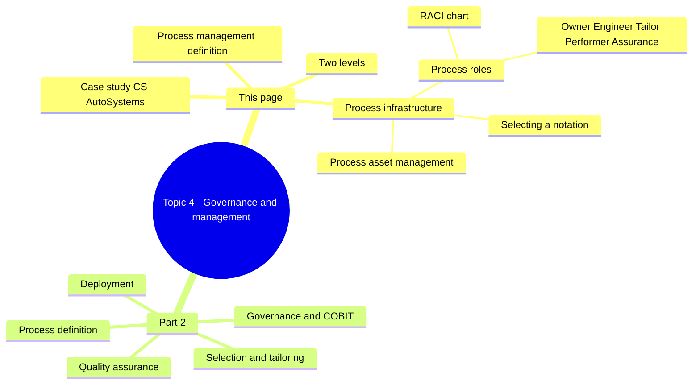
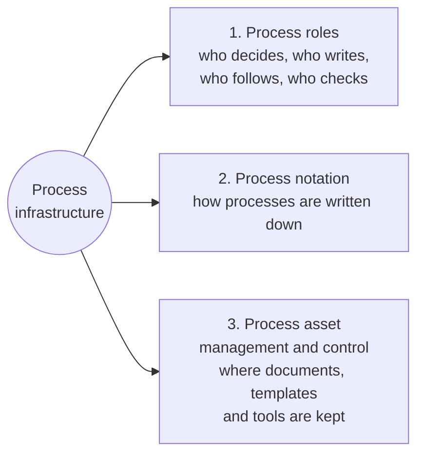
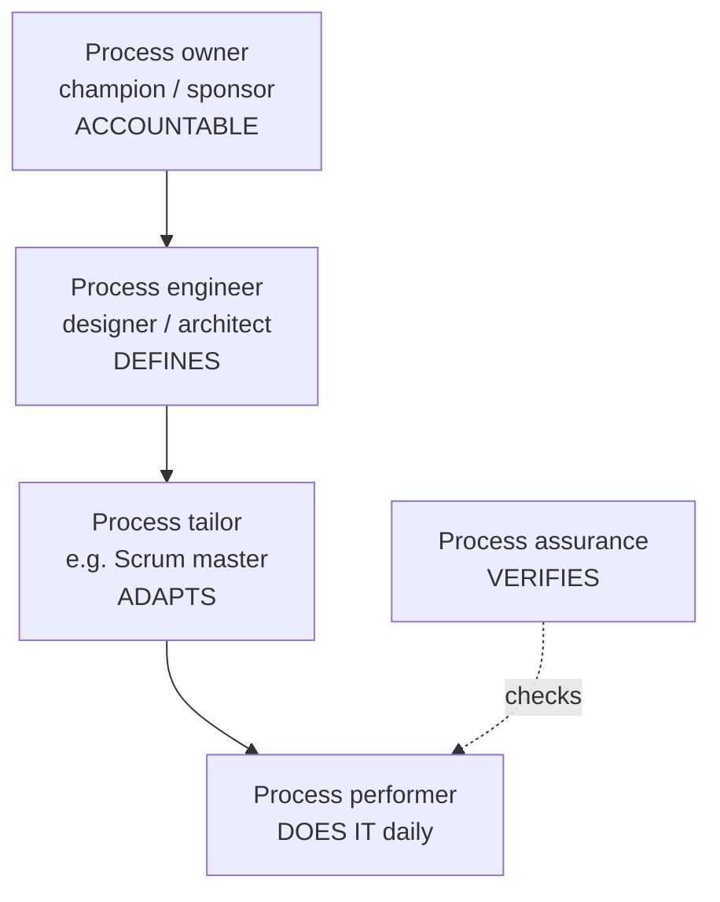

import Callout from '../../../components/Callout.astro';
import QA from '../../../components/QA.astro';
import QAList from '../../../components/QAList.astro';
import Figure from '../../../components/Figure.astro';
import taxonomy from './images/w05-governance-taxonomy.png';

<Callout type="why">
Weeks 2–4 were about *what* a process looks like. Topic 4 is about **making an organisation actually use it**. Someone has to own the process, write it down, adapt it for each project, follow it every day, and check that it's followed.

When nobody clearly owns these jobs, you get the familiar result: a beautiful process document that nobody reads, while every team does its own thing.

- **Real life:** every company with ISO 9001 or CMMI certification has a process owner and quality manager; a **RACI chart** is a standard project-management deliverable; a Scrum master is effectively a "process tailor"; your **group assignment** needs clear roles for the same reasons.
- **Connects to:** Week 2–3 (choosing a notation), Week 4 (life cycle models and CMMI), Part 2 (process definition, selection, tailoring, deployment and QA), Topic 5 (process assessment and improvement), Topic 6 (measurement).
</Callout>

<Callout type="key">
1. **Process management** = the direction, control and coordination of work performed to develop a product or perform a service (SEVOCAB).
2. It works on **two levels**: the **whole organisation** and **individual projects or teams**.
3. **Process infrastructure** has three parts: **(1) process roles, (2) a process notation, (3) process asset management and control**.
4. **RACI** = **R**esponsible (does the work), **A**ccountable (exactly **one** person, answerable for success), **C**onsulted (two-way), **I**nformed (one-way).
5. **Five process roles:** **owner** (accountable, approves changes), **engineer** (defines and documents), **tailor** (adapts to a project, e.g. a Scrum master), **performer** (does it every day), **assurance** (checks it's done correctly).
6. **Process assets** = artefacts for describing, implementing and improving processes: policies, descriptions, templates, measurements, tools.
</Callout>

## Big picture

<Figure src={taxonomy} alt="Tree: Process governance and management splits into process governance and process management; process governance covers process infrastructure management; process management covers process design, process deployment and process operation; these break down into process definition, process selection, process tailoring, process assessment, process improvement, quality assurance and process measurement" caption="Process governance and management taxonomy: all the topics in this chapter and the later ones (assessment, improvement, measurement)." credit="Topic 4 (Fig 4.1)" max={600} />

## 1. Introduction

- Earlier chapters covered **how processes are defined** and **what they contain**.
- This chapter covers **using** them within an organisation and its software development.

> **Process management (SEVOCAB):** the **direction, control and coordination** of work performed to develop a product or perform a service.

**Process management happens on two levels:**

| Level | Decides | Example |
|---|---|---|
| **Organisation** | Which processes, notations and tools are standard for everyone | "All projects use our V-Model-based development process" |
| **Project / team** | How that standard is applied (or tailored) in this project | "Our team uses 2-week sprints within the company process" |

**Scope of process governance:** all the steps are covered in this chapter, except **process assessment and improvement** (Topic 5) and **process measurement** (Topic 6), which come in the second half of the semester.

## 2. Process infrastructure

One of the first steps in managing software processes is to set up a suitable **infrastructure**:

1. **Define the process management roles**: who decides which processes to use, who writes them down, and so on.
2. **Select a suitable process notation.**
3. **Select the processes and tools** used to manage and control the resulting documents and other artefacts.

## 3. Process roles

An important part of the infrastructure is defining the **people involved and their roles**. A **RACI chart** is a common tool for describing the roles in a process and their responsibilities.

### RACI chart

| Letter | Role | Question | Rule |
|---|---|---|---|
| **R** | **Responsible** | **Who is getting the activity done?** | **At least one** person, group or entity per activity |
| **A** | **Accountable** | **Who answers for its success?** Ensures it's completed successfully | **Exactly one** person per activity (may also be R) |
| **C** | **Consulted** | **Who provides input?** (two-way communication) | Any number, **including zero** |
| **I** | **Informed** | **Who receives information?** (one-way communication) | Any number, **including zero** |

<Callout type="tip" title="Analogy: a wedding dinner">
**R** = the caterers who cook the food. **A** = the couple's parent who signed the contract and will be blamed if the food is bad (only **one**). **C** = the couple, asked about the menu (they give input). **I** = the guests, told what time dinner starts (they just receive information).
</Callout>

**Example RACI for a mobile app release** *(mine)*:

| Activity | Product owner | Tech lead | Developers | QA | Marketing |
|---|---|---|---|---|---|
| Define release scope | **A** | C | C | C | I |
| Implement features | I | **A** | R | C | — |
| Test release | I | C | C | **A**, R | — |
| Approve go-live | **A**, R | C | I | C | I |
| Announce release | C | I | I | I | **A**, R |

Each row has **exactly one A** and **at least one R**.

<Callout type="warn" title="Common RACI mistakes">
- **Two A's in one row.** If two people are accountable, nobody really is.
- **No R in a row.** Someone has to actually do the work.
- **Everyone is C.** Too many people consulted slows decisions down. Use I where people only need to know.
</Callout>

### People in process management

| Role | Also called | Definition (SEVOCAB) | In practice |
|---|---|---|---|
| **Process owner** | Process champion / sponsor | An individual **accountable for the performance** of a process in realising its objectives, **driving process improvement** and **approving process changes** | The **main responsibility** for a process, e.g. Head of Engineering |
| **Process engineer** | Process designer / architect | Person or group **responsible for analysing, defining, modelling and maintaining** life cycle and process descriptions | **Defines and documents** processes, e.g. a process improvement team |
| **Process tailor** | e.g. **Scrum master** | Person or group responsible for **tailoring the standard process to a specific situation** such as a project | Adapts the standard process for one project or team |
| **Process performer** | Developer, tester… | Person or group responsible for **performing the activities** of a process **day-to-day** | Has the **most effect** on the process |
| **Process assurance** | QA / auditor | Person or group that **verifies that the process is performed correctly** according to the process definition | Checks the process is followed correctly |

### Table 4.1: process management roles in RACI form

| Activity | Process owner | Process engineer | Process tailor | Process performer | Process assurance |
|---|---|---|---|---|---|
| **Ensure performance of process** | **A** | C | R | R | R |
| **Improve process** | **A** | R | C | C | C |
| **Analyse, define and maintain process** | **A** | R | C | C | C |
| **Perform process on a day-to-day basis** | I | C | C | **A, R** | C |

**How to read it:**
- The **owner is accountable** for everything **except** daily performance, where the owner is only **informed**.
- The **engineer** does the work (R) of **defining and improving** the process.
- The **performer** is both accountable **and** responsible for **doing** the work day to day.
- **Assurance** helps ensure performance (R) and is consulted on everything else.

## 4. Case study: CS AutoSystems

> - CS AutoSystems' development department is **very small**, so there's **no full-time process engineer**.
> - The **quality manager** (responsible for the ISO 9001 quality system, focused on **production**) took on the **process engineer** role for all processes and wrote a development procedure based on the **V-Model**.
> - As often happens, this procedure was **fairly superficial** and **not considered helpful** by the development engineers.
> - So, **initiated and led by the head of development**, a group of **developers** created a more detailed life cycle model and process description, **filling the role of process engineers as well as process performers**.
>
> *What's the summary of this case study?*

**Summary** *(model answer)*:
- The full set of process management roles works well in **big organisations** with distinct people and manpower. In a **small** company, one person often holds **several roles**.
- When a process is written by someone **far from the work** (a production-focused quality manager), the result tends to be **superficial and unused**.
- The fix was to let the **people who perform the process also engineer it** (developers as process engineers), with **ownership and sponsorship** from the head of development. That made the process **detailed, practical and accepted**.
- **Lesson:** combine roles sensibly in small organisations, keep a clear owner, and **involve process performers in defining the process**. This also makes **deployment** (Part 2) much easier.

## 5. Selecting a process notation

Selecting a notation is usually done at the **organisational level**, especially if the processes apply across the whole organisation. If a description applies to only one project or team, the notation can be chosen at that level.

**Typical criteria:**

| Criterion | Guidance |
|---|---|
| **Usage of the process descriptions** | For human readers only, a **less formal** notation with basic structure is fine. If **tool support** is intended (automation, execution), more **formality** is needed |
| **External requirements** | Customers, regulators and standards may require a particular notation or level of documentation |
| **Who will use the notation?** | **Full-time process engineers** can handle a fairly **complex** notation. **Process performers** who only occasionally edit descriptions need something **easy to use** |
| **How much explicit tailoring is expected?** | The notation should make **tailoring easy** while keeping **control over the different variants** |

*Example:* a regulated medical-device company with automation tools might choose **BPMN + SPEM**, while a 10-person startup might just use **simple flowcharts and checklists in a wiki** (Week 3).

## 6. Process asset management and control

There are usually many **artefacts** that help in working with processes: **training material, templates, examples and measurement data**.

> **(Organisational) process assets (SEVOCAB):** artefacts that relate to **describing, implementing and improving** processes, such as **policies, measurements, process descriptions and process implementation support tools**.

These must be **managed and controlled** like any other important artefact: **version control**, **access rights**, a **single place to find them** (e.g. an intranet process portal or Confluence space), and a **change process** approved by the process owner.

<QAList>
  <QA q="Define process management (SEVOCAB)." level="easy" why="Direction, control and coordination of work.">
    The **direction, control and coordination** of work performed to develop a product or perform a service.
  </QA>
  <QA q="On which two levels is software process management performed?" level="easy" why="The organisation and individual projects or teams.">
    The level of the **overall organisation** and the level of **individual projects (or teams)**.
  </QA>
  <QA q="What are the three parts of process infrastructure?" level="easy" why="Roles, notation, and asset management/control.">
    (1) Defining the **process roles**; (2) selecting a suitable **process notation**; (3) selecting processes and tools for **process asset management and control**.
  </QA>
  <QA q="Explain each letter of RACI, including how many people can hold each role per activity." level="medium" why="Exactly one A; at least one R; C is two-way; I is one-way.">
    - **Responsible:** gets the activity done; at least one.
    - **Accountable:** ensures it's completed successfully and answers for it; **exactly one** (may also be R).
    - **Consulted:** gives input (two-way); any number, including zero.
    - **Informed:** kept up to date (one-way); any number, including zero.
  </QA>
  <QA q="Describe the distinct responsibilities of the process owner and process assurance. (From the 'Additional questions' slide.)" level="medium" why="Owner = accountable, approves changes. Assurance = checks the process is actually followed.">
    **Process owner** (champion/sponsor): **accountable** for the performance of the process in realising its objectives; drives **process improvement** and **approves process changes**. Holds the main responsibility for the process. **Process assurance:** **verifies** that the process is **performed correctly according to its definition** (e.g. through audits and reviews). The owner is accountable for the process being good; assurance checks that it is actually followed.
  </QA>
  <QA q="Differentiate the process engineer and the process tailor." level="medium" why="Engineer defines the standard process; tailor adapts it for one project (e.g. a Scrum master).">
    The **process engineer** analyses, defines, models and maintains the **standard** process descriptions for the organisation. The **process tailor** (e.g. a Scrum master) **adapts that standard process** to a specific situation such as one project.
  </QA>
  <QA q="Why is the process performer said to have the most effect on the process?" level="medium" why="They do the work daily. The real process is what performers actually do.">
    Performers carry out the activities **day to day**. However good the definition is, the actual process is what performers do. If they don't follow it, or follow it badly, the process fails in practice.
  </QA>
  <QA q="According to Table 4.1, what is the process owner's role in 'perform process on a day-to-day basis', and who is accountable for it?" level="medium" why="Owner = I. Performer = A and R.">
    The owner is only **Informed (I)**. The **process performer** is both **Accountable and Responsible (A, R)** for day-to-day performance.
  </QA>
  <QA q="Summarise the CS AutoSystems case study and its lesson." level="hard" why="A process written far from the work went unused; developers co-authoring it under a clear owner fixed it.">
    A small company had no full-time process engineer. The production-focused **quality manager** wrote a superficial V-Model procedure that developers found unhelpful. The **head of development** then led **developers** to create a detailed process, so they acted as both **process engineers and performers**. **Lesson:** in small organisations roles are combined, and processes defined **with the people who perform them** (under a clear owner) are more practical and better accepted.
  </QA>
  <QA q="Give three criteria for selecting a process notation." level="medium" why="How it will be used, external requirements, who uses it, and how much tailoring is needed.">
    Any three of: **how the descriptions will be used** (human reading → informal; tool support → more formal); **external requirements** (customers, regulators); **who will use it** (full-time engineers can handle complexity, occasional users need simplicity); **how much tailoring is expected** (easy to tailor while controlling variants).
  </QA>
  <QA q="What are organisational process assets? Give four examples." level="easy" why="Artefacts for describing, implementing and improving processes (policies, templates, measurements, tools).">
    Artefacts related to describing, implementing and improving processes. Examples: **policies, process descriptions, templates, training material, examples, measurement data, process support tools**.
  </QA>
  <QA q="Create a RACI row for 'Approve a change to the company coding standard', with Process owner, Process engineer, Developers and QA." level="hard" why="Approving process changes is the owner's job (A, R). The people affected are consulted.">
    | Activity | Process owner | Process engineer | Developers | QA |
    |---|---|---|---|---|
    | Approve change to coding standard | **A, R** | C | C | I (or C) |

    Approving process changes is the owner's job (SEVOCAB), so the owner is both A and R. The engineer, who drafted the change, and the developers, who will follow it, are consulted. QA is informed so it can update its checks.
  </QA>
</QAList>
