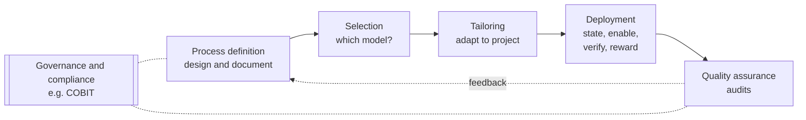
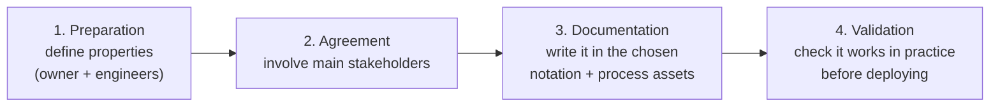
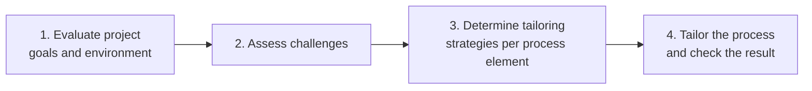
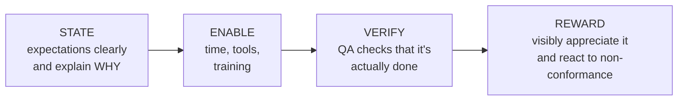
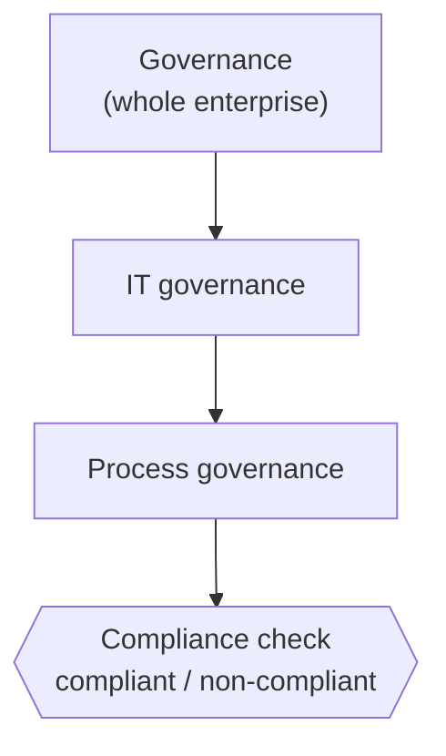

import Callout from '../../../components/Callout.astro';
import QA from '../../../components/QA.astro';
import QAList from '../../../components/QAList.astro';

<Callout type="why">
A process only has value if it fits the situation **and** people actually follow it. This page covers the full journey: designing a process, choosing one, adapting it to a project, getting people to use it, and checking they do.

**Deployment, the "last mile"**, is where most process initiatives fail. Teams nod at the new process and then carry on as before, unless someone states it clearly, gives them the time and tools, checks, and rewards it.

- **Real life:** a company rolling out "everyone must do code review" or "all releases go through the CI pipeline"; choosing Scrum for a mobile team but a V-Model for the safety-critical firmware team; a bank's IT governance driven by COBIT and audits.
- **Connects to:** Part 1 (roles: owner, engineer, tailor, performer, assurance), Week 4 (life cycle models and Scrum, which are what you select and tailor), Topic 5 (assessment and improvement), Topic 6 (measurement).
</Callout>

<Callout type="key">
1. **Process definition** has customers: the process's **beneficiaries** and its **performers**. Write it at three levels: **expert** (checklist), **intermediate** (plus guidance), **beginner** (plus training).
2. **Developing a process:** **preparation → agreement → documentation → validation**.
3. **Preparation** fixes 10 properties: purpose, process scope, organisational scope, level of detail, flexibility, obligation, philosophy, application area, organisational environment, method neutrality.
4. **Selection** happens at the **organisation** level and then the **project** level, by asking **Why → What → How**.
5. **Boehm & Turner's five factors** for agile vs plan-driven: **size, criticality, dynamism, personnel, culture**.
6. **Tailoring** = adapting a general process to a specific case by **deleting, modifying or adding** parts. Agile teams tailor too.
7. **Deployment** (the "last-mile problem"): **State → Enable → Verify → Reward**.
8. **Process QA** = confidence that the process achieves its goals **and** is performed as defined. Its main tool is **process audits**.
9. **Governance ⊃ IT governance ⊃ process governance**. **Compliance** is a yes/no result. **COBIT** is an IT governance framework.
</Callout>

## Big picture

*Order of this topic. The slides plan it across lecture weeks 6–7: infrastructure → definition → selection and tailoring → deployment → QA.*

## 1. Process definition: basic concepts

**First define the process objectives and requirements.** Identify the different kinds of **customers** and the **value** the process creates for them:

| Customer type | Who | Example: "release process" |
|---|---|---|
| **Primary customer** | Whoever benefits from the process. Every process has (or should have) one, often **internal** | The operations team receiving releases |
| **Customer of the organisation** | Most processes support, more or less directly, delivering products or services to an **external** customer | App users |
| **Customers of the process *definition*** | The people who will **perform** the process | Developers and release engineers who follow the document |

**Write the definition for different levels of experience:**

| Level | Needs | Form |
|---|---|---|
| **Expert** | A **concise** description | **Checklist or flowchart**. Especially important for processes done rarely (once a year or once a project). This part is often the **mandatory and auditable** part |
| **Intermediate** | Plus guidance on **how** to perform it and interpret the expert description | Expert description + **optional guidance** |
| **Beginner** | Plus **training material** | Not part of the description itself, but **linked** from it (e.g. hyperlinks) |

### Software process development: the four major steps

1. **Preparation:** main responsibility lies with the **process owner**, supported by **process engineers** and possibly **process performers**.
2. **Agreement:** involve the **main stakeholders**, in a sequence similar to requirements identification.
3. **Documentation:** once the overall process is agreed, document it in the appropriate **notation**, including the relevant **process assets**.
4. **Validation:** before deploying, check that the process **and** its documentation are adequate for practical use and help achieve the defined goals.

### Preparation: properties to define (iteratively)

| Property | Question | Range / examples |
|---|---|---|
| **Purpose** | Why is it created? This strongly shapes the content | General understanding, training, standardising across organisations, improving work, ensuring safety or security |
| **Process scope** | How much of the life cycle? | Whole service life cycle (**ITIL**, **ISO/IEC/IEEE 12207**) → development (**V-Model**, **Scrum**) → one or a few processes (**TMMi** for testing) |
| **Organisational scope** | From whose point of view? | The **developer** organisation, the **customer** side (selecting a supplier, defining the work), or both (if they're in the same organisation) |
| **Level of detail** | How much detail? | Simple life cycle (phase names only) → frameworks such as **Scrum** → detailed models such as **RUP** and **V-Model XT** (tasks, subtasks, roles, templates) |
| **Degree of flexibility** | Rigid or building blocks? | A fixed sequence of steps (easy to define, hard to use when assumptions don't hold) ↔ basic **building blocks** assembled per case |
| **Degree of obligation** | Must you follow it? | **Suggested** (performers decide) → **recommended / expected** (follow unless there's a convincing reason not to) → mandatory |
| **Underlying philosophy** | Plan-driven or agile/lean? | Many organisations use a **mixture** |
| **Application area** | What kind of system? | Hardware + software systems, pure software, high safety/security/reliability, configuration and integration projects |
| **Organisational environment** | Team size and distribution? | Globally distributed teams need cooperation defined **in detail**; co-located teams can agree informally "over coffee". Contractual and legal requirements |
| **Method neutrality** | Tied to a method? | Method-neutral ↔ built around a specific method |

## 2. Process selection

Selection happens on **two levels**:
1. The **organisation** selects a process or set of processes to use.
2. Within that, each **project** selects its own processes.

**A three-step approach:**

| Step | Question | Meaning |
|---|---|---|
| **Why** | Why do we want this? What benefit should it bring? | Understand the motivation |
| **What** | Which parts of the selected model matter for our objectives, and which aren't relevant now? | Set priorities |
| **How** | How do we tailor and implement the selected parts so they genuinely help? | Plan the adaptation |

### Boehm & Turner's five critical factors: agile or plan-driven?

| Factor | Favours **agile** when… | Favours **plan-driven** when… |
|---|---|---|
| **Size** | Small teams | Large teams. (Scaling agile is possible, but usually at the cost of some agility) |
| **Criticality** | Low impact of failure | Safety, money or legal regulations that may **prescribe** an approach and require **proof** of properties. (Some work exists on agile for critical systems) |
| **Dynamism** | Very dynamic environment, **fast-changing requirements** (the reason agile was invented) | **Stable** environment, requirements rarely change |
| **Personnel** | **Highly skilled** people (self-organisation and shared responsibility need skill in the methods) | Mixed skill levels with specialised roles |
| **Culture** | People thrive on **freedom and responsibility** | A **structured** culture with clear policies and procedures |

*Boehm & Turner draw these five factors on a polar ("radar") chart: the closer a project sits to the centre on each axis, the better agile fits.*

## 3. Process tailoring

> **Tailoring:** adapting a general process (description) to a **specific instance**, or group of instances, such as a task, project or team.

- It can involve **deleting** parts that aren't relevant, **modifying** parts that don't fit, or **adding** to it.
- Tailoring applies to **agile too**, though it's rarely called that. A self-organising team deciding how to adapt Scrum to its project **is** tailoring standard Scrum.

### Steps for tailoring

**First, prepare:** write **tailoring guidelines** that say how to tailor and what kinds of tailoring are allowed.

**Then, for each project:**

### Tailoring criteria

| Group | Criteria |
|---|---|
| **1. Team** | Team size, distribution (one room vs different continents), knowledge of the domain and processes |
| **2. Internal environment** | Project duration and type, management availability and support, tool infrastructure |
| **3. External environment** | Number, availability and background of stakeholders; type of contract |
| **4. Objectives** | The goals of the development effort, e.g. domain and complexity |

**Example** *(mine)*: the company's standard process requires a full design document and three review gates. A 6-week, 3-person internal dashboard project might **delete** two gates, **modify** the design document into a one-page architecture sketch, and **add** a weekly demo to the product owner, all within the tailoring guidelines.

## 4. Process deployment

> Deployment is possibly the **most important** task in process management: it's the step from a process definition (**"essentially a piece of paper"**) to **changing the way work is actually done**. It's often called the **last-mile problem**.

**Typical challenges:**
- Many people are **hesitant to follow rules set by someone else**, especially if it means extra effort with **no benefit to themselves**, at least in the short term.
- For example, the main benefit of **documenting** software comes in **maintenance**, which seems a long way off and may not even be done by the same people.

### State–Enable–Verify–Reward

| Step | What to do | Why |
|---|---|---|
| **State** expectations clearly | Management (or a self-organising team itself) says clearly that the process must be followed, **and explains why** | Otherwise people see it as one more bureaucratic burden. If expectations aren't clear, there's little chance they'll be met |
| **Enable** implementation | Provide **resources** (time, tools) and **training** | People must know *how* and be *able* to do it |
| **Verify** implementation | Use **QA checks** to confirm the new way of working is actually followed | There's a natural tendency to continue as before, and most changes need extra effort at first. Verification gets the majority to comply, not just a few willing people |
| **Reward** | Following the process must be **visibly appreciated** (not necessarily with money), and there must be a **reaction to not doing so** | If management plays down non-conformance, that sends a clear signal that conformance doesn't matter, and people act accordingly |

<Callout type="tip" title="Example: introducing mandatory code review">
**State:** "From 1 Dec every PR needs one approval, because last quarter 40% of production bugs would have been caught in review." **Enable:** set aside review time in sprint planning, set up branch protection, run a 1-hour review workshop. **Verify:** a weekly report of merges without approval. **Reward:** praise great reviews in the retro; follow up with teams that bypass it.
</Callout>

## 5. Quality assurance (of processes)

> **Quality assurance (QA)** is about **providing confidence that quality requirements are satisfied.**

- QA can be applied to **products and services** created by the processes, and to the **processes themselves** (the focus here).
- There are many process QA activities; the most important are **process audits**.

**Two main goals of process QA:**
1. Ensure the process **achieves its goals**: high-quality results, **on time and within budget**, **consistently and reliably**.
2. Ensure the process is **performed according to its definition**. This starts as the **"verify"** step of state–enable–verify–reward, and continues as a **permanent** task, usually with lower coverage.

## 6. Governance concepts

| Term | Definition | In simple words |
|---|---|---|
| **Governance** *(COBIT 5)* | Ensures stakeholder needs, conditions and options are evaluated to set balanced, agreed enterprise objectives; sets direction through prioritisation and decision-making; and monitors performance and compliance against the agreed direction and objectives | **Deciding where we're going, and checking we get there** |
| **IT governance** *(ISO/IEC 38500:2008)* | The system by which the current and future use of IT is **directed and controlled** | Governance applied to **IT**, making sure IT supports the organisation |
| **Process governance** | A governance view that ensures processes **support and enable the enterprise strategy** and the achievement of its objectives, including the **functional governance** of processes (that they're performed efficiently and effectively) | Governance applied to **processes** |
| **Compliance** *(PMBOK® Guide)* | Conforming to a rule, standard, law or requirement, such that the assessment gives a **binomial** result: **"compliant" or "non-compliant"** | **Yes/no**: did we follow the rule? |

### COBIT (Control Objectives for Information and Related Technologies)

- Helps organisations meet business challenges in **regulatory compliance, risk management and aligning IT strategy with organisational goals**.
- **Processes** are defined as an **enabler** that helps achieve effective governance.
- **In simple terms:** COBIT is a set of rules and tips for using IT in the best way. It makes sure IT systems are not just high-quality but also **safe, efficient and aligned with what the business wants**. *(The details of COBIT are beyond the scope of this chapter.)*

## Practice questions from the slides

### Touch 'n Go eWallet case

> Users have reported being **unexpectedly logged out**, seeing **incorrect balances**, getting **notifications for transactions they didn't make**, **poor navigation**, and **lost transactions** when topping up mid-checkout. You're the new **QA Lead**, introducing **Scrum**.
>
> **Task 1:** construct a sample **product backlog** with at least **four user stories**: two based on the technical issues and two for a new feature (e.g. international mobile number registration for tourists, or cryptocurrency payment support).

**Model answer** *(mine)*:

| ID | User story | Acceptance criteria | Priority | Type |
|---|---|---|---|---|
| **PB-1** | **As a** TNG user, **I want** my wallet balance to always show the correct amount, **so that** I can trust the app with my money. | Balance matches the server ledger within 5 s of any transaction; a mismatch triggers an automatic refresh and is logged; regression tests cover top-up, payment and refund | **Must** (High) | Bug: technical issue |
| **PB-2** | **As a** TNG user, **I want** to stay logged in while I'm actively using the app, **so that** I'm not kicked out in the middle of a payment. | No forced logout during an active session; a silent token refresh before expiry; a 5-minute warning before an idle logout; zero session-expiry errors in a 1-week beta | **Must** (High) | Bug: technical issue |
| **PB-3** | **As a** TNG user, **I want** to top up during checkout without losing my order, **so that** I can complete my purchase. | Cart and payment state are preserved across the top-up flow; after a successful top-up the user returns to the same checkout step; works for all top-up methods | **Should** (High) | Bug: technical issue |
| **PB-4** | **As a** tourist visiting Malaysia, **I want** to register with my **foreign mobile number**, **so that** I can use TNG for tolls and payments during my trip. | Supports international numbers with country codes; OTP via SMS works for the top 10 tourist source countries; eKYC with passport; spending limits per Bank Negara rules | **Should** (Medium) | New feature |
| **PB-5** | **As a** tech-savvy user, **I want** to pay merchants using **cryptocurrency**, **so that** I have more payment options. | Supports approved coins only; converted to MYR at a quoted rate before confirmation; complies with local regulations; full transaction history | **Could** (Low) | New feature |

**Why this order?** PB-1 and PB-2 directly affect **trust in a money app** (correctness and reliability), so they come first. Fixing quality issues before adding features is exactly the QA mindset of this course. The new features follow, ranked by value and regulatory risk.

<Callout type="exam">
In backlog questions, marks usually come from: the correct **"As a / I want / so that"** format, **testable acceptance criteria**, a sensible **priority with justification**, and linking stories back to the **case facts** (logout, balance, phantom notifications, lost checkout).
</Callout>

<QAList>
  <QA q="Who are the 'customers' of a process definition, and why does it matter?" level="medium">
    (1) The **primary customer** who benefits from the process (often internal); (2) the organisation's **external customers** whose products or services the process supports; (3) the **performers** who use the definition. Identifying them clarifies the **value** the process must create and how the description must be written.
  </QA>
  <QA q="Describe the expert, intermediate and beginner levels of a process definition." level="medium">
    **Expert:** a concise checklist or flowchart, often the mandatory and auditable part. **Intermediate:** plus optional guidance on how to perform and interpret it. **Beginner:** plus training material, linked from the description but not part of it.
  </QA>
  <QA q="List the four major steps of software process development." level="easy">
    **Preparation** (owner leads, with engineers and performers), **agreement** (involve the main stakeholders), **documentation** (in the chosen notation, with process assets), **validation** (check it's adequate for practical use before deploying).
  </QA>
  <QA q="Explain 'degree of flexibility' and 'degree of obligation' as process properties." level="medium">
    **Flexibility:** from a rigid fixed sequence of steps (easy to define, hard to use when assumptions don't hold) to basic building blocks assembled per case. **Obligation:** from **suggested** (performers decide) to **recommended or expected** (follow unless there's a convincing reason not to).
  </QA>
  <QA q="Give an example of each process scope level." level="easy">
    Whole service life cycle: **ITIL**, **ISO/IEC/IEEE 12207**. Development work: **V-Model**, **Scrum**. One or a few processes: **TMMi** (testing).
  </QA>
  <QA q="Explain the Why–What–How approach to process selection." level="medium">
    **Why:** understand why you want the process and what benefit it should bring. **What:** set priorities, deciding which parts of the model matter for your objectives and which don't apply. **How:** decide how to tailor and implement the selected parts so they genuinely help the organisation.
  </QA>
  <QA q="State Boehm & Turner's five critical factors and which way each points." level="medium">
    **Size** (small → agile, large → plan-driven); **criticality** (high safety or regulation → plan-driven); **dynamism** (fast-changing requirements → agile); **personnel** (highly skilled → agile); **culture** (empowered, freedom → agile; structured, policies → plan-driven).
  </QA>
  <QA q="A 200-person team builds rail signalling software under strict safety regulation; requirements are stable. Agile or plan-driven? Use Boehm & Turner." level="hard">
    **Plan-driven** (e.g. a V-Model). **Size** is large; **criticality** is very high, and regulations require proof of safety; **dynamism** is low (stable requirements). All three point to plan-driven. Some agile practices (e.g. continuous integration) can still be added through tailoring.
  </QA>
  <QA q="What is tailoring? Is it only for plan-driven processes?" level="easy">
    Adapting a general process to a specific instance (project, team) by **deleting, modifying or adding** parts. **No**: agile teams tailor too. A self-organising team adapting Scrum to its project is tailoring.
  </QA>
  <QA q="List the steps for tailoring a process for a project, and the four groups of tailoring criteria." level="medium">
    **Prepare** tailoring guidelines, then: (1) evaluate project goals and environment, (2) assess challenges, (3) determine tailoring strategies for the process elements, (4) tailor the process and check it. **Criteria:** team, internal environment, external environment, objectives.
  </QA>
  <QA q="Why is process deployment called the 'last-mile problem'?" level="medium">
    It's the hardest final step: turning a process definition (a piece of paper) into **actual changes in how people work**. People resist rules set by others, especially when the extra effort brings them no short-term benefit (e.g. documentation pays off only in later maintenance).
  </QA>
  <QA q="Explain the State–Enable–Verify–Reward approach." level="medium">
    - **State** expectations clearly and explain why.
    - **Enable** with time, tools and training.
    - **Verify** with QA checks that the process is actually followed.
    - **Reward:** visibly appreciate conformance and react to non-conformance, because ignoring it signals that it doesn't matter.
  </QA>
  <QA q="What are the two main goals of process quality assurance?" level="medium">
    (1) Ensure the process **achieves its goals**: high-quality results on time and within budget, consistently and reliably. (2) Ensure the process is **performed according to its definition**: the "verify" step of deployment, continued permanently. The main tool is **process audits**.
  </QA>
  <QA q="Differentiate governance, IT governance, process governance and compliance." level="hard">
    - **Governance:** sets enterprise objectives and direction through prioritisation and decisions, and monitors performance against them (COBIT 5).
    - **IT governance:** directing and controlling the current and future use of IT (ISO/IEC 38500).
    - **Process governance:** ensures processes support the enterprise strategy and are performed efficiently and effectively.
    - **Compliance:** conforming to a rule, standard, law or requirement, with a yes/no result (PMBOK).
  </QA>
  <QA q="What is COBIT, in simple terms?" level="easy">
    An IT governance framework (Control Objectives for Information and Related Technologies) that helps organisations with **regulatory compliance, risk management and aligning IT with business goals**, treating processes as enablers of good governance. Simply: rules and tips for using IT well, safely and in line with the business.
  </QA>
</QAList>
