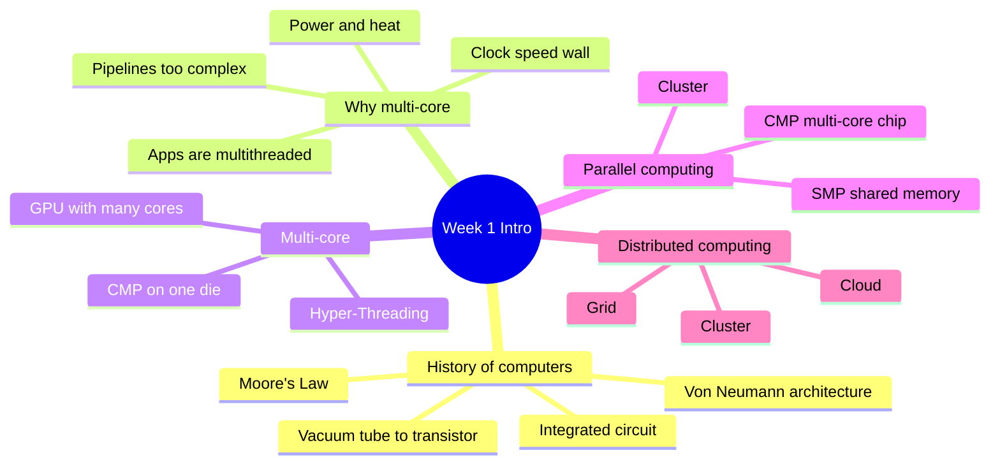
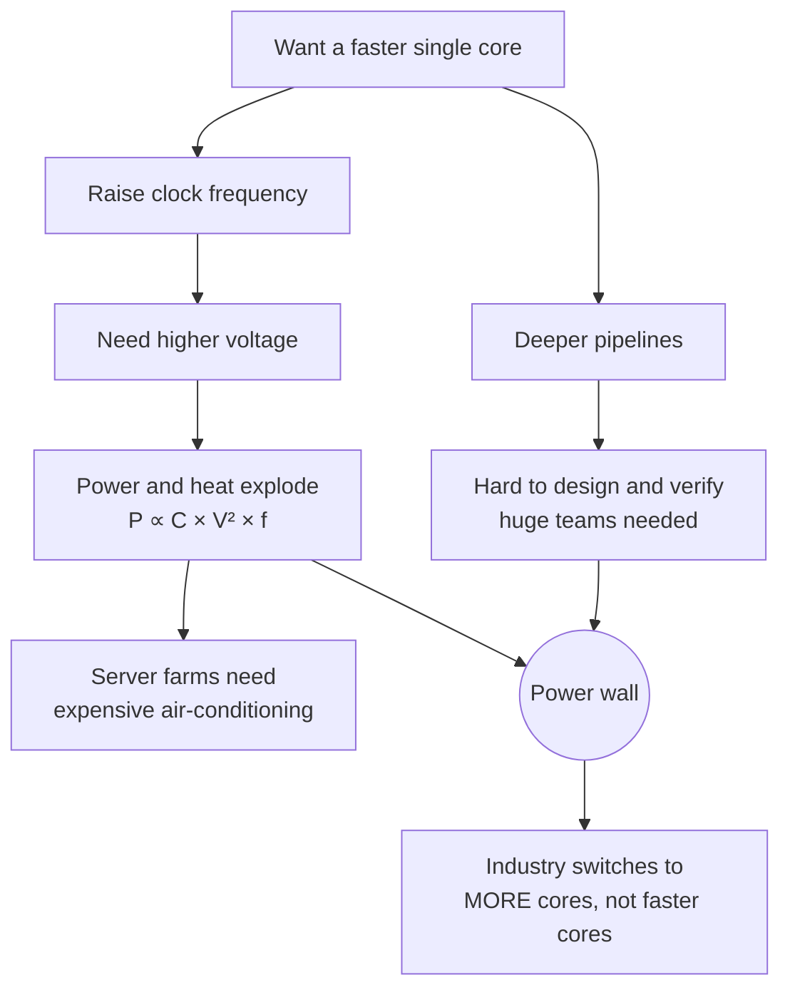
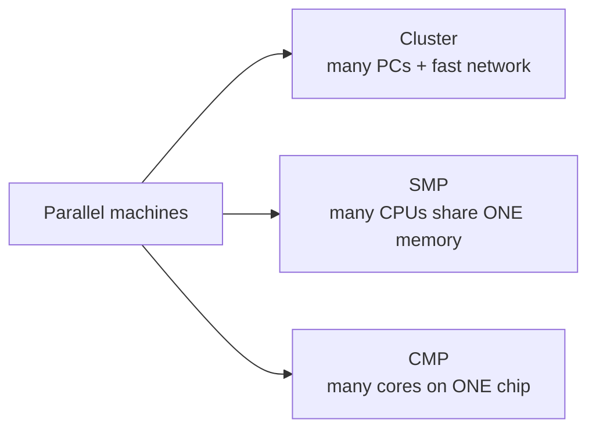
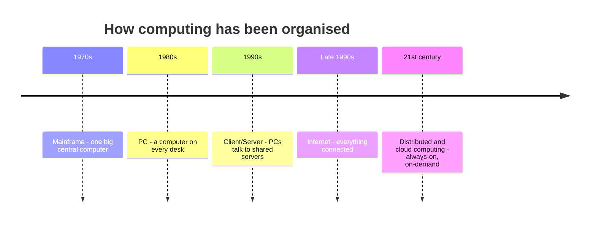

import Callout from '../../../components/Callout.astro';
import QA from '../../../components/QA.astro';
import QAList from '../../../components/QAList.astro';
import Figure from '../../../components/Figure.astro';
import moore from './images/w01-moores-law.png';
import vonNeumann from './images/w01-von-neumann.png';
import intelEvo from './images/w01-intel-evolution.png';
import die from './images/w01-dual-core-die.jpg';
import ht from './images/w01-hyperthreading.png';
import mc from './images/w01-multicore-threads.png';
import gpu from './images/w01-gpu-architecture.png';

<Callout type="why">
For about 30 years, programmers got faster software **for free**: just wait for next year's CPU with a higher clock speed. Around 2005 that stopped. CPUs stopped getting much faster per core and started getting **more cores** instead.

So now, if your program only uses one core, it uses maybe 1/8 or 1/16 of your laptop. **The only way to keep getting faster is to write parallel programs.** That is the whole reason this course exists.

- **Real life:** game engines, video encoding, AI training on GPUs, banks processing millions of transactions, weather forecasting, and every cloud service you will use later in this course.
- **Connects to:** Week 3 (parallel architecture in depth), Week 4 (how to measure speed-up), Weeks 6–7 (actually writing parallel code with Pthreads/OpenMP), Week 11 (GPU/CUDA).
</Callout>

<Callout type="key">
1. **Moore's Law** — transistor count doubles roughly every 18–24 months. It still (mostly) holds; what stopped is **clock speed** going up.
2. **Power wall** — power ∝ C × V² × f. Raising frequency means raising voltage too, so heat explodes. That's why we went multi-core.
3. **Multi-core (CMP)** — many cores on one chip. Two slower cores can match one fast core at **¼ of the power**.
4. **Hyper-Threading ≠ multi-core** — HT runs 2 threads on *one* core by sharing its parts; multi-core has truly separate cores.
5. **Parallel computing** = split one job to finish it *faster* (tightly coupled). **Distributed computing** = many autonomous computers *sharing resources* (loosely coupled).
</Callout>

## Big picture

## 1. How we got here — evolution of computers

<Figure src={moore} max={560} alt="Moore's Law chart: calculations per second per $1000 from 1900 to 2000 on a log scale, rising through electromechanical, relay, vacuum tube, transistor and integrated circuit eras" caption="Computing power per dollar has grown exponentially across five technologies. Notice the y-axis is logarithmic — each grid line is 100× more." credit="Lecture slide 2" />

| Era | Technology | What changed |
|---|---|---|
| 1940s | Vacuum tubes / relays | Room-sized machines, very unreliable |
| 1950s | **Transistor** (e.g. Manchester Transistor Computer) | Smaller, cooler, more reliable |
| 1970s | **Integrated circuit → microprocessor** | Whole CPU on **one chip** (Intel 8080, 8086) |
| 1980s–2000s | Smaller transistors, higher clock | Pentium → Pentium 4, MHz → GHz |
| 2005+ | **Multi-core** | Clock speed flattens; core count rises |

### The Von Neumann architecture

Almost every CPU today still follows this 1945 design. Program **and** data live in the same memory; the CPU fetches an instruction, executes it, then fetches the next one — **one at a time**.

<Figure src={vonNeumann} max={420} alt="Von Neumann architecture: Memory connected to a CPU containing a Control Unit and Arithmetic Logic Unit, with Input and Output" caption="Control Unit decides what to do, ALU does the maths, Memory holds both instructions and data." credit="Lecture slide 4" />

<Callout type="note" title="Why this matters for parallelism">
"One instruction at a time" is the **bottleneck**. Everything in this course — multi-core, GPUs, clusters, cloud — is a way of escaping that single sequential stream. The single shared path between CPU and memory is called the **Von Neumann bottleneck**.
</Callout>

## 2. Moore's Law and the clock-speed wall

<Figure src={intelEvo} alt="Four charts of Intel CPUs from 8080 (1974) to Pentium 4 (2000): number of transistors rising, minimum transistor size falling, clock frequency rising, MIPS rising" caption="Intel 8080 → Pentium 4: more transistors, smaller transistors, higher clock, more instructions per second (MIPS). All on log scales." credit="Lecture slide 6" />

**Moore's Law** (Gordon Moore, Intel co-founder, 1965): the number of transistors on a chip doubles about every 18–24 months.

For decades, extra transistors were used to make **one** core faster — higher clock, deeper pipelines, smarter prediction. Then three problems hit at the same time:

### The power formula (know this!)

> **Performance = Frequency × Instructions Per Cycle (IPC)**
>
> **Power ∝ Cdynamic × V² × f**

- **C** = capacitance (roughly: how many transistors are switching)
- **V** = voltage, **f** = clock frequency
- Voltage is **squared**, and higher frequency needs higher voltage — so power grows much faster than speed.

**Worked example — why 2 slow cores beat 1 fast core:**

| | 1 core @ f | 2 cores @ f/2 |
|---|---|---|
| Frequency | f | f/2 |
| Voltage (can drop with frequency) | V | V/2 |
| Capacitance | C | 2C (twice the cores) |
| **Power** | C·V²·f | 2C · (V/2)² · (f/2) = **¼ · C·V²·f** |
| Work done per second | 1× | 2 × ½ = **1×** |

**Same performance, ¼ of the power.** Or keep full frequency and get 2× performance (if the program can use both cores).

<Callout type="exam">
"Why did processor manufacturers move to multi-core?" — mention: (1) clock frequency can't keep rising because power ∝ V²f causes heat problems; (2) deep pipelines are hard to design/verify; (3) many applications are already multithreaded; (4) extra transistors from Moore's Law are better spent on more cores.
</Callout>

## 3. Multi-core processors

A **multi-core processor** = several processor cores on **one die** (one piece of silicon), fitting in **one socket**. Also called a **CMP (Chip Multi-Processor)**.

<Figure src={die} max={520} alt="Diagram of a dual-core die: front side bus and memory bus controller on top, shared L2 cache, then separate L1 instruction and data caches for Processor P0 and Processor P1" caption="Intel Core 2 Duo layout: each core (P0, P1) has its own L1 caches, but they share one L2 cache and one bus to memory. Sharing is fast — but it's also where conflicts happen (Week 3: cache coherence)." credit="Lecture slide 11 (Lin & Snyder)" />

### Multi-core vs Hyper-Threading

<Figure src={ht} alt="Left: single core chip running one thread. Right: one core running two threads with Hyper-Threading" caption="Hyper-Threading: one core, two threads sharing its execution units." credit="Slide 14" />
<Figure src={mc} alt="Four cores, each running several threads in parallel" caption="Multi-core: each core runs its own threads truly in parallel." credit="Slide 14" />

| | Single core | Hyper-Threading (HT) | Multi-core |
|---|---|---|---|
| Physical cores | 1 | 1 | 2, 4, 8 … |
| Threads at the same instant | 1 | 2 (share one core's units) | 1–2 per core |
| Speed-up | — | Small (~10–30%), fills idle units | Up to N× for N cores |
| Analogy | One chef | One chef using both hands on two dishes | Several chefs, each with their own stove |

<Callout type="warn">
Hyper-Threading does **not** double performance. The two threads share the same ALUs and caches; HT only helps when one thread is waiting (e.g. for memory) and the other can use the idle parts. Your OS shows "8 logical processors" on a 4-core HT chip — that's 4 real cores.
</Callout>

Within each core, the OS still **time-slices** threads, just like on a single-core machine. Multi-core adds true parallelism *between* cores.

### The industry switch (slide 15 activity)

| Manufacturer / Year | AMD '05 | Intel '06 | IBM '04 | Sun '07 |
|---|---|---|---|---|
| Processors (cores) / chip | 2 | 2 | 2 | 8 |
| Threads / core | 1 | 2 | 2 | 16 |
| **Threads / chip** | 2 | 4 | 4 | **128** |

**How to read it:** threads per chip = cores × threads per core. Sun's 2007 chip had 8 cores × 16 threads = 128 threads.

The point of the slide: **by ~2006 every major vendor had gone multi-core**. A sequential program got no faster on these chips — "procrastination penalised". At the same time the PS3's Cell had 8 cores and NVIDIA GPUs had 128 cores.

<Callout type="tip" title="Today's numbers (for context)">
Those 2005–2007 numbers are tiny now. A normal laptop has 8–16 cores, server CPUs have over 100 cores, and a modern GPU has **thousands** of small cores. The trend from the slides only accelerated.
</Callout>

### A peek at GPU architecture

<Figure src={gpu} max={600} alt="GPU architecture: a grid of thread blocks B1..Bn distributed to multiprocessors (MP), each containing an instruction unit, many SPs, SFUs and shared memory, all connected to GPU device memory" caption="A GPU = many multiprocessors (MP). Each MP has many simple Streaming Processors (SP), Special Function Units (SFU) for maths like sin/sqrt, and its own Shared Memory (SM). Work is split into thread blocks; each block runs on one MP." credit="Lecture slide 5" />

A CPU has a **few powerful** cores; a GPU has **thousands of simple** cores. GPUs are great when you do the *same* operation on lots of data (pixels, matrices, AI). You'll program this in **Week 11 (CUDA)**.

## 4. Parallel computing

> **Parallel computing:** using **multiple processors at the same time** to solve **one problem** faster than a single processor could.

Researchers have done this for decades in science and engineering (problems too big for one computer → use hundreds or thousands). What's new is that **every machine is now parallel**, so every programmer needs it.

**Three kinds of parallel machines:**

| Type | Full name | Memory | Example |
|---|---|---|---|
| **Cluster** | — | Each PC has its own memory; talk over network | University HPC cluster, supercomputers |
| **SMP** | Symmetric Multi-Processor | All CPUs share one memory | Multi-socket server |
| **CMP** | Chip Multi-Processor | Cores share memory (and some cache) | Your laptop CPU |

### High Performance Computing (HPC)

**HPC** means using parallel machines — usually large clusters or supercomputers — to solve problems that are too big or too slow for one computer: weather and climate models, drug discovery, crash simulations, training large AI models. The fastest supercomputers have **millions of cores**. Today you can also rent HPC-style clusters from the cloud by the hour — which is where Week 2 comes in.

## 5. Distributed computing

> **Distributed system:** a collection of **autonomous computers**, connected by a network, that **cooperate and share resources** (printers, databases, storage, compute).

Started in the 1980s, everywhere by the 1990s. Ranges from simple client–server to the whole Internet. Examples: **cluster**, **grid**, and later **cloud**.

### The trend in computing

"Virtual, adaptable, open, on-demand" — distributed computing combines resources so it looks like one always-on, unlimited computer. That's the idea behind **cloud computing** (Week 2).

## 6. Parallel vs distributed

They're converging — the same fast networks and clusters are used for both — and they share the same research problems: **inter-process communication, resource management, scheduling/load balancing, and grain size**.

**What they have in common:** multiple processors, connected by some "network", running many activities at the same time that cooperate.

| | Parallel system | Distributed system |
|---|---|---|
| **Goal** | **Faster execution** of one application | **Share resources** to increase throughput |
| **Grain size** | **Fine** (tasks talk often) | **Coarse** (tasks mostly independent) |
| **Architecture** | **Tightly coupled, homogeneous** (same machines) | **Loosely coupled, heterogeneous** (different machines) |
| **Location** | Same place, same time | Different locations, different resources |
| **Memory** *(extra)* | Often shared memory | No shared memory — message passing |
| **Failures** *(extra)* | One part fails → usually whole job fails | Designed to keep running when parts fail |
| **Applications** | One application | Many applications, many users |

The slide's last row is "??" — the two "extra" rows are reasonable answers to fill it in.

<Callout type="tip" title="Easy way to remember">
**Parallel** = one team in one kitchen cooking **one big meal** faster. **Distributed** = many restaurants in different cities **sharing suppliers** and serving many customers. *"Parallelism is a restricted form of distributed computing."*
</Callout>

**Grain size** = how much work a task does between communications. Fine-grained = tiny tasks that talk constantly (needs a fast, tight connection → parallel). Coarse-grained = big chunks that rarely talk (fine over a slower network → distributed).

Distributed systems also try to hide their complexity — the user should see a **single system image**, as if it were one computer.

## 7. Why bother? Motivations

| Motivation | What it means |
|---|---|
| **Absolute performance** | Some problems are simply too big/slow for one machine |
| **Price/performance** | Many cheap PCs can beat one expensive supercomputer per dollar |
| **Technological reasons** | Single-core speed has hit physical limits (power wall) |
| **Inherently parallel/distributed apps** | e.g. banking across branches, sensor networks, multiplayer games |
| **Resource sharing** | Share expensive printers, databases, GPUs |
| **Availability** | If one machine fails, others carry on |
| **Incremental growth** | Need more power? Add another machine instead of replacing everything |
| **Scavenging** | Use idle computers — typical utilisation is only ~25% |

## Worked example: the slide quiz

> Machine A finishes **10 jobs/hour** and costs **$100/hour**. Machine B finishes **2 jobs/hour** and costs **$15/hour**. Finishing earlier saves you **$6 per hour**. You have **10 jobs**. Which machine?

| | Machine A | Machine B |
|---|---|---|
| Time for 10 jobs | 10 ÷ 10 = **1 hour** | 10 ÷ 2 = **5 hours** |
| Rental cost | 1 × $100 = **$100** | 5 × $15 = **$75** |
| Finishes earlier by | 4 hours | — |
| Saving from finishing early | 4 × $6 = **$24** | $0 |
| **Effective cost** | $100 − $24 = **$76** | **$75** |

**Answer:** Machine B is cheaper, but only by **$1**. Machine A gives you the results **4 hours earlier** for almost the same price, so many people would choose A. This is the **price/performance** trade-off: the "best" machine depends on how much your time is worth. If finishing early saved $7/hour instead of $6, A would win.

<Callout type="exam">
Expect calculation questions like this one. Always show: time for each option → cost for each option → value of the time saved → compare → state your choice **and why**.
</Callout>

<QAList>
  <QA q="State Moore's Law. Has it stopped?" level="easy">
    The number of transistors on a chip doubles roughly every 18–24 months. It has slowed but largely continues. What stopped around 2005 was the rise in **clock speed** — the extra transistors are now used for more cores instead of faster single cores.
  </QA>
  <QA q="What is a multi-core processor (CMP)?" level="easy">
    A single chip (die) containing two or more independent processor cores, fitting in one socket. Each core has its own execution pipeline, so cores run in parallel. CMP = Chip Multi-Processor.
  </QA>
  <QA q="Give three reasons why manufacturers moved from single-core to multi-core." level="medium">
    1. **Power/heat** — power ∝ C·V²·f; raising frequency needs more voltage, so heat grows very fast (power wall).
    2. **Design complexity** — very deep pipelines are hard to design and verify and need huge teams.
    3. **Applications are multithreaded** — software can already use many cores.

    Also: the general trend in architecture toward more parallelism, and the cooling cost of server farms.
  </QA>
  <QA q="Using P ∝ C·V²·f, show why two cores at half frequency use about ¼ the power of one core at full frequency for the same performance." level="hard">
    - One core: P₁ = C·V²·f
    - Two cores at f/2 can run at about V/2, and capacitance doubles to 2C:
      P₂ = 2C · (V/2)² · (f/2) = 2C · V²/4 · f/2 = **C·V²·f / 4**
    - Work per second: 2 cores × ½ speed = same as 1 core at full speed.

    So: **same performance at ¼ of the power.**
  </QA>
  <QA q="A laptop shows '8 logical processors' but has a 4-core CPU. Explain." level="medium">
    The CPU has **Hyper-Threading**: each physical core runs 2 hardware threads, so 4 cores × 2 = 8 logical processors. But there are only 4 real cores — the two threads on a core share its execution units, so it is not 8× the speed of one core.
  </QA>
  <QA q="Differentiate parallel computing and distributed computing in terms of goal, grain size and architecture." level="medium">
    | | Parallel | Distributed |
    |---|---|---|
    | Goal | Faster execution of one application | Resource sharing, higher throughput |
    | Grain size | Fine | Coarse |
    | Architecture | Tightly coupled, homogeneous | Loosely coupled, heterogeneous |
  </QA>
  <QA q="Name the three types of parallel machines and how their memory differs." level="easy">
    - **Cluster** — many PCs, each with its own memory, joined by a fast network.
    - **SMP (Symmetric Multi-Processor)** — several processors sharing one memory system.
    - **CMP (Chip Multi-Processor)** — many cores on one chip sharing memory.
  </QA>
  <QA q="What does 'grain size' mean, and why does it matter for choosing parallel vs distributed?" level="hard">
    Grain size is how much computation a task does between communications. **Fine-grained** tasks communicate very often, so they need a tightly coupled, low-latency system (parallel machine). **Coarse-grained** tasks are mostly independent, so they work fine on loosely coupled machines over a slower network (distributed system). Too fine a grain on a slow network = time wasted communicating instead of computing.
  </QA>
  <QA q="From the 2005–2007 table, how many threads per chip did the Sun '07 processor have, and how is it calculated?" level="easy">
    **128** = 8 cores per chip × 16 threads per core.
  </QA>
  <QA q="Your company's office PCs are only used ~25% of the time. Which motivation for distributed computing does this relate to, and how could you use it?" level="medium">
    **Scavenging** — making use of wasted computing power. Idle PCs (e.g. at night) can be joined into a grid or volunteer-computing system to run batch jobs like rendering or data analysis, instead of buying new servers.
  </QA>
  <QA q="What is the Von Neumann bottleneck, and how does parallel computing help?" level="medium">
    In the Von Neumann architecture, instructions and data share one memory and one path to the CPU, and the CPU executes one instruction at a time. That single path limits speed. Parallel computing adds more processing units (cores, GPU units, machines) so many instructions run at once, and uses caches/local memories to reduce the traffic on that one path.
  </QA>
  <QA q="Why is a GPU better than a CPU for processing every pixel of a 4K image, but worse for running a web browser?" level="hard">
    A GPU has **thousands of simple cores** that do the same operation on lots of data at once — perfect for per-pixel work (data parallelism). A browser is full of branching, unpredictable, mostly sequential logic, which runs best on a **few powerful CPU cores** with large caches and branch prediction.
  </QA>
  <QA q="What is quantum computing (in one paragraph)?" level="easy">
    A quantum computer uses **qubits**, which can be in a combination (superposition) of 0 and 1, and can be **entangled** with each other. For certain problems — factoring large numbers, simulating molecules, some optimisation — quantum algorithms can be dramatically faster than classical ones. It is **not** a faster general-purpose CPU, and current machines are still small and error-prone.
  </QA>
</QAList>
