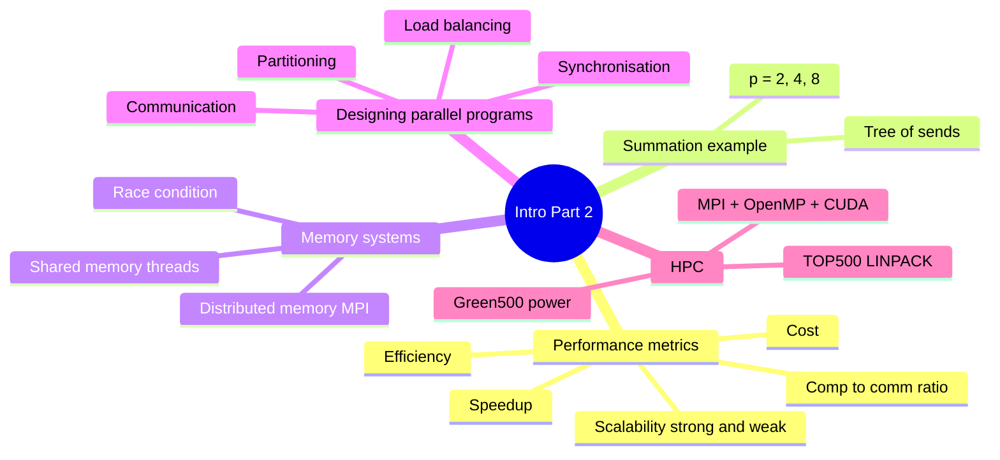

import Callout from '../../../components/Callout.astro';
import QA from '../../../components/QA.astro';
import QAList from '../../../components/QAList.astro';
import Figure from '../../../components/Figure.astro';
import sumP2 from './images/w02p-sum-p2.png';
import sumP4 from './images/w02p-sum-p4.png';
import sumP8 from './images/w02p-sum-p8.png';
import strong from './images/w02p-strong-scaling.png';
import weak from './images/w02p-weak-scaling.png';
import distMem from './images/w02p-distributed-memory.png';
import sharedRace from './images/w02p-shared-memory-race.png';
import dataPar from './images/w02p-data-parallelism.png';
import taskPar from './images/w02p-task-parallelism.png';
import modelPar from './images/w02p-model-parallelism.png';
import top500 from './images/w02p-top500.png';
import hetero from './images/w02p-heterogeneous-hpc.png';

<Callout type="why">
Making code parallel is only half the job. The other half is **proving it got faster, and by how much**. Adding more processors doesn't automatically help: past some point, the time spent *talking* between processors costs more than the time saved *computing*.

This lecture gives you the numbers to judge that: **speedup, efficiency, cost and scalability**.

- **Real life:** deciding how many cloud VMs or GPU nodes to rent (more isn't always better, and you pay for each one), and reading benchmark claims critically.
- **Connects to:** **Assignment 1** (you'll measure and report speedup for your parallel program), Week 4 (performance measures and overhead in depth), Weeks 6–7 (shared memory with Pthreads/OpenMP), Week 11 (GPUs/CUDA).
</Callout>

<Callout type="key">
1. **Speedup** S = T(1) / T(p). Ideal is S = p (linear).
2. **Efficiency** E = S / p, the fraction of each processor's time doing useful work. Ideal is 100%.
3. **Cost** C = T(p) × p, total processor-time used. Ideal is C ≈ T(1).
4. **Strong scaling:** fixed problem size, more processors. **Weak scaling:** problem grows with the processors.
5. **Computation-to-communication ratio:** the higher it is, the better the program scales.
6. **Memory:** *distributed* (each node has its own memory, uses MPI) vs *shared* (all cores see one memory, uses Pthreads/OpenMP/CUDA, risk of race conditions).
7. **Partitioning:** data, task or model parallelism. Also plan communication, synchronisation and load balancing.
</Callout>

## Big picture

## 1. The four performance measures

### Speedup: how many times faster?

> **S = T(1) / T(p)**
>
> T(1) = time on 1 processor, T(p) = time on p processors

| Type | Meaning | Why it happens |
|---|---|---|
| **Sub-linear** | S < p | Normal: communication, waiting and overhead eat some of the gain |
| **Linear** | S ≈ p | Ideal: 8 processors give 8× faster |
| **Super-linear** | S > p | Rare. Usually a **cache effect**: splitting the data means each processor's piece now fits in its fast cache, so each one runs faster than the single processor did |

### Efficiency: how well are processors used?

> **E = S / p = T(1) / (T(p) × p)**

If 8 processors give a speedup of 6, then E = 6/8 = **75%**. On average each processor spends a quarter of its time not doing useful work (waiting or communicating).

### Cost: total processor-time spent

> **C = T(p) × p**

Cost is what you'd **pay** if you rented p machines for T(p) time each. A parallel program is **cost-optimal** when its cost stays close to T(1), meaning you're not wasting processor-time.

<Callout type="tip" title="The link between them">
E = T(1) / C. So **efficiency drops exactly when cost grows beyond the sequential time.** If you remember one formula, remember S = T(1)/T(p); the other two come from it.
</Callout>

### Scalability: what happens as p grows?

| | **Strong scalability** | **Weak scalability** |
|---|---|---|
| Processors | Increase | Increase |
| Problem size | **Fixed** | **Grows with p** (e.g. n = 1024 × p) |
| Question it answers | "Can I solve *this* problem faster?" | "Can I solve a *bigger* problem in the same time?" |
| Example | Render one film frame faster | Render more frames per hour |

### Computation-to-communication ratio

> time spent computing ÷ time spent sending messages between processors

A **higher ratio means better speedup and efficiency**. This is the main thing that limits how far a program can scale. It's the same idea as **grain size** from Week 1: coarse grains have a high ratio.

## 2. Worked example: parallel summation

We want to add up n = 1024 numbers, A[0] + A[1] + … + A[1023], using processing elements (PEs).

**The rules (the "machine model"):**

| Rule | Assumption |
|---|---|
| Computation | A PE adds two numbers in its local memory in **1 time unit** |
| Communication | Sending data to another PE takes **3 time units** (regardless of size) |
| Input / output | All of A starts in **PE#0**; the result must end up in **PE#0** |
| Synchronisation | All PEs work in **lock-step**: each step, a PE computes, communicates, or is idle |

**Sequential:** adding 1024 numbers takes 1023 additions, so **T(1) = 1023**.

### p = 2

<Figure src={sumP2} alt="Five stages with PE#0 and PE#1: (A) PE#0 holds A[0..1023]; (B) it sends A[512..1023] to PE#1; (C) both sum their halves; (D) PE#1 sends its partial sum to PE#0; (E) PE#0 adds them" caption="Split, sum locally, send back, add." credit="Intro Part 2, slide 7" max={520} />

| Step | Time |
|---|---|
| PE#0 sends half (512 numbers) to PE#1 | 3 |
| Both sum 512 numbers locally (511 additions) | 511 |
| PE#1 sends its partial sum back | 3 |
| PE#0 adds the two partial sums | 1 |
| **Total T(2)** | **518** |

S = 1023 / 518 = **1.975** and E = 1.975 / 2 = **98.75%**

### p = 4 and p = 8: a tree of sends

<Figure src={sumP4} alt="Six stages with 4 PEs: data split in half, then quarters, summed locally, then partial sums combined back to PE#0 in two rounds" caption="p = 4: two rounds of sending out, two rounds of combining back." credit="Slide 8" />
<Figure src={sumP8} alt="Eight PEs: PE#0 sends halves, quarters and eighths in a tree pattern" caption="p = 8: three rounds out (½, ¼, ⅛) and three rounds back." credit="Slide 9" />

The data is spread in a **binary tree**: each round, every PE that has data sends half of it to a new PE. Reaching p PEs takes **log₂p rounds**. Combining the partial sums back also takes log₂p rounds, each costing 3 (send) + 1 (add).

> **T(p) = 3·log₂p (spread out) + (n/p − 1) (local sum) + 4·log₂p (combine back) = 7·log₂p + n/p − 1**

Check p = 8: 7×3 + 128 − 1 = **148** ✓ (matches the slide)

| p | T(p) | Speedup | Efficiency | Cost T(p)×p |
|---|---|---|---|---|
| 1 | 1023 | 1.00 | 100% | 1023 |
| 2 | 518 | 1.97 | 98.7% | 1036 |
| 4 | 269 | 3.80 | 95.1% | 1076 |
| 8 | 148 | 6.91 | 86.4% | 1184 |
| 16 | 91 | 11.24 | 70.3% | 1456 |
| 64 | 57 | 17.95 | 28.0% | 3648 |
| **128** | **56** | **18.27** ← best | 14.3% | 7168 |
| 256 | 59 | 17.34 | 6.8% | 15104 |
| 512 | 64 | 15.98 | 3.1% | 32768 |

### Strong scalability (n fixed at 1024)

<Figure src={strong} alt="Four charts for p = 1 to 512 with n = 1024: runtime drops then flattens, cost explodes, speedup rises to about 18 then falls, efficiency falls steadily" caption="Runtime stops improving, speedup peaks around p = 128 and then drops, cost explodes, and efficiency collapses." credit="Intro Part 2, slide 10" />

**Why does speedup go down after p = 128?** The local work n/p keeps shrinking (1024/512 is only 2 numbers each), but the communication part 7·log₂p keeps **growing**. Past p = 128, the extra sends cost more than the computing they save. The computation-to-communication ratio has become too low.

### Weak scalability (n = 1024 × p)

<Figure src={weak} alt="Two charts: speedup grows almost linearly up to about 483 at p = 512; efficiency stays above 94% for all p" caption="Give each processor 1024 numbers of its own and speedup keeps growing (≈483 at p = 512), with efficiency above 94%." credit="Intro Part 2, slide 11" />

Each PE always has 1024 numbers, so the compute part stays the same while communication only grows slowly (log₂p). **Same algorithm, very different conclusion.** That's why you must always say *which* scalability you measured.

<Callout type="exam">
Expect: *"Given T(1) and T(p), calculate speedup, efficiency and cost"* or *"Explain why speedup decreases when p increases beyond a certain point."* For the second one, say that per-processor computation n/p shrinks while communication grows with log p, so the computation-to-communication ratio falls.
</Callout>

## 3. Parallelism basics: two kinds of memory system

### Distributed memory systems

<Figure src={distMem} alt="(A) Four CPUs each with their own memory, connected via an interconnection network. (B) A 2D grid of data partitioned into four blocks, one per processor P0 to P3, with arrows showing exchange of boundary data" caption="(A) Each CPU has its own private memory and talks over a network. (B) The data (e.g. a grid) is partitioned so each processor owns one block, and neighbours exchange edges." credit="Slide 13" />

- Processors communicate over an **interconnection network** (there is no shared memory).
- Communication is either **point-to-point** (one sends to one) or **collective** (one to all, all to one, as in the summation).
- Standard tool: **MPI (Message Passing Interface)**.
- **Data partitioning:** decide which process owns which part of the data.
- **PGAS (Partitioned Global Address Space):** a hybrid in which memory is physically distributed, but programmers see one global address space (languages such as UPC and Chapel).

### Shared memory systems

<Figure src={sharedRace} alt="(A) Four cores each with local memory connected to one shared memory. (B) Array A with element A[4] marked ?, Thread 0 writes a[4] = 3.1 and Thread 1 writes a[4] = 2.9 at the same time" caption="(A) All cores read and write the same main memory. (B) A race condition: two threads write A[4] at the same time, so the final value (3.1 or 2.9) depends on which one happens to finish last." credit="Slide 15" max={560} />

- Cores communicate through a shared **bus or crossbar switch**, by reading and writing the same memory.
- This is how **every modern multi-core CPU** works.
- **Danger: race conditions.** If threads access the same data without coordination, the result depends on timing. You'll fix this with mutexes and locks in Week 6.
- Hardware must keep each core's cache consistent (**cache coherence**), leading to **cc-NUMA** (cache-coherent non-uniform memory access) designs. See Week 3.
- Tools: **Pthreads**, **OpenMP**, **CUDA** (GPU).

| | Distributed memory | Shared memory |
|---|---|---|
| Who sees what | Each node sees only its own memory | All cores see the same memory |
| Communication | Explicit messages over a network | Implicit: just read/write variables |
| Main problem | Communication cost | Race conditions, cache coherence |
| Scales to | Thousands of nodes | One machine (tens to hundreds of cores) |
| Tools | MPI | Pthreads, OpenMP, CUDA |
| Example | A cluster / supercomputer | Your laptop CPU, a GPU |

## 4. Designing a parallel program: four considerations

### 1. Partitioning: how to split the work

**Data parallelism:** the same operation on different pieces of data.

<Figure src={dataPar} alt="Prefix sum example: an input array split across four processors P0 to P3, each computes a local prefix sum, then the rightmost values are combined and added back" caption="Example: parallel prefix sum. Each processor handles one chunk of the array, then the chunks are combined." credit="Slide 16" />

**Task parallelism:** different operations, possibly on the same data.

<Figure src={taskPar} alt="Images are fed into three binary classifiers in parallel (is dog? is cat? is human?), whose outputs are merged into a ternary classifier" caption="Example: three different classifiers (dog? cat? human?) run at the same time on each image, then the answers are merged." credit="Slide 17" />

**Model parallelism:** split *the model itself* across processors (common in AI).

<Figure src={modelPar} alt="A fully connected neural network with four layers whose neurons are split horizontally across GPU 0 to GPU 3" caption="Example: a neural network too large for one GPU is split across 4 GPUs." credit="Slide 18" />

| Type | What's split | Analogy | Example |
|---|---|---|---|
| **Data** | The data | 4 cashiers, each serving a different queue | Apply a filter to every pixel; sum an array |
| **Task** | The work / functions | Kitchen: one cooks, one cuts, one plates | Run spam check, virus scan and indexing on an email at once |
| **Model** | The model / structure | Assembly line split across workers | Training a huge AI model on many GPUs |

### 2. Communication

*How* processors communicate depends on the partitioning scheme you chose: neighbours exchanging edges, a tree of sends, all-to-all, and so on.

### 3. Synchronisation

Threads and processes must be synchronised so the result is **correct**: for example, wait until all partial sums are ready before adding them (that's a *barrier*), or lock A[4] so only one thread writes it at a time.

### 4. Load balancing

Give each processor roughly **equal work** so none sits idle. The total time is set by the **slowest** processor.

<Callout type="warn">
Forgetting load balancing is a classic mistake. If one of 4 threads gets twice the work of the others, your speedup is capped at about 2× instead of 4×, because the other 3 threads finish early and wait.
</Callout>

## 5. HPC trends and rankings

### TOP500: the official supercomputer ranking

- **top500.org** ranks the world's 500 fastest computers twice a year (June and November).
- It uses the **LINPACK (HPL) benchmark**: solve a huge dense system of linear equations **A·x = b**, and measure speed in **floating-point operations per second** (GFlop/s = 10⁹, PFlop/s = 10¹⁵, EFlop/s = 10¹⁸).

<Figure src={top500} alt="Log-scale chart of max LINPACK performance from 1994 to 2016 for the sum of all 500 systems, the number 1, the mean, and number 500, all rising in straight lines" caption="A straight line on a log scale means exponential growth. The #500 system today beats the #1 system from about 10 years earlier." credit="Slide 21" max={560} />

| Year | #1 system | Performance | Cores |
|---|---|---|---|
| 1993 | CM-5/1024 | 59.7 GFlop/s (the slide says 5.9) | 1,024 |
| 2016 | Sunway TaihuLight | 93,014,600 GFlop/s ≈ 93 PFlop/s | ~10 million |
| **June 2026** | **LineShine** (Shenzhen) | **2.198 EFlop/s** | CPU-only |

1993 → 2016 is about **six orders of magnitude** (×1,000,000). The TOP500 record for CM-5/1024 is 59.7 GFlop/s, which matches that claim, so the slide's "5.9" is probably a typo.

**Today:** in the **June 2026** list, China's **LineShine** (灵晟, Shenzhen) took #1 with **2.198 EFlop/s**, replacing the US system El Capitan. It is the first system on the list to sustain over 2 exaflops using **CPUs only** (no GPUs), and five systems now exceed 1 exaflop. ([TOP500, June 2026](https://top500.org/lists/top500/2026/06/))

### Green500: performance per watt

The **Green500** ranks supercomputers by **energy efficiency** (GFlop/s per watt), not raw speed. This matters because a top machine draws tens of megawatts, which links back to the **power wall** from Week 1. To get more speed per watt, modern HPC is **heterogeneous**: it mixes CPUs with accelerators such as GPUs.

### Modern HPC = three levels of parallelism

<Figure src={hetero} alt="Heterogeneous HPC system: a cluster of nodes on an interconnection network; each node has several CPUs; each CPU socket has many cores; nodes also have accelerator boards. Labels show MPI, UPC, OpenMP, Pthreads and CUDA" caption="A modern supercomputer is a cluster of nodes; each node has multi-core CPUs and GPU accelerators. Each level uses a different programming tool." credit="Slide 23" max={600} />

| Level | Hardware | Tool | Week |
|---|---|---|---|
| **Node-level** | Many machines in a cluster | **MPI** | 5 |
| **Intra-node** | Many cores in one CPU | **OpenMP** / Pthreads | 6–7 |
| **Accelerator** | Thousands of GPU cores | **CUDA** | 11 |

<Callout type="note">
That table is the map of the whole parallel half of this course. Real HPC programs **combine** all three ("MPI + OpenMP + CUDA"), and that combining is one of the main challenges of building modern HPC software.
</Callout>

<QAList>
  <QA q="Define speedup, efficiency and cost, with formulas." level="easy">
    - **Speedup** S = T(1)/T(p): how many times faster on p processors.
    - **Efficiency** E = S/p = T(1)/(p·T(p)): the fraction of processor time doing useful work.
    - **Cost** C = p × T(p): total processor-time used.
  </QA>
  <QA q="A program takes 120 s on 1 core and 20 s on 8 cores. Find speedup, efficiency and cost. Is it cost-optimal?" level="medium">
    - S = 120 / 20 = **6**
    - E = 6 / 8 = **75%**
    - C = 8 × 20 = **160 core-seconds**

    Not perfectly cost-optimal: cost 160 > T(1) = 120, so 40 core-seconds are wasted on overhead (communication, waiting).
  </QA>
  <QA q="Distinguish sub-linear, linear and super-linear speedup. How can super-linear speedup happen?" level="medium">
    Sub-linear: S < p (the normal case, because of overhead). Linear: S ≈ p (ideal). Super-linear: S > p. It usually comes from **cache effects**: once the data is split, each processor's share fits in its fast cache, so it runs faster per element than the single processor working on the whole dataset.
  </QA>
  <QA q="What's the difference between strong and weak scalability?" level="easy">
    Both increase the number of processors. **Strong:** the problem size stays **fixed**, so you're asking whether the same problem gets solved faster. **Weak:** the problem size **grows with p** (e.g. n = 1024 × p), so you're asking whether a bigger problem gets solved in the same time.
  </QA>
  <QA q="Using the summation model (add = 1 unit, send = 3 units, tree distribution), derive T(4) for n = 1024 and compute speedup." level="hard">
    - Spread out: 2 rounds × 3 = 6
    - Local sum of 1024/4 = 256 numbers: 255
    - Combine back: 2 rounds × (3 send + 1 add) = 8
    - **T(4) = 6 + 255 + 8 = 269**

    S = 1023 / 269 = **3.80**, E = 3.80 / 4 = **95.1%**.
  </QA>
  <QA q="In the strong-scaling summation experiment, speedup peaks near p = 128 and then falls. Explain why." level="hard">
    T(p) = 7·log₂p + n/p − 1. The computation part n/p shrinks as p grows (only 2 numbers each at p = 512), while the communication part 7·log₂p keeps **growing**. Past about p = 128, each extra doubling adds more communication time than it saves in computation. The **computation-to-communication ratio** becomes too low, so T(p) rises and speedup drops.
  </QA>
  <QA q="Why does the same summation program scale well in the weak-scaling experiment?" level="medium">
    With n = 1024 × p, every processor always has 1024 numbers to add, so the computation per processor stays constant while communication only grows logarithmically. The computation-to-communication ratio stays high, so efficiency stays above 94% even at p = 512.
  </QA>
  <QA q="Compare distributed memory and shared memory systems, naming one programming tool for each." level="easy">
    **Distributed:** each processor has private memory, communicates by explicit messages over a network, scales to thousands of nodes. Tool: **MPI**.

    **Shared:** all cores access one main memory, communicate by reading and writing shared variables, risk race conditions, limited to one machine. Tools: **Pthreads, OpenMP, CUDA**.
  </QA>
  <QA q="Two threads write to A[4] at the same time, one writing 3.1 and the other 2.9. What is this problem called, and what's the final value?" level="easy">
    A **race condition**. The final value is **unpredictable**: it can be 3.1 or 2.9 depending on which thread writes last, and it can change from run to run. It must be prevented with synchronisation (e.g. a mutex or lock).
  </QA>
  <QA q="Classify each as data, task or model parallelism: (a) resizing 10,000 photos on 8 cores; (b) a web server where one thread handles logins, another payments, another search; (c) splitting a neural network's layers across 4 GPUs." level="medium">
    (a) **Data** parallelism: the same operation on different data. (b) **Task** parallelism: different functions running at the same time. (c) **Model** parallelism: the model itself is partitioned.
  </QA>
  <QA q="What are the four considerations when designing a parallel program?" level="easy">
    1. **Partitioning:** split the work (data, task or model).
    2. **Communication:** which processors exchange what (depends on the partitioning).
    3. **Synchronisation:** coordinate threads and processes so results are correct.
    4. **Load balancing:** give everyone equal work to reduce idle time.
  </QA>
  <QA q="What does the TOP500 measure, and why do we also need the Green500?" level="medium">
    TOP500 ranks supercomputers by **LINPACK (HPL)** performance, the speed of solving a dense linear system Ax = b, in floating-point operations per second. The **Green500** ranks by **performance per watt**, because top systems consume tens of megawatts. Energy, not just speed, is now the main limit on building faster machines.
  </QA>
  <QA q="A modern supercomputer combines MPI, OpenMP and CUDA. What level of parallelism does each handle?" level="medium">
    **MPI:** node-level, between machines in the cluster (distributed memory). **OpenMP:** intra-node, between the cores of one CPU (shared memory). **CUDA:** accelerator-level, the thousands of cores on a GPU.
  </QA>
  <QA q="You rent cloud VMs at RM 1 per VM-hour. A job takes 64 h on 1 VM and 10 h on 8 VMs. Is the parallel run worth it?" level="hard">
    - Speedup = 64 / 10 = **6.4**, efficiency = 6.4 / 8 = **80%**
    - Cost: 1 VM = 64 VM-hours = **RM 64**; 8 VMs = 8 × 10 = 80 VM-hours = **RM 80**

    You pay **RM 16 more (25%)** to get the result **54 hours sooner**. It's worth it if the time matters. The 20% inefficiency is exactly that extra RM 16.
  </QA>
</QAList>
