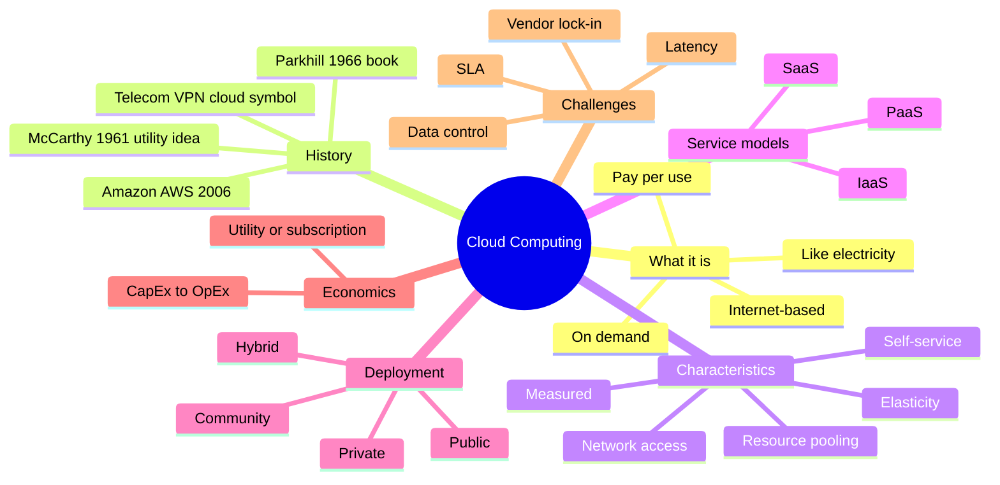
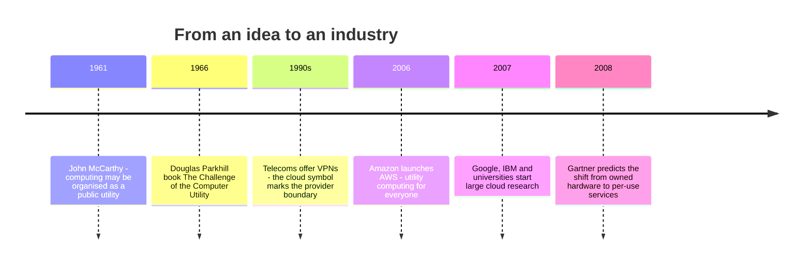
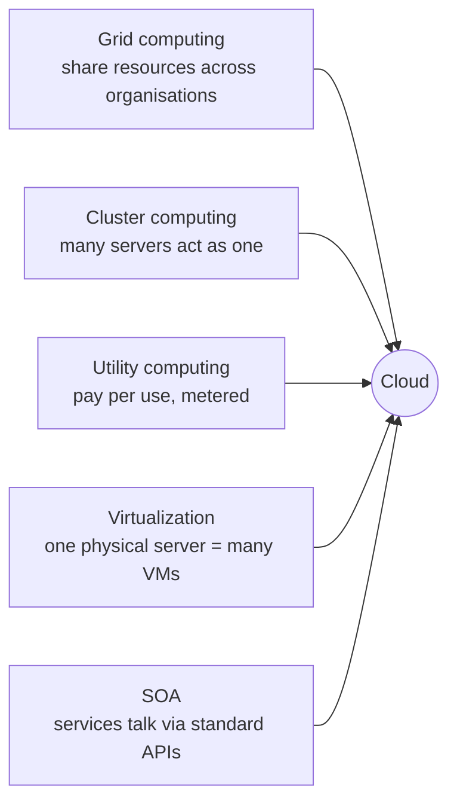
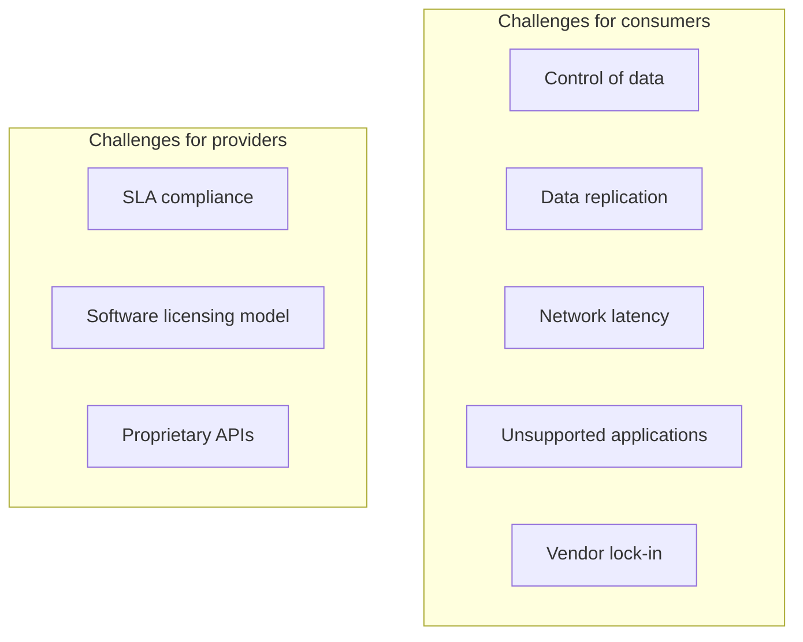

import Callout from '../../../components/Callout.astro';
import QA from '../../../components/QA.astro';
import QAList from '../../../components/QAList.astro';
import Figure from '../../../components/Figure.astro';
import evolution from './images/w02-computing-evolution.png';
import arch from './images/w02-cloud-architecture.jpg';
import layers from './images/w02-cloud-layers.png';
import serviceModels from './images/w02-service-models.png';
import publicCloud from './images/w02-public-cloud.png';
import privateCloud from './images/w02-private-cloud.png';
import communityCloud from './images/w02-community-cloud.png';
import hybridCloud from './images/w02-hybrid-cloud.png';
import infra from './images/w02-infrastructure-layers.png';

<Callout type="why">
Nearly every app you'll build or use runs on someone else's computers: Grab, Shopee, your bank app, your FYP's backend. Instead of buying servers, companies **rent** computing power by the hour, the same way you pay for electricity.

As a developer you need to know what you're renting (IaaS vs PaaS vs SaaS), who is responsible for what, how you pay for it, and when the cloud is actually the wrong choice.

- **Real life:** deploying a FastAPI backend on AWS or Google Cloud, using Firebase for a Flutter app, picking a hosting plan, estimating a monthly cloud bill, explaining to a manager why moving to the cloud saves (or doesn't save) money.
- **Connects to:** Week 9 (virtualization — the technology that makes clouds possible), Week 10 (Kubernetes), Week 12 (Hadoop on the cloud), **Week 13 (service models in depth)**, Week 14 (AWS & OpenStack), Week 15 (cloud security).
</Callout>

<Callout type="key">
1. **Cloud computing** = shared computing resources delivered **over the Internet, on demand, pay-per-use** — like the electricity grid.
2. **5 essential characteristics:** on-demand self-service, broad network access, resource pooling, rapid elasticity, measured service.
3. **3 service models:** **IaaS** (rent the hardware), **PaaS** (rent a platform to deploy code), **SaaS** (use finished software).
4. **4 deployment models:** **public, private, community, hybrid**.
5. **Economics:** converts **CapEx** (buying hardware upfront) into **OpEx** (paying monthly for what you use). Not always cheaper.
6. **Main challenges:** control of data, latency, **vendor lock-in**, SLA compliance.
</Callout>

## Big picture

## 1. What is cloud computing?

> **Cloud computing:** Internet-based computing where shared resources, software and information are provided to computers and other devices **on demand**, like the **electricity grid**.

**The electricity analogy:** you don't build a power station at home. You plug into the grid, use what you need, and pay for the kWh on your bill. Cloud is the same for computing: you don't buy servers, you "plug in" over the Internet and pay for CPU-hours, GB of storage, and so on.

Key ideas from the slides:
- The details are **abstracted away**. Users don't need expertise in, or control over, the infrastructure "in the cloud".
- Resources are **dynamically scalable** and usually **virtualized** (one physical server runs many virtual machines; see Week 9).
- It only became possible because the Internet made remote computers easy to reach.
- **Why "cloud"?** Network diagrams used to draw the telephone network, and later the Internet, as a cloud shape meaning "the complicated stuff we don't need to show".

### Where cloud fits in the evolution of computing

<Figure src={evolution} alt="Five icons from left to right: desktop computing, client-server computing, cluster computing, grid computing, cloud computing" caption="Cloud is the latest step: one desktop → clients talking to a server → clusters of servers → grids across organisations → cloud, resources on demand from anywhere." credit="Cloud Computing Part I, slide 4" />

Cloud is called a **paradigm shift**, like the shift from mainframe to client–server in the early 1980s.

## 2. History

- **The idea is old (1960s).** McCarthy imagined computation sold like a utility. Parkhill's 1966 book already described almost everything we now call cloud: elastic supply, utility pricing, the "illusion of infinite supply", and public, private, government and community forms.
- **Where the "cloud" boundary came from.** Telecom companies used to sell dedicated point-to-point circuits. In the 1990s they switched to **VPNs**, which offered the same quality at lower cost by balancing traffic across their whole network. On diagrams, the cloud marked *"from here on, it's the provider's responsibility"*. Cloud computing moved that boundary to include **servers**, not just the network.
- **Amazon made it real.** Its data centres used only **~10% of capacity** most of the time, because they were sized for rare traffic spikes. After rebuilding them with a cloud architecture (and small "two-pizza teams"), Amazon started renting the spare capacity as **Amazon Web Services (2006)**.

<Callout type="note" title="Two-pizza teams">
Jeff Bezos's rule: if a team can't be fed with two pizzas, it's too big. Small independent teams, each owning one service, are also why cloud systems are built from many small services talking over APIs (see Architecture below).
</Callout>

## 3. Essential characteristics

Part II "revisits" the characteristics using the five that are now standard (from the NIST definition):

| Characteristic | Meaning | Everyday example |
|---|---|---|
| **On-demand self-service** | Get resources yourself, instantly, no human approval | Click "Create VM" in AWS and it's running in a minute |
| **Broad network access** | Reach it over the network from any device | Open Google Drive on laptop *and* phone |
| **Resource pooling** | Provider's hardware is shared by many customers (**multi-tenancy**) | Your VM and a stranger's VM run on the same physical server |
| **Rapid elasticity** | Scale up or down quickly, as if supply were unlimited | Shopee adds servers for 11.11, removes them after |
| **Measured service** | Usage is metered and billed | Bill shows exactly how many GB and CPU-hours you used |

<Callout type="tip" title="Memory trick">
**"On Broad Resources, Rapidly Measured"** → **O**n-demand, **B**road access, **R**esource pooling, **R**apid elasticity, **M**easured service.
</Callout>

Part I also points out:
- **You don't own the hardware.** You avoid buying it (capital expenditure) and **rent usage** from a third party, either on a **utility** model (pay for what you consume) or a **subscription** (fixed price per period).
- **Sharing improves utilisation.** Servers aren't left idle, which cuts cost. A side effect is that overall computer usage rises, because customers no longer need to buy for peak load.
- **Fast networks** make a far-away data centre feel almost as quick as a local server.

## 4. Architecture

<Figure src={arch} alt="Cloud architecture diagram: cloud computing services (servers, virtual desktop, software platform, applications, storage) in the back end, connected via Internet to front-end client devices" caption="Back end = the provider's data centre (servers, storage, platforms, apps). Front end = your devices. They're connected over the Internet." credit="Cloud Computing Part I, slide 17" />

- A cloud is made of **many components that talk to each other through APIs** (usually web services such as REST/HTTP).
- This follows the **Unix philosophy**: many small programs, each doing *one thing well*, working together through universal interfaces.
- **Result:** complexity is controlled, and the system is easier to manage than one big **monolith**. This is the same idea as **microservices**.

<Figure src={layers} alt="A cloud containing three layers: Application (monitoring, content, collaboration, communication, finance), Platform (object storage, identity, runtime, queue, database), Infrastructure (compute, block storage, network), accessed by laptops, phones, tablets, desktops and servers" caption="Inside the cloud there are three layers — Infrastructure at the bottom, Platform in the middle, Applications on top. These layers become the three service models (IaaS, PaaS, SaaS)." credit="Cloud Computing Part I, slide 20" />

## 5. Enabling technologies

Cloud didn't appear from nothing. It combines five older technologies:

| Technology | What it gives the cloud |
|---|---|
| **Grid computing** | Combining loosely coupled computers across sites into one "virtual supercomputer" |
| **Cluster computing** | Many servers in one place working as a single system |
| **Utility computing** | The **business model**: metered, pay-per-use, like electricity |
| **Virtualization** | The **key technology**: split one physical machine into many isolated VMs, so resources can be pooled and handed out on demand (**Week 9**) |
| **Service-Oriented Architecture (SOA)** | Building systems from services with standard interfaces, so they can be combined and accessed over the network |

## 6. Service models — IaaS, PaaS, SaaS

The question each model answers: **how much do you manage yourself, and how much does the provider manage?**

<Figure src={serviceModels} max={600} alt="Three cloud diagrams. (a) IaaS: consumer manages Application, Database, OS; provider manages Compute, Storage, Network. (b) PaaS: consumer manages Application; provider manages Database, OS, Compute, Storage, Network. (c) SaaS: provider manages everything" caption="Move down from IaaS to SaaS and the provider takes over more of the stack, while you manage less." credit="Cloud Computing Part II, slide 12" />

| Layer | IaaS | PaaS | SaaS |
|---|---|---|---|
| Application | 🧑 **You** | 🧑 **You** | ☁️ Provider |
| Database | 🧑 You | ☁️ Provider | ☁️ Provider |
| OS | 🧑 You | ☁️ Provider | ☁️ Provider |
| Compute / Storage / Network | ☁️ Provider | ☁️ Provider | ☁️ Provider |
| **You get** | Virtual machines, disks, networks | A place to deploy your code | Finished software in a browser |
| **Slide examples** | Amazon EC2 | Google App Engine, Microsoft Azure | Google web apps, Salesforce Sales Cloud / Service Cloud (CRM) |
| **Other examples** | Google Compute Engine, Azure VMs | Heroku, AWS Elastic Beanstalk | Gmail, Microsoft 365, Zoom, Canva |
| **Who uses it** | Sysadmins / DevOps | Developers | End users |

<Callout type="tip" title="Pizza analogy">
- **On-premise** = make pizza at home: you buy the oven, the ingredients, everything.
- **IaaS** = rent a kitchen: oven and gas are provided, but you bring the ingredients and cook.
- **PaaS** = take-and-bake: the pizza is prepared for you, you just bake it (you only bring your code).
- **SaaS** = dine in the restaurant: you just eat.
</Callout>

<Callout type="warn">
In the slides, SaaS is also called **"Application-as-a-Service"**; they mean the same thing. Also, "PaaS = no servers" doesn't mean there are no servers. It means **you** don't manage them.
</Callout>

**Example with your own skills:** to deploy a FastAPI backend:
- **IaaS:** rent an EC2 VM, install Ubuntu, Python, Nginx and PostgreSQL, and patch them yourself.
- **PaaS:** push your code to App Engine or Elastic Beanstalk, and it runs.
- **SaaS:** you wouldn't deploy it at all. You'd just *use* software someone else built.

## 7. Deployment models — public, private, community, hybrid

This is about **who the cloud is for, and who owns or hosts it**.

<Figure src={publicCloud} alt="Public cloud: Enterprise P, Enterprise Q and User R all connect to one cloud service provider's resources" caption="Public — one provider's resources shared by many companies and users (P, Q, R)." credit="Part II, slide 14" />
<Figure src={communityCloud} alt="Community cloud: Enterprises P, Q and R share a dedicated part of the provider's resources" caption="Community — a group of organisations with a common vision share a dedicated cloud." credit="Part II, slide 16" />

<Figure src={privateCloud} max={520} alt="(a) On-premise private cloud inside Enterprise P. (b) Externally hosted private cloud: provider's resources dedicated to Enterprise P" caption="Private — used by ONE organisation only. (a) On-premise: in its own data centre. (b) Externally hosted: in a provider's data centre, but dedicated to that one organisation." credit="Part II, slide 15" />

<Figure src={hybridCloud} alt="Hybrid cloud: a public cloud used by Enterprise Q and User R, connected to Enterprise P's private cloud" caption="Hybrid — a combination of two or more of the models above, connected together." credit="Part II, slide 17" />

| Model | Used by | Pros | Cons | Example |
|---|---|---|---|---|
| **Public** | Anyone | Cheapest, unlimited scale, no maintenance | Less control; shared with strangers | AWS, Google Cloud, Azure |
| **Private** | One organisation | Full control, security, compliance | Expensive; you have to size it yourself | A bank's own OpenStack cloud |
| **Community** | Several orgs with shared needs | Share cost, meet a common regulation | Coordination between members | Government agencies, universities sharing a research cloud |
| **Hybrid** | Mix | Sensitive data stays private; burst to public at peaks | Most complex to run | Hospital keeps patient records private, runs its website on public cloud |

<Callout type="exam">
Typical question: *"A hospital wants to move to the cloud but must keep patient data under its own control. Recommend a deployment model and justify."* Answer: **hybrid**. Keep patient records on a **private** cloud (control, regulation), and put less-sensitive workloads such as the appointment website on the **public** cloud (cheap, elastic). Then name one challenge, such as integrating the two.
</Callout>

## 8. Infrastructure

<Figure src={infra} max={560} alt="Four stacked layers: Physical Infrastructure (servers, switches, racks), Virtual Infrastructure (VMs, virtual storage), Applications and Platform Software (APP on OS), Cloud Management and Service Creation Tools (gears)" caption="A cloud's infrastructure in four layers, bottom to top." credit="Cloud Computing Part II, slide 19" />

1. **Physical infrastructure:** real servers, storage, switches and racks in data centres.
2. **Virtual infrastructure:** VMs, virtual disks and virtual networks created on top of the hardware.
3. **Applications and platform software:** operating systems, runtimes and apps running in those VMs.
4. **Cloud management and service creation tools:** the "control panel" that creates, monitors, bills and scales everything (for example the AWS console or OpenStack; see Week 14).

Most clouds are built from **common data centres** but appear to users as a **single point of access**. Commercial clouds must meet **Quality of Service (QoS)** levels written into a **Service Level Agreement (SLA)**: a contract that promises, for example, "99.9% uptime, or we refund you".

**Major providers** listed in the slides: Microsoft, Salesforce, Skytap, Amazon, Google. Today the big three are **AWS, Microsoft Azure and Google Cloud**.

## 9. Cloud vs related concepts

Cloud **borrows from** these ideas, but they're not the same thing:

| Concept | What it is | How it relates to cloud |
|---|---|---|
| **Autonomic computing** | Systems that manage themselves (self-healing, self-tuning) | Cloud uses it (auto-scaling, auto-recovery) |
| **Client–server** | Clients request, servers provide | Cloud is built on it, at huge scale |
| **Grid computing** | Loosely coupled computers acting as one "virtual supercomputer" for big tasks | An ancestor; grids were mainly for science, cloud is for everyone |
| **Mainframe** | One powerful central computer for bulk processing (census, banking) | Also centralised, but cloud is distributed and rented |
| **Utility computing** | Computing sold as a metered service, like electricity | The **pricing model** cloud uses |
| **Peer-to-peer (P2P)** | No central coordinator; every node is both supplier and consumer | The opposite of the client–server style cloud uses |

## 10. Economics — CapEx vs OpEx

- **CapEx (Capital Expenditure):** a big upfront purchase, such as buying servers, a data-centre room and air-conditioning.
- **OpEx (Operational Expenditure):** ongoing running costs, such as the monthly cloud bill.

Cloud turns CapEx into OpEx. You pay on a **utility** basis (resources used, like electricity) or a **subscription** basis (time-based, like a newspaper), with little or no upfront cost.

**Benefits:** low barrier to entry, shared infrastructure and costs, low management overhead, immediate access to many applications, the ability to cancel at any time (so you avoid the risk of an investment that doesn't pay off), and SLAs with financial penalties if the provider fails.

**Nicholas Carr's argument:** IT is becoming a standard commodity, just as factories stopped running their own electricity generators once the electricity grid arrived in the early 1900s.

<Callout type="warn" title="Cloud is NOT always cheaper">
You save on upfront CapEx but may **pay more in OpEx** over time. Cloud may not make financial sense when:
- the capital expense would be small anyway, or
- the organisation has a more flexible capital budget than operating budget, or
- the workload runs **24/7 at a steady level**, so you're paying rental for hardware you could have bought.

How much you save depends on how efficient your own data centre is compared with the vendor's, your existing operating costs, how much of your workload you move to the cloud, and what type of functionality you host there.
</Callout>

**Worked example (made-up numbers):** a startup needs one server for 3 years.

| | Buy (on-premise) | Rent (cloud VM) |
|---|---|---|
| Upfront | RM 15,000 server | RM 0 |
| Monthly | RM 300 (power, cooling, space) | RM 600 |
| **3-year total** | 15,000 + 36 × 300 = **RM 25,800** | 36 × 600 = **RM 21,600** |
| If the startup fails after 6 months | Lost RM 15,000 + 1,800 | Lost only RM 3,600 |

Here the cloud is cheaper *and* much less risky. If the server were needed for 6 years, buying would win (RM 36,600 vs RM 43,200). You'd also probably need to replace the server by then.

### What cloud providers charge for

- **Instances** (VMs), with extra charges for high-memory or high-CPU types
- **Data transfer** in and out
- **Storage**, measured in **GB-month**
- **I/O requests**, including **PUT and GET** requests
- **IP addresses**
- **Load balancing**
- **Bidding for instances:** you bid for spare capacity, and the price depends on demand. Today this exists as **spot instances**, which are cheap but can be taken back at short notice.

## 11. Key features (benefits)

| Feature | In one line |
|---|---|
| **Agility** | Re-provision resources quickly and cheaply, which means faster "idea-to-cash", lower innovation risk and quick scaling |
| **Cost** | CapEx → OpEx, fine-grained usage pricing, fewer in-house IT skills needed |
| **Device & location independence** | Access from any device, anywhere, through a browser |
| **Multi-tenancy** | Many users share resources: cheaper locations, higher peak capacity, better utilisation (systems are often only 10–20% used) |
| **Reliability** | Multiple redundant sites help business continuity and disaster recovery, *but* major outages still happen and you can't do much about them |
| **Scalability** | Dynamic, on-demand, self-service provisioning in near real time, without designing for peak load |
| **Security** | Providers can afford more security staff than most customers, *but* you lose control of sensitive data, audit logs can be hard to access, and data spread across many places and devices adds complexity |
| **Maintenance** | Nothing to install on each PC, and updates reach all users instantly |
| **Metering** | Usage is measured per client and application (daily, weekly, monthly, yearly), so you can compare vendors on cost and QoS |

Part II's short version of the **benefits**: reduced IT cost, business agility, flexible scaling, high availability.

<Callout type="exam">
Questions often ask you to **"discuss"** a feature, which means giving both sides. For example: *security* can be **better** (dedicated experts, centralised protection) **and worse** (loss of control, harder audits, more devices to protect). Mentioning both sides scores marks in "analyse" (CO3) questions.
</Callout>

## 12. Challenges and adoption

| Challenge | Why it's a problem |
|---|---|
| **Control of data** | Your data sits on someone else's machines, possibly in another country with different laws |
| **Data replication** | Keeping copies in sync across regions is hard and costs money |
| **Network latency** | Everything goes over the Internet, which is slower than a local server and hurts real-time apps |
| **Unsupported applications** | Old software may not run on the cloud without rewriting |
| **Vendor lock-in** | Once you rely on AWS-specific services, moving to Azure is hard and expensive |
| **SLA compliance** (provider) | Providers must actually meet the uptime and performance they promise, or pay penalties |
| **Software licensing** (provider) | Old per-machine licences don't fit VMs that appear and disappear |
| **Proprietary APIs** (provider) | Each provider's own APIs make systems harder to integrate, and they are a cause of lock-in |

**Before adopting cloud, consider:**
1. **Deployment model:** public, private, community or hybrid?
2. **Application suitability:** can the app run in the cloud, and is latency acceptable?
3. **Financial advantage:** compare total cost over several years (CapEx vs OpEx).
4. **Cloud provider:** price, reliability, region, support, lock-in.
5. **SLA:** uptime guarantee, penalties, data ownership, and how you get your data back out.

<QAList>
  <QA q="Define cloud computing in one sentence and give the analogy used in the lecture." level="easy">
    Internet-based computing where shared resources, software and information are provided to computers and devices **on demand** and paid for by use, like the **electricity grid**: you plug in and pay for what you consume instead of building your own power station.
  </QA>
  <QA q="List and briefly explain the five essential characteristics of cloud computing." level="easy">
    1. **On-demand self-service:** provision resources yourself, without asking the provider.
    2. **Broad network access:** available over the network from any device.
    3. **Resource pooling:** physical resources are shared among many tenants.
    4. **Rapid elasticity:** scale up or down quickly, and it appears unlimited.
    5. **Measured service:** usage is metered and billed.
  </QA>
  <QA q="For IaaS, PaaS and SaaS, state what the consumer manages and give one example of each." level="medium">
    | Model | Consumer manages | Example |
    |---|---|---|
    | IaaS | Application, database, OS | Amazon EC2 |
    | PaaS | Application only | Google App Engine, Microsoft Azure |
    | SaaS | Nothing (just uses it) | Gmail, Salesforce CRM |

    The provider manages everything else.
  </QA>
  <QA q="Your team built a Flutter app with a FastAPI backend and wants to deploy without managing servers or OS updates. Which service model fits, and why not IaaS?" level="medium">
    **PaaS** (e.g. Google App Engine, AWS Elastic Beanstalk). You upload only your application code, and the provider manages the OS, runtime, scaling and patching. With **IaaS** you'd rent a VM and have to install, secure and update the OS, Python, web server and database yourself, which is more control but more work.
  </QA>
  <QA q="Differentiate the four deployment models." level="easy">
    - **Public:** one provider's infrastructure shared by the general public (e.g. AWS).
    - **Private:** used by a single organisation, either on-premise or externally hosted but dedicated to it.
    - **Community:** shared by several organisations with a common vision or common requirements.
    - **Hybrid:** a combination of two or more of the above, connected together.
  </QA>
  <QA q="Give the two types of private cloud and one reason to choose each." level="medium">
    - **On-premise private cloud:** in the organisation's own data centre. Choose it for maximum control, or when data must not leave the building.
    - **Externally hosted private cloud:** in a provider's data centre but dedicated to one organisation. Choose it for privacy without having to build and run your own data centre.
  </QA>
  <QA q="Explain CapEx and OpEx, and how cloud computing changes them." level="easy">
    **CapEx** is a large upfront purchase of long-term assets (buying servers). **OpEx** is the ongoing operating cost (monthly bills). Cloud converts CapEx into OpEx: no hardware purchase, you pay per use or by subscription. This lowers the barrier to entry and the investment risk.
  </QA>
  <QA q="Is cloud computing always cheaper? Give two situations where it may not be." level="hard">
    No. You save on upfront CapEx but may pay more OpEx over time. It may not be cheaper when:
    1. The workload runs **24/7 at a steady level for years**, so renting costs more in total than buying.
    2. The **capital expense would be small** anyway, or the organisation has more room in its capital budget than its operating budget.

    It also depends on how efficient your own data centre is compared with the provider's, and on data-transfer charges.
  </QA>
  <QA q="Amazon's data centres were running at about 10% of capacity. Explain why this happened and how it led to AWS." level="medium">
    They were sized for **occasional peak traffic** (e.g. holiday sales), so most of the time ~90% sat idle. After moving to a more efficient cloud architecture internally, Amazon started **renting that spare capacity** to other companies on a utility basis, which became Amazon Web Services in 2006.
  </QA>
  <QA q="What is vendor lock-in? How can a company reduce it?" level="medium">
    Vendor lock-in is becoming so dependent on one provider's proprietary services and APIs that switching to another provider is difficult and expensive. To reduce it: use open standards and portable technologies (containers, Kubernetes, standard SQL databases), avoid provider-specific services where possible, keep data in exportable formats, or use more than one cloud (multi-cloud or hybrid).
  </QA>
  <QA q="Name the five enabling technologies of cloud computing. Which one is the key technical enabler, and why?" level="medium">
    Grid computing, cluster computing, utility computing, virtualization, and service-oriented architecture (SOA). **Virtualization** is the key technical enabler: it lets one physical server be split into many isolated virtual machines, so the provider can **pool** resources and hand them out **on demand**.
  </QA>
  <QA q="A university, a hospital group and a government agency all must follow the same data-protection regulation and want to share costs. Recommend a deployment model." level="hard">
    A **community cloud**. It is shared by organisations with a common goal or requirement (here, the same regulation), so they split the cost while the cloud is configured to meet their shared compliance rules. It gives them more control than a public cloud and costs less than each building its own private cloud.
  </QA>
  <QA q="Discuss security as a feature of cloud computing (give both sides)." level="hard">
    **Better:** providers centralise data and can afford dedicated security teams, tools and monitoring that most companies can't, and they usually log all access.

    **Worse:** customers **lose control** over sensitive data, audit logs can be hard or impossible for them to access, and data spread over a wider area and many devices makes security more complex.

    **Conclusion:** cloud security is often as good as or better than traditional systems, but it depends on choosing a trustworthy provider and a strong SLA.
  </QA>
  <QA q="List four things a cloud provider might charge you for." level="easy">
    Any four of: instances (VMs, with more for high-CPU or high-memory types), data transfer in and out, storage (per GB-month), I/O requests, PUT and GET requests, IP addresses, load balancing.
  </QA>
  <QA q="How is cloud computing different from grid computing?" level="medium">
    Both pool many computers. **Grid computing** links loosely coupled computers, often across organisations, into a "virtual supercomputer" for very large tasks, mainly in science. **Cloud computing** delivers resources **as an on-demand, pay-per-use service** to anyone, using virtualization and self-service, for general workloads such as websites, apps and storage.
  </QA>
</QAList>
