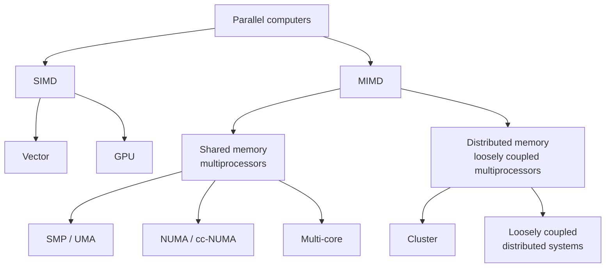
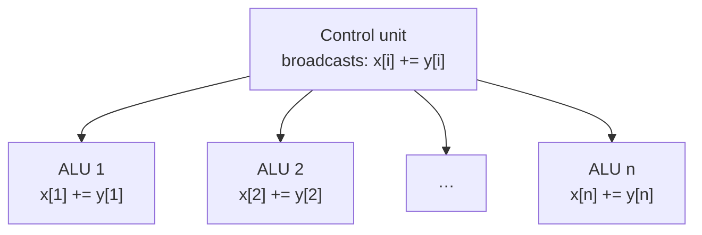
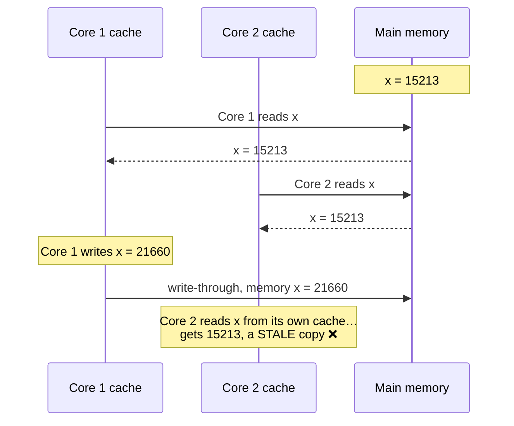
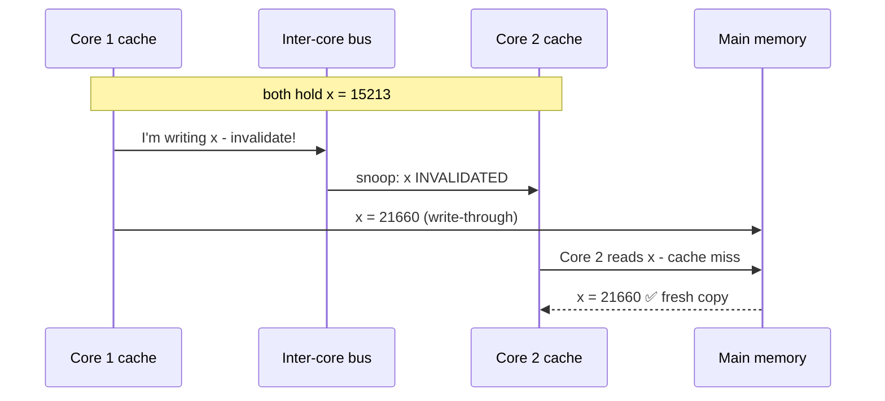
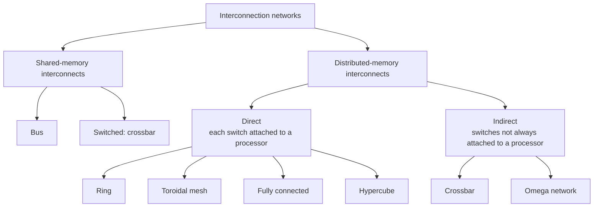

import Callout from '../../../components/Callout.astro';
import QA from '../../../components/QA.astro';
import QAList from '../../../components/QAList.astro';
import Figure from '../../../components/Figure.astro';
import sisd from './images/w03-sisd.png';
import simd from './images/w03-simd.png';
import misd from './images/w03-misd.png';
import mimd from './images/w03-mimd.png';
import models from './images/w03-models-paradigms.jpg';
import sharedMem from './images/w03-shared-memory.png';
import numa from './images/w03-numa.png';
import uma from './images/w03-uma.png';
import coherence from './images/w03-cache-coherence.png';
import distMem from './images/w03-distributed-memory.png';
import crossbar from './images/w03-crossbar.png';
import ringMesh from './images/w03-ring-mesh.png';
import ringBisect from './images/w03-ring-bisection.png';
import fully from './images/w03-fully-connected.png';
import hypercube from './images/w03-hypercube.png';
import indirect from './images/w03-indirect-network.png';
import omega from './images/w03-omega.png';
import omegaSwitch from './images/w03-omega-switch.png';

<Callout type="why">
"Parallel computer" can mean a GPU, your laptop's 8 cores, or a 10,000-node supercomputer, and you program each one **differently**. This page gives you the vocabulary to say *which kind* of machine you're dealing with, and therefore which tool and design to use.

- **Real life:** choosing between a GPU (SIMD-style) and more CPU cores (MIMD) for a workload; understanding why a multi-socket server gets slower when a thread uses memory on the "other" socket (NUMA); why cloud data-centre networks are built the way they are.
- **Connects to:** Week 4 (designing parallel programs for these machines), Week 5 (message passing on distributed memory), Weeks 6–7 (shared memory: Pthreads/OpenMP), Week 11 (GPU/CUDA), Week 14 (cloud data-centre architecture).
</Callout>

<Callout type="key">
1. **Flynn's taxonomy** (1966) classifies machines by instruction streams × data streams: **SISD** (classic single core), **SIMD** (GPUs, vector units), **MISD** (almost none exist), **MIMD** (multi-core CPUs, clusters).
2. **SIMD** = one control unit, many ALUs, all doing the **same** instruction on different data (**data parallelism**). Great for regular data; bad when branches differ.
3. **Shared memory:** **UMA** (same access time for every core, i.e. SMP) vs **NUMA** (local memory is faster than remote).
4. **Cache coherence:** private caches can hold **stale copies**. The fix is **snooping + invalidation** (protocols such as MSI and MESI).
5. **Distributed memory:** each node has its own memory, as in a **cluster**. Nodes communicate by messages.
6. **Interconnects:** shared memory uses a **bus** or **crossbar**; distributed memory uses **direct** networks (ring, mesh, hypercube, fully connected) or **indirect** ones (crossbar, omega). **Bisection width** measures how well connected a network is.
</Callout>

## Big picture

*Taxonomy of parallel computers, after slide 116. The lecture also lists pipeline machines under the SIMD/vector side.*

## 1. Flynn's taxonomy

Proposed by **Michael J. Flynn in 1966**. It classifies a computer by how many **instruction streams** (instructions being run) and how many **data streams** (pieces of data being processed) it has **at the same time**.

| | **Single data** | **Multiple data** |
|---|---|---|
| **Single instruction** | **SISD**: classic Von Neumann, a single-core CPU | **SIMD**: vector computers, **GPUs** |
| **Multiple instruction** | **MISD**: pipeline computer, *rarely built* | **MIMD**: **multi-core CPUs**, clusters, distributed systems |

<Figure src={sisd} alt="One instruction stream over time: load A, load B, C = A + B, store C, A = B * 2, store A" caption="SISD: one instruction at a time, on one piece of data." credit="Slide 41" max={260} />
<Figure src={simd} alt="Processors P1, P2 … Pn all execute load A(i), load B(i), C(i)=A(i)*B(i), store C(i) in lock step" caption="SIMD: every processor runs the same instruction at the same time, each on its own data (A(1), A(2) … A(n))." credit="Slide 42" />
<Figure src={misd} alt="Processors P1, P2 … Pn each run different instructions (C(1)=A(1)*1, C(2)=A(1)*2 … ) on the same data A(1)" caption="MISD: different instructions on the same data. Few real machines exist; one use is running several cryptography algorithms on one message." credit="Slide 43" />
<Figure src={mimd} alt="Processors P1, P2 … Pn each run completely different instruction sequences on different data" caption="MIMD: each processor runs its own program on its own data. This is what most modern parallel machines are." credit="Slide 44" />

| Class | Parallelism | Control | Example today |
|---|---|---|---|
| SISD | None | — | One core of an old CPU, a simple microcontroller |
| SIMD | **Synchronous**, data-parallel | **Single** thread of control, lock-step | GPU, CPU vector instructions (SSE/AVX/NEON) |
| MISD | Pipeline-like | — | Rare: fault-tolerant flight computers |
| MIMD | **Asynchronous** | **Multiple** threads of control | Your multi-core laptop, a cluster, the cloud |

<Callout type="note">
Most real MIMD machines **also contain SIMD parts**: every modern CPU core has vector (SIMD) instructions, and many contain GPUs. Flynn's taxonomy is a **conceptual** view, not a strict box.
</Callout>

### The banking analogy

**Tellers** = processors · **customers** = tasks · **transactions** = operations · **accounts** = data.

| Model | How the bank works | Coupling / grain |
|---|---|---|
| **SIMD / SPMD** | Accounts are split among tellers. **All tellers do the same step at the same moment**, like a drill: "everyone: open account… now deposit… now print receipt" | Tightly coupled, medium grain |
| **MIMD** | Each teller serves their own customer, **however and whenever** they like. Accounts are shared, so **any access to an account is locked** to stop two tellers changing the same account at once | Coupled, medium grain |

**SPMD (Single Program, Multiple Data):** every processor runs the **same program** but at its own pace, on its own data. It's the practical, more flexible version of SIMD, and the most common style today (e.g. MPI programs).

## 2. SIMD systems in detail

> **SIMD:** parallelism by **dividing data among processors** and applying **the same instruction** to every item. Also called **data parallelism**.

**What if there are fewer ALUs than data items?** Divide the work and process it in rounds. Example: **m = 4 ALUs, n = 15 items**:

| Round | ALU 1 | ALU 2 | ALU 3 | ALU 4 |
|---|---|---|---|---|
| 1 | x[0] | x[1] | x[2] | x[3] |
| 2 | x[4] | x[5] | x[6] | x[7] |
| 3 | x[8] | x[9] | x[10] | x[11] |
| 4 | x[12] | x[13] | x[14] | *idle* |

Rounds needed = ⌈n/m⌉ = ⌈15/4⌉ = **4**. In round 4, ALU 4 is idle.

**Early SIMD machines:** Thinking Machines **Connection Machine CM-2** (65,000 processing elements) and the MasPar MP-2. Pure SIMD as a general-purpose platform has mostly disappeared; **SPMD** is more common now. SIMD lives on in multimedia, streaming and real-time applications, and above all in **GPUs**.

### SIMD drawbacks

- All ALUs must run **the same instruction, or stay idle**. If half the data takes the `if` branch and half the `else`, half the ALUs wait each time.
- In the classic design they must run **synchronously** (lock-step).
- The ALUs have **no instruction storage** of their own.
- Efficient for **large, regular data-parallel problems**, but poor for more complex, irregular problems.

### Vector processors

| Scalar processor | Vector processor |
|---|---|
| Operates on **one data item** at a time | Operates on **arrays (vectors)** of data at once |
| Simple, the most common type | More complex hardware |
| Each instruction handled one after another | One instruction processes many items |

**Key features:**
- **Vector registers** hold a whole vector of operands and operate on all of them at once.
- **Vectorised and pipelined functional units** apply the same operation to every element. **Vector operations are SIMD.**
- **Vector instructions** operate on vectors, not scalars, so one instruction does the work of a whole loop.
- **Interleaved memory:** memory is split into multiple **banks** that can be accessed independently. Spreading a vector's elements across banks removes the wait between successive loads and stores.
- **Strided memory access and hardware scatter/gather:** efficiently access elements at fixed intervals (e.g. every 4th element, or one column of a matrix).

| 😀 Pros | 😟 Cons |
|---|---|
| Fast and easy to use | Poor at **irregular** data structures (linked lists, trees) |
| **Vectorising compilers** find code to exploit automatically, and report code they *can't* vectorise so you can rewrite it | **Limited scalability**: there's a hard limit to how big a problem they can handle |
| High memory bandwidth; uses **every item in a cache line** | |

### GPUs

- Graphics APIs represent an object's surface as **points, lines and triangles**.
- A **graphics processing pipeline** converts these into an array of **pixels** for the screen.
- Several pipeline stages are programmable **shader functions**, usually just a few lines of C-like code.
- Shaders are **implicitly parallel**: the same shader runs on thousands of pixels or vertices, so GPUs use **SIMD parallelism**, although they're not pure SIMD systems.
- That's why GPUs became general-purpose parallel processors (GPGPU), covered in **Week 11 (CUDA)**.

## 3. MIMD systems

> **MIMD:** multiple independent instruction streams on multiple data streams. A collection of **fully independent processing units or cores**, **each with its own control unit and its own ALU**.

They run **asynchronously**: each core goes at its own pace, with no global clock forcing lock-step. MIMD machines split into **shared memory** and **distributed memory**.

### Models and paradigms

<Figure src={models} alt="Diagram with application programs at the top and concrete architectures (SMP, CC-NUMA, Myrinet, ATM) at the bottom; in between, models such as Pthreads, Java Threads, OpenMP, Skeletons, MPI, PVM, threads, shared memory, distributed shared memory, message passing and cluster" caption="Programming models sit between applications and hardware. Shared-memory models (threads, OpenMP) map to SMP or cc-NUMA; message-passing models (MPI, PVM) map to clusters." credit="Slide 67" max={520} />

- **Model:** a high-level abstraction that captures the important concepts. It's simple to understand and more stable than the technology underneath.
- **Paradigm:** a kind of model describing typical **structures or patterns** of programs.
- **Programming model:** the programmer's view of the machine (e.g. "threads sharing memory" or "processes sending messages").
- **Abstract model:** a model with cost measures, used for designing algorithms (like the summation model in Intro Part 2).

## 4. Shared memory systems

> Autonomous processors connected to a memory system through an **interconnection network**. **Every processor can access every memory location**, and processors communicate **implicitly** by reading and writing shared data.

<Figure src={sharedMem} alt="Several CPUs connected through an interconnect to one memory" caption="Generic shared-memory system: many CPUs, one memory." credit="Slide 71 (Pacheco Fig 2.3)" max={520} />

- Most shared-memory systems today are built from **one or more multi-core processors**.
- Also called **SMP (Symmetric Multi-Processor)**: every processor has an equal chance to read and write, at equal speed.
- **It doesn't scale well**: traditionally up to about **64 processors**, because of **bus contention** (everyone fighting for the same bus).

They come in two classes, based on memory access time.

<Figure src={uma} alt="Chip 1 and Chip 2, each with two cores, both connected through one interconnect to a single memory" caption="UMA: every core reaches memory through the same interconnect, so access time is the same everywhere." credit="Slide 76 (Pacheco Fig 2.5)" />
<Figure src={numa} alt="Chip 1 and Chip 2, each with two cores, its own interconnect and its own memory, with a link between the two chips" caption="NUMA: each chip has its own local memory. Accessing the other chip's memory goes over the link and is slower." credit="Slide 74 (Pacheco Fig 2.6)" />

| | **UMA** (Uniform Memory Access) | **NUMA** (Non-Uniform Memory Access) |
|---|---|---|
| Access time | **Same** for all memory | Local memory **faster** than remote memory |
| Built from | One SMP; identical processors | **Two or more SMPs linked together** |
| Scales | Poorly (bus contention) | Better (each chip has its own memory) |
| With cache coherence | **CC-UMA** | **CC-NUMA** |
| Programmer's worry | Simple | Keep a thread's data in its **local** memory for speed |

### Cache design in a bus-based system

Cache memory **reduces contention on the shared bus**: if most instructions and data come from the cache (a high **hit rate**), the bus is used less. But this creates a new problem.

**Cache coherent** means: if one processor updates a shared memory location, **all other processors know about the update**. This is done **in hardware**; programmers have **no control** over when caches get updated.

## 5. The cache coherence problem

<Figure src={coherence} alt="Two cores, each with its own cache, connected through an interconnect to memory containing x, y0, y1, z1" caption="Two cores, two private caches, one shared memory. If both cache x, which copy is correct after one core changes it?" credit="Slide 78 (Pacheco Fig 2.17)" max={360} />

**Step-by-step** (the slides use 4 cores; 2 are shown here because the other 2 never touch x; write-through caches):

Core 2's cache still holds the old value. Each core should see memory as **one consistent array**, but with private caches it doesn't. This isn't specific to multi-core: it's a general problem for any multiprocessor with caches.

### The fix: invalidation with snooping

All caches **listen ("snoop")** on a shared **inter-core bus**. When a core writes, it broadcasts an **invalidation request**, and every other cache holding that line marks it **invalid**.

### Invalidation or update: which is better?

| | **Invalidation** | **Update** |
|---|---|---|
| On a write | Tell others "your copy is invalid" | Send others the **new value** |
| Multiple writes to the same location | Only the **first** write causes bus traffic | **Every** write is broadcast, including the new value |
| Bus traffic | **Less**, so it usually performs better | More |

**Invalidation generally wins.** Real CPUs use more sophisticated invalidation protocols with extra state bits per cache line: **MSI** and **MESI** (**M**odified, **E**xclusive, **S**hared, **I**nvalid).

<Callout type="warn" title="Why programmers should care: false sharing">
Coherence works on whole **cache lines** (e.g. 64 bytes), not single variables. If thread A updates `count[0]` and thread B updates `count[1]`, and both sit in the **same cache line**, each write invalidates the other core's cache. The two cores fight over the line, and the program runs *slower* in parallel even though the threads never touch each other's data. This is called **false sharing**, and you'll see it in Weeks 6–7.
</Callout>

### Private vs shared caches

| Advantages of **private** caches | Advantages of **shared** caches |
|---|---|
| **Closer to the core**, so faster access | Threads on different cores can **share** the same cached data, so there's no coherence traffic for it |
| **Reduces contention** | If only one or a few threads run, they get **more cache space** |

**Typical design of a chip multiprocessor:**
- With SMT only (one core, many hardware threads): **all caches shared**.
- Multi-core chips: **L1 always private**; **L2 private in some designs, shared in others**.
- **Main memory is always shared.**

| Design | L1 | L2 | Examples |
|---|---|---|---|
| "Fish" machine: dual-core Intel Xeon, each core hyper-threaded | Private | **Shared** | Intel Xeon (dual-core) |
| Private L2 | Private | **Private** | AMD Opteron, AMD Athlon, Intel Pentium D |
| With L3 | Private | Private | **L3** added (Intel Itanium 2) |

Today's typical design: **private L1 and L2 per core, with one big shared L3**.

## 6. Distributed memory systems

<Figure src={distMem} alt="Several CPU+memory pairs, each connected to a common interconnect" caption="Each CPU has its own memory. They're connected only through the network." credit="Slide 93 (Pacheco Fig 2.4)" max={520} />

- **Clusters** are the most popular type: a collection of **commodity systems** (ordinary PCs or servers) connected by a **commodity network**.
- Each **node** is an independent computation unit; nodes are joined by a communication network.
- Clusters whose nodes are themselves multi-core shared-memory machines are often called **hybrid systems**.

### Cluster

> *"A cluster is a type of parallel or distributed system that consists of a collection of interconnected **whole computers**, and is used as a **single unified computing resource**."* (Pfister)

- **Whole computer** = its own processors, cache, memory, disk, I/O and OS (a PC, workstation or SMP).
- **Interconnection network:** Ethernet, Myrinet (today InfiniBand is common in HPC).
- **Single unified computing resource** = a **single system image**: one entry point, one file system, coordinated job queues, location transparency, and one system to administer.
- **Advantages:** cheap ($$$), scalable, a familiar ("typical") environment.
- **Beowulf cluster:** a dedicated do-it-yourself cluster of up to hundreds of nodes running **Linux**, used as a parallel machine.

### Loosely coupled distributed systems

Whole computers (PCs, workstations, usually **heterogeneous**) connected by an ordinary network, usually **TCP/IP**. They suit **distributed computing** rather than parallel computing, unless the problem is **very coarse-grained** or **trivially (embarrassingly) parallel**: tasks so independent they hardly ever communicate.

| | Shared memory | Cluster | Loosely coupled |
|---|---|---|---|
| Memory | One shared | Private per node | Private per machine |
| Network | Bus / crossbar | Fast dedicated (Myrinet, InfiniBand) | Ordinary TCP/IP |
| Machines | One box | Usually identical | Mixed |
| Best for | Fine-grained parallel | Parallel (medium/coarse grain) | Distributed, very coarse grain |

## 7. Interconnection networks

The network affects the performance of **both** shared and distributed memory systems. A fast processor is useless if it's waiting for data.

### Shared-memory interconnects

**Bus:** a set of parallel wires shared by all connected devices, plus hardware that controls who may use it.
- ✅ Cheap and simple.
- ❌ As more devices connect, **contention increases and performance decreases**. This is why SMPs top out at tens of processors.

**Switched interconnect (crossbar):** switches route data between devices.

<Figure src={crossbar} alt="(a) A crossbar connecting 4 processors P1–P4 to 4 memory modules M1–M4 through a grid of switches; (b) the two internal switch configurations; (c) simultaneous accesses where each processor reaches a different memory module" caption="Crossbar: (a) a grid of switches links every processor to every memory module; (b) each switch is either 'straight through' or 'turn'; (c) all 4 processors can reach 4 different memories at the same time." credit="Slide 101 (Pacheco Fig 2.7)" max={340} />

- ✅ Allows **simultaneous communication** between different devices, so it's **faster than a bus**.
- ❌ The switches and links are **expensive**: p × m switches for p processors and m memories.

### Distributed-memory interconnects

**Direct interconnect:** each switch is attached to a processor–memory pair, and switches connect to each other with fixed physical links.

<Figure src={ringMesh} alt="(a) A ring of three processors; (b) a 3×3 toroidal mesh where edges wrap around" caption="(a) Ring: each node links to two neighbours. (b) Toroidal mesh: a grid where the edges wrap around, so every node has 4 neighbours." credit="Slide 103 (Pacheco Fig 2.8)" max={560} />

#### Bisection width: measuring connectivity

> **Bisection width:** split the network into two equal halves so that as **few links as possible** cross the divide. The number of crossing links = how many **simultaneous communications** can happen between the halves.

<Figure src={ringBisect} alt="Two ways to split an 8-node ring into halves A and B: (a) 2 links cross the divide, (b) 4 links cross" caption="Two bisections of an 8-node ring. (a) Only 2 links cross, (b) 4 cross. Bisection width uses the WORST case (the minimum), so a ring's bisection width = 2." credit="Slide 105 (Pacheco Fig 2.9)" max={520} />

**Bisection bandwidth** = bisection width × bandwidth of each link. It measures the total data rate between the two halves.

**Fully connected:** every switch connects directly to every other switch.

<Figure src={fully} alt="Eight nodes, each linked to every other node" caption="Fully connected: bisection width p²/4, the best possible, but it needs p(p−1)/2 links. Impractical for large p." credit="Slide 107 (Pacheco Fig 2.11)" max={300} />

**Hypercube:** highly connected, and built up step by step:
- **1-D:** 2 processors linked together (fully connected).
- **2-D:** take two 1-D hypercubes and join "corresponding" switches, giving a square.
- **3-D:** take two 2-D hypercubes and join corresponding switches, giving a cube.
- A **d-dimensional** hypercube has **p = 2ᵈ** nodes, and each node has **d = log₂p** links.

<Figure src={hypercube} alt="(a) one-dimensional hypercube: two nodes linked; (b) two-dimensional: a square of four nodes; (c) three-dimensional: a cube of eight nodes" caption="Hypercubes of dimension 1, 2 and 3. Each new dimension doubles the nodes." credit="Slide 109 (Pacheco Fig 2.12)" max={520} />

#### Comparing networks (p = number of nodes)

| Network | Diameter (longest shortest path) | Bisection width | Number of links |
|---|---|---|---|
| Completely connected | 1 | **p²/4** | p(p−1)/2 |
| Star | 2 | 1 | p − 1 |
| Complete binary tree | 2·log₂((p+1)/2) | 1 | p − 1 |
| Linear array | p − 1 | 1 | p − 1 |
| Ring | **⌊p/2⌋** | 2 | p |
| 2-D toroidal mesh *(extra)* | 2⌊√p/2⌋ | 2√p | 2p |
| Hypercube | log₂p | p/2 | (p·log₂p)/2 |

The two blank cells on the slide are filled in here (shown in **bold**), and the toroidal mesh row is extra.

- **Diameter** = the maximum number of hops between any two nodes. **Lower is better** (less latency).
- **Bisection width:** **higher is better** (more simultaneous traffic).
- **Links:** **fewer is cheaper**.
- The **hypercube** is a good compromise: low diameter and high bisection width, with only log p links per node.

<Callout type="exam">
Typical question: *"For p = 16, compare the ring and the hypercube."*
- Ring: diameter ⌊16/2⌋ = **8**, bisection width **2**, links **16**.
- Hypercube: diameter log₂16 = **4**, bisection width 16/2 = **8**, links (16×4)/2 = **32**.

The hypercube costs twice as many links but has half the diameter and 4× the bisection width.
</Callout>

**Indirect interconnect:** switches aren't necessarily attached to a processor. They are usually drawn with one-way links: each processor has an outgoing and an incoming link into a **switching network**.

<Figure src={indirect} alt="Processors on the left with outgoing links into a box labelled Switching Network and incoming links back" caption="A generic indirect network. Examples: the crossbar and the omega network." credit="Slide 112 (Pacheco Fig 2.13)" max={460} />

**Omega network:** a cheaper alternative to a full crossbar, built from layers of small **2×2 switches**.

<Figure src={omega} alt="An 8×8 omega network made of 3 stages of 2×2 switches with a shuffle wiring pattern between stages" caption="8×8 omega network: log₂8 = 3 stages of four 2×2 switches each." credit="Slide 114 (Pacheco Fig 2.15)" />
<Figure src={omegaSwitch} alt="A single 2×2 switch made of 4 smaller crossbar switch points" caption="Each 2×2 switch is itself a tiny crossbar." credit="Slide 115 (Pacheco Fig 2.16)" />

| | Crossbar | Omega network |
|---|---|---|
| Switches for p processors | p² | (p/2)·log₂p two-by-two switches |
| Simultaneous communication | Any processor to any free memory at once | Some combinations **block** each other |
| Cost | High | Much lower |

For p = 8: a crossbar needs 64 switch points, while an omega network needs 12 small switches (each one a 2×2 crossbar, so 48 switch points). The saving grows quickly as p increases.

<QAList>
  <QA q="Draw and explain Flynn's taxonomy with one example for each class." level="easy" why="Count streams: single or multiple instructions × single or multiple data. SISD classic, SIMD GPU, MISD rare, MIMD multi-core.">
    | | Single data | Multiple data |
    |---|---|---|
    | **Single instruction** | **SISD**: classic Von Neumann single-core | **SIMD**: GPU, vector processor |
    | **Multiple instruction** | **MISD**: pipeline machine, rare | **MIMD**: multi-core CPU, cluster |

    It classifies machines by the number of concurrent instruction streams × data streams (Flynn, 1966).
  </QA>
  <QA q="Contrast SIMD and MIMD in terms of control and synchronisation." level="medium" why="SIMD = one control unit, lock-step, synchronous. MIMD = each core has its own control unit and runs asynchronously.">
    **SIMD:** one control unit broadcasts **one instruction** to many ALUs, which run in **lock-step** (synchronous, single thread of control) on different data.

    **MIMD:** each core has **its own control unit and ALU** and runs its own instruction stream **asynchronously** (multiple threads of control).
  </QA>
  <QA q="A SIMD machine has 8 ALUs and must process 50 data items. How many rounds are needed, and how many ALUs are idle in the last round?" level="medium" why="Rounds = ⌈50/8⌉ = 7. The last round has 50 − 48 = 2 items, so 6 ALUs sit idle.">
    Rounds = ⌈50/8⌉ = **7**. Six full rounds process 48 items; the 7th round has 2 items, so **6 ALUs are idle**.
  </QA>
  <QA q="Why is SIMD inefficient for code with lots of if/else branches?" level="medium" why="All ALUs must run the same instruction. With divergent branches, one group waits while the other runs.">
    All ALUs must execute the **same instruction** or stay idle. If some data elements take the `if` branch and others take the `else`, the machine runs the `if` part while the "else" ALUs wait, then runs the `else` part while the "if" ALUs wait. Up to half the ALUs (or more) are idle at any time.
  </QA>
  <QA q="Give two advantages and two disadvantages of vector processors." level="easy" why="Pros: fast, easy, vectorising compilers, high bandwidth. Cons: irregular data structures and limited scalability.">
    **Pros:** fast and easy to use; vectorising compilers find exploitable code automatically; high memory bandwidth and they use every item in a cache line.

    **Cons:** poor at irregular data structures; limited scalability for very large problems.
  </QA>
  <QA q="What is interleaved memory, and why do vector processors use it?" level="hard" why="Banks are accessed in parallel, so consecutive elements come from different banks without waiting. That gives vectors the bandwidth they need.">
    Memory is split into multiple **banks** that can be accessed more or less independently. Successive vector elements are spread across banks, so while one bank is busy delivering element i, the next bank is already delivering element i+1. This removes the delay between loading and storing successive elements and gives the high bandwidth vector units need.
  </QA>
  <QA q="Differentiate UMA and NUMA." level="easy" why="UMA = same access time everywhere; NUMA = local memory faster than remote. NUMA comes from linking SMPs.">
    **UMA:** every processor has the **same** access time to all memory (one shared memory, typical of SMPs). **NUMA:** made by linking two or more SMPs; each processor accesses its **local** memory faster than **remote** memory across the link. With cache coherence they're called CC-UMA and CC-NUMA.
  </QA>
  <QA q="Why don't bus-based shared memory systems scale beyond tens of processors?" level="medium" why="Everyone shares one bus, so more processors means more waiting (contention).">
    All processors share the same bus to memory. As more processors are added, **bus contention** increases (they wait for their turn), so performance drops. Caches reduce bus traffic, but they bring the cache-coherence problem and add coherence traffic of their own.
  </QA>
  <QA q="Explain the cache coherence problem with an example." level="medium" why="Private caches can hold different copies. After one core writes, another can still read its old, stale value.">
    Cores 1 and 2 both read x = 15213 into their private caches. Core 1 then writes x = 21660 (to its cache and, with write-through, to memory). Core 2 then reads x from **its own cache** and gets the old value 15213, a **stale copy**. Private caches can hold inconsistent copies of the same memory location.
  </QA>
  <QA q="How does an invalidation-based snooping protocol solve cache coherence? Why is invalidation usually preferred to update?" level="hard" why="Writers broadcast 'invalidate', others drop their copy and re-fetch. Invalidation needs bus traffic only on the first of repeated writes.">
    All caches **snoop** on a shared bus. When a core writes a location, it broadcasts an **invalidation**, and the other caches mark their copy invalid. Their next read of that location is a miss, so they fetch the new value.

    Invalidation is preferred because for **repeated writes** to the same location only the first write generates bus traffic, while an update protocol must broadcast **every** write together with its value. Real CPUs use refined versions with extra state bits, such as **MSI** and **MESI**.
  </QA>
  <QA q="What is false sharing?" level="hard" why="Coherence works per cache line. Different variables in the same line still bounce between cores even though no data is really shared.">
    Two threads update **different variables** that happen to sit in the **same cache line**. Coherence works per line, so each write invalidates the other core's copy and the line bounces between the cores. The program slows down even though the threads share no data. The fix is to pad or align the data so each thread's variables are in separate cache lines.
  </QA>
  <QA q="Give the advantages of private caches and of shared caches." level="easy" why="Private: closer and less contention. Shared: data sharing without coherence traffic, and more space for a single heavy thread.">
    **Private:** closer to the core, so faster; less contention. **Shared:** threads on different cores can share cached data; a single (or a few) heavy thread can use more cache space.
  </QA>
  <QA q="Define a cluster (Pfister) and explain 'single system image'." level="medium" why="Whole computers, used as one resource. Single system image = it looks like one machine to users and admins.">
    A cluster is a parallel or distributed system made of interconnected **whole computers** (each with its own CPU, memory, disk, I/O and OS) used as a **single unified computing resource**. **Single system image** means users and admins see it as one machine: a single entry point, one file system, coordinated job queues and location transparency.
  </QA>
  <QA q="What is bisection width? What is the bisection width of an 8-node ring, and why is it 2, not 4?" level="medium" why="Bisection width uses the WORST case (minimum cut). A ring can always be cut with only 2 links crossing.">
    Bisection width is the **minimum** number of links that must be cut to split the network into two equal halves. It measures how many simultaneous communications can cross between the halves. For an 8-node ring you can cut it so only **2** links cross (cutting in different places can cross 4), and the definition takes the **worst case** (minimum), so it is **2**.
  </QA>
  <QA q="For p = 64 nodes, compute diameter, bisection width and number of links for a hypercube and a fully connected network." level="hard" why="Hypercube: log₂64 = 6, 64/2 = 32, 64·6/2 = 192. Fully connected: 1, 64²/4 = 1024, 64·63/2 = 2016.">
    | | Diameter | Bisection width | Links |
    |---|---|---|---|
    | Hypercube | log₂64 = **6** | 64/2 = **32** | (64×6)/2 = **192** |
    | Fully connected | **1** | 64²/4 = **1024** | 64×63/2 = **2016** |

    Fully connected is better on paper but needs over 10× the links, so it's impractical.
  </QA>
  <QA q="How is a 3-dimensional hypercube built, and how many links does each node have?" level="medium" why="Join two 2-D squares at corresponding nodes. Each node gets one link per dimension, so 3.">
    Take two 2-D hypercubes (squares of 4 nodes) and connect each node to its "corresponding" node in the other square. The result has 8 nodes, and **each node has 3 links** (= dimension d = log₂8).
  </QA>
  <QA q="Compare a crossbar and an omega network." level="hard" why="Crossbar = p² switches, non-blocking, expensive. Omega = log₂p stages of 2×2 switches, cheap but can block.">
    Both are indirect interconnects. A **crossbar** uses a full grid of p² switches and lets every processor reach any free memory at the same time (non-blocking), but it's expensive. An **omega network** uses log₂p stages of p/2 small 2×2 switches, which is far cheaper, but some communication patterns **block** each other because they need the same switch.
  </QA>
  <QA q="Your Flutter app's backend runs on 8 cloud VMs connected by ordinary Ethernet. Classify this system using Flynn's taxonomy and the memory model." level="medium" why="Each VM runs its own program (MIMD) and has its own memory, talking over the network (distributed memory).">
    **MIMD** (each VM runs its own instruction stream on its own data), **distributed memory**: it's a cluster or loosely coupled system where nodes communicate over the network (TCP/IP), not through shared memory.
  </QA>
</QAList>
