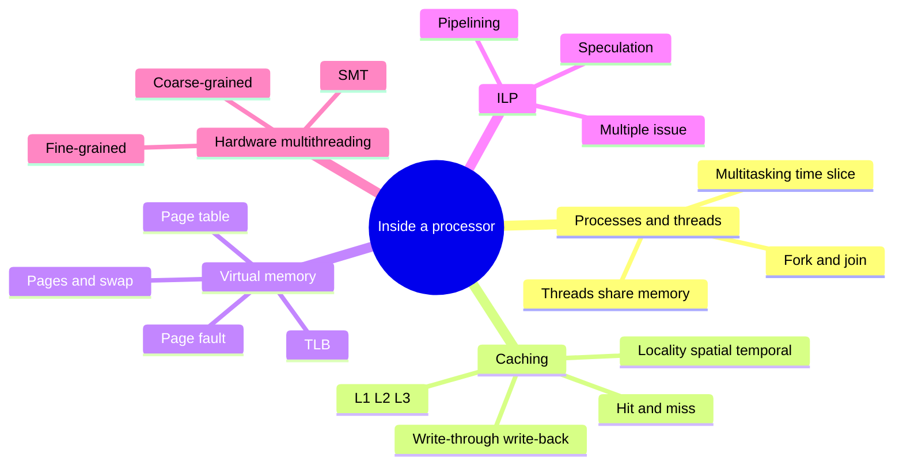
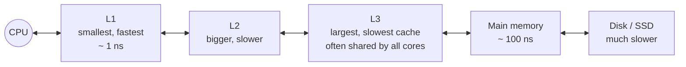
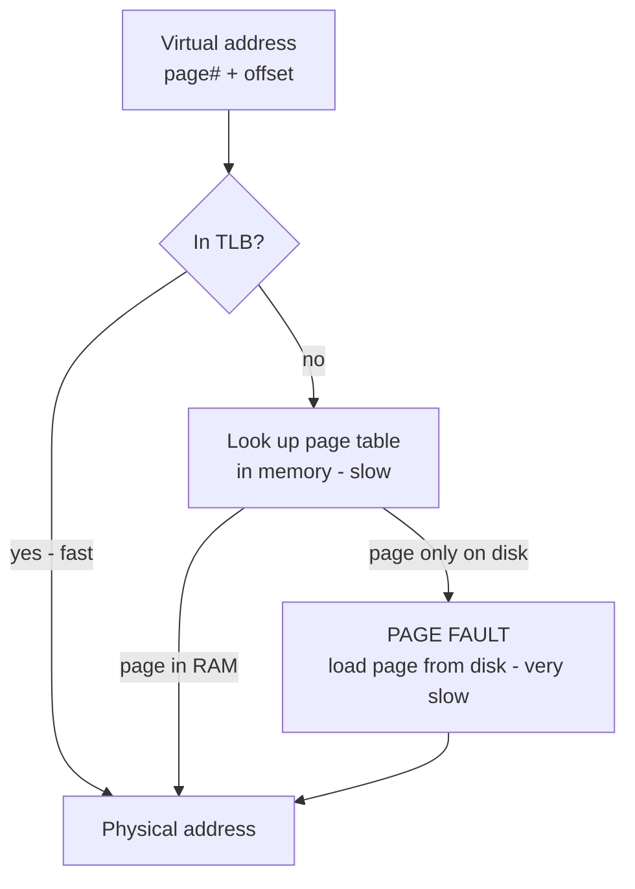

import Callout from '../../../components/Callout.astro';
import QA from '../../../components/QA.astro';
import QAList from '../../../components/QAList.astro';
import Figure from '../../../components/Figure.astro';
import procThreads from './images/w03-process-threads.png';
import pageTable from './images/w03-page-table.png';
import fpSteps from './images/w03-fp-add-steps.png';
import pipelined from './images/w03-pipelined-add.png';

<Callout type="why">
Before using many processors, you need to know how **one** processor gets its speed, because parallel code that ignores it can end up **slower**.

Two threads fighting over the same cache line, or code that jumps randomly through memory and misses the cache, can wipe out all your speedup. The CPU is also already doing parallel work behind your back (pipelining, multiple issue, Hyper-Threading), and that's the "free" parallelism we ran out of in Week 1.

- **Real life:** why looping over an array row-by-row is much faster than column-by-column; why your app slows down when RAM is full (swapping); why a browser tab running in its own process doesn't crash the others.
- **Connects to:** Part 2 (cache coherence in multi-core); Week 4 (overhead and performance); Week 6 (processes vs threads, Pthreads); Week 11 (GPU memory).
</Callout>

<Callout type="key">
1. **Process vs thread:** a process is a running program with its own memory; **threads live inside a process and share its memory**. Starting a thread is *fork*, waiting for it to finish is *join*.
2. **Cache** = small, fast memory near the CPU. It works because of **locality** (spatial: nearby data; temporal: the same data again soon). **L1 → L2 → L3**: smallest/fastest to largest/slowest.
3. **Write-through** updates memory immediately; **write-back** marks the line *dirty* and writes it later.
4. **Virtual memory** = main memory used as a cache for the disk: **pages**, a **page table** and the **TLB** (a cache of the page table). A page that's only on disk causes a **page fault**.
5. **ILP:** **pipelining** (an assembly line; 1000 adds take 1006 ns instead of 7000 ns), **multiple issue** (duplicate units; static vs dynamic/superscalar) and **speculation** (guess, and redo if wrong).
6. **Hardware multithreading:** fine-grained, coarse-grained, and **SMT** (= Hyper-Threading).
</Callout>

## Big picture



## 1. Multitasking and threads

**Multitasking** gives the **illusion** that one processor runs many programs at once. Each process gets a short **time slice**; when its turn ends, it **blocks** and waits for its next turn. It switches so fast that it *looks* simultaneous, but on one core only one thing really runs at a time.

**Threads** are contained **inside a process**. They let you split a program into (more or less) independent tasks. The hope: when one thread **blocks** (e.g. waiting for a file or the network), another thread has work to do.

<Figure src={procThreads} alt="A process line splits into two thread lines which later merge back" caption="The 'master' thread starts two threads (forking) and later waits for them to finish (joining)." credit="Slide 4 (Pacheco Fig 2.2)" max={560} />

| | Process | Thread |
|---|---|---|
| What it is | A running program | A path of execution inside a process |
| Memory | **Own** separate memory | **Shares** the process's memory |
| Create / switch cost | Heavy | Light |
| If it crashes | Others are safe | Can bring down the whole process |
| Talk to each other | Needs special mechanisms (pipes, sockets) | Just read and write shared variables, which is fast but can cause race conditions |

<Callout type="tip" title="Analogy">
A **process** is a house; **threads** are the people living in it. They share the kitchen and fridge (memory), so they can cooperate easily, but two people grabbing the last egg at the same time is a **race condition**. Different houses (processes) don't share a fridge at all.
</Callout>

## 2. Caching

> **Cache:** a collection of memory locations that can be accessed **faster** than other memory locations. A CPU cache is usually on the same chip as the CPU.

Main memory (RAM) is roughly 100× slower than the CPU. Without a cache, the CPU would spend most of its time waiting.

### Why caches work: the principle of locality

After accessing one location, a program usually accesses **a nearby location** soon after.

| Type | Meaning | Example |
|---|---|---|
| **Spatial locality** | Access locations **near** the one just used | Looping through `z[0], z[1], z[2] …` |
| **Temporal locality** | Access the **same** location again **soon** | The variable `sum` inside a loop |

```c
float z[1000];
sum = 0.0;
for (i = 0; i < 1000; i++)
    sum += z[i];      // z[i]: spatial locality, sum: temporal locality
```

Memory is moved into the cache in **blocks** (cache lines). If a block holds 16 floats, reading `z[0]` loads `z[0]…z[15]` together. The next **16 additions use the cache**, and only then is the next block read. That's 1 slow read per 16 elements instead of 16.

### Levels of cache



### Hit or miss

- **Cache hit:** the CPU wants `x` and finds it in the cache, so it's fast.
- **Cache miss:** `x` isn't in any cache level, so it must be fetched from **main memory**. That's slow, and the CPU may stall while it waits.

The CPU checks L1, then L2, then L3, and only then main memory.

### Keeping cache and memory consistent

When the CPU **writes** to the cache, the cached value no longer matches main memory. There are two policies:

| Policy | How it works | Pro | Con |
|---|---|---|---|
| **Write-through** | Update main memory **at the same time** as the cache | Memory is always up to date | Every write is slow (goes to memory) |
| **Write-back** | Mark the cache line **dirty**; write it to memory only when the line is replaced | Fewer memory writes, faster | Memory is temporarily out of date |

<Callout type="note" title="Bookmark this">
This "cache vs memory out of sync" problem gets much worse with **several cores, each with its own cache**. That's the **cache coherence** problem in Part 2.
</Callout>

## 3. Virtual memory

If a program (or its data) is **too big for main memory**, virtual memory lets main memory act **as a cache for the disk (secondary storage)**.

- It exploits **spatial and temporal locality** (again!): only the **active parts** of running programs are kept in RAM.
- Idle parts are kept on disk in **swap space**.
- Memory is managed in **pages**: fixed-size blocks of data and instructions, usually **4–16 KB**.

### Virtual addresses and the page table

When a program is compiled, its pages get **virtual page numbers**. When it runs, the OS builds a **page table** that maps each virtual page number to a **physical address** in RAM.

<Figure src={pageTable} alt="A 32-bit virtual address divided into a virtual page number (bits 31 to 12) and a byte offset (bits 11 to 0)" caption="A virtual address = virtual page number + byte offset. With 4 KB pages (2¹² bytes), the low 12 bits are the offset and the high 20 bits are the page number." credit="Slide 17 (Pacheco Table 2.2)" max={520} />



### Translation-Lookaside Buffer (TLB)

Looking up the page table (which is in memory) on **every** access would greatly slow programs down. So the processor has a special address-translation cache, the **TLB**, which keeps a small number of recent page-table entries (**typically 16–512**) in very fast memory.

**Page fault:** the page table says the page is valid, but the page is currently **on disk, not in RAM**. The OS must load it from disk, which is very slow.

<Callout type="tip" title="It's caches all the way down">
TLB caches the page table → L1/L2/L3 cache RAM → RAM caches the disk (virtual memory). **Every level relies on locality.**
</Callout>

## 4. Instruction-Level Parallelism (ILP)

> **ILP:** improve performance by having **multiple processor components (functional units) executing instructions at the same time**, even inside a single core.

There are two main techniques: **pipelining** and **multiple issue**.

### Pipelining: an assembly line

**Example:** add the floating-point numbers 9.87×10⁴ and 6.54×10³. A floating-point add has 7 steps:

<Figure src={fpSteps} alt="Table of 7 steps: fetch operands, compare exponents, shift one operand, add, normalize result, round result, store result, showing the values at each step" caption="Seven steps to add two floating-point numbers. Result: 1.05 × 10⁵." credit="Slide 23" max={600} />

**Without pipelining:** each add takes 7 ns (1 ns per step), so

```c
float x[1000], y[1000], z[1000];
for (i = 0; i < 1000; i++)
    z[i] = x[i] + y[i];      // 1000 × 7 ns = about 7000 ns
```

**With pipelining:** split the adder into **7 separate hardware units**. Unit 1 fetches the operands, unit 2 compares the exponents, and so on. The output of one unit is the input to the next. While unit 2 works on add #1, unit 1 is already fetching add #2.

<Figure src={pipelined} alt="Table over time 0 to 1005 showing operand pairs 0, 1, 2 … moving diagonally through 7 stages: fetch, compare, shift, add, normalize, round, store" caption="Pipelined addition: the numbers are the index of the add in each stage. After the pipeline fills (time 6), one add finishes every nanosecond." credit="Slide 26 (Pacheco Table 2.3)" max={520} />

> One add **still takes 7 ns**, but **1000 adds take 7 + 999 = 1006 ns** instead of 7000 ns, almost **7× faster**.

<Callout type="tip" title="Laundry analogy">
Wash (1 h), dry (1 h), fold (1 h). Doing 4 loads one at a time takes 12 h. With a pipeline you start washing load 2 while load 1 dries, and it takes only 6 h. Each load still takes 3 h; you just finish one **every hour**.
</Callout>

**General formula:** with k stages of 1 time unit each, n operations take **k + (n − 1)** units instead of k × n.

### Multiple issue: duplicate the units

**Multiple-issue** processors **replicate functional units** and try to execute different instructions at the same time. For example, with **two adders**, `z[0]` and `z[1]` are computed together, then `z[2]` and `z[3]`, and so on.

| Type | Who decides what runs together | When |
|---|---|---|
| **Static multiple issue** | The **compiler** | Compile time |
| **Dynamic multiple issue** = **superscalar** | The **processor** | Run time |

### Speculation: guess, then check

To use multiple issue, the CPU needs instructions it can run at the same time, so it **guesses** ahead.

```c
z = x + y;
if (z > 0)        // CPU guesses "z will be positive"...
    w = x;        // ...and runs this early, before z is ready
else
    w = y;
```

If the guess is **wrong**, the CPU must **throw away the work and recalculate** `w = y`. Wrong guesses waste time. This is why unpredictable `if`s inside hot loops can be slow.

## 5. Hardware multithreading

There isn't always enough independent work in **one** thread to keep all the functional units busy. **Hardware multithreading** lets the CPU switch to another thread when the current one **stalls** (e.g. while waiting for data from memory).

| Type | When it switches thread | Pros | Cons |
|---|---|---|---|
| **Fine-grained** | After **every instruction**, skipping stalled threads | Avoids almost all time wasted on stalls | A thread with a long run of ready instructions has to wait its turn for every single one |
| **Coarse-grained** | Only when a thread stalls on a **long** operation | Switching doesn't need to be instant | Idle during short stalls; switching itself causes delays |
| **SMT (Simultaneous Multithreading)** | Variation of fine-grained: **multiple threads use the multiple functional units at the same time** | Best use of a superscalar core | Threads compete for the same units and cache |

**SMT is what Intel calls Hyper-Threading** (Week 1): 2 hardware threads sharing one core's units.

## A riddle about doubling

> Water lilies **double** in area every 24 hours. At the start of summer there's one lily. The lake is completely covered after **60 days**. On which day is it **half** covered?

**Answer: day 59.** It doubles every day, so the day before it's full, it's half full.

**The point:** exponential growth is deceptive. For most of the time almost nothing seems to happen, then it explodes at the end. This is the same as Moore's Law (Week 1) and the TOP500 chart: each step doubles everything before it. It also works in reverse: an algorithm whose cost doubles with each extra element becomes impossible very suddenly.

<QAList>
  <QA q="What's the difference between a process and a thread?" level="easy">
    A **process** is a running program with its **own** memory space. A **thread** is a path of execution **inside** a process; threads of the same process **share** its memory. Threads are cheaper to create and switch, and they communicate by shared variables, which is fast but risks race conditions.
  </QA>
  <QA q="What are 'forking' and 'joining' in the context of threads?" level="easy">
    **Forking:** the master thread starts a new thread. **Joining:** the master waits for that thread to terminate and then continues.
  </QA>
  <QA q="Explain spatial and temporal locality using the loop `for (i=0;i<1000;i++) sum += z[i];`" level="medium">
    **Spatial:** `z[i]` is followed by `z[i+1]`, the next location in memory, so when one cache block is loaded (e.g. 16 floats) the next 15 accesses are hits. **Temporal:** `sum` (and `i`) are accessed again every iteration, so they stay in the cache (or a register).
  </QA>
  <QA q="Compare write-through and write-back caches." level="medium">
    **Write-through:** every write updates the cache **and** main memory immediately. Memory is always consistent, but writes are slower. **Write-back:** writes update only the cache and mark the line **dirty**; memory is updated when the line is evicted. That means fewer memory writes and faster performance, but memory is temporarily stale.
  </QA>
  <QA q="What is a TLB, and why is it needed?" level="medium">
    The **Translation-Lookaside Buffer** is a small, very fast cache in the processor that stores recently used page-table entries (typically 16–512). Without it, every memory access would first need a page-table lookup in (slow) main memory, roughly doubling the time of every access.
  </QA>
  <QA q="What is a page fault?" level="easy">
    An access to a page that is valid in the page table but is currently stored **only on disk**, not in main memory. The OS must load the page from disk (very slow) before the program can continue.
  </QA>
  <QA q="With 4 KB pages and 32-bit virtual addresses, how many bits are the byte offset and the virtual page number?" level="medium">
    4 KB = 2¹² bytes, so the **offset is 12 bits** (bits 0–11) and the **virtual page number is 32 − 12 = 20 bits** (bits 12–31), giving up to 2²⁰ ≈ 1 million pages.
  </QA>
  <QA q="A floating-point add has 7 stages of 1 ns each. How long do 1000 additions take without and with pipelining?" level="medium">
    - Without: 1000 × 7 = **7000 ns**.
    - With: 7 ns for the first add to come out, then one per ns for the remaining 999, so 7 + 999 = **1006 ns**.

    That's about a 7× speedup, although each individual add still takes 7 ns.
  </QA>
  <QA q="Using the same 7-stage pipeline, how long would 50 additions take? What's the speedup over no pipelining?" level="hard">
    - Pipelined: 7 + (50 − 1) = **56 ns**.
    - Unpipelined: 50 × 7 = **350 ns**.

    Speedup = 350 / 56 = **6.25**. It's below 7 because the pipeline-fill time (the first 7 ns) matters more when n is small. As n grows, the speedup approaches 7, the number of stages.
  </QA>
  <QA q="Differentiate static and dynamic multiple issue." level="easy">
    Both run several instructions at once on replicated functional units. **Static:** the **compiler** schedules which instructions run together, at compile time. **Dynamic (superscalar):** the **processor** decides at run time.
  </QA>
  <QA q="What is speculation, and what happens if the guess is wrong?" level="medium">
    The compiler or processor **guesses** the outcome of an instruction (e.g. which way a branch goes) and executes the following instructions early, based on that guess. If the guess is wrong, the speculative results are **discarded** and the correct instructions are executed, which wastes time.
  </QA>
  <QA q="Compare fine-grained, coarse-grained and simultaneous multithreading." level="hard">
    - **Fine-grained:** switch threads after every instruction, skipping stalled ones. Hides stalls, but slows down a thread that has lots of ready work.
    - **Coarse-grained:** switch only on long stalls. Cheap switching, but short stalls are wasted and each switch has a delay.
    - **SMT:** instructions from **several threads run in the same cycle** on different functional units. Best utilisation; this is Intel's Hyper-Threading.
  </QA>
  <QA q="Water lilies double every day and cover the lake on day 60. When is it a quarter covered, and what does this teach about exponential growth?" level="easy">
    **Day 58** (half on day 59, a quarter on day 58). Exponential growth looks small for a long time and then suddenly dominates. That's why Moore's Law doubling had such a huge effect, and why "a few more doublings" in data or processors changes everything.
  </QA>
</QAList>
