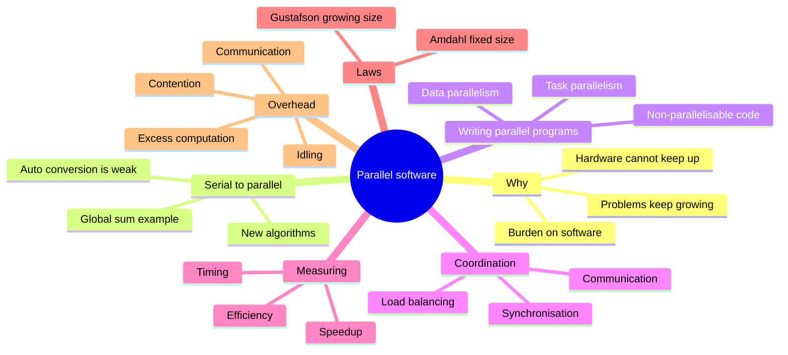
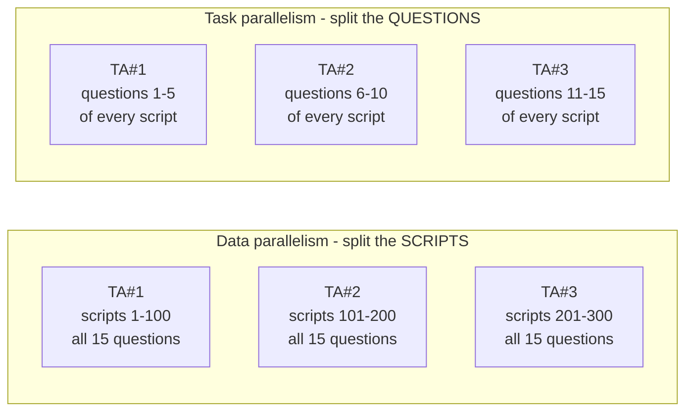

import Callout from '../../../components/Callout.astro';
import QA from '../../../components/QA.astro';
import QAList from '../../../components/QAList.astro';
import Figure from '../../../components/Figure.astro';
import treeSum from './images/w04-tree-sum.png';
import sharedVsDist from './images/w04-shared-vs-distributed.png';
import profile from './images/w04-overhead-profile.png';

<Callout type="why">
Hardware won't make your program faster any more. **The burden is now on software** (Week 1). This week answers the practical questions every parallel programmer faces:

- How do I split this work up?
- How do I *know* it got faster?
- What's the **maximum** speedup I can ever hope for?
- Why is my 8-core version only 3× faster?

**Amdahl's Law** in particular is one of the most-tested ideas in this course. It explains why simply "adding more cores" stops working.

- **Real life:** before spending a week parallelising a function, use Amdahl's Law to check whether it's even worth it. If that function is only 10% of the runtime, the whole program can never get more than about 11% faster, however good your parallel code is.
- **Connects to:** Week 2 Intro Part 2 (speedup, efficiency, cost, scalability), **Assignment 1** (you'll time and report speedup), Weeks 6–7 (Pthreads/OpenMP), Week 11 (CUDA).
</Callout>

<Callout type="key">
1. **Turning serial into parallel:** automatic conversion rarely works well. Often the best parallel solution is a **new algorithm** (e.g. the tree-based global sum).
2. **Task parallelism** = split the *tasks*. **Data parallelism** = split the *data*, with every core doing the same operations.
3. **Coordination** needs **communication, load balancing and synchronisation**.
4. **Grain size:** coarse grains give a high computation-to-communication ratio; fine grains make load balancing easier.
5. **Amdahl's Law:** S = 1 / (β + (1−β)/P), where β is the serial fraction. Speedup can **never exceed 1/β**, whatever P is.
6. **Gustafson's Law:** S = P + (1−P)·α. If the problem **grows** with P, speedup keeps growing.
7. **Overhead:** T<sub>parallel</sub> = T<sub>serial</sub>/p + T<sub>overhead</sub>. Its sources are communication, synchronisation, idling, contention and excess computation.
</Callout>

## Big picture



## 1. Why we need ever more performance

Computing power keeps increasing, but **so do our problems**. Past increases solved things we never dreamed of (e.g. decoding the human genome), and bigger problems are waiting:

| Area | Why it needs huge computation |
|---|---|
| **Climate modelling** | Simulate atmosphere, oceans and ice over decades at fine resolution |
| **Protein folding** | Predict how a protein's chain folds into its 3D shape (key to understanding disease) |
| **Drug discovery** | Screen millions of candidate molecules against a target |
| **Energy research** | Model wind turbines, solar cells, nuclear fusion, batteries |
| **Data analysis** | Process the flood of data from science, business, sensors and the web |

**The burden is on software.** Hardware and compilers can't keep up the pace alone. From now on:
- **Shared-memory programs:** start **one process** and **fork threads**. The threads carry out the tasks.
- **Distributed-memory programs:** start **multiple processes**. The processes carry out the tasks.

## 2. From sequential to parallel

Running many copies of a serial program usually isn't useful. Running 8 copies of your favourite game doesn't make *one* game faster, and that's what you actually want.

**Two approaches:**
1. **Rewrite** serial programs so they're parallel.
2. Write **translation programs** that convert serial code to parallel code automatically. This is **very difficult, and success has been limited**.

An automatic tool may recognise some patterns (such as simple loops), but the result is often **inefficient**. **Sometimes the best parallel solution is to step back and design an entirely new algorithm.**

### Example: compute n values and add them

**Serial version:**

```c
sum = 0;
for (i = 0; i < n; i++) {
    x = Compute_next_value(...);
    sum += x;
}
```

**Parallel version, step 1: partial sums.** With p cores (p much smaller than n), each core sums about n/p values into its own **private** variables:

```c
my_sum = 0;
my_first_i = ...;   // this core's start index
my_last_i  = ...;   // this core's end index
for (my_i = my_first_i; my_i < my_last_i; my_i++) {
    my_x = Compute_next_value(...);
    my_sum += my_x;
}
```

**Example:** 8 cores, n = 24. Compute_next_value returns:
`1,4,3 | 9,2,8 | 5,1,1 | 5,2,7 | 2,5,0 | 4,1,8 | 6,5,1 | 2,3,9`

| Core | 0 | 1 | 2 | 3 | 4 | 5 | 6 | 7 |
|---|---|---|---|---|---|---|---|---|
| my_sum | 8 | 19 | 7 | 15 | 7 | 13 | 12 | 14 |

**Step 2, version A: the master adds everything.**

```c
if (I'm the master core) {
    sum = my_sum;
    for each core other than myself {
        receive value from core;
        sum += value;
    }
} else {
    send my_sum to the master;
}
```

Core 0 computes 8 + 19 + 7 + 15 + 7 + 13 + 12 + 14 = **95**. The master does **7 receives and 7 additions**, while all the other cores sit idle.

**Step 2, version B: a better algorithm, a tree.** Don't make the master do all the work; share it.
- Pair the cores: core 0 adds core 1's result, core 2 adds core 3's, and so on.
- Repeat with only the even-ranked cores: core 0 adds core 2's result, core 4 adds core 6's.
- Then cores divisible by 4 repeat, and so on, until core 0 has the final result.

<Figure src={treeSum} alt="Tree of additions over time: cores 0–7 hold 8,19,7,15,7,13,12,14; first round gives 27, 22, 20, 26 at cores 0,2,4,6; second round gives 49 at core 0 and 46 at core 4; final round gives 95 at core 0" caption="Tree-structured global sum: 8 values → 4 → 2 → 1 in three rounds. Core 0 ends with 95." credit="Slide 21" max={520} />

| | Version A (master) | Version B (tree) |
|---|---|---|
| Master's work, 8 cores | 7 receives + 7 adds | **3** receives + 3 adds |
| Master's work, 1000 cores | 999 receives + 999 adds | **10** receives + 10 adds |
| Improvement | — | more than 2× (8 cores) and almost 100× (1000 cores) |
| General | p − 1 steps | **⌈log₂p⌉ steps** |

<Callout type="tip">
This is the same binary-tree idea as the summation example in Week 2 Intro Part 2. **Tree patterns turn p − 1 sequential steps into log₂p.** You'll see the pattern again as **reduction** in MPI (Week 5) and OpenMP (Week 7).
</Callout>

## 3. How do we write parallel programs?

| | **Task parallelism** | **Data parallelism** |
|---|---|---|
| What's split | The **tasks** needed to solve the problem | The **data** |
| Each core | Does different work | Does **similar operations** on **its part** of the data |

### Professor P's exam scripts

Professor P has **300 exam scripts** with **15 questions** each, and 3 teaching assistants.



In the global-sum example, computing the partial sums is **data parallel** (each core sums its own values). Receiving and adding versus sending is **task parallel** (the master and the other cores do different jobs).

### Non-parallelisable code

If a problem is **inherently sequential** (each step needs the previous result), **adding processors won't help**. The existence of these serial parts **limits** the benefit of parallelisation. This is **Amdahl's Law** (section 6).

## 4. Issues in designing parallel programs

### Coordination

Cores usually need to coordinate their work:

| Issue | Meaning | In the global-sum example |
|---|---|---|
| **Communication** | One or more cores send data to another | Cores send their my_sum to the master |
| **Load balancing** | Share work **evenly** so no core is overloaded | Each core gets about n/p values |
| **Synchronisation** | Cores work at their own pace, so make sure none gets too far ahead | The master must wait until every partial sum is ready |

### Types of parallel systems

<Figure src={sharedVsDist} alt="(a) Shared memory: cores 0 to p−1 all connected to one memory. (b) Distributed memory: each core paired with its own memory, all connected by a network" caption="(a) Shared memory: coordinate by reading and updating shared locations. (b) Distributed memory: each core has private memory and must send messages across a network." credit="Slide 34" max={520} />

| Shared memory | Distributed memory |
|---|---|
| Cores share access to the computer's memory | Each core has its own **private** memory |
| Coordinate by examining and updating **shared memory locations** | Communicate **explicitly by sending messages** across a network |
| Tools: **Pthreads, OpenMP** (Weeks 6–7) | Tool: **MPI** (Week 5) |

## 5. Key terms and performance measures

### Grain size (granularity)

> **Grain:** a group of tasks performed by a single processor. The key question: *"How many tasks should be packed into each grain to get the best performance?"*

| | Fine-grained | Coarse-grained |
|---|---|---|
| Grain | Small tasks, lots of communication | Big tasks, little communication |
| Advantage | **Easier load balancing** (many small pieces spread evenly) | **High computation-to-communication ratio** |
| Risk | Communication overhead dominates | Load imbalance (one big chunk can hold everyone up) |

<Callout type="tip" title="Analogy">
Moving house with friends. **Fine-grained:** everyone carries one book at a time, so it's easy to keep everyone busy, but you spend all day walking back and forth. **Coarse-grained:** each person takes a whole room, so there's less walking, but whoever got the kitchen finishes last.
</Callout>

### Definitions

| Term | Definition |
|---|---|
| **Run-time** | Time from start to end of execution on a sequential computer |
| **Parallel run-time** | Time from when the parallel computation starts until the **last** processor finishes |
| **Speedup** | S(P) = T₁ / T(P), where **T₁ is the time of the *best* (fastest) sequential algorithm**, not just the parallel code run on one core |
| **Efficiency** | E(P) = S(P) / P, the fraction of time a processor is usefully employed |
| **Scalability** | The capacity to increase speedup **in proportion to** the number of processors |
| **Linear speedup** | Ideal. Only for **embarrassingly (trivially) parallel** applications with minimal communication |
| **Super-linear** | S > p. Rare (usually a cache effect). Most applications are **below linear** |

<Callout type="warn">
A common mistake is to compute speedup using the **parallel program run on 1 core** as T₁. That's often slower than a good serial program, because it still carries parallel overhead, so it makes your speedup look better than it really is. The definition uses the **fastest sequential** program.
</Callout>

### Taking timings

What should "time" mean? Start to finish of the whole program, or just a segment? **CPU time** or **wall-clock time**? For parallel programs we usually want **wall-clock time** of the parallel part, because CPU time doesn't include time spent waiting.

```c
double start, finish;
start = Get_current_time();      // MPI_Wtime() in MPI, omp_get_wtime() in OpenMP
/* Code that we want to time */
finish = Get_current_time();
printf("The elapsed time = %e seconds\n", finish - start);
```

In a parallel program, every thread or process has its **own** start and finish. The program is only done when the **slowest** one finishes:

```c
shared double global_elapsed;
private double my_start, my_finish, my_elapsed;

Barrier();                       // everyone starts together
my_start = Get_current_time();
/* Code that we want to time */
my_finish = Get_current_time();
my_elapsed = my_finish - my_start;

global_elapsed = Global_max(my_elapsed);   // the slowest one decides
if (my_rank == 0)
    printf("The elapsed time = %e seconds\n", global_elapsed);
```

<Callout type="tip" title="For Assignment 1">
Run each timing **several times** and report the **minimum** or the average, because other programs on the machine add noise. Always say how many cores or threads, what problem size, and what machine you used.
</Callout>

### Speedup example: painting a picket fence

- 30 min preparation (**serial**), 1 min per picket (**parallel**), 30 min clean-up (**serial**)
- 300 pickets alone: 30 + 300 + 30 = **360 min**

| Painters | Time (min) | Speedup | Efficiency |
|---|---|---|---|
| 1 | 30 + 300 + 30 = 360 | 1.0× | 100% |
| 2 | 30 + 150 + 30 = 210 | 1.7× | 85% |
| 10 | 30 + 30 + 30 = 90 | 4.0× | 40% |
| 100 | 30 + 3 + 30 = 63 | 5.7× | 5.7% |
| ∞ | 30 + 0 + 30 = 60 | **6.0×** | very low |

**Even with infinite painters, speedup can't pass 6×**, because the 60 min of serial work (60/360 = 1/6 of the job) always remains. **That is Amdahl's Law.**

**What if the owner uses a spray gun** to paint all 300 pickets in 60 min? That's a **better serial algorithm**: 30 + 60 + 30 = 120 min. If there's only one spray gun, the best parallel version (infinite painters by hand) takes 60 min, so the **maximum speedup over the best serial algorithm is 120 / 60 = 2×**, not 6×. Always compare against the best serial solution.

### Speedup and efficiency, as formulas

> **S = T<sub>serial</sub> / T<sub>parallel</sub>** and **E = S / p = T<sub>serial</sub> / (p · T<sub>parallel</sub>)**

A typical measured program:

| p | 1 | 2 | 4 | 8 | 16 |
|---|---|---|---|---|---|
| S | 1.0 | 1.9 | 3.6 | 6.5 | 10.8 |
| E = S/p | 1.0 | 0.95 | 0.90 | 0.81 | 0.68 |

Speedup keeps rising, but **efficiency falls** as p grows. That's typical.

### Speedup in reality

| Kind of problem | Typical speedup | Example |
|---|---|---|
| **Trivially parallel** | S = P (linear) | Ray tracing: each pixel is independent |
| **Divide-and-conquer** | S ≈ P / log₂P | Tree-based algorithms, merge sort |
| **Communication-bound** | S ≈ 1 / C(P), where C(P) is logarithmic | Large matrix problems |
| **Super-linear** | Above the 45° line | Rare: cache effects |

### Reasons for the gap between ideal and real

1. **Amdahl's Law:** speedup is bounded by the serial portion.
2. **Task management and load balancing:** managing tasks costs time, and balancing the load is hard, especially when the work changes at run time.
3. **Communication and synchronisation:** they cost **orders of magnitude** more than computing. They're measured by:
   - **Latency:** time for one message to get from one node to another (the fixed start-up delay).
   - **Bandwidth:** amount of data transferred per unit of time.

A useful rule of thumb *(extra)*: **time to send a message ≈ latency + message size / bandwidth**. Sending many small messages is dominated by latency, so it's better to batch them into fewer, bigger messages.

## 6. Amdahl's Law

> **Gene Amdahl:** unless **virtually all** of a serial program is parallelised, the possible speedup is **very limited, regardless of how many cores** you have.

Let **β** = the fraction of the program that is **serial**, so **1 − β** can be parallelised. With P processors:

| | Serial part | Parallel part | Total time |
|---|---|---|---|
| **1 processor** | β·T(1) | (1 − β)·T(1) | T(1) |
| **3 processors** | β·T(1) *(same!)* | (1 − β)·T(1) / 3 | β·T(1) + (1 − β)·T(1)/3 |
| **P processors** | β·T(1) *(same!)* | (1 − β)·T(1) / P | β·T(1) + (1 − β)·T(1)/P |

Only the parallel part shrinks; the serial part never does. Divide T(1) by the total to get the speedup:

> **Amdahl's Law: S = 1 / ( β + (1 − β) / P )**
>
> As P → ∞: **S<sub>max</sub> = 1 / β**

**Slide example:** a program with **β = 0.67** (67% serial) on **10 processors**:

S = 1 / (0.67 + 0.33/10) = 1 / (0.67 + 0.033) = 1 / 0.703 = **1.42**

That's **less than a 2× increase** on 10 processors. Even with infinite processors: 1/0.67 = **1.49×**.

| Serial fraction β | Max speedup (P = ∞) | Speedup on 10 cores | Speedup on 100 cores |
|---|---|---|---|
| 50% | 2× | 1.82 | 1.98 |
| 10% | 10× | 5.26 | 9.17 |
| 5% | 20× | 6.90 | 16.8 |
| 1% | 100× | 9.17 | 50.3 |

<Callout type="exam">
Amdahl calculations are very likely. Show: (1) identify β; (2) write S = 1/(β + (1−β)/P); (3) substitute; (4) give the answer and **interpret it** (e.g. "less than 2× despite 10 processors, so the serial part dominates"). Also be ready to give the limit 1/β.
</Callout>

## 7. Gustafson's Law (Gustafson–Barsis)

Proposed by **John L. Gustafson and Edwin H. Barsis** in *"Reevaluating Amdahl's Law"* (**1988**).

**The criticism of Amdahl:** it assumes a **fixed problem size**. In real life, when people get more computing power, they **solve bigger problems** in the same time: finer weather grids, bigger datasets, higher resolution.

- Parallelism is used to **increase the (parallel) size of the problem**.
- Measure time on the **parallel** machine and normalise it to 1: T(P) = α + (1 − α) = 1, where α is the **serial fraction of the parallel run**.
- On **one** processor, the parallel part would take P times longer: T(1) = α + P(1 − α).

> **Gustafson's Law: S = T(1)/T(P) = P + (1 − P)·α**

**Slide example:** α = 0.67 on 10 processors:

S = 10 + (1 − 10)(0.67) = 10 − 6.03 = **3.97** (Amdahl gave 1.42)

That's **about a 4× increase** for the same "67% serial" on 10 processors.

### Which law is correct?

**Both.** They answer **different questions**, and their "serial fraction" means different things.

| | **Amdahl's Law** | **Gustafson's Law** |
|---|---|---|
| Problem size | **Fixed** | **Grows** with P |
| Question | "How much faster can I solve *this* problem?" | "How much more work can I do in the *same time*?" |
| Serial fraction | β of the **serial** program's time | α of the **parallel** program's time |
| Typical parallelism | **Control parallelism**: parallel threads of control (fork–join) | **Data parallelism**: same operations on more data (SIMD/SPMD) |
| As P grows | Speedup **saturates** at 1/β | Speedup keeps **growing** (roughly linearly) |
| Matches | **Strong scaling** | **Weak scaling** |
| Mood | Pessimistic | Optimistic |

As the problem size increases, the **inherently serial fraction shrinks** (start-up and I/O stay about the same while the computation grows), so Gustafson sees more speedup.

<Callout type="tip" title="Remember it like this">
**Amdahl:** you have a fixed 100 km trip. A faster car only helps on the motorway part; the 10 km of city traffic always takes the same time.
**Gustafson:** with a faster car, you'll just **travel further** in your one-hour drive.
</Callout>

## 8. Overhead

> "If I use two processors, my program should run twice as fast?" Not really, because of **overhead**.

<Figure src={profile} alt="Execution profile of 8 processors P0 to P7 over time: mostly dark bars of computation, with grey blocks of interprocessor communication and white blocks of idling at different points" caption="Execution profile on 8 processors. Dark = computation (essential + excess), grey = communication, white = idling. Every grey or white block is time not spent on useful work." credit="Slide 63" max={600} />

### Sources of overhead

| Source | What it is | Example |
|---|---|---|
| **Interprocess interaction** | Processors on any non-trivial problem need to talk to each other | Sending partial sums |
| **Synchronisation** | One thread or process must wait for an event on another | Waiting at a barrier |
| **Idling** | Processors idle because of **load imbalance, synchronisation or serial parts** | P3 and P6 idle in the profile above |
| **Contention** | Performance drops because of **competition for shared resources** | Many threads fighting over one lock, the memory bus or the network |
| **Excess computation** | Work the **serial version doesn't do** | Repeating a calculation on every processor to avoid sending it; a harder-to-parallelise algorithm |

> **T<sub>parallel</sub> = T<sub>serial</sub> / p + T<sub>overhead</sub>**

Overhead usually **grows with p** (more processors means more communication and synchronisation), while T<sub>serial</sub>/p shrinks. Eventually the overhead dominates, and adding processors makes things **slower**, exactly like the summation example in Week 2.

## 9. What's next

You'll write explicitly parallel programs in **C**, using extensions:
- **Pthreads** and **OpenMP** for shared memory (Weeks 6–7)
- **MPI** for distributed memory (Week 5)
- **CUDA** for GPUs (Week 11)

<QAList>
  <QA q="Why is automatically converting serial programs to parallel programs difficult?" level="easy" why="Tools only spot simple patterns, and the best parallel solution often needs a different algorithm entirely.">
    Translators can only recognise simple patterns (such as independent loops), and the parallel code they produce is often inefficient. The best parallel solution frequently needs a **completely different algorithm** (like the tree-based global sum), which a translator can't invent.
  </QA>
  <QA q="In the global sum with 8 cores, how many receives does the master do in the 'master adds all' version vs the tree version? What about 1024 cores?" level="medium" why="Master version = p − 1 receives; tree version = log₂p. For 1024 that's 1023 vs 10.">
    8 cores: **7** vs **3** (log₂8). 1024 cores: **1023** vs **10** (log₂1024). The tree version turns p − 1 steps into log₂p.
  </QA>
  <QA q="Given my_sum = 8, 19, 7, 15, 7, 13, 12, 14 on cores 0–7, show each round of the tree-based global sum." level="medium" why="Add neighbours each round: 27, 22, 20, 26 → 49, 46 → 95. Only even cores, then multiples of 4, keep working.">
    - Round 1: core 0 = 8+19 = **27**, core 2 = 7+15 = **22**, core 4 = 7+13 = **20**, core 6 = 12+14 = **26**
    - Round 2: core 0 = 27+22 = **49**, core 4 = 20+26 = **46**
    - Round 3: core 0 = 49+46 = **95**
  </QA>
  <QA q="Differentiate task parallelism and data parallelism using the exam-marking example." level="easy" why="Split scripts = data parallelism (same work, different data). Split questions = task parallelism (different work).">
    **Data parallelism:** each TA marks 100 **different scripts** (all 15 questions), so the data is split. **Task parallelism:** each TA marks **different questions** (1–5, 6–10, 11–15) on all 300 scripts, so the tasks are split.
  </QA>
  <QA q="Name and explain the three coordination issues in parallel programs." level="easy" why="Communication, load balancing, synchronisation. Each one is a different reason cores have to coordinate.">
    - **Communication:** cores send data (e.g. partial sums) to other cores.
    - **Load balancing:** share the work evenly so no core is overloaded and others idle.
    - **Synchronisation:** cores run at their own pace, so make them wait for each other where needed so results are correct.
  </QA>
  <QA q="State one advantage each of fine-grained and coarse-grained parallelism." level="easy" why="Coarse = less communication overhead. Fine = easier to spread evenly (load balance).">
    **Coarse-grained:** high computation-to-communication ratio (less overhead). **Fine-grained:** easier to achieve load balance.
  </QA>
  <QA q="Why should the speedup formula use the best sequential program for T₁, not the parallel program run on 1 core?" level="medium" why="The parallel code on one core still carries overhead, which makes speedup look better than it really is. Compare against the best serial program.">
    The parallel program on 1 core still has parallel overhead (thread creation, synchronisation, extra computation), so it's usually slower than the best serial program. Using it as T₁ inflates the speedup. The fair question is how much faster the parallel solution is than the **best you could do serially**.
  </QA>
  <QA q="When timing a parallel program, why do we use a barrier and take the maximum elapsed time?" level="medium" why="Barrier = everyone starts together. Max = the program is only done when the slowest thread finishes.">
    The **barrier** makes all threads or processes start the timed section together. Each one finishes at a different time, and the parallel section is only complete when the **slowest** finishes, so the program's elapsed time is the **maximum** of the individual times.
  </QA>
  <QA q="A program is 20% serial. Using Amdahl's Law, find the speedup on 4 and on 16 processors, and the maximum possible speedup." level="medium" why="S = 1/(β + (1 − β)/P). P = 4 gives 2.5, P = 16 gives 4.0, and the limit is 1/β = 5.">
    - P = 4: S = 1 / (0.2 + 0.8/4) = 1 / 0.4 = **2.5**
    - P = 16: S = 1 / (0.2 + 0.8/16) = 1 / 0.25 = **4.0**
    - Max: 1 / 0.2 = **5×**

    Going from 4 to 16 processors (4× the hardware) gives only 1.6× more speedup.
  </QA>
  <QA q="Using Gustafson's Law, find the speedup on 16 processors for a serial fraction of 0.2. Why is it so different from Amdahl's answer?" level="hard" why="Gustafson grows the problem with P, so the serial part shrinks relatively: 16 − 15 × 0.2 = 13.">
    S = P + (1 − P)α = 16 + (1 − 16)(0.2) = 16 − 3 = **13.0** (Amdahl gave 4.0).

    Gustafson assumes the **problem grows** with P, so the parallel part grows while the serial part stays the same, and the serial fraction is measured on the **parallel** run. Amdahl assumes a **fixed** problem, so the serial part is a fixed share of the total and limits the speedup.
  </QA>
  <QA q="In the picket-fence example, why can't speedup exceed 6×?" level="easy" why="60 of 360 minutes are serial, so even infinite painters leave 60 minutes. 360/60 = 6.">
    60 of the 360 minutes (preparation + clean-up) are serial and can't be shared. Even with infinite painters the job takes 60 minutes, so S<sub>max</sub> = 360/60 = 6, which is Amdahl's 1/β with β = 1/6.
  </QA>
  <QA q="The fence owner gets a spray gun that paints all 300 pickets in 60 minutes (one gun only). What's the maximum parallel speedup now?" level="hard" why="Compare against the new best serial time: 120 minutes. Parallel best is 60, so the maximum is only 2×.">
    The best serial time becomes 30 + 60 + 30 = **120 min**. With unlimited hand painters the parallel time is at best 30 + 0 + 30 = 60 min, so S<sub>max</sub> = 120/60 = **2×**. A better serial algorithm shrinks the possible speedup, which is why speedup must be measured against the best serial solution.
  </QA>
  <QA q="List the five sources of overhead in parallel programs." level="easy" why="Communication, synchronisation, idling, contention, excess computation.">
    Interprocess interaction (communication), synchronisation, idling (from load imbalance, synchronisation or serial parts), contention for shared resources, and excess computation.
  </QA>
  <QA q="Define latency and bandwidth. If latency is 50 µs and bandwidth is 1 GB/s, how long does it take to send one 1 KB message, and 1000 messages of 1 KB?" level="hard" why="Time ≈ latency + size/bandwidth. Many small messages pay the latency each time, so batch them.">
    **Latency:** the time for a message to travel from one node to another (fixed start-up cost). **Bandwidth:** data transferred per unit of time.
    - One 1 KB message ≈ 50 µs + 1 KB / 1 GB/s = 50 + 1 µs = **51 µs**.
    - 1000 separate messages ≈ 1000 × 51 = **51 ms**.
    - One 1000 KB message ≈ 50 µs + 1000 µs ≈ **1.05 ms**.

    Batching avoids paying the latency 1000 times.
  </QA>
  <QA q="Your 8-thread program shows: 70% computation, 15% waiting at barriers, 10% fighting for one lock, 5% repeated work. Name each overhead and suggest a fix." level="hard" why="Barriers = idling or imbalance; lock = contention; repeated work = excess computation. Fix the biggest first.">
    - **Waiting at barriers = synchronisation/idling**, probably load imbalance. Fix: divide work more evenly, or use dynamic scheduling.
    - **Fighting for a lock = contention.** Fix: shorter critical sections, per-thread local results combined at the end (a reduction).
    - **Repeated work = excess computation.** Fix: compute once and share, if communication is cheaper than recomputing.
  </QA>
</QAList>
