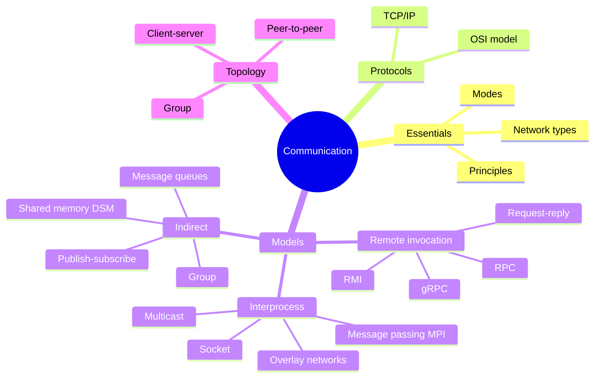
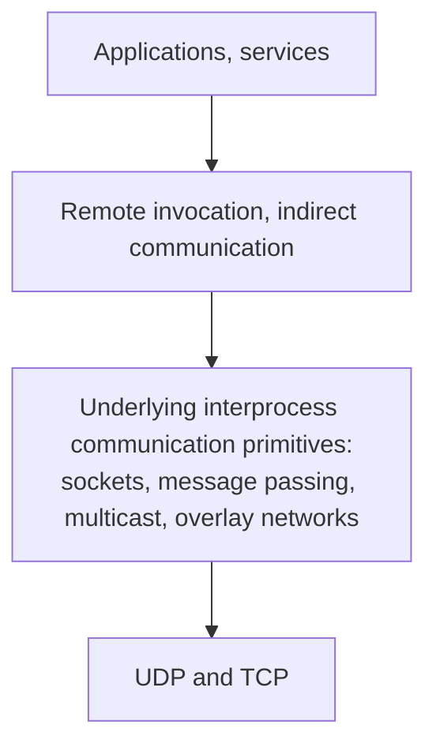
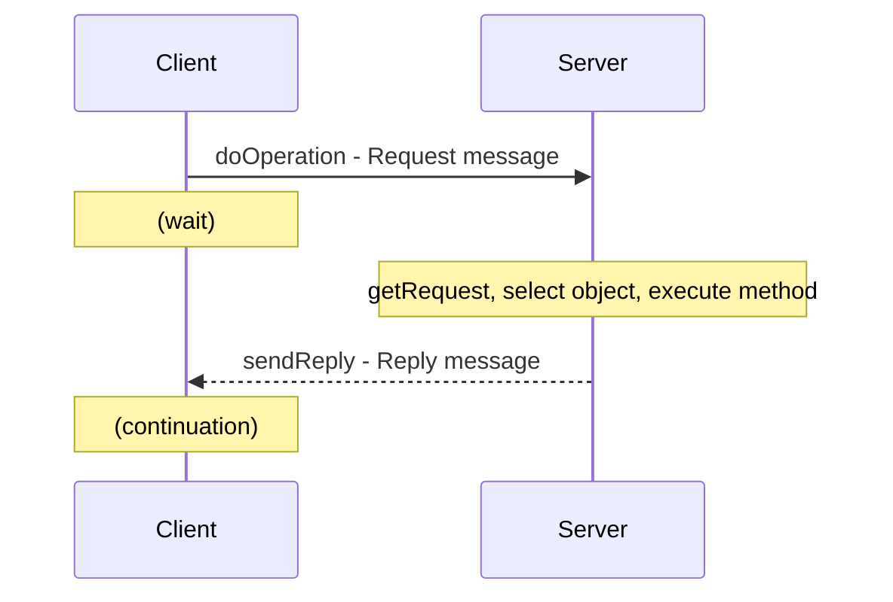
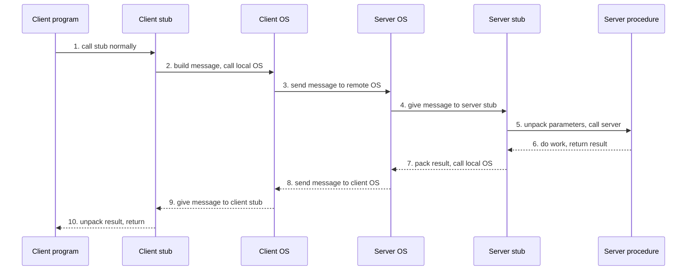
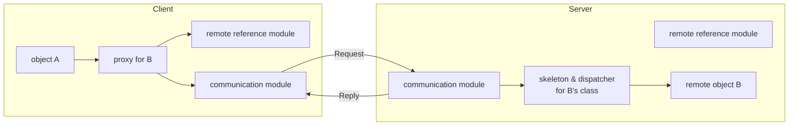

import Callout from '../../../components/Callout.astro';
import QA from '../../../components/QA.astro';
import QAList from '../../../components/QAList.astro';
import Figure from '../../../components/Figure.astro';
import syncRpc from './images/w05-sync-rpc.png';
import asyncRpc from './images/w05-async-rpc.png';
import deferredRpc from './images/w05-deferred-rpc.png';
import dce from './images/w05-dce-objects.png';
import pubsub from './images/w05-pubsub.jpg';
import mq from './images/w05-message-queue.jpg';
import mqCombos from './images/w05-queue-combinations.png';
import dsm from './images/w05-dsm.jpg';

<Callout type="why">
In distributed memory there's **no shared variable**, so the only way for processes to cooperate is to **send messages**. This week is the "how": every distributed or cloud system you'll ever build uses one of these models.

- **Real life:** your Flutter app calling a FastAPI backend is **request–reply over HTTP** (a form of remote invocation). Microservices at Google, Netflix and similar companies talk with **gRPC**. Order systems use **message queues** (RabbitMQ, AWS SQS, Kafka). Push notifications and chat apps use **publish–subscribe** (Firebase, MQTT). Supercomputers run **MPI**.
- **Connects to:** Week 3 (distributed-memory machines and interconnects), Week 4 (communication overhead, latency, bandwidth), Weeks 6–7 (the shared-memory alternative), Weeks 9–10 (containers and Kubernetes services talking over the network), Week 12 (Hadoop), Week 14 (cloud architecture).
</Callout>

<Callout type="key">
1. **Four areas:** communication essentials, protocols (OSI, TCP/IP), **models**, and **topology** (client–server, P2P, group).
2. **Three families of communication models:**
   - **Interprocess communication:** sockets, **message passing (MPI)**, multicast, overlay networks
   - **Remote invocation:** request–reply, **RPC**, **RMI**
   - **Indirect communication:** group communication, **publish–subscribe**, **message queues**, shared memory
3. **MPI** = a message-passing **library specification** (not a language). You can write a complete program with **6 functions**: Init, Finalize, Comm_size, Comm_rank, Send, Recv.
4. **Blocking** calls return when the operation is done; **non-blocking** calls return immediately.
5. **RPC** calls a remote *procedure* through **stubs** that **marshal** arguments. **RMI** invokes methods on remote *objects* through **proxies** and **skeletons**. **gRPC** is Google's modern RPC, using **protobuf + HTTP/2**.
6. **Indirect communication** decouples sender and receiver in **space** (they don't know each other) and/or **time** (they don't need to be running at the same time).
</Callout>

## Big picture



## 1. Communication essentials and protocols

*The slides list these in the overview without detail. Here's the minimum you need. (Extra)*

### OSI model vs TCP/IP

| OSI layer | What it does | TCP/IP layer | Examples |
|---|---|---|---|
| 7 Application | What the app wants to say | **Application** | HTTP, DNS, SMTP, **gRPC** |
| 6 Presentation | Data format, encryption | (Application) | TLS, JSON, protobuf |
| 5 Session | Keep a conversation going | (Application) | |
| 4 Transport | Process to process, reliability | **Transport** | **TCP, UDP** |
| 3 Network | Machine to machine, routing | **Internet** | **IP** |
| 2 Data link | One hop on a local network | **Link** | Ethernet, Wi-Fi |
| 1 Physical | Bits on the wire or air | (Link) | Cables, radio |

### TCP vs UDP

| | **TCP** | **UDP** |
|---|---|---|
| Connection | Connection-oriented (handshake first) | Connectionless |
| Reliability | Guaranteed delivery, in order, retransmits lost packets | No guarantees; packets may be lost, duplicated or reordered |
| Speed | Slower (overhead) | Faster, lightweight |
| Used for | Web, APIs, file transfer, email | Video calls, games, DNS, live streaming |

Request–reply protocols can be built on **either**: UDP keeps them simple and fast, while TCP gives reliability for free.

## 2. Interprocess communication: message passing and MPI



*The layers of communication, from slide 26. Higher-level models are built on top of the lower ones.*

### What is MPI?

> **MPI (Message Passing Interface):** a **message-passing library specification**. It assumes each processor has its **own local memory**, and data moves **only by passing messages**.

- **Not** a compiler specification or a language, and **not** a specific product. It's a **standard** that many libraries implement.
- Designed for parallel computers, clusters and heterogeneous networks.
- Maintained by the **MPI Forum** (mpi-forum.org).
- **History:** development began in **early 1992** through an open process (IBM, Intel, Cray and others, plus labs, universities and government). The final draft came in **May 1994**. Public implementations (**MPICH**, LAM/MPI, now **Open MPI**) and vendor implementations are widely available.
- It is the **de facto standard** for message-passing applications and has superseded earlier libraries (PVM, p4, Express, Linda).

### Point-to-point communication

Point-to-point communication **always involves exactly two processes**: one sends, one receives.

```c
int MPI_Send(void *buf, int count, MPI_Datatype datatype,
             int dest, int tag, MPI_Comm comm);

int MPI_Recv(void *buf, int count, MPI_Datatype datatype,
             int source, int tag, MPI_Comm comm, MPI_Status *status);
```

| Parameter | Meaning |
|---|---|
| `buf` | Address of the data to send, or where to put received data |
| `count`, `datatype` | How many elements, and of what MPI type |
| `dest` / `source` | The **rank** of the other process in the communicator |
| `tag` | A label so the receiver can tell messages apart |
| `comm` | The **communicator**: a group of processes plus a communication context |
| `status` | (Recv only) who actually sent the message, its tag and its size |

### Blocking vs non-blocking, and the four send modes

- **Blocking** operations return only when the operation is **complete** (it's safe to reuse the buffer).
- **Non-blocking** operations return **immediately**, so the program can do other work. You check later with `MPI_Wait` or `MPI_Test`.

| Mode | Blocking | Non-blocking |
|---|---|---|
| **Generic (standard)** | `MPI_Send`: blocks until it's safe to reuse the buffer (message is in transit or delivered) | `MPI_Isend`: returns immediately with a request handle; check with `MPI_Wait`/`MPI_Test` |
| **Synchronous** | `MPI_Ssend`: returns only when the message has been **delivered** to the receiver | `MPI_Issend`: as `MPI_Isend`, but Wait/Test say whether it was delivered |
| **Buffered** | `MPI_Bsend`: copies into a buffer you allocated (`MPI_Buffer_attach`), then returns | `MPI_Ibsend`: Wait/Test say whether it was copied into the buffer |
| **Ready** | `MPI_Rsend`: you promise the receiver is **already waiting**, which allows optimisations | `MPI_Irsend`: same promise, non-blocking |

<Callout type="tip" title="Analogy">
**Blocking** send = handing a parcel to the courier and waiting at the counter until they say "OK, it's ours now." **Non-blocking** send = dropping it in the box and walking away; you check the tracking number later (`MPI_Wait`). **Synchronous** send = waiting until the recipient signs for it.
</Callout>

<Callout type="warn" title="Deadlock with blocking sends">
If process 0 does `Ssend` to 1 and then `Recv` from 1, while process 1 does `Ssend` to 0 and then `Recv` from 0, **both wait for the other to receive first**, and neither ever does. Fix it by ordering the calls (one sends first, the other receives first), or by using non-blocking calls or `MPI_Sendrecv`.
</Callout>

### Collective communication

Collective operations involve **all** processes in a communicator.

| Operation | Pattern | Before | After | What it does |
|---|---|---|---|---|
| **Barrier** | Synchronisation | — | — | **No data is exchanged.** Everyone blocks until **all** processes have called the barrier |
| **Broadcast** (multicast) | One to many | P0: `x` | P0, P1, P2, P3: `x` | One process sends the **same** message to all |
| **Scatter** | One to many | P0: `[a b c d]` | P0: `a`, P1: `b`, P2: `c`, P3: `d` | One process **splits** an array and sends a different piece to each |
| **Gather** | Many to one | P0: `a`, P1: `b`, P2: `c`, P3: `d` | P0: `[a b c d]` | Collect a piece from each process into one array |
| **Reduction** (sum) | Many to one | P0: `1`, P1: `2`, P2: `3`, P3: `4` | P0: `10` | Combine everyone's values with an operation (sum, max…) into one result, like the global sum in Week 4 |

### Other MPI services

- **Virtual topologies:** arrange processes in an application-friendly shape (grid, graph).
- **Derived datatypes:** user-defined types, which can be non-contiguous (e.g. a column of a matrix).
- **Dynamic task creation:** spawn new processes during execution.
- **Client/server functions** and **application skeletons** (supervisor/workers, client/server).
- **One-sided communication:** Remote Memory Access (`put` and `get` straight into another process's memory).
- **Parallel I/O:** many processes accessing files concurrently.

### Communicators and ranks

- A **communicator** combines a **group** (an ordered list of processes) and a **context**. Every MPI communication call takes one.
- Processes in a group are numbered **0, 1, 2, …**. That number is the process's **rank**.
- `MPI_Init` creates the default communicator **`MPI_COMM_WORLD`**, which contains **all** MPI processes.
- **Intracommunicators** handle communication within one group; **intercommunicators** handle communication between two groups.

### MPI messages and datatypes

An MPI message is an **array of elements of one MPI datatype**. Messages are **typed**: the type must be given in both the send and the receive.

| MPI datatype | C type |
|---|---|
| `MPI_CHAR` | signed char |
| `MPI_SHORT` / `MPI_INT` / `MPI_LONG` | signed short / int / long |
| `MPI_UNSIGNED_CHAR` / `_SHORT` / `_INT` / `_LONG` | unsigned versions |
| `MPI_FLOAT` / `MPI_DOUBLE` / `MPI_LONG_DOUBLE` | float / double / long double |
| `MPI_BYTE` | raw bytes (no conversion) |
| `MPI_PACKED` | data packed with `MPI_Pack` |

**Derived datatypes** let you build your own types (e.g. a struct, or non-contiguous data).

### The six basic MPI functions

MPI has about 129 functions in the version the slides describe (MPI-1), but **a complete program needs only 6**:

| Function | Purpose |
|---|---|
| `MPI_Init` | Start the MPI computation |
| `MPI_Finalize` | End it |
| `MPI_Comm_size` | How many processes are there? |
| `MPI_Comm_rank` | Which one am I? |
| `MPI_Send` | Send a message |
| `MPI_Recv` | Receive a message |

```c
// Skeleton (slide 17), as real C. Compile: mpicc hello.c -o hello   Run: mpirun -np 4 ./hello
#include <stdio.h>
#include <mpi.h>

int main(int argc, char *argv[]) {
    int count, myid;
    MPI_Init(&argc, &argv);
    MPI_Comm_size(MPI_COMM_WORLD, &count);   // total processes
    MPI_Comm_rank(MPI_COMM_WORLD, &myid);    // my rank: 0 .. count-1
    printf("I am %d of %d\n", myid, count);
    MPI_Finalize();
    return 0;
}
```

**A send/receive example** *(extra)*: each worker sends its partial sum to rank 0, exactly the "master adds all" global sum from Week 4.

```c
int my_sum = compute_my_part(myid);          // each process computes its piece
if (myid != 0) {
    MPI_Send(&my_sum, 1, MPI_INT, 0, 0, MPI_COMM_WORLD);        // send to rank 0
} else {
    int total = my_sum, value;
    for (int src = 1; src < count; src++) {
        MPI_Recv(&value, 1, MPI_INT, src, 0, MPI_COMM_WORLD, MPI_STATUS_IGNORE);
        total += value;
    }
    printf("Global sum = %d\n", total);
}
// In practice, one line does the same with a tree internally:
// MPI_Reduce(&my_sum, &total, 1, MPI_INT, MPI_SUM, 0, MPI_COMM_WORLD);
```

## 3. Multicast and overlay networks

### Multicast communication

> **Multicast:** send **one message** from one process to **every member of a group**. **Broadcast** delivers it to **all machines**.

**Benefits:**
- **Fault tolerance** through replicated services: send the request to all replicas, so it doesn't matter if one fails.
- **Discovering services** in spontaneous networks ("is there a printer here?").
- **Better performance** through replicated data.
- **Propagating event notifications.**

### Overlay networks

> **Overlay network:** a **virtual network** of nodes and virtual links built **on top of** an existing network (like the Internet), to provide services the underlying network doesn't.

Uses: multimedia content distribution, routing for ad hoc networks, extra features such as multicast and secure communication.

**Advantages:**
- New network services **without changing the underlying network**.
- Easy to experiment with and customise.
- An open, extensible architecture.

**Examples:** Skype and peer-to-peer file sharing, multimedia streaming, multiplayer gaming.

| Motivation | Type | Description |
|---|---|---|
| **Tailored for application needs** | **Distributed hash tables** | Map keys to values across many nodes with no central server, like a hash table spread over a network |
| | **Peer-to-peer file sharing** | Custom addressing and routing to find and download files from peers (e.g. BitTorrent) |
| | **Content distribution networks (CDNs)** | Replication and caching to deliver web content and video quickly |
| **Tailored for network style** | **Wireless ad hoc networks** | Custom routing for networks without fixed infrastructure |
| | **Disruption-tolerant networks** | Work in hostile environments with frequent node or link failure and long delays |
| **Offering additional features** | **Multicast** | Multicast where routers don't support it (e.g. the MBone) |
| | **Resilience** | Much more robust, available Internet paths |
| | **Security** | Extra security over IP, e.g. **VPNs** |

## 4. Remote invocation

### Request–reply protocol

The basis of client–server communication, and what **RPC and RMI** are built on.



**Issues:**
- **Communication failure:** *omission failures* (messages lost), and the order of operations isn't guaranteed.
- **Failure model and its fixes:**
  - **Timeouts:** if no reply arrives in time, resend the request.
  - **Discard duplicate requests:** give each request an ID so the server can recognise repeats.
  - **Lost reply messages:** if the operation isn't safe to repeat (e.g. "transfer RM 100"), the server must not run it twice.
  - **History:** the server keeps recent replies so it can **resend the reply** instead of re-executing.

| Style | Messages | Use |
|---|---|---|
| **R** (Request) | Client: request only | No reply needed (e.g. logging an event) |
| **RR** (Request–Reply) | Client: request; Server: reply | Most client–server interactions. The reply also acts as an acknowledgement |
| **RRA** (Request–Reply–Acknowledge) | + Client: acknowledges the reply | Lets the server **delete saved replies from its history** |

### Remote Procedure Call (RPC)

> **RPC:** lets a client **call a procedure in a remote process** as if it were local. It's built on the request–reply protocol. A server can call another server, forming a **chain of RPCs**.

**Key parts:**
- **Interface:** the server defines which procedures can be called remotely.
- **Client stub:** looks like a normal local procedure to the client. It **marshals** the procedure ID and arguments into a request message, sends it, and **un-marshals** the result from the reply.
- **Server stub:** un-marshals the arguments and calls the real procedure.
- **Dispatcher:** in the server, picks the right server stub for each request.
- **Communication module:** sends and receives the messages.

**Marshalling** = converting data (ints, strings, structs) into a flat byte format for sending. **Un-marshalling** = converting it back.

### The 10 steps of an RPC



<Callout type="exam">
"List the steps of an RPC" is a classic question. Remember the shape: **down** the client side (program → stub → OS), **across** the network, **up** the server side (OS → stub → procedure), then **the same in reverse** for the result.
</Callout>

### Synchronous vs asynchronous RPC

<Figure src={syncRpc} alt="Timeline: client calls remote procedure, sends request, waits; server calls local procedure and returns results; reply returns to client which continues" caption="Synchronous RPC: the client is blocked for the whole round trip." credit="Slide 35" max={420} />

<Figure src={asyncRpc} alt="(a) traditional RPC: client waits for result. (b) asynchronous RPC: client waits only for the server to accept the request, then continues while the server works" caption="(a) Traditional RPC waits for the result. (b) Asynchronous RPC waits only until the server accepts the request." credit="Slide 36" max={620} />

<Figure src={deferredRpc} alt="Client calls remote procedure, waits for acceptance and continues; later the server calls the client with the result (interrupting it) and the client acknowledges" caption="Deferred synchronous RPC: two asynchronous RPCs. The server later calls the client back with the result. If the client doesn't even wait for acceptance, it's a one-way RPC." credit="Slide 37" max={560} />

| Type | Client waits for… | Good for |
|---|---|---|
| **Synchronous** | The **result** | Simple calls where you need the answer now |
| **Asynchronous** | Only **acceptance** of the request | Calls with no useful result (e.g. "start backup") |
| **Deferred synchronous** | Acceptance; the result arrives later via a callback | Long jobs where the client does other work meanwhile |
| **One-way** | Nothing | Fire-and-forget |

### Remote Method Invocation (RMI)

> **RMI:** method invocation between **objects in different processes** (on the same computer or not). It's the object-oriented version of RPC (e.g. Java RMI).



| Component | Role |
|---|---|
| **Communication module** | Carries out the **request–reply** protocol |
| **Remote reference module** | Translates between **local and remote object references**, and creates remote object references |
| **Proxy** | Lives with the client. Makes remote calls **transparent** by hiding object references, (un)marshalling and send/receive. The RMI equivalent of the client stub |
| **Dispatcher** | In the server, selects the right method for each request |
| **Skeleton** | In the server, implements the methods of the remote interface: un-marshals arguments and calls the real object |

### The DCE distributed-object model

<Figure src={dce} alt="(a) Server machine with three dynamic private objects, one per client. (b) Server machine with one named shared object accessed by clients 1, 2 and 3 via remote references" caption="(a) Dynamic objects: each client gets its own private object, created on demand. (b) Named objects: one shared object that many clients access." credit="Slide 42" max={600} />

### RMI vs RPC

| | RPC | RMI |
|---|---|---|
| **Similarities** | Both: programming with interfaces, run on different machines, built on request–reply, local and remote calls use the same syntax (transparency) | ← same |
| Invokes | **Functions / procedures** | **Methods on objects** |
| Paradigm | Procedural | Full **object-oriented** (inheritance, polymorphism) |
| References | No object identity | **Unique remote object references**, so objects can be **passed as parameters**, which gives much richer parameter passing |

### gRPC and protocol buffers

**gRPC:**
- An RPC framework developed and used by **Google**, open-sourced in **February 2015**.
- Platform-independent and high-performance.
- Built on **protocol buffers** and **HTTP/2**.
- You need it to talk to gRPC services (e.g. many Google APIs), and it's a strong choice for your own systems.

**Protocol buffers (protobuf):**
- Google's **binary serialisation** format (the marshalling format), open-sourced in **July 2008**.
- Platform-independent, **low CPU** to process, **low bandwidth** to transmit (much smaller than JSON).
- **Version tolerant:** you can add fields without breaking old clients.

**How you use it:** write a `.proto` schema, then generate code for data contracts, client stubs and server stubs. Implement and host the service, and create a client (see grpc.io).

```proto
// example.proto  (extra)
syntax = "proto3";

service CourseService {
  rpc GetWeek (WeekRequest) returns (WeekReply);
}
message WeekRequest { string course = 1; int32 week = 2; }
message WeekReply   { string title  = 1; repeated string topics = 2; }
```

**RPC vs gRPC** (the slide leaves this as a question):

| | Classic RPC (e.g. Sun RPC, DCE RPC) | gRPC |
|---|---|---|
| Similarities | Interface definition → generated stubs → call remote functions like local ones; request–reply underneath | ← same |
| Data format | XDR / NDR binary formats | **Protocol buffers** |
| Transport | Usually TCP or UDP directly | **HTTP/2**: multiplexing, header compression, works through web infrastructure |
| Streaming | Request–reply only | **Streaming** both ways (client, server, bidirectional) |
| Languages | Mostly C | Many: Go, Java, Python, C++, Dart (Flutter!), C#… |
| Extras | Minimal | Deadlines, cancellation, authentication, load balancing |

## 5. Indirect communication

Indirect communication goes **through an intermediary**. The sender and receiver are **decoupled**:
- **Space decoupling:** the sender doesn't know who the receivers are.
- **Time decoupling:** the sender and receiver don't need to exist at the same time.

### Group communication

A message is sent to **all members of a group**, and the sender may **not know who they are**. It's implemented using **multicast** or an **overlay network**.

| Point-to-point | One-to-many (group) |
|---|---|
| One sender, one receiver | One sender, many receivers in a group |

**Characteristics:** groups are **dynamic**. They can be created and destroyed, processes join and leave, and a process can belong to several groups.

**Why it's important:**
- **Reliable dissemination** of updates and notifications to many users.
- **Collaborative applications** (e.g. multiplayer games).
- **Fault tolerance** through replication.
- **System monitoring and management** (e.g. load balancing).

**Implementation issues:**
- **Reliability and ordering of multicast:**
  - **FIFO ordering:** messages from the **same sender** arrive in the order they were sent.
  - **Causal ordering:** if message A could have *caused* message B (B was sent after the sender saw A), everyone receives A before B.
  - **Total ordering:** **all** members receive **all** messages in exactly the **same order**.
- **Group membership management:** an interface for membership changes, failure detection, notifying members of changes, and expanding a group address into its members.

<Callout type="tip" title="Ordering example: a group chat">
Ali posts "Lunch at 1?", and Siti replies "Yes!". **Causal** ordering guarantees nobody sees "Yes!" before the question. **Total** ordering additionally guarantees that if two people post at the same moment, **everyone** sees those two posts in the same order.
</Callout>

### Publish–subscribe systems

Also called **distributed event-based systems**.

<Figure src={pubsub} alt="Publishers on the left call publish(e1), publish(e2), advertise(t1) into a central publish-subscribe system; subscribers on the right call subscribe(t1), subscribe(t2) and receive notify(e1)" caption="Publishers send events to the event service; subscribers register interest (subscribe) and are notified when matching events arrive. Neither side knows the other." credit="Slide 55" max={560} />

- **Publishers** publish structured **events** to an event service.
- **Subscribers** express interest in particular events through **subscriptions**.
- The service delivers (**notifies**) matching events to every subscriber.
- **Examples:** Firebase Cloud Messaging topics, MQTT for IoT sensors (useful for your ESP32 projects), Google Pub/Sub, Kafka topics.

### Message queuing

<Figure src={mq} alt="Producers send messages into queues inside a message queue system; consumers receive, poll or are notified" caption="Producers put messages into queues; consumers take them out by receiving (blocking), polling or being notified." credit="Slide 57" max={620} />

**Four combinations of loosely coupled communication using queues:**

<Figure src={mqCombos} alt="Four cases (a) sender running, receiver running; (b) sender running, receiver passive; (c) sender passive, receiver running; (d) sender passive, receiver passive" caption="The queue holds messages, so sender and receiver don't need to be running at the same time." credit="Slide 58" max={560} />

| Case | Sender | Receiver | What happens |
|---|---|---|---|
| (a) | Running | Running | Normal flow, message passes through quickly |
| (b) | Running | **Passive** | Message waits in the queue until the receiver starts |
| (c) | **Passive** | Running | Receiver reads messages left earlier by the sender |
| (d) | Passive | Passive | Message just sits safely in the queue |

**Basic queue interface:**

| Primitive | Meaning |
|---|---|
| **Put** | Append a message to a specified queue |
| **Get** | **Block** until the queue is non-empty, then remove the first message |
| **Poll** | Check the queue and remove the first message if there is one. **Never blocks** |
| **Notify** | Install a **handler** that's called when a message is put into the queue |

**Examples:** RabbitMQ, AWS SQS, Azure Service Bus. Typical use: an e-commerce site puts "order placed" in a queue, and the payment, email and inventory services process it in their own time.

| | Publish–subscribe | Message queue |
|---|---|---|
| Delivery | Each event goes to **every** matching subscriber | Each message is taken by **one** consumer |
| Pattern | One-to-many broadcast of events | Work distribution / point-to-point |
| Example | "New post" notification to all followers | "Process this order" to one worker |

### Shared memory approaches (DSM)

<Figure src={dsm} alt="Three processes, each with its own physical memory, mapped onto one distributed shared memory; DSM appears as memory in each process's address space" caption="Distributed Shared Memory: each machine has its own physical memory, but the system makes them look like one shared memory in every process's address space." credit="Slide 61" max={560} />

**DSM** lets programs on different machines read and write what **looks like shared memory**, while underneath the system sends messages to keep the copies consistent. It's the same idea as **PGAS** from Week 2.

## 6. Communication topology

| Topology | Description | Examples |
|---|---|---|
| **Client–server** | The **most common**. Clients request, servers provide | Web, your app + API backend |
| **Peer-to-peer (P2P)** | Peers are **equally privileged**; each is both client and server | File sharing and content delivery: Napster, Kazaa, BitTorrent |
| **Group** | Messages to a whole group, using **multicast** | Replicated services, multiplayer games |

## Summary: which model when?

| If you need… | Use |
|---|---|
| High-performance parallel computing on a cluster | **MPI** |
| To call a function on another server and get a result | **RPC / gRPC** (or REST) |
| Remote objects in an OO system | **RMI** |
| To notify many interested parties of events | **Publish–subscribe** |
| Reliable work handoff, even if the receiver is down | **Message queue** |
| One message to a set of replicas | **Group communication / multicast** |

<QAList>
  <QA q="What is MPI, and what is it not?" level="easy">
    MPI is a **message-passing library specification** (a standard API) for programs where each process has its own local memory and data moves by messages. It is **not a language, not a compiler specification, and not a specific product**: MPICH and Open MPI are implementations of it.
  </QA>
  <QA q="Name the six basic MPI functions and what each does." level="easy">
    `MPI_Init` (start), `MPI_Finalize` (end), `MPI_Comm_size` (number of processes), `MPI_Comm_rank` (my ID), `MPI_Send` (send a message), `MPI_Recv` (receive a message).
  </QA>
  <QA q="What are a communicator and a rank? What is MPI_COMM_WORLD?" level="easy">
    A **communicator** combines a group of processes with a communication context, and every MPI call uses one. A **rank** is a process's number (0, 1, 2…) within the communicator. **MPI_COMM_WORLD** is the default communicator created by `MPI_Init`, containing all processes.
  </QA>
  <QA q="Differentiate blocking and non-blocking communication in MPI, with an example of each." level="medium">
    **Blocking** (`MPI_Send`, `MPI_Recv`): the call returns only when the operation is complete, so the buffer is safe to reuse. **Non-blocking** (`MPI_Isend`, `MPI_Irecv`): the call returns immediately with a request handle; the program continues and later checks completion with `MPI_Wait` or `MPI_Test`. Non-blocking calls let you **overlap communication with computation**.
  </QA>
  <QA q="What's the difference between MPI_Send and MPI_Ssend?" level="medium">
    `MPI_Send` (standard) returns once the send buffer can be reused; the message may be buffered and not yet received. `MPI_Ssend` (synchronous) returns only when the receiver has **started receiving** the message, so the sender knows it was delivered.
  </QA>
  <QA q="Two processes each do a blocking synchronous send to the other, then a receive. What happens, and how do you fix it?" level="hard">
    **Deadlock.** Each send waits for the other process to receive, but neither reaches its receive. Fixes: reverse the order on one process (rank 0 sends first, rank 1 receives first); use non-blocking `MPI_Isend`/`MPI_Irecv` with `MPI_Wait`; or use `MPI_Sendrecv`.
  </QA>
  <QA q="Explain barrier, broadcast, scatter, gather and reduction." level="medium">
    - **Barrier:** everyone waits until all have arrived; no data exchanged.
    - **Broadcast:** one process sends the same data to all.
    - **Scatter:** one process splits data and sends a different piece to each.
    - **Gather:** collect a piece from each process into one place.
    - **Reduction:** combine everyone's values with an operation (sum, max) into one result.
  </QA>
  <QA q="Give three benefits of multicast." level="easy">
    Any three of: fault tolerance through replicated services; discovering services in spontaneous networks; better performance through replicated data; propagating event notifications.
  </QA>
  <QA q="What is an overlay network? Give two advantages and two examples." level="medium">
    A virtual network of nodes and logical links built on top of an existing network to provide extra services. **Advantages:** new services without changing the underlying network; easy experimentation and customisation; open and extensible. **Examples:** P2P file sharing (BitTorrent), Skype, CDNs, VPNs, distributed hash tables.
  </QA>
  <QA q="How does the request-reply protocol handle lost messages and duplicate requests?" level="hard">
    - **Timeouts:** the client resends the request if no reply arrives in time.
    - **Request IDs:** the server detects and **discards duplicate** requests.
    - **Lost replies:** if the operation isn't safe to repeat, the server keeps a **history** of recent replies and resends the saved reply instead of re-executing.

    The **RRA** variant lets the client acknowledge the reply so the server can delete it from the history.
  </QA>
  <QA q="What does a client stub do in RPC? What is marshalling?" level="medium">
    The **client stub** looks like a local procedure to the client. It **marshals** the procedure ID and arguments into a request message, sends it through the communication module, waits for the reply, then **un-marshals** the result and returns it. **Marshalling** is converting in-memory data into a flat byte format for transmission.
  </QA>
  <QA q="List the 10 steps of a remote procedure call." level="medium">
    1. Client calls the client stub. 2. Stub builds a message and calls the local OS. 3. Client OS sends it to the remote OS. 4. Remote OS gives it to the server stub. 5. Server stub unpacks the parameters and calls the server. 6. Server does the work and returns to the stub. 7. Server stub packs the result and calls its OS. 8. Server OS sends it to the client OS. 9. Client OS gives it to the client stub. 10. Stub unpacks the result and returns to the client.
  </QA>
  <QA q="Differentiate synchronous, asynchronous and deferred synchronous RPC." level="medium">
    - **Synchronous:** the client blocks until the result returns.
    - **Asynchronous:** the client waits only until the server **accepts** the request, then continues.
    - **Deferred synchronous:** two asynchronous RPCs. The client continues after acceptance, and the server later calls the client back with the result.
    - (**One-way:** the client doesn't even wait for acceptance.)
  </QA>
  <QA q="Explain the roles of the proxy, skeleton, dispatcher and remote reference module in RMI." level="hard">
    - **Proxy** (client side): stands in for the remote object; marshals the call, sends it and un-marshals the reply, so the remote call looks local.
    - **Dispatcher** (server): picks the right method for an incoming request.
    - **Skeleton** (server): un-marshals the arguments, calls the real object's method, and marshals the result.
    - **Remote reference module** (both sides): translates between local and remote object references.
  </QA>
  <QA q="State two similarities and two differences between RMI and RPC." level="medium">
    **Similarities:** both use interfaces; both are built on request–reply; both make remote calls look like local calls (transparency); both run across machines.

    **Differences:** RMI invokes **methods on objects** while RPC invokes **procedures**; RMI uses full OO features and **unique remote object references**, which allow objects to be passed as parameters (richer semantics).
  </QA>
  <QA q="What are gRPC and protocol buffers, and why might you choose gRPC over REST/JSON for microservices?" level="hard">
    **gRPC** is Google's open-source (2015) RPC framework on **HTTP/2**; **protocol buffers** (2008) is its binary serialisation format. Compared with REST/JSON, gRPC gives **smaller, faster messages** (low CPU and bandwidth), **strongly typed generated client and server code** from a `.proto` schema, **streaming**, HTTP/2 multiplexing, and **version tolerance**. That makes it a good fit for high-volume service-to-service traffic.
  </QA>
  <QA q="Explain FIFO, causal and total ordering in group communication." level="hard">
    - **FIFO:** messages from the same sender are delivered in the order that sender sent them.
    - **Causal:** if one message could have caused another (it was sent after the first was seen), every member delivers the cause before the effect.
    - **Total:** every member delivers all messages in exactly the same order, even from different senders.
  </QA>
  <QA q="Compare publish-subscribe and message queues, giving a use case for each." level="medium">
    **Publish–subscribe:** events go to **every** subscriber interested in that topic (one-to-many). Use case: notify all followers of a new post, or send sensor readings to every dashboard. **Message queue:** each message is taken by **one** consumer, and it waits in the queue if no consumer is running. Use case: hand "process this order" jobs to a pool of workers reliably.
  </QA>
  <QA q="What are the four primitives of a message-queuing interface? Which one never blocks?" level="easy">
    **Put** (append a message), **Get** (block until non-empty, remove first), **Poll** (check and remove first if present; **never blocks**), **Notify** (install a handler called when a message arrives).
  </QA>
  <QA q="Why can a message queue work even when the receiver is offline?" level="medium">
    It provides **time decoupling**: the queue **stores** messages persistently, so a sender can put messages while the receiver is passive (not running), and the receiver gets them when it starts. Sender and receiver never need to run at the same time.
  </QA>
  <QA q="Compare the client-server and peer-to-peer topologies." level="easy">
    **Client–server:** clear roles. Servers provide, clients request. Simple to manage, but the server can be a bottleneck and a single point of failure. **P2P:** all peers are equal and both supply and consume. It scales well and has no central point of failure, but it's harder to manage and secure (e.g. BitTorrent).
  </QA>
</QAList>
