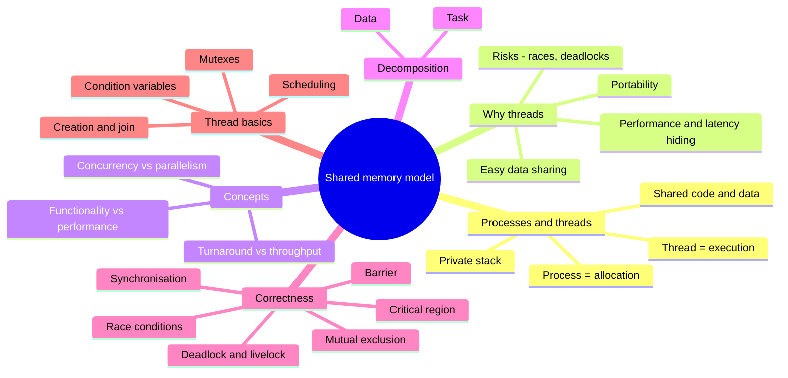
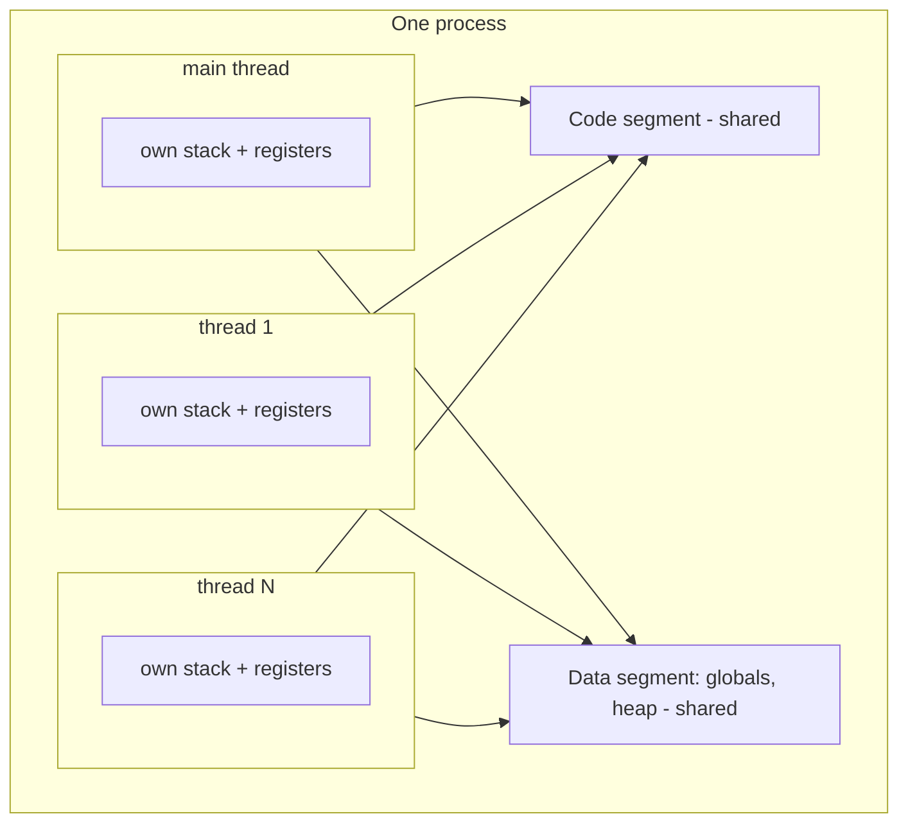
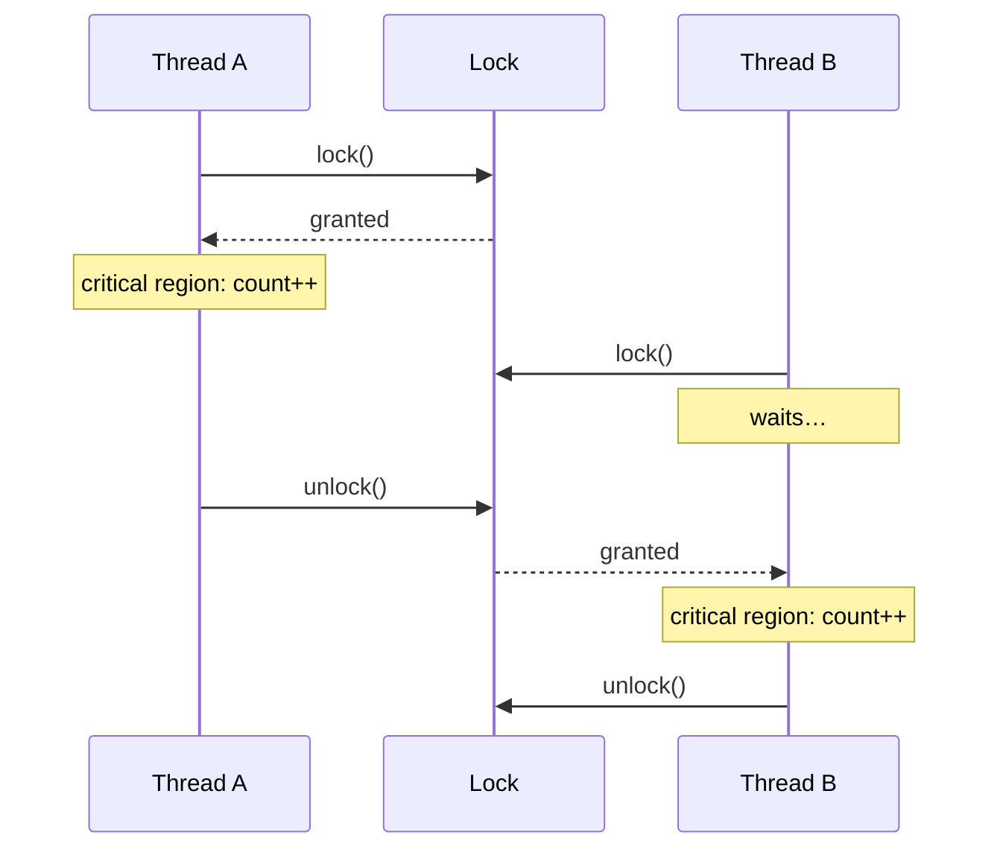
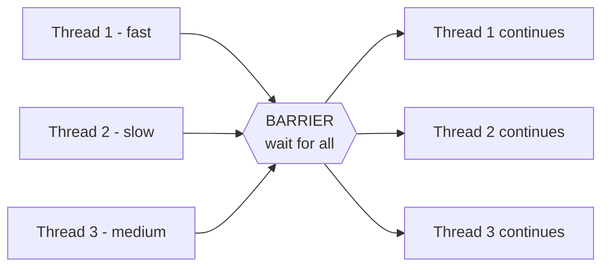
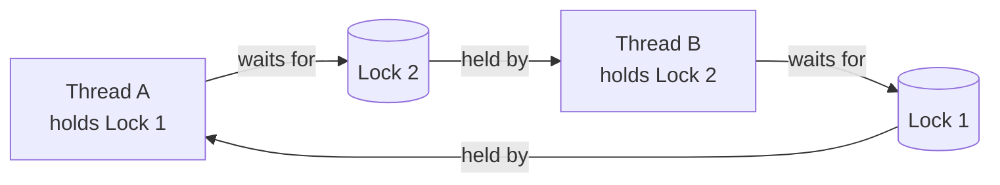
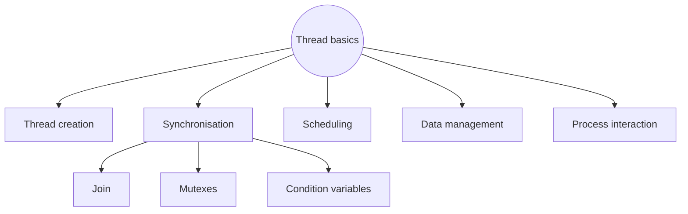

import Callout from '../../../components/Callout.astro';
import QA from '../../../components/QA.astro';
import QAList from '../../../components/QAList.astro';
import Figure from '../../../components/Figure.astro';
import unixThreads from './images/w06-unix-process-threads.png';
import ctxSwitch from './images/w06-context-switch.png';
import concPar from './images/w06-concurrency-parallelism.svg';

<Callout type="why">
Every multi-core program you write (OpenMP and Pthreads in C, `Isolate`s in Dart/Flutter, threads in Python, Java or C#) runs on the **shared memory model**. Threads are the cheapest way to use all your cores, but they are also the easiest way to write **bugs that only appear sometimes**: race conditions and deadlocks. These bugs pass every test on your laptop and then fail in production.

This week gives you the vocabulary and mental model for those bugs, and the tools that prevent them.

- **Real life:** two users booking the last seat at the same time; a bank balance that "loses" a deposit; an app that freezes because two threads each wait for the other; a game whose UI stays smooth because loading happens on another thread.
- **Connects to:** Week 3 (shared-memory hardware, cache coherence, false sharing), Week 4 (synchronisation and contention as overhead), **Week 7 (Pthreads and OpenMP in code)**, **Assignment 2** (given in Week 7).
</Callout>

<Callout type="key">
1. A **process** is the unit of **allocation** (memory, files, ID). A **thread** is the unit of **execution** (program counter, stack pointer, registers).
2. Threads in a process **share the code and data segments**, but **each has its own stack**.
3. Threads are **cheap and fast** to communicate (shared memory) but **not protected** from each other. Processes are **secure** but **expensive** to switch and communicate.
4. **Concurrency** = threads in progress at the same time (works on 1 core). **Parallelism** = threads *executing* at the same time (needs multiple cores).
5. **Race condition:** concurrent access to the same memory where **at least one thread writes**, and the result depends on timing.
6. **Critical region** = code that touches shared variables. **Mutual exclusion** = only one thread in it at a time. **Synchronisation** = how we enforce that (locks, semaphores, barriers, condition variables…).
7. **Deadlock:** threads wait for something that will **never** happen. **Livelock:** threads keep **reacting** to each other but make no progress.
</Callout>

## Big picture



## 1. Processes and threads

### What is a process?

Modern operating systems load programs as **processes**. To the OS, a process has **two roles**:
1. **Resource holder:** owns memory, file handles, and other system resources.
2. **Execution unit:** a **thread** that runs the instructions.

A process starts with a **main thread** that initialises it and begins executing at its entry point (`main()`).

### What is a thread?

> **Thread:** a **single sequential flow of control** within a program, a sequence of instructions being executed.

- Any thread can **create other threads** within the process.
- **Each thread gets its own stack** (for its local variables and function calls).
- **All threads share** the process's **code segment and data segment** (global variables, heap).



<Figure src={unixThreads} alt="Left: a UNIX process with one user address space (stack, text, data, heap) and its process ID, registers, files. Right: threads within a UNIX process, each with its own stack, stack pointer, program counter and registers, sharing text, data, heap and files" caption="Left: a single-threaded UNIX process. Right: the same process with two threads. Each thread has its own stack and registers; the code (text), data, heap and open files are shared." credit="Slide 5 (LLNL Pthreads tutorial)" max={640} />

### Processes vs threads

| | **Process** | **Thread** |
|---|---|---|
| Role | **Unit of allocation**: process ID, environment, working directory, program instructions, resources, privileges | **Unit of execution**: program counter, stack pointer, registers |
| Relationship | Has **one or more** threads | Belongs to **exactly one** process |
| **Address space** | Its **own**, protected by the OS | **Shares** the process's address space with the other threads |
| **Interaction** | Through **OS primitives** and shared locations in the OS kernel (pipes, sockets…), which is **expensive** | Through the **shared memory** of the process, using the language's or library's concurrency primitives, which is **cheap** |
| **Context switching** | **Heavy**: the entire process state must be saved | **Light**: only the current register state needs saving |
| **Security** | **Secure**: one process can't corrupt another | **Not secure**: a thread can overwrite another thread's memory |

<Figure src={ctxSwitch} alt="Process A and Process B above the operating system: S1 switch from user space to kernel space, S2 switch context from process A to B, S3 switch from kernel space back to user space" caption="A process context switch: (1) user → kernel, (2) the OS saves A's whole state and loads B's, (3) kernel → user. Threads in the same process skip most of this." credit="Slide 8" max={460} />

<Callout type="tip" title="Example you already know">
Chrome runs **each tab as a separate process**, so one crashing tab doesn't kill the others (security and isolation). **Inside** a tab, multiple **threads** handle rendering, JavaScript and networking, because they need to share the page's data quickly.
</Callout>

## 2. Why use threads?

### Benefits

| Benefit | Explanation |
|---|---|
| **Software portability** | Develop on a serial (single-core) machine and run on a parallel one **without changes** |
| **Performance and resource utilisation** | An easy way to use multi-core. **Latency hiding**: while one thread waits (memory, I/O, network), another uses the CPU, which masks overhead |
| **Efficient data sharing** | Sharing through memory is **more efficient than message passing** |
| **Ease of programming** | You can specify many concurrent tasks; the system **maps tasks to processors dynamically** to reduce idling, so the programmer is released from explicit scheduling and load balancing. Thread programs are **easier to write than message-passing ones** |

### Risks

- **Increases the complexity** of the application.
- **Difficult to debug:** **data races** and **deadlocks**, which happen only under certain timings.
- Code complexity, portability issues, and testing and debugging difficulty.

<Callout type="warn" title="Heisenbugs">
Thread bugs often **disappear when you try to observe them**. Adding a `printf` or running in a debugger changes the timing, and the race no longer happens. That's why you prevent races **by design** (proper synchronisation) instead of testing for them.
</Callout>

## 3. Concurrency vs parallelism

<Figure src={concPar} alt="Top: on one core, thread 1 and thread 2 alternate in short time slices. Bottom: on two cores, thread 1 and thread 2 run side by side for the whole time" caption="Concurrency: both threads are in progress, taking turns on one core. Parallelism: both threads actually run at the same instant on separate cores." credit="Redrawn from slide 13" max={620} />

| | **Concurrency** | **Parallelism** |
|---|---|---|
| Definition | Two or more threads are **in progress** at the same time | Two or more threads are **executing** at the same time |
| Hardware | Works on **one core** (time-slicing) | Needs **multiple cores** |
| Relationship | The broader idea | A special case of concurrency |

*"Concurrency is about **dealing with** many things at once; parallelism is about **doing** many things at once."*

## 4. Why we thread: functionality or performance?

### Threading for functionality

Give threads **separate functions** of the application, for example one thread for input, one for the GUI, one for computation and one for output. It's the **easiest** method, because the threads rarely overlap.

**Example: building a house.** The bricklayer, carpenter, roofer and plumber each have their own job.

### Threading for performance

Thread to **improve turnaround or throughput** of computations.

**Examples:** an automobile assembly line, where each worker does an assigned job; a postal service, with branches, sorters and delivery staff.

| Goal | **Turnaround** | **Throughput** |
|---|---|---|
| Definition | Complete **a single task** in the **smallest amount of time** | Complete **the most tasks** in a **fixed amount of time** |
| Example | Set **one** dinner table fast: one person does plates, one napkins, one utensils, one glasses | Set up a **banquet**: many waiters each do separate tables, or specialists do all the plates, all the glasses… |
| Real case | Tomorrow's weather forecast must be ready before tomorrow | A web server handling as many requests per second as possible |
| Links to | Strong scaling / Amdahl (Week 4) | Weak scaling / Gustafson (Week 4) |

## 5. Decomposition: how to split work among threads

| | **Task decomposition** | **Data decomposition** |
|---|---|---|
| Split by | A natural set of **independent tasks** | A **large data set** whose elements can be computed independently |
| Data | Assign data to each task as needed | Divide the data, and the computation on it, among threads |
| Example | **Paint-by-numbers**: each colour is a task (tasks = number of colours); two artists, one paints the even numbers, the other the odd | **Grading test papers**: several graders, each with the **same answer key**, each grading a different pile |
| Same as | Task parallelism (Week 4) | Data parallelism (Week 4) |

**"What if different keys are needed?"** If there are several exam versions, each grader needs the right key for each paper, or each grader takes one version. The data becomes less uniform, so you need either more coordination or a task-style split.

## 6. Race conditions

> **Race condition:** threads "race" against each other for resources. The **execution order is assumed but cannot be guaranteed**.

The most common case is a **storage conflict**: **concurrent access to the same memory location** by multiple threads, where **at least one thread is writing**.

**Analogy: musical chairs.** When the music stops, who gets the chair depends on timing. If chairs were memory locations, which thread's value ends up stored depends on who gets there last.

**Classic example:** two threads both run `count++` on a shared `count = 5`. `count++` is really **three** steps: read, add, write.

| Time | Thread A | Thread B | count in memory |
|---|---|---|---|
| 1 | read count → 5 | | 5 |
| 2 | | read count → 5 | 5 |
| 3 | add 1 → 6 | | 5 |
| 4 | | add 1 → 6 | 5 |
| 5 | write 6 | | **6** |
| 6 | | write 6 | **6** ❌ should be 7 |

One increment is **lost**. Run it again and you might get 7, so the result depends on timing.

<Callout type="note">
**Only reading** shared data is safe. A race needs **at least one writer**. Two threads both reading `count` at the same time is fine.
</Callout>

## 7. Mutual exclusion and critical regions

- **Critical region (critical section):** the part of the code that **accesses (reads and writes) shared variables**.
- **Mutual exclusion:** program logic that makes sure **only one thread at a time** executes in the critical region. This is how you avoid race conditions.

**Analogies:**
- **Safe deposit box:** the attendants make sure only one person views a box at a time; others must wait until it's returned.
- **ATM machine:** only one person uses it at a time while the others queue.



## 8. Synchronisation

> **Synchronisation:** implementing mutual exclusion to **coordinate access to shared resources** in multithreaded applications. It **controls the relative order** of thread execution and resolves conflicts that might cause unwanted behaviour.

**How it works:** a **synchronisation object** enforces mutual exclusion.
- One thread **"holds"** the object; the other threads **must wait**.
- When it's done, the holding thread **releases** the object, and one waiting thread is given it.

**Analogy: a library book.** One patron has the book checked out, so others must wait for it to be returned. Who gets it next depends on the library's **policy** (first in the queue, a priority list…), just as threads' order depends on the scheduler.

**Types of synchronisation objects:**

| Object | What it does |
|---|---|
| **Lock / mutex** | Only the thread that holds it may enter. **Mut**ual **ex**clusion |
| **Semaphore** | A counter allowing up to **N** threads at once (N = 1 behaves like a lock) |
| **Critical section** | A language or OS construct marking code for one thread at a time |
| **Event** | One thread signals; waiting threads wake up |
| **Condition variable** | Wait (sleeping, not spinning) until a condition becomes true, then get woken |
| **Atomic** | A hardware-guaranteed indivisible operation (e.g. atomic increment), with no lock needed |

### Barrier synchronisation

- Threads **pause at a certain point** in the code.
- **When all threads have arrived, all are released** together.
- Waiting threads are **idle**, which is **overhead** (Week 4).
- **Analogy: a race starting line.** No runner starts until everyone is at the line.
- **Use:** make sure every thread has finished phase 1 (e.g. computing its partial result) before anyone starts phase 2 (which uses those results).



## 9. Deadlock and livelock

> **Deadlock:** threads wait for some event or condition that will **never happen**.

**Analogy: a traffic jam at an intersection.** Every car is blocking another, and none can turn or back up.



**The four conditions for deadlock** *(the slide mentions them but doesn't list them)*. All four must hold at the same time:
1. **Mutual exclusion:** a resource can be held by only one thread.
2. **Hold and wait:** a thread holds one resource while waiting for another.
3. **No pre-emption:** a resource can't be forcibly taken away.
4. **Circular wait:** A waits for B, B waits for A (or a longer cycle).

**Break any one to prevent deadlock.** The most practical rule is to **always acquire locks in the same global order** (e.g. always Lock 1 before Lock 2), which removes the circular wait.

> **Livelock:** threads **keep changing state in response to each other** but make no progress.

**Analogy: Robin Hood and Little John on a log bridge.** Each politely steps aside for the other, in the same direction, again and again. Both are active and neither is blocked, but nobody crosses. In code, this happens when two threads both detect a conflict, back off, retry at the same moment, and repeat forever.

| | **Deadlock** | **Livelock** |
|---|---|---|
| Thread state | **Blocked** (waiting, using no CPU) | **Active** (running, using CPU) |
| Progress | None | None |
| Analogy | Gridlocked intersection | Two people stepping aside for each other in a corridor |
| Typical fix | Consistent lock ordering, timeouts | Random back-off (wait a random time before retrying) |

## 10. Thread basics: what a thread library gives you



**POSIX threads (Pthreads)** is a standard thread API for C on Unix and Linux. It's an execution model that exists **independently of any language**, and it lets a program control **multiple flows of work that overlap in time**. The detailed Pthreads coverage comes in the next set of slides (Week 7).

### Preview: the race and its fix in Pthreads *(extra)*

```c
// race.c   compile: gcc -pthread race.c -o race
#include <pthread.h>
#include <stdio.h>

#define THREADS 4
#define N 1000000

long counter = 0;                                     // SHARED (data segment)
pthread_mutex_t lock = PTHREAD_MUTEX_INITIALIZER;

void *work(void *arg) {
    for (int i = 0; i < N; i++) {                     // i is PRIVATE (each thread's stack)
        pthread_mutex_lock(&lock);                    // enter critical region
        counter++;                                    // only one thread at a time here
        pthread_mutex_unlock(&lock);                  // leave critical region
    }
    return NULL;
}

int main(void) {
    pthread_t t[THREADS];
    for (int k = 0; k < THREADS; k++)
        pthread_create(&t[k], NULL, work, NULL);      // fork
    for (int k = 0; k < THREADS; k++)
        pthread_join(t[k], NULL);                     // join (wait for each)
    printf("counter = %ld (expected %d)\n", counter, THREADS * N);
    return 0;
}
```

Remove the two mutex lines and run it a few times: you'll get **different, wrong** totals (less than 4,000,000). That's the race condition in action. With the mutex it's always correct, but slower, because the threads queue for the lock (**contention**). A better design gives each thread its own local counter and adds them up at the end (a **reduction**), which is exactly what OpenMP's `reduction` clause does in Week 7.

<QAList>
  <QA q="What are the two roles of a process from the OS's point of view?" level="easy">
    **Resource holder** (memory, file pointers and other resources assigned to the process) and **execution unit** (the thread or threads that run its instructions).
  </QA>
  <QA q="What do threads in the same process share, and what does each have privately?" level="easy">
    **Shared:** the code segment and data segment (global variables, heap), open files. **Private to each thread:** its own **stack**, **program counter**, **stack pointer** and **registers**.
  </QA>
  <QA q="Compare processes and threads in terms of address space, interaction, context switching and security." level="medium">
    | | Process | Thread |
    |---|---|---|
    | Address space | Own, OS-protected | Shared with the other threads |
    | Interaction | OS primitives (expensive) | Shared memory (cheap) |
    | Context switch | Heavy (whole process state) | Light (registers only) |
    | Security | Secure | Not secure (can overwrite another thread's memory) |
  </QA>
  <QA q="What is latency hiding and why is it a benefit of threads, even on one core?" level="medium">
    While one thread is **waiting** (for memory, disk or the network), another thread can use the CPU. The waiting time is **hidden** behind useful work, so the CPU stays busy and overall throughput improves even with a single core.
  </QA>
  <QA q="Differentiate concurrency and parallelism. Can you have concurrency without parallelism?" level="easy">
    **Concurrency:** two or more threads are in progress at the same time. **Parallelism:** two or more threads are executing at the same instant. **Yes**, you can have concurrency without parallelism: one core time-slicing between threads is concurrent but not parallel. Parallelism needs multiple cores.
  </QA>
  <QA q="Differentiate threading for functionality and threading for performance, with an example of each." level="medium">
    **Functionality:** give threads separate jobs of the application (e.g. a GUI thread, a network thread, a file-saving thread), like a bricklayer, carpenter and plumber building a house. **Performance:** use threads to finish computation faster (turnaround) or do more of it (throughput), like an assembly line.
  </QA>
  <QA q="What's the difference between turnaround and throughput?" level="easy">
    **Turnaround:** finish **one** task in the shortest time (set one dinner table as fast as possible). **Throughput:** finish the **most** tasks in a fixed time (set up a whole banquet).
  </QA>
  <QA q="Explain task decomposition and data decomposition using the slide examples." level="medium">
    **Task:** paint-by-numbers, where each colour is a separate task; two artists split the colours (even and odd). **Data:** grading test papers, where many graders with the same answer key each grade a different pile of the same exam.
  </QA>
  <QA q="Define a race condition. What two conditions must be true for a storage conflict?" level="easy">
    A race condition is when threads race for a resource and the outcome depends on an execution order that isn't guaranteed. A storage conflict needs (1) **concurrent access to the same memory location** by multiple threads, and (2) **at least one of them is writing**.
  </QA>
  <QA q="Two threads each run count++ 1000 times on a shared count starting at 0, with no locking. Is the final value always 2000? Explain." level="hard">
    **No.** It can be anything from about 1000 up to 2000. `count++` is three steps (read, add 1, write). If both threads read the same old value before either writes, both write the same new value and **one increment is lost**. How many are lost depends on timing, so it changes from run to run.
  </QA>
  <QA q="Define critical region and mutual exclusion." level="easy">
    **Critical region:** the portion of code that accesses (reads and writes) shared variables. **Mutual exclusion:** program logic that ensures only one thread at a time executes in the critical region, preventing race conditions.
  </QA>
  <QA q="How does a synchronisation object enforce mutual exclusion? Give four types." level="medium">
    One thread **holds** the object while the others **wait**; when it's done, the holder **releases** it and one waiting thread gets it (like a library book). Types: lock/mutex, semaphore, critical section, event, condition variable, atomic.
  </QA>
  <QA q="What is a barrier, and why is it a source of overhead?" level="medium">
    A barrier is a point where threads pause until **all** threads have arrived, and then all are released together (like a race starting line). It's overhead because the threads that arrive early sit **idle** while they wait for the slowest one.
  </QA>
  <QA q="Thread A locks L1 then tries to lock L2. Thread B locks L2 then tries to lock L1. What happens? How do you prevent it?" level="hard">
    **Deadlock:** each holds one lock and waits forever for the other (a circular wait). Prevent it by making **all threads acquire the locks in the same order** (e.g. always L1 before L2), which breaks the circular-wait condition. Alternatives: lock with a timeout, or take both locks atomically.
  </QA>
  <QA q="Name the four conditions necessary for deadlock." level="medium">
    **Mutual exclusion**, **hold and wait**, **no pre-emption**, **circular wait**. All four must hold at the same time, so removing any one prevents deadlock.
  </QA>
  <QA q="Differentiate deadlock and livelock, with an analogy for each." level="medium">
    **Deadlock:** threads are **blocked**, waiting for something that never happens (cars gridlocked at an intersection). **Livelock:** threads stay **active**, repeatedly changing state in response to each other, but make no progress (Robin Hood and Little John stepping aside for each other on a log bridge). Neither makes progress, but a livelocked thread still uses CPU.
  </QA>
  <QA q="In the Pthreads example, which variables are shared and which are private? Why does adding the mutex make the program slower?" level="hard">
    **Shared:** `counter` and `lock` (globals, in the data segment). **Private:** `i` and `arg` (local, on each thread's own stack). The mutex makes it slower because threads must **queue** for the lock on every single increment (**contention**), so the increments effectively run one at a time and the parallelism is lost. A per-thread local count combined at the end (a reduction) avoids this.
  </QA>
</QAList>
