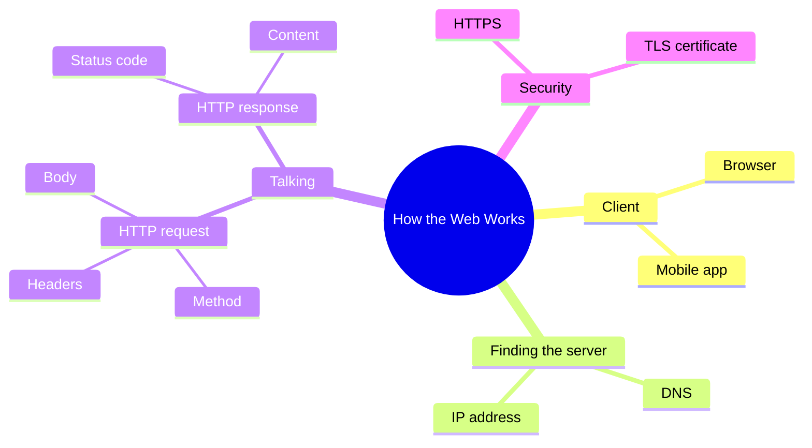
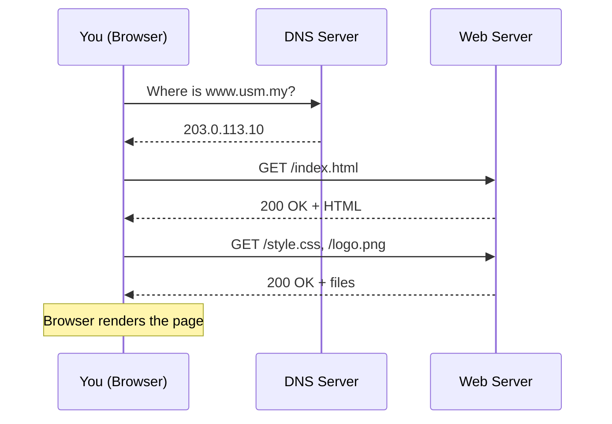

import Callout from '../../../components/Callout.astro';
import QA from '../../../components/QA.astro';
import QAList from '../../../components/QAList.astro';
import Figure from '../../../components/Figure.astro';
import layers from './images/w01-layers.svg';

<Callout type="why">
Every app you build (Flutter, web, FastAPI) talks over the web. When something breaks — a slow page, a CORS error, a `404` — you can only debug it if you know **what travels between the client and the server, and in what order**.

- **Real life:** reading a browser Network tab, designing REST APIs, choosing caching headers.
- **Connects to:** Week 2 (HTML/CSS), later weeks on APIs and security (HTTPS).
</Callout>

<Callout type="key">
1. The web is a **client–server** system: the client *asks*, the server *answers*.
2. **DNS** turns a name (`usm.my`) into an IP address.
3. **HTTP** is the request/response "language" — a method (`GET`, `POST`…) and a status code (`200`, `404`…).
4. **HTTPS** = HTTP + encryption (TLS).
</Callout>

## Big picture



## What happens when you open a URL

Think of it like posting a letter: first you look up the address (DNS), then you send the letter (request), then you wait for a reply (response).



<Callout type="tip">
Open any website, press **F12 → Network** and refresh. Every row is one HTTP request from the diagram above.
</Callout>

## Where HTTP sits

<Figure src={layers} alt="Stack of network layers: Application (HTTP), Transport (TCP), Internet (IP), Link" caption="HTTP is an application-layer protocol. It relies on TCP to deliver data reliably and IP to route it." credit="Example figure — slide images appear like this" />

## HTTP methods and status codes

| Method | Meaning | Example |
|---|---|---|
| `GET` | Read data | Load a profile page |
| `POST` | Create data | Submit a sign-up form |
| `PUT` / `PATCH` | Update data | Edit your bio |
| `DELETE` | Remove data | Delete a post |

| Code range | Meaning | Common ones |
|---|---|---|
| 2xx | Success | `200 OK`, `201 Created` |
| 3xx | Redirect | `301 Moved Permanently` |
| 4xx | **Client** made a mistake | `400`, `401`, `403`, `404` |
| 5xx | **Server** broke | `500`, `503` |

<Callout type="warn">
`401 Unauthorized` means *"I don't know who you are"* (not logged in). `403 Forbidden` means *"I know who you are, but you're not allowed"*. Students mix these up often.
</Callout>

## A raw HTTP request

```http
GET /api/courses HTTP/1.1
Host: studypack.example
Accept: application/json
```

```http
HTTP/1.1 200 OK
Content-Type: application/json

[{"code": "CSE242", "weeks": 14}]
```

<Callout type="exam">
"Explain, with a diagram, the steps that occur when a user enters a URL in a browser." — draw the sequence diagram above and name DNS, HTTP request, response and rendering.
</Callout>

<QAList>
  <QA q="What does DNS do?" level="easy">
    It translates a human-readable domain name (e.g. `usm.my`) into the IP address of the server, so the browser knows where to send the request.
  </QA>
  <QA q="Which HTTP method should a 'submit registration form' use, and why?" level="easy">
    `POST` — it **creates** a new resource on the server and sends data in the request body. `GET` should only read data and must not change anything.
  </QA>
  <QA q="A user who is logged in tries to open the admin page and gets an error. Is it more likely 401 or 403?" level="medium">
    **403 Forbidden.** The server knows who they are (they're logged in), but their role isn't allowed. 401 would mean they aren't authenticated at all.
  </QA>
  <QA q="Why does a single web page usually cause many HTTP requests?" level="medium">
    The first response is just the HTML. The browser then reads it and finds more resources — CSS, JavaScript, images, fonts — and requests each one separately.
  </QA>
  <QA q="What is the difference between HTTP and HTTPS, and what attack does HTTPS prevent?" level="hard">
    HTTPS wraps HTTP inside **TLS encryption** and verifies the server with a certificate. It prevents **eavesdropping and man-in-the-middle** attacks — e.g. someone on café Wi-Fi reading or changing your password in transit.
  </QA>
</QAList>
