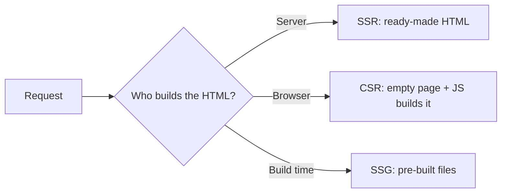

import Callout from '../../../components/Callout.astro';
import QA from '../../../components/QA.astro';
import QAList from '../../../components/QAList.astro';

<Callout type="why">
Choosing where pages are rendered decides how fast your app feels on a cheap phone, whether Google can index it, and how much your server costs.
</Callout>

## Compare at a glance

| | SSR | CSR | SSG |
|---|---|---|---|
| First load | Fast | Slower | Fastest |
| SEO | Good | Weaker | Good |
| Server cost | Higher | Low | Lowest |

<Callout type="tip">
This StudyPack site itself is **SSG** — every page is built once, then served as plain files by GitHub Pages.
</Callout>

<QAList>
  <QA q="Why is SSG a good fit for a notes website?" level="easy">
    The content rarely changes and is the same for every visitor, so pages can be built once and served as static files — fast and free to host.
  </QA>
</QAList>
